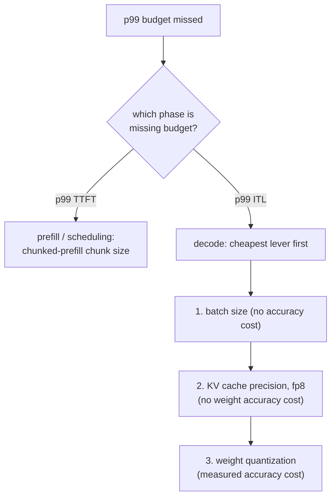

# Бюджет задержки

Измерение и защита бюджета задержки p99. Сделан для быстрого поиска при диагностике промаха.

## p99, а не среднее

**p99** это значение, ниже которого попадают 99% измеренных запросов; медленнее лишь худший 1%. Среднее может выглядеть нормально, скрывая реальную проблему: [блокировка головы очереди](batching.md#admission-order-and-head-of-line-blocking) бьёт только по малой доле запросов, которым не повезло делить шаг с большим префиллом, поэтому она почти не двигает среднее по тысячам в остальном быстрых запросов, делая при этом этот невезучий 1% драматически медленнее.

## Два числа, а не одно

«Задержка запроса» делится как минимум на два числа, в каждом из которых доминирует своя фаза и которые формируются разными рычагами:

| Число | В нём доминирует | Формируется |
|---|---|---|
| Время до первого токена (TTFT) | Префилл | Планированием, размером чанка чанкованного префилла |
| Задержка между токенами (ITL) | Декодирование | Размером батча, точностью кеша, квантизацией весов |

Свёртка их в одно усреднённое число скрывает, на какой рычаг на самом деле указывает плохой результат.

## Что делает измерение p99 надёжным

- **Достаточно выборок.** P99 по 20 запросам на самом деле сообщает об одном самом медленном, а не об устойчивой оценке хвоста; надёжному значению обычно нужны выборки в сотни и тысячи.
- **Реалистичная нагрузка.** Реалистичная конкурентность (чтобы поведение батчинга и планирования действительно испытывалось под давлением) и реалистичная смесь длин промптов и вывода: [расточительность статического батчинга](batching.md#static-batching-wastes-capacity-on-uneven-finish-times) и блокировка головы очереди обе зависят от разброса длин запросов, который бенчмарк с одинаковой длиной никогда не выявляет.

## Порядок диагностики: сначала фаза, затем самый дешёвый рычаг



Проверка рычагов не той фазы впустую тратит усилия: настройка размера чанка ничего не даёт при проблеме ITL, упирающейся в декодирование, а уменьшение батча ничего не даёт при проблеме TTFT, вызванной тем, что большой префилл останавливает очередь. Внутри ветки декодирования порядок следует стоимости: сначала размер батча (бесплатно), затем точность кеша (без потери точности весов), затем квантизация весов (стоит измеренной точности, поэтому прибегать к ней стоит лишь когда более дешёвые рычаги исчерпаны или недостаточны).

## Разобранная цепочка

Модель на 13B на одном GPU в 80 ГБ, измерено по реалистичному бенчмарку из 2000 запросов: p99 TTFT с запасом в рамках бюджета, p99 ITL 80 мс при бюджете 50 мс.

```text
TTFT fine -> rules out scheduling; this is a decode-phase, ITL problem
1. batch size already at the lesson-6-defended figure -> shrinking further costs needed throughput, skip
2. quantize weights to int8 -> ITL drops to 65 ms, accuracy delta measured against the unquantized model
   still over budget; two options remain:
   a. shrink batch size further (free, if it still meets required concurrency)
   b. quantize to int4 with AWQ (frees more time, further measured accuracy cost)
-> pick whichever closes the gap without paying for more than the budget needs
```

## На что должна ссылаться итоговая защита

1. **Сами измеренные значения p99**, из выборки, достаточно крупной и реалистичной, чтобы ей доверять.
2. **Рассуждения о памяти и размере батча**, стоящие за [потолком ёмкости](kv-cache.md#capacity-budget) и [защищаемым размером батча](batching.md#the-throughputlatency-trade-off), на которых остановилась конфигурация.
3. **Число по точности**, измеренное для той [квантизации](quantization-at-serve-time.md#defending-the-choice-means-citing-three-numbers), если она применялась, которая к этому привела.

Конфигурация, достигшая цели по задержке случайно, без записи ни одной из этих трёх вещей, защищена ровно настолько же, насколько и та, что цель не достигла.

## Связанные материалы

- [Урок 16](../lessons/0016-p99-latency-methodology.md), [Урок 17](../lessons/0017-defending-a-latency-budget-end-to-end.md)
- [KV-кеш](kv-cache.md), [Батчинг](batching.md), [Квантизация при обслуживании](quantization-at-serve-time.md): рычаги, через которые проходит порядок диагностики этого листа
