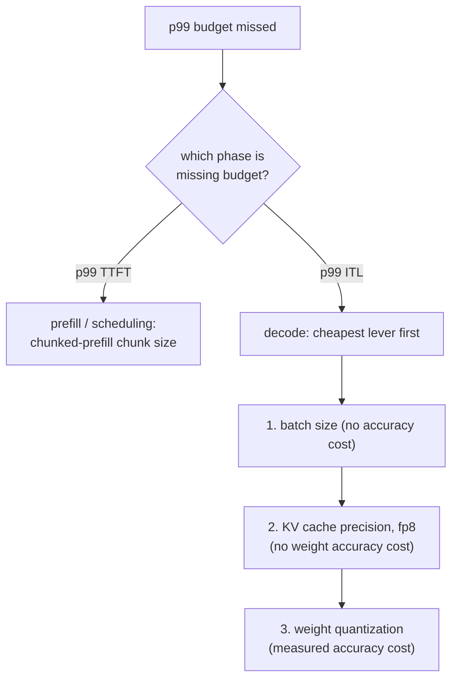

# 延迟预算

测量并辩护 p99 延迟预算。为在诊断未达标时查阅而做。

## 看 p99，不看平均值

**p99** 是 99% 的被测请求都不超过的那个值；只有最慢的 1% 比它更慢。平均值看起来可能很好，却掩盖了真实的问题：[队首阻塞](batching.md#admission-order-and-head-of-line-blocking)只会打到那一小部分运气不好、与大预填充共用一步的请求，所以在成千上万个本来就很快的请求上，它几乎拉不动平均值，却让那倒霉的 1% 慢得离谱。

## 两个数字，不是一个

“请求延迟”至少要拆成两个数字，各自由不同的阶段主导，也受不同的杠杆影响：

| 数字 | 主导阶段 | 受什么影响 |
|---|---|---|
| 首 token 延迟（TTFT） | 预填充 | 调度、分块预填充的块大小 |
| token 间延迟（ITL） | 解码 | 批大小、缓存精度、权重量化 |

把它们合并成一个混合数字，就看不清一个糟糕的结果究竟指向哪个杠杆。

## 怎样的 p99 测量才值得信任

- **足够多的样本。** 只有 20 个请求的 p99，实际上报告的是最慢的那一个，而不是稳定的尾部估计；值得信任的数字通常需要几百到几千个样本。
- **真实的负载。** 真实的并发（使批处理和调度行为真正受到压力），以及真实的提示词/输出长度混合：[静态批处理的浪费](batching.md#static-batching-wastes-capacity-on-uneven-finish-times)和队首阻塞，都取决于请求长度的差异，而长度一致的基准测试永远暴露不出这一点。

## 诊断顺序：先看阶段，再选最便宜的杠杆



查错了阶段的杠杆是白费力气：调块大小，对受解码限制的 ITL 问题没有任何作用；缩小批次，对由大预填充拖住队列所造成的 TTFT 问题也没有任何作用。在解码这个分支内部，顺序按成本来排：先是批大小（免费），然后是缓存精度（没有权重精度的代价），最后是权重量化（要付出实测的精度代价，所以只有在更便宜的杠杆用尽或不够用时才去动它）。

## 一条算例链

一个 13B 模型，跑在一块 80 GB 的 GPU 上，用真实的 2000 个请求的基准测试来测量：p99 TTFT 轻松低于预算，p99 ITL 是 80 ms，而预算是 50 ms。

```text
TTFT fine -> rules out scheduling; this is a decode-phase, ITL problem
1. batch size already at the lesson-6-defended figure -> shrinking further costs needed throughput, skip
2. quantize weights to int8 -> ITL drops to 65 ms, accuracy delta measured against the unquantized model
   still over budget; two options remain:
   a. shrink batch size further (free, if it still meets required concurrency)
   b. quantize to int4 with AWQ (frees more time, further measured accuracy cost)
-> pick whichever closes the gap without paying for more than the budget needs
```

## 最终的辩护必须引用什么

1. **实测的 p99 数字**本身，来自一个足够大、足够真实、值得信任的样本。
2. 配置最终落在的[容量上限](kv-cache.md#capacity-budget)和[被辩护的批大小](batching.md#the-throughputlatency-trade-off)背后的**内存与批大小的推理**。
3. 为达到这一步而应用的任何[量化](quantization-at-serve-time.md#defending-the-choice-means-citing-three-numbers)，所对应的**实测精度数字**（如果有的话）。

一套配置如果靠运气达到了延迟目标，却没有写下这三者中的任何一个，那它和没达标的配置一样，同样是没有被辩护的。

## 相关内容

- [第 16 课](../lessons/0016-p99-latency-methodology.md)、[第 17 课](../lessons/0017-defending-a-latency-budget-end-to-end.md)
- [KV 缓存](kv-cache.md)、[批处理](batching.md)、[服务时量化](quantization-at-serve-time.md)：本表的诊断顺序所依次走过的那些杠杆
