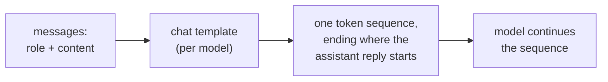

# Lección 1. Lo que ve el modelo

**Vínculo con la misión:** Cada decisión posterior de este track, dónde va una instrucción, cómo se marcan los datos, qué cambia una edición de formato, es una decisión sobre una única secuencia de tokens, así que la primera habilidad es poder decir cuál es esa secuencia para una conversación dada.
**Fuente principal:** [Docs: "Chat templates", Hugging Face Transformers](https://huggingface.co/docs/transformers/main/en/chat_templating)
**Requisitos previos:** [Prompt](../GLOSSARY.md), [Plantilla de chat](../GLOSSARY.md), [Rol](../GLOSSARY.md)

## Qué debes saber

### Una secuencia, no un formulario con campos

Una interfaz de chat muestra un cuadro de system, una lista de mensajes y una respuesta. El modelo no ve nada de eso. La documentación de Hugging Face lo dice con claridad: todos los modelos de lenguaje causales, entrenados para chat o no, continúan una secuencia de tokens, y un chat sigue siendo solo una secuencia de tokens.

La lista de mensajes, cada uno un par `role` y `content`, se convierte en esa secuencia mediante una **plantilla de chat**, a menudo con tokens de control como `<|user|>` o `<|assistant|>` que permiten al modelo ver la estructura del chat. Por eso un **rol** es formato sobre el que se hizo fine-tuning al modelo, no un canal de entrada separado.

### Un ejemplo real renderizado

La guía de Hugging Face renderiza esta conversación para el modelo `zephyr-7b-beta`:

```text
system: You are a friendly chatbot who always responds in the style of a pirate
user: How many helicopters can a human eat in one sitting?
```

Con `add_generation_prompt=True`, la plantilla produce este texto, que luego se tokeniza:

```text
<|system|>
You are a friendly chatbot who always responds in the style of a pirate</s>
<|user|>
How many helicopters can a human eat in one sitting?</s>
<|assistant|>
```

La última línea es el prompt de generación. Marca dónde empieza una respuesta del asistente, y el modelo continúa desde ahí. La guía advierte que sin él el modelo puede hacer algo extraño, como continuar el mensaje del usuario en lugar de responderlo.

### Las plantillas difieren según el modelo

La guía señala que distintos modelos pueden usar formatos o tokens de control diferentes, incluso cuando se les hizo fine-tuning desde el mismo modelo base. El propio ejemplo de `add_generation_prompt` de la guía renderiza un chat con marcadores `<|im_start|>` y `<|im_end|>` en lugar del estilo `<|user|>` de arriba. Así que "el prompt" solo queda totalmente definido cuando se nombra el modelo y, con él, su plantilla.



### Por qué esto importa para el resto del track

Si los roles son formato entrenado, entonces el lugar que ocupa un texto en la secuencia es lo único con lo que cuenta el modelo. La lección 2 se apoya en esto para el system prompt y la clasificación de instrucciones. Con una API alojada rara vez ves el texto renderizado, pero existe, y una petición que se lee como tres partes separadas es una sola cadena para el modelo.

## Práctica

1. ▢ Predice y luego comprueba. Un chat tiene un mensaje de system "Answer in French." y un mensaje de usuario "What is a token?". Usando la plantilla estilo zephyr de arriba, escribe el texto que recibe el modelo, terminando en el punto donde el modelo empieza a escribir.

<details markdown="1"><summary>Comprobación</summary>

```text
<|system|>
Answer in French.</s>
<|user|>
What is a token?</s>
<|assistant|>
```

La línea final `<|assistant|>` es el prompt de generación. Omitirla es el descuido habitual: sin ella la secuencia termina dentro del turno del usuario.

</details>

2. ▢ Un colega dice "el system prompt se envía al modelo por un canal distinto del mensaje del usuario, así que el usuario no puede tocarlo". ¿Qué tiene de erróneo esa imagen?

<details markdown="1"><summary>Comprobación</summary>

Ambos mensajes se renderizan en una única secuencia de tokens mediante la plantilla de chat. El mensaje de system se distingue del mensaje del usuario solo por los tokens de rol que lo rodean y por el peso que el modelo aprendió a dar a esos tokens durante el entrenamiento. No es un canal separado. Que el modelo tienda a clasificarlo más alto es comportamiento entrenado (lección 2), no un control de acceso.

</details>

3. ▢ ¿Qué afirmación sobre una plantilla de chat es correcta?

    - a) Convierte mensajes con rol en la secuencia de tokens con la que se entrenó el modelo
    - b) Es idéntica en todos los modelos que comparten un modelo base, así que una sola cadena sirve
    - c) El modelo la aplica durante la generación, un mensaje cada vez
    - d) Mantiene el texto de system fuera del contexto que el modelo puede leer

<details markdown="1"><summary>Comprobación</summary>

**a)** Esa es la definición. (b) es falsa: la guía dice que los modelos con fine-tuning desde el mismo modelo base pueden usar formatos y tokens de control diferentes. (c) es falsa: la plantilla se ejecuta antes del modelo, produciendo la secuencia de entrada. (d) es falsa: el texto de system renderizado forma parte de la secuencia que lee el modelo.

</details>

4. ▢ ¿Por qué enviar a un modelo distinto una cadena construida a mano con los tokens de control de otro modelo puede dar respuestas peores?

<details markdown="1"><summary>Comprobación</summary>

Al modelo se le hizo fine-tuning con el formato exacto que produce su propia plantilla. Los tokens de control de otro modelo no son los marcadores que aprendió, así que la estructura de la conversación se difumina. La vía segura es dejar que la plantilla del propio modelo renderice los mensajes. La guía afirma que los formatos difieren entre modelos; que las respuestas empeoren es la consecuencia esperada, así que pruébalo en lugar de asumir el tamaño del efecto.

</details>

## Prácticas en el mundo real

- [ ] Abre una ventana de chat y, en un solo mensaje, escribe una instrucción corta al estilo system seguida de una pregunta ("Answer in one sentence. What is a token?"). Luego escribe a mano la secuencia única que crees que recibe el modelo, con los marcadores de rol incluidos.
- [ ] Encuentra la plantilla de chat de un modelo abierto en su página de Hugging Face (la entrada `chat_template` en la configuración de su tokenizador) y lee qué tokens marcan el inicio del turno del asistente.
- [ ] Mañana: sin mirar esta lección, dibuja el camino desde "lista de mensajes" hasta "salida del modelo" y señala dónde actúa la plantilla de chat.

## Para profundizar

- [Docs: "Chat templates", Hugging Face Transformers](https://huggingface.co/docs/transformers/main/en/chat_templating)
- [Anatomía de un prompt](../reference/prompt-anatomy.md)
- [Recursos](../RESOURCES.md)

---

¿No termina de quedar claro? Vuelve a leer la fuente primaria de arriba, ya que esta lección la comprime y en la compresión es donde se escapa la comprensión. Consulta el [glosario](../GLOSSARY.md) por si algún término te resultó resbaladizo.

Si lo poco claro es la propia lección y no el material, eso es un defecto: [abre un issue](https://github.com/TokenCemetery/teach/issues).
