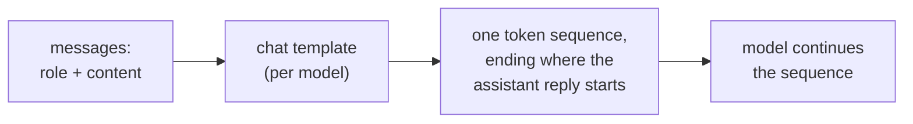

# Leçon 1. Ce que voit le modèle

**Lien avec la mission :** Chaque choix ultérieur de ce parcours, où placer une instruction, comment marquer les données, ce que change une modification de format, est un choix portant sur une séquence unique de tokens. La première compétence consiste donc à dire ce qu'est cette séquence pour une conversation donnée.
**Source primaire :** [Doc : "Chat templates", Hugging Face Transformers](https://huggingface.co/docs/transformers/main/en/chat_templating)
**Prérequis :** [Prompt](../GLOSSARY.md), [Chat template](../GLOSSARY.md), [Rôle](../GLOSSARY.md)

## À savoir

### Une séquence, pas un formulaire à champs

Une interface de chat affiche une zone système, une liste de messages et une réponse. Le modèle ne voit rien de tout cela. La documentation de Hugging Face le dit sans détour : tous les modèles de langage causaux, entraînés au chat ou non, prolongent une séquence de tokens, et un chat n'est lui aussi qu'une séquence de tokens.

La liste de messages, dont chacun est une paire `role` et `content`, est convertie en cette séquence par un **chat template**, souvent avec des tokens de contrôle comme `<|user|>` ou `<|assistant|>` qui permettent au modèle de percevoir la structure du chat. Un **rôle** est donc un formatage sur lequel le modèle a été fine-tuné, pas un canal d'entrée séparé.

### Un exemple réel de rendu

Le guide de Hugging Face rend cette conversation pour le modèle `zephyr-7b-beta` :

```text
system: You are a friendly chatbot who always responds in the style of a pirate
user: How many helicopters can a human eat in one sitting?
```

Avec `add_generation_prompt=True`, le gabarit produit ce texte, qui est ensuite tokenisé :

```text
<|system|>
You are a friendly chatbot who always responds in the style of a pirate</s>
<|user|>
How many helicopters can a human eat in one sitting?</s>
<|assistant|>
```

La dernière ligne est le generation prompt. Il marque l'endroit où commence une réponse de l'assistant, et le modèle continue à partir de là. Le guide avertit que sans lui, le modèle peut faire quelque chose d'étrange, comme prolonger le message de l'utilisateur au lieu d'y répondre.

### Les gabarits diffèrent selon le modèle

Le guide note que des modèles différents peuvent utiliser des formats ou des tokens de contrôle différents, même lorsqu'ils sont fine-tunés à partir du même modèle de base. L'exemple `add_generation_prompt` du guide rend lui-même un chat avec des marqueurs `<|im_start|>` et `<|im_end|>` à la place du style `<|user|>` ci-dessus. Ainsi, « le prompt » n'est entièrement défini qu'une fois le modèle nommé, et donc son gabarit.



### Pourquoi cela compte pour la suite du parcours

Si les rôles sont du formatage entraîné, alors l'endroit où se trouve un texte dans la séquence est la seule information dont dispose le modèle. La leçon 2 s'appuie là-dessus pour le system prompt et le classement des instructions. Avec une API hébergée, vous voyez rarement le texte rendu, mais il existe, et une requête qui se lit comme trois parties distinctes n'est qu'une seule chaîne pour le modèle.

## Pratique

1. ▢ Prédisez, puis vérifiez. Un chat comporte un message système « Answer in French. » et un message utilisateur « What is a token? ». En utilisant le gabarit de style zephyr ci-dessus, écrivez le texte que reçoit le modèle, en vous arrêtant au point où le modèle commence à écrire.

<details markdown="1"><summary>Vérifier</summary>

```text
<|system|>
Answer in French.</s>
<|user|>
What is a token?</s>
<|assistant|>
```

La ligne finale `<|assistant|>` est le generation prompt. L'omettre est l'erreur habituelle : sans elle, la séquence se termine au milieu du tour de l'utilisateur.

</details>

2. ▢ Un collègue dit : « le system prompt est envoyé au modèle sur un canal distinct de celui du message utilisateur, donc l'utilisateur ne peut pas y toucher. » Qu'est-ce qui cloche dans ce tableau ?

<details markdown="1"><summary>Vérifier</summary>

Les deux messages sont rendus en une seule séquence de tokens par le chat template. Le message système ne diffère du message utilisateur que par les tokens de rôle qui l'entourent et par le poids que le modèle a appris à donner à ces tokens pendant l'entraînement. Ce n'est pas un canal séparé. Le fait que le modèle tende à le classer plus haut est un comportement entraîné (leçon 2), pas un contrôle d'accès.

</details>

3. ▢ Quelle affirmation sur un chat template est correcte ?

    - a) Il convertit des messages étiquetés par rôle en la séquence de tokens sur laquelle le modèle a été entraîné
    - b) Il est identique pour tous les modèles qui partagent un modèle de base, donc une seule chaîne suffit
    - c) Il est appliqué par le modèle pendant la génération, un message à la fois
    - d) Il garde le texte système en dehors du contexte que le modèle peut lire

<details markdown="1"><summary>Vérifier</summary>

**a)** C'est la définition. (b) est faux : le guide dit que des modèles fine-tunés à partir du même modèle de base peuvent utiliser des formats et des tokens de contrôle différents. (c) est faux : le gabarit s'exécute avant le modèle, et produit la séquence d'entrée. (d) est faux : le texte système rendu fait partie de la séquence que le modèle lit.

</details>

4. ▢ Pourquoi envoyer à un modèle différent une chaîne construite à la main avec les tokens de contrôle d'un autre modèle peut-il donner de moins bonnes réponses ?

<details markdown="1"><summary>Vérifier</summary>

Le modèle a été fine-tuné sur le format exact que produit son propre gabarit. Les tokens de contrôle d'un autre modèle ne sont pas les marqueurs qu'il a appris, donc la structure de la conversation devient floue. La voie sûre consiste à laisser le gabarit du modèle lui-même rendre les messages. Le guide établit que les formats diffèrent selon les modèles ; que les réponses se dégradent est la conséquence attendue, donc testez-le plutôt que de supposer l'ampleur de l'effet.

</details>

## Exercices en situation réelle

- [ ] Ouvrez une fenêtre de chat et, dans un seul message, écrivez une courte instruction de style système suivie d'une question (« Answer in one sentence. What is a token? »). Écrivez ensuite à la main la séquence unique que vous pensez voir reçue par le modèle, marqueurs de rôle compris.
- [ ] Trouvez le chat template d'un modèle ouvert sur sa page Hugging Face (l'entrée `chat_template` de la configuration de son tokenizer) et lisez quels tokens marquent le début du tour de l'assistant.
- [ ] Demain : sans regarder cette leçon, dessinez le chemin qui va de « liste de messages » à « sortie du modèle » et indiquez où agit le chat template.

## Pour aller plus loin

- [Doc : "Chat templates", Hugging Face Transformers](https://huggingface.co/docs/transformers/main/en/chat_templating)
- [Anatomie d'un prompt](../reference/prompt-anatomy.md)
- [Ressources](../RESOURCES.md)

---

Ça ne passe pas ? Relisez la source primaire en haut de page, car cette leçon la condense et c'est dans la condensation que la compréhension s'échappe. Consultez le [glossaire](../GLOSSARY.md) pour tout terme qui vous a paru glissant.

Si c'est la leçon elle-même qui n'est pas claire plutôt que la matière, c'est un défaut : [ouvrez une issue](https://github.com/TokenCemetery/teach/issues).
