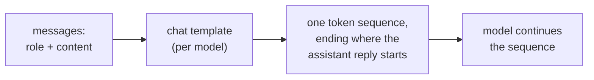

# पाठ 1. Model क्या देखता है

**मिशन से संबंध:** इस track का हर आगे का फ़ैसला, जैसे instruction कहाँ जाए, data को कैसे चिह्नित करें, format में बदलाव से क्या बदलता है, एक ही token sequence के बारे में फ़ैसला है। इसलिए पहली skill यह बताना है कि किसी दी गई बातचीत के लिए वह sequence क्या है।
**मुख्य स्रोत:** [Docs: "Chat templates", Hugging Face Transformers](https://huggingface.co/docs/transformers/main/en/chat_templating)
**पूर्व-आवश्यकताएँ:** [Prompt](../GLOSSARY.md), [Chat template](../GLOSSARY.md), [Role](../GLOSSARY.md)

## यह जानें

### एक sequence, fields वाला form नहीं

Chat interface एक system box, messages की सूची और एक reply दिखाता है। Model इनमें से कुछ नहीं देखता। Hugging Face का दस्तावेज़ साफ़ कहता है: सभी causal language models, चाहे chat-trained हों या नहीं, tokens के एक sequence को आगे बढ़ाते हैं, और chat भी बस tokens का एक sequence है।

Messages की सूची, जिसमें हर एक `role` और `content` की जोड़ी है, **chat template** द्वारा उस sequence में बदली जाती है, अक्सर `<|user|>` या `<|assistant|>` जैसे control tokens के साथ, जिनसे model chat का structure देख पाता है। इसलिए **role** वह formatting है जिस पर model को fine-tune किया गया है, कोई अलग input channel नहीं।

### एक असली rendered उदाहरण

Hugging Face की गाइड `zephyr-7b-beta` model के लिए यह बातचीत render करती है:

```text
system: You are a friendly chatbot who always responds in the style of a pirate
user: How many helicopters can a human eat in one sitting?
```

`add_generation_prompt=True` के साथ, template यह text बनाता है, जिसे फिर tokenize किया जाता है:

```text
<|system|>
You are a friendly chatbot who always responds in the style of a pirate</s>
<|user|>
How many helicopters can a human eat in one sitting?</s>
<|assistant|>
```

आख़िरी पंक्ति generation prompt है। यह बताती है कि assistant का reply कहाँ शुरू होता है, और model वहीं से आगे बढ़ता है। गाइड चेताती है कि इसके बिना model कुछ अजीब कर सकता है, जैसे user के message का जवाब देने के बजाय उसी को आगे बढ़ाना।

### हर model का template अलग होता है

गाइड बताती है कि अलग-अलग models अलग formats या control tokens इस्तेमाल कर सकते हैं, भले ही उन्हें एक ही base model से fine-tune किया गया हो। गाइड का अपना `add_generation_prompt` उदाहरण ऊपर के `<|user|>` वाले तरीक़े की जगह `<|im_start|>` और `<|im_end|>` markers के साथ chat render करता है। इसलिए "the prompt" तभी पूरी तरह तय होता है जब model, और इस तरह उसका template, नाम लेकर बताया जाए।



### इस track के बाक़ी हिस्से के लिए यह क्यों मायने रखता है

अगर roles सिखाई हुई formatting हैं, तो sequence में text की जगह ही वह एकमात्र चीज़ है जिस पर model चल सकता है। पाठ 2 इसी पर system prompt और instructions के क्रम की बात आगे बढ़ाता है। Hosted API के साथ आप rendered text शायद ही कभी देखते हैं, पर वह मौजूद होता है, और जो request तीन अलग हिस्सों जैसी पढ़ी जाती है वह model के लिए एक ही string है।

## अभ्यास

1. ▢ पहले अनुमान लगाएँ, फिर जाँचें। एक chat में system message "Answer in French." है और एक user message "What is a token?" है। ऊपर के zephyr-style template का इस्तेमाल करके वह text लिखें जो model को मिलता है, उस बिंदु पर ख़त्म करते हुए जहाँ model लिखना शुरू करता है।

<details markdown="1"><summary>जाँचें</summary>

```text
<|system|>
Answer in French.</s>
<|user|>
What is a token?</s>
<|assistant|>
```

आख़िर की `<|assistant|>` पंक्ति generation prompt है। उसे छोड़ देना आम चूक है: उसके बिना sequence user के turn के भीतर ही ख़त्म हो जाता है।

</details>

2. ▢ एक सहकर्मी कहता है "system prompt model को user message से अलग channel पर भेजा जाता है, इसलिए user उसे छू नहीं सकता।" इस तस्वीर में क्या ग़लत है?

<details markdown="1"><summary>जाँचें</summary>

दोनों messages chat template द्वारा एक ही token sequence में render होते हैं। System message, user message से सिर्फ़ अपने आसपास के role tokens में और उस वज़न में अलग है जो model ने training में उन tokens को देना सीखा। यह अलग channel नहीं है। Model का उसे ऊँचा क्रम देना सिखाया हुआ व्यवहार है (पाठ 2), access control नहीं।

</details>

3. ▢ Chat template के बारे में कौन-सा कथन सही है?

    - a) यह role-tagged messages को उस token sequence में बदलता है जिस पर model को train किया गया था
    - b) यह एक ही base model साझा करने वाले models में एक जैसा होता है, इसलिए एक string चल जाती है
    - c) इसे model generation के दौरान, एक बार में एक message पर लागू करता है
    - d) यह system text को उस context से बाहर रखता है जिसे model पढ़ सकता है

<details markdown="1"><summary>जाँचें</summary>

**a)** यही परिभाषा है। (b) ग़लत है: गाइड कहती है कि एक ही base से fine-tune किए गए models भी अलग formats और control tokens इस्तेमाल कर सकते हैं। (c) ग़लत है: template model से पहले चलता है और input sequence बनाता है। (d) ग़लत है: rendered system text उस sequence का हिस्सा है जिसे model पढ़ता है।

</details>

4. ▢ एक model के control tokens वाली हाथ से बनाई string किसी दूसरे model को भेजने पर बदतर replies क्यों मिल सकते हैं?

<details markdown="1"><summary>जाँचें</summary>

Model को उसी सटीक format पर fine-tune किया गया था जो उसका अपना template बनाता है। दूसरे model के control tokens वे markers नहीं हैं जो उसने सीखे, इसलिए बातचीत का structure धुँधला हो जाता है। सुरक्षित रास्ता यह है कि model के अपने template से messages render करवाए जाएँ। गाइड कहती है कि models के बीच formats अलग होते हैं; replies का बिगड़ना उसका अपेक्षित नतीजा है, इसलिए असर का आकार मान लेने के बजाय उसे परखें।

</details>

## असली दुनिया का अभ्यास

- [ ] एक chat window खोलें और एक ही message में छोटा system-style instruction और उसके बाद एक सवाल लिखें ("Answer in one sentence. What is a token?")। फिर हाथ से वह एक sequence लिखें जो आपके हिसाब से model को मिलता है, role markers समेत।
- [ ] किसी एक open model के Hugging Face पेज पर उसका chat template खोजें (उसके tokenizer configuration में `chat_template` प्रविष्टि) और पढ़ें कि assistant के turn की शुरुआत कौन-से tokens चिह्नित करते हैं।
- [ ] कल: इस पाठ को देखे बिना, "messages की सूची" से "model output" तक का रास्ता खींचें और लिखें कि chat template कहाँ काम करता है।

## आगे बढ़ने के लिए

- [Docs: "Chat templates", Hugging Face Transformers](https://huggingface.co/docs/transformers/main/en/chat_templating)
- [Prompt Anatomy](../reference/prompt-anatomy.md)
- [संसाधन](../RESOURCES.md)

---

बात नहीं बन रही? ऊपर दिए primary source को दोबारा पढ़ें, क्योंकि यह पाठ उसे संक्षिप्त करता है और समझ संक्षेप में ही रिसती है। जो शब्द फिसलन भरा लगे, उसके लिए [शब्दावली](../GLOSSARY.md) देखें।

अगर दिक़्क़त सामग्री की नहीं बल्कि पाठ की ही है, तो वह एक खोट है: [issue खोलें](https://github.com/TokenCemetery/teach/issues)।
