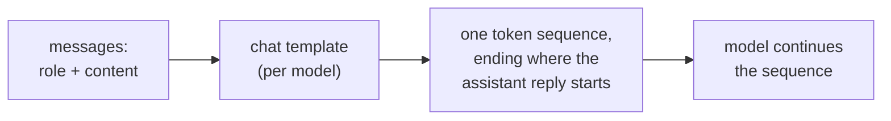

# Lesson 1. What the Model Sees

**Mission link:** Every later choice in this track, where an instruction goes, how data is marked, what a format edit changes, is a choice about one token sequence, so the first skill is saying what that sequence is for a given conversation.
**Primary source:** [Docs: "Chat templates", Hugging Face Transformers](https://huggingface.co/docs/transformers/main/en/chat_templating)
**Prerequisites:** [Prompt](../GLOSSARY.md), [Chat template](../GLOSSARY.md), [Role](../GLOSSARY.md)

## Know this

### One sequence, not a form with fields

A chat interface shows a system box, a message list and a reply. The model sees none of that. Hugging Face's documentation puts it plainly: all causal language models, chat-trained or not, continue a sequence of tokens, and a chat is still just a sequence of tokens.

The list of messages, each a `role` and `content` pair, is converted into that sequence by a **chat template**, often with control tokens such as `<|user|>` or `<|assistant|>` that let the model see the chat structure. So a **role** is formatting the model was fine-tuned on, not a separate input channel.

### A real rendered example

The Hugging Face guide renders this conversation for the `zephyr-7b-beta` model:

```text
system: You are a friendly chatbot who always responds in the style of a pirate
user: How many helicopters can a human eat in one sitting?
```

With `add_generation_prompt=True`, the template produces this text, which is then tokenized:

```text
<|system|>
You are a friendly chatbot who always responds in the style of a pirate</s>
<|user|>
How many helicopters can a human eat in one sitting?</s>
<|assistant|>
```

The last line is the generation prompt. It marks where an assistant reply begins, and the model continues from there. The guide warns that without it the model may do something strange, such as continuing the user's message instead of replying to it.

### Templates differ per model

The guide notes that different models may use different formats or control tokens, even when fine-tuned from the same base model. The guide's own `add_generation_prompt` example renders a chat with `<|im_start|>` and `<|im_end|>` markers instead of the `<|user|>` style above. So "the prompt" is only fully defined once the model, and so its template, is named.



### Why this matters for the rest of the track

If roles are trained formatting, then where text sits in the sequence is the only thing the model has to go on. Lesson 2 builds on this for the system prompt and instruction ranking. With a hosted API you rarely see the rendered text, but it exists, and a request that reads as three separate parts is one string to the model.

## Practice

1. ▢ Predict, then check. A chat has a system message "Answer in French." and one user message "What is a token?". Using the zephyr-style template above, write the text the model receives, ending at the point where the model starts writing.

<details markdown="1"><summary>Check</summary>

```text
<|system|>
Answer in French.</s>
<|user|>
What is a token?</s>
<|assistant|>
```

The trailing `<|assistant|>` line is the generation prompt. Leaving it out is the usual slip: without it the sequence ends inside the user's turn.

</details>

2. ▢ A colleague says "the system prompt is sent to the model on a separate channel from the user message, so the user cannot touch it." What is wrong with that picture?

<details markdown="1"><summary>Check</summary>

Both messages are rendered into one token sequence by the chat template. The system message differs from the user message only by the role tokens around it and by whatever weight the model learned to give those tokens in training. It is not a separate channel. That the model tends to rank it higher is trained behaviour (lesson 2), not an access control.

</details>

3. ▢ Which statement about a chat template is correct?

    - a) It converts role-tagged messages into the token sequence the model was trained on
    - b) It is identical across models sharing a base model, so one string works
    - c) It is applied by the model during generation, one message at a time
    - d) It keeps the system text out of the context the model can read

<details markdown="1"><summary>Check</summary>

**a)** That is the definition. (b) is wrong: the guide says models fine-tuned from the same base can use different formats and control tokens. (c) is wrong: the template runs before the model, producing the input sequence. (d) is wrong: the rendered system text is part of the sequence the model reads.

</details>

4. ▢ Why can sending a hand-built string with one model's control tokens to a different model give worse replies?

<details markdown="1"><summary>Check</summary>

The model was fine-tuned on the exact format its own template produces. Another model's control tokens are not the markers it learned, so the structure of the conversation is blurred. The safe route is to let the model's own template render the messages. The guide states that formats differ between models; that the replies get worse is the expected consequence, so test it rather than assume the size of the effect.

</details>

## Real-world reps

- [ ] Open a chat window and, in a single message, write a short system-style instruction followed by a question ("Answer in one sentence. What is a token?"). Then write out by hand the single sequence you think the model receives, role markers included.
- [ ] Find the chat template of one open model on its Hugging Face page (the `chat_template` entry in its tokenizer configuration) and read which tokens mark the start of the assistant turn.
- [ ] Tomorrow: without looking at this lesson, draw the path from "list of messages" to "model output" and label where the chat template acts.

## Going further

- [Docs: "Chat templates", Hugging Face Transformers](https://huggingface.co/docs/transformers/main/en/chat_templating)
- [Prompt Anatomy](../reference/prompt-anatomy.md)
- [Resources](../RESOURCES.md)

---

Not landing? Reread the primary source at the top, since this lesson compresses it and compression is where understanding leaks. Check the [glossary](../GLOSSARY.md) for any term that felt slippery.

If the lesson itself is unclear rather than the material, that is a defect: [open an issue](https://github.com/TokenCemetery/teach/issues).
