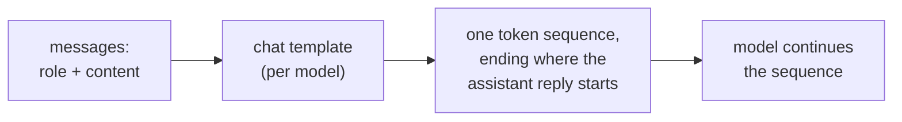

# Lição 1. O que o modelo vê

**Ligação com a missão:** Toda escolha posterior nesta trilha, onde fica uma instrução, como os dados são marcados, o que uma edição de formato muda, é uma escolha sobre uma única sequência de tokens, então a primeira habilidade é dizer qual é essa sequência para uma determinada conversa.
**Fonte principal:** [Docs: "Chat templates", Hugging Face Transformers](https://huggingface.co/docs/transformers/main/en/chat_templating)
**Pré-requisitos:** [Prompt](../GLOSSARY.md), [Chat template](../GLOSSARY.md), [Papel](../GLOSSARY.md)

## Saiba isto

### Uma sequência, e não um formulário com campos

Uma interface de chat mostra uma caixa de system, uma lista de mensagens e uma resposta. O modelo não vê nada disso. A documentação da Hugging Face diz isso sem rodeios: todos os modelos de linguagem causais, treinados para chat ou não, continuam uma sequência de tokens, e um chat ainda é apenas uma sequência de tokens.

A lista de mensagens, cada uma um par `role` e `content`, é convertida nessa sequência por um **chat template**, muitas vezes com tokens de controle como `<|user|>` ou `<|assistant|>` que permitem ao modelo enxergar a estrutura do chat. Portanto, um **papel** é formatação sobre a qual o modelo passou por fine-tuning, e não um canal de entrada separado.

### Um exemplo real renderizado

O guia da Hugging Face renderiza esta conversa para o modelo `zephyr-7b-beta`:

```text
system: You are a friendly chatbot who always responds in the style of a pirate
user: How many helicopters can a human eat in one sitting?
```

Com `add_generation_prompt=True`, o template produz este texto, que em seguida é tokenizado:

```text
<|system|>
You are a friendly chatbot who always responds in the style of a pirate</s>
<|user|>
How many helicopters can a human eat in one sitting?</s>
<|assistant|>
```

A última linha é o generation prompt. Ela marca onde começa a resposta do assistente, e o modelo continua a partir dali. O guia avisa que, sem ela, o modelo pode fazer algo estranho, como continuar a mensagem do usuário em vez de respondê-la.

### Os templates variam de modelo para modelo

O guia observa que modelos diferentes podem usar formatos ou tokens de controle diferentes, mesmo quando passaram por fine-tuning a partir do mesmo modelo base. O próprio exemplo de `add_generation_prompt` do guia renderiza um chat com marcadores `<|im_start|>` e `<|im_end|>` em vez do estilo `<|user|>` acima. Então "o prompt" só fica totalmente definido quando o modelo, e portanto o seu template, é nomeado.



### Por que isso importa para o resto da trilha

Se os papéis são formatação treinada, então o lugar do texto na sequência é a única coisa que o modelo tem para se orientar. A Lição 2 parte disso para tratar do system prompt e da ordem de prioridade das instruções. Com uma API hospedada você raramente vê o texto renderizado, mas ele existe, e uma requisição que parece ter três partes separadas é uma única string para o modelo.

## Prática

1. ▢ Preveja, depois confira. Um chat tem uma mensagem de system "Answer in French." e uma mensagem de usuário "What is a token?". Usando o template no estilo zephyr acima, escreva o texto que o modelo recebe, terminando no ponto em que o modelo começa a escrever.

<details markdown="1"><summary>Verificação</summary>

```text
<|system|>
Answer in French.</s>
<|user|>
What is a token?</s>
<|assistant|>
```

A linha final `<|assistant|>` é o generation prompt. Omiti-la é o deslize mais comum: sem ela, a sequência termina dentro do turno do usuário.

</details>

2. ▢ Um colega diz: "o system prompt é enviado ao modelo em um canal separado da mensagem do usuário, então o usuário não consegue mexer nele." O que há de errado nessa imagem?

<details markdown="1"><summary>Verificação</summary>

As duas mensagens são renderizadas em uma única sequência de tokens pelo chat template. A mensagem de system só difere da mensagem de usuário pelos tokens de papel ao redor dela e pelo peso que o modelo aprendeu a dar a esses tokens no treinamento. Não é um canal separado. O fato de o modelo tender a classificá-la como mais importante é comportamento treinado (lição 2), e não um controle de acesso.

</details>

3. ▢ Qual afirmação sobre um chat template está correta?

    - a) Ele converte mensagens marcadas por papel na sequência de tokens com a qual o modelo foi treinado
    - b) Ele é idêntico entre modelos que compartilham um modelo base, então uma única string serve
    - c) Ele é aplicado pelo modelo durante a geração, uma mensagem por vez
    - d) Ele mantém o texto de system fora do contexto que o modelo consegue ler

<details markdown="1"><summary>Verificação</summary>

**a)** Essa é a definição. (b) está errada: o guia diz que modelos que passaram por fine-tuning a partir do mesmo modelo base podem usar formatos e tokens de controle diferentes. (c) está errada: o template roda antes do modelo, produzindo a sequência de entrada. (d) está errada: o texto de system renderizado faz parte da sequência que o modelo lê.

</details>

4. ▢ Por que enviar a um modelo diferente uma string montada à mão com os tokens de controle de outro modelo pode gerar respostas piores?

<details markdown="1"><summary>Verificação</summary>

O modelo passou por fine-tuning exatamente no formato que o seu próprio template produz. Os tokens de controle de outro modelo não são os marcadores que ele aprendeu, então a estrutura da conversa fica borrada. O caminho seguro é deixar o template do próprio modelo renderizar as mensagens. O guia afirma que os formatos diferem entre modelos; que as respostas piorem é a consequência esperada, então teste em vez de presumir o tamanho do efeito.

</details>

## Prática no mundo real

- [ ] Abra uma janela de chat e, em uma única mensagem, escreva uma curta instrução no estilo de system seguida de uma pergunta ("Answer in one sentence. What is a token?"). Depois escreva à mão a sequência única que você acha que o modelo recebe, com os marcadores de papel incluídos.
- [ ] Encontre o chat template de um modelo aberto na página dele na Hugging Face (a entrada `chat_template` na configuração do tokenizer) e leia quais tokens marcam o início do turno do assistente.
- [ ] Amanhã: sem olhar para esta lição, desenhe o caminho de "lista de mensagens" até "saída do modelo" e indique onde o chat template atua.

## Para ir além

- [Docs: "Chat templates", Hugging Face Transformers](https://huggingface.co/docs/transformers/main/en/chat_templating)
- [Anatomia do Prompt](../reference/prompt-anatomy.md)
- [Recursos](../RESOURCES.md)

---

Não ficou claro? Releia a fonte principal no topo, já que esta lição a comprime e é na compressão que o entendimento escapa. Consulte o [glossário](../GLOSSARY.md) para qualquer termo que pareceu escorregadio.

Se o problema é a lição em si, e não o material, isso é um defeito: [abra uma issue](https://github.com/TokenCemetery/teach/issues).
