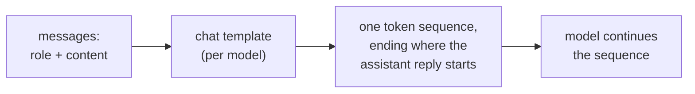

# Урок 1. Что видит модель

**Связь с целью курса:** Каждый следующий выбор в этом треке, куда поставить инструкцию, как пометить данные, что меняет правка формата, это выбор о единой последовательности токенов, поэтому первое умение состоит в том, чтобы сказать, какова эта последовательность для данного разговора.
**Первоисточник:** [Документация: "Chat templates", Hugging Face Transformers](https://huggingface.co/docs/transformers/main/en/chat_templating)
**Предварительные требования:** [Промпт](../GLOSSARY.md), [Чат-шаблон](../GLOSSARY.md), [Роль](../GLOSSARY.md)

## Что нужно знать

### Одна последовательность, а не форма с полями

Чат-интерфейс показывает поле системного сообщения, список сообщений и ответ. Модель не видит ничего из этого. Документация Hugging Face говорит об этом прямо: все каузальные языковые модели, обученные на чатах или нет, продолжают последовательность токенов, а чат тоже всего лишь последовательность токенов.

Список сообщений, каждое из которых представляет собой пару `role` и `content`, превращается в эту последовательность **чат-шаблоном**, часто с управляющими токенами вроде `<|user|>` или `<|assistant|>`, позволяющими модели увидеть структуру чата. Поэтому **роль** это форматирование, на котором модель дообучали, а не отдельный канал ввода.

### Реальный отрисованный пример

Руководство Hugging Face отрисовывает такой разговор для модели `zephyr-7b-beta`:

```text
system: You are a friendly chatbot who always responds in the style of a pirate
user: How many helicopters can a human eat in one sitting?
```

С `add_generation_prompt=True` шаблон выдаёт такой текст, который затем токенизируется:

```text
<|system|>
You are a friendly chatbot who always responds in the style of a pirate</s>
<|user|>
How many helicopters can a human eat in one sitting?</s>
<|assistant|>
```

Последняя строка это промпт генерации. Она отмечает место, где начинается ответ ассистента, и модель продолжает с него. Руководство предупреждает, что без неё модель может сделать что-то странное, например продолжить сообщение пользователя вместо того, чтобы ответить на него.

### У разных моделей разные шаблоны

Руководство отмечает, что разные модели могут использовать разные форматы или управляющие токены, даже если они дообучены из одной базовой модели. Собственный пример руководства с `add_generation_prompt` отрисовывает чат с маркерами `<|im_start|>` и `<|im_end|>` вместо стиля `<|user|>` выше. Поэтому «промпт» определён полностью только тогда, когда названа модель, а значит, и её шаблон.



### Почему это важно для остальной части трека

Если роли это обученное форматирование, то единственное, на что модель может опираться, это то, где в последовательности стоит текст. Урок 2 развивает эту мысль для системного промпта и ранжирования инструкций. При работе с облачным API вы редко видите отрисованный текст, но он существует, и запрос, который читается как три отдельные части, для модели одна строка.

## Практика

1. ▢ Сначала предскажите, потом проверьте. В чате есть системное сообщение "Answer in French." и одно сообщение пользователя "What is a token?". Используя шаблон в стиле zephyr выше, запишите текст, который получает модель, до того места, где модель начинает писать.

<details markdown="1"><summary>Проверка</summary>

```text
<|system|>
Answer in French.</s>
<|user|>
What is a token?</s>
<|assistant|>
```

Завершающая строка `<|assistant|>` это промпт генерации. Обычная ошибка состоит в том, чтобы её пропустить: без неё последовательность обрывается внутри хода пользователя.

</details>

2. ▢ Коллега говорит: «системный промпт отправляется модели по отдельному каналу, не так, как сообщение пользователя, поэтому пользователь не может его затронуть». Что неверно в этой картине?

<details markdown="1"><summary>Проверка</summary>

Оба сообщения отрисовываются в одну последовательность токенов чат-шаблоном. Системное сообщение отличается от сообщения пользователя только токенами роли вокруг него и тем весом, который модель научилась придавать этим токенам при обучении. Это не отдельный канал. То, что модель склонна ставить его выше, это обученное поведение (урок 2), а не контроль доступа.

</details>

3. ▢ Какое утверждение о чат-шаблоне верно?

    - a) Он превращает сообщения с метками ролей в последовательность токенов, на которой модель обучалась
    - b) Он одинаков у моделей с общей базовой моделью, поэтому подходит одна строка
    - c) Он применяется самой моделью во время генерации, по одному сообщению
    - d) Он не пускает системный текст в контекст, который может прочитать модель

<details markdown="1"><summary>Проверка</summary>

**a)** Это и есть определение. (b) неверно: руководство говорит, что модели, дообученные из одной базовой, могут использовать разные форматы и управляющие токены. (c) неверно: шаблон выполняется до модели и создаёт входную последовательность. (d) неверно: отрисованный системный текст является частью последовательности, которую читает модель.

</details>

4. ▢ Почему отправка вручную собранной строки с управляющими токенами одной модели другой модели может давать худшие ответы?

<details markdown="1"><summary>Проверка</summary>

Модель дообучали на точном формате, который выдаёт её собственный шаблон. Управляющие токены другой модели не те маркеры, которым она научилась, поэтому структура разговора размывается. Безопасный путь состоит в том, чтобы позволить собственному шаблону модели отрисовать сообщения. Руководство утверждает, что форматы у моделей различаются; то, что ответы ухудшаются, это ожидаемое следствие, поэтому проверяйте это, а не предполагайте размер эффекта.

</details>

## Практика в реальной работе

- [ ] Откройте окно чата и в одном сообщении напишите короткую инструкцию в системном стиле, а за ней вопрос ("Answer in one sentence. What is a token?"). Затем выпишите вручную единую последовательность, которую, по вашему мнению, получает модель, включая маркеры ролей.
- [ ] Найдите чат-шаблон одной открытой модели на её странице Hugging Face (запись `chat_template` в конфигурации её токенизатора) и прочитайте, какие токены отмечают начало хода ассистента.
- [ ] Завтра: не заглядывая в этот урок, нарисуйте путь от «списка сообщений» до «вывода модели» и подпишите, где действует чат-шаблон.

## Что почитать дальше

- [Документация: "Chat templates", Hugging Face Transformers](https://huggingface.co/docs/transformers/main/en/chat_templating)
- [Анатомия промпта](../reference/prompt-anatomy.md)
- [Ресурсы](../RESOURCES.md)

---

Не доходит? Перечитайте первоисточник в начале: этот урок его сжимает, а при сжатии понимание как раз и теряется. Загляните в [глоссарий](../GLOSSARY.md), если какой-то термин показался скользким.

Если неясен сам урок, а не материал, это дефект: [откройте issue](https://github.com/TokenCemetery/teach/issues).
