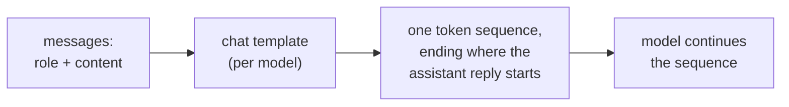

# 第 1 课：模型看到的是什么

**使命关联:** 本系列后面的每个选择，比如指令放在哪里、数据如何标记、改一处格式会带来什么变化，都是在对同一条 token 序列做选择，所以第一项技能就是：对给定的一段对话，能说出这条序列到底是什么。
**主要来源:** [文档：“Chat templates”，Hugging Face Transformers](https://huggingface.co/docs/transformers/main/en/chat_templating)
**前置知识:** [提示词](../GLOSSARY.md)、[聊天模板](../GLOSSARY.md)、[角色](../GLOSSARY.md)

## 要点

### 一条序列，而不是带字段的表单

聊天界面会显示一个系统消息框、一列消息和一条回复，而模型看不到这些。Hugging Face 的文档说得很直白：所有因果语言模型，无论是否经过聊天训练，做的都是接着一串 token 往下续写，聊天也不过是一串 token。

消息列表中的每条消息由 `role` 和 `content` 两部分组成，**聊天模板**把整个列表转换成那条序列，通常还会加入 `<|user|>`、`<|assistant|>` 这样的控制 token，让模型能看出聊天的结构。因此**角色**是模型微调时见过的格式，而不是独立的输入通道。

### 一个真实的渲染示例

Hugging Face 的指南为 `zephyr-7b-beta` 模型渲染了下面这段对话：

```text
system: You are a friendly chatbot who always responds in the style of a pirate
user: How many helicopters can a human eat in one sitting?
```

设置 `add_generation_prompt=True` 后，模板会生成下面这段文本，再对它做分词：

```text
<|system|>
You are a friendly chatbot who always responds in the style of a pirate</s>
<|user|>
How many helicopters can a human eat in one sitting?</s>
<|assistant|>
```

最后一行是生成提示（generation prompt）。它标出助手回复从哪里开始，模型就从这里接着续写。指南提醒说，缺了这一行，模型可能会做出奇怪的事，比如接着续写用户的消息，而不是回复它。

### 不同模型的模板各不相同

指南指出，即使从同一个基础模型微调而来，不同的模型也可能使用不同的格式或控制 token。指南自己的 `add_generation_prompt` 示例，渲染出来的聊天用的是 `<|im_start|>` 和 `<|im_end|>` 标记，而不是上面的 `<|user|>` 风格。所以只有指明了是哪个模型，也就指明了它的模板，“提示词”才算被完整定义。



### 这对本系列其余部分意味着什么

如果角色只是训练过的格式，那么文本在序列中的位置就是模型唯一能依据的东西。第 2 课会在此基础上讲系统提示词和指令排序。使用托管 API 时你很少能看到渲染后的文本，但它确实存在，而一个读起来像三个独立部分的请求，在模型眼里只是一个字符串。

## 练习

1. ▢ 先预测，再核对。一段对话里有系统消息 “Answer in French.” 和一条用户消息 “What is a token?”。使用上面 zephyr 风格的模板，写出模型收到的文本，写到模型开始生成的位置为止。

<details markdown="1"><summary>检查</summary>

```text
<|system|>
Answer in French.</s>
<|user|>
What is a token?</s>
<|assistant|>
```

结尾的 `<|assistant|>` 行就是生成提示。漏掉它是最常见的失误：没有它，序列会停在用户这一轮的中间。

</details>

2. ▢ 一位同事说：“系统提示词是通过一条独立于用户消息的通道发给模型的，所以用户碰不到它。”这个想法错在哪里？

<details markdown="1"><summary>检查</summary>

两条消息都由聊天模板渲染进同一条 token 序列。系统消息和用户消息的区别，只在于它周围的角色 token，以及模型在训练中学会给这些 token 的权重。它不是独立的通道。模型倾向于把它排得更高，这是训练出来的行为（第 2 课），不是访问控制。

</details>

3. ▢ 关于聊天模板，下面哪种说法是正确的？

    - a) 它把带角色标签的消息转换成模型训练时使用的 token 序列
    - b) 共用同一个基础模型的各模型，其模板完全相同，所以一个字符串通用
    - c) 它在生成过程中由模型应用，一次处理一条消息
    - d) 它让系统文本不进入模型能读到的上下文

<details markdown="1"><summary>检查</summary>

**a)** 这正是它的定义。(b) 错：指南说明，从同一基础模型微调出来的模型可以使用不同的格式和控制 token。(c) 错：模板在模型之前运行，产出的是输入序列。(d) 错：渲染后的系统文本是模型所读序列的一部分。

</details>

4. ▢ 为什么把带有某个模型控制 token 的手工拼接字符串发给另一个模型，回复可能会变差？

<details markdown="1"><summary>检查</summary>

模型是在它自己的模板所生成的那种格式上微调的。另一个模型的控制 token 并不是它学过的标记，对话的结构因此变得模糊。稳妥的做法是让模型自己的模板来渲染消息。指南只说明了不同模型的格式不同，回复变差是由此预期会出现的后果，所以要实际测一测，而不是假定影响有多大。

</details>

## 实战练习

- [ ] 打开一个聊天窗口，在同一条消息里先写一句系统风格的短指令，再写一个问题（“Answer in one sentence. What is a token?”）。然后手写出你认为模型收到的那条完整序列，包括角色标记。
- [ ] 在 Hugging Face 页面上找到一个开源模型的聊天模板（它的分词器配置里的 `chat_template` 条目），读一读哪些 token 标记助手这一轮的开始。
- [ ] 明天：不看本课内容，画出从“消息列表”到“模型输出”的路径，并标出聊天模板在哪里起作用。

## 延伸阅读

- [文档：“Chat templates”，Hugging Face Transformers](https://huggingface.co/docs/transformers/main/en/chat_templating)
- [提示词的构成](../reference/prompt-anatomy.md)
- [资源](../RESOURCES.md)

---

没学明白？请重读顶部的主要来源，因为本课是对它的压缩，而理解正是在压缩中流失的。如果有哪个术语觉得含糊，可以查看[术语表](../GLOSSARY.md)。

如果问题出在课程本身，而不是学习材料，那就是一个缺陷：[提交 issue](https://github.com/TokenCemetery/teach/issues)。
