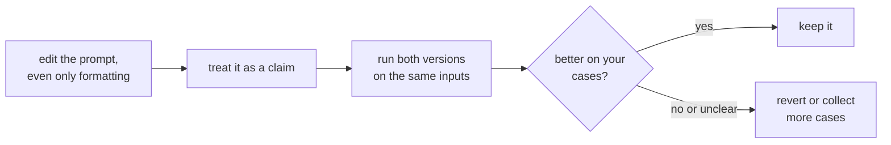

# Lección 5. Sensibilidad al formato

**Vínculo con la misión:** Si un cambio que no significa nada puede mover los resultados, entonces ninguna edición de un prompt es digna de confianza solo por leerla, y el resto de este track, hasta medir un cambio en la etapa 8, descansa en eso.
**Fuente principal:** [Paper: "Quantifying Language Models' Sensitivity to Spurious Features in Prompt Design", Sclar et al., 2023](https://arxiv.org/abs/2310.11324)
**Requisitos previos:** [Lección 4](0004-structure-and-delimiters.md), [Prompt few-shot](../GLOSSARY.md)

## Calentamiento

1. ▢ ¿Qué hace un delimitador y qué no hace?

Comprobación

Marca dónde termina un tipo de contenido y empieza otro, lo que reduce la confusión entre datos e instrucciones. No hace cumplir ese límite frente a una entrada que lo imite.

2. ▢ ¿Por qué "el prompt" depende de qué modelo se use?

Comprobación

Porque la plantilla de chat, que renderiza los mensajes en la secuencia de tokens, difiere entre modelos, incluso entre los que se afinaron con fine-tuning desde el mismo modelo base.

## Qué debes saber

### Un cambio sin significado

Sclar et al. estudiaron cambios de formato de prompt que no deberían alterar lo que un prompt significa: el separador entre una etiqueta y su texto, las mayúsculas y minúsculas de una etiqueta, los espacios entre campos. Uno de sus ejemplos es un formato como "Passage: text || Answer: text" frente a variantes del mismo. En varios modelos de código abierto muy usados en configuraciones few-shot, encontraron diferencias de rendimiento de hasta 76 puntos de precisión, medidas con LLaMA-2-13B.

Ese es el caso extremo. El propio paper señala que su muestra de formatos es un límite inferior de la dispersión real, y que la misma sensibilidad aparece con modelos más grandes, más ejemplos few-shot y modelos ajustados por instrucciones.

### No se transfiere limpiamente

Los autores reportan también que qué formato funciona bien se correlaciona solo débilmente entre modelos. Un formato que le va bien a un modelo no te da información fiable sobre otro. Esto importa cuando cambias de modelo: un prompt afinado para un modelo se traslada como punto de partida, no como resultado.

### Qué significa esto para quien escribe el prompt

La recomendación del paper está dirigida a quienes evalúan: reporta un rango de rendimiento a través de formatos plausibles, no un único número de un solo formato. Propone un algoritmo, FormatSpread, para estimar ese rango sin acceso a los pesos del modelo. Para quien escribe prompts, la lectura práctica es:

- Trata cada edición, incluso una cosmética, como una hipótesis, no como una corrección.
- Compara dos versiones de un prompt sobre las mismas entradas, no sobre el recuerdo de cómo se sintieron las salidas.
- No concluyas que una técnica es mala porque falló en un formato, ni que es buena porque funcionó en uno.

El alcance de esta evidencia son los modelos de código abierto y las tareas few-shot de tipo clasificación. Qué tan grande es el efecto para los modelos de chat alojados de hoy en tu tarea no es algo que esta lección pueda decirte, que es precisamente el motivo para medirlo tú mismo.

La etapa 8 convierte este ciclo en un conjunto de regresión y una comparación pareada.

## Práctica

1. ▢ Dos prompts difieren solo en "Answer:" frente a "ANSWER -". ¿Dice el hallazgo del paper que rendirán igual?

Comprobación

No. Dice que cambios de este tipo que preservan el significado pueden mover mucho la precisión en algunas configuraciones. No dice que los dos vayan a diferir en tu modelo y tu tarea, solo que no puedes asumir que no lo harán.

2. ▢ Un colega reporta "Cambié nuestro prompt a encabezados Markdown y mejoró." ¿Qué preguntas antes de aceptarlo?

Comprobación

Cuántas entradas compararon, si ambas versiones vieron las mismas entradas y si la diferencia es mayor que la variación entre ejecuciones. Un puñado de salidas leídas a ojo es una anécdota. Dados los hallazgos del paper, el cambio podría ser real, pero también podría serlo una muestra afortunada.

3. ▢ ¿Qué conclusión respaldan los resultados de los autores?

    - a) El formato solo importa para modelos pequeños y desaparece a medida que los modelos crecen
    - b) Un formato que funciona bien en un modelo funcionará bien en otros
    - c) La sensibilidad persistió con modelos más grandes, más ejemplos y ajuste por instrucciones
    - d) Los efectos del formato aparecen solo cuando un prompt no tiene ejemplos few-shot

Comprobación

**c)** El abstract dice que la sensibilidad se mantiene incluso al aumentar el tamaño del modelo, el número de ejemplos few-shot o al aplicar ajuste por instrucciones. (a) y (d) lo contradicen. (b) contradice su hallazgo de que el rendimiento de un formato se correlaciona solo débilmente entre modelos.

4. ▢ Predice y luego ejecuta. Elige una tarea de clasificación corta que puedas juzgar, como etiquetar diez frases como positivas o negativas. Escribe el prompt en dos formatos que signifiquen lo mismo, por ejemplo "Sentence: ... Label:" y "TEXT >> ... ANSWER >>". Predice si el número de etiquetas correctas diferirá, ejecuta ambos sobre las mismas diez frases y cuenta.

Pista

Usa las mismas diez frases en el mismo orden. Ejecuta cada versión dos veces si la herramienta lo permite, para ver si una diferencia es mayor que la variación entre repeticiones.

Comprobación

No hay una respuesta fija. Son posibles recuentos idénticos, y no son evidencia de que el formato no importe: los grandes efectos del paper se midieron en configuraciones few-shot con modelos de código abierto, y diez frases no pueden resolver una diferencia pequeña. Si los recuentos difieren, una brecha de una o dos frases puede ser ruido. El ejercicio muestra lo poco que puede decirte una comparación de diez casos, que es la razón por la que las lecciones posteriores construyen un conjunto de regresión y prueban contra el ruido.

## Prácticas en el mundo real

- [ ] Toma un prompt en el que confíes y reescribe solo su formato, con separadores, mayúsculas y espaciado, luego ejecuta ambas versiones sobre las mismas tres entradas y anota si alguna salida cambia.
- [ ] Anota, para un prompt que cambiaste hace poco, qué evidencia tenías de que el cambio ayudó.
- [ ] Mañana: la próxima vez que edites un prompt, conserva la versión antigua y la nueva lado a lado y envía ambas antes de decidir.

## Para profundizar

- [Paper: "Quantifying Language Models' Sensitivity to Spurious Features in Prompt Design", Sclar et al., 2023](https://arxiv.org/abs/2310.11324): las cifras sobre la dispersión y el método FormatSpread.
- [Anatomía de un prompt](../reference/prompt-anatomy.md)
- [Recursos](../RESOURCES.md)

---

¿No termina de quedar claro? Vuelve a leer la fuente primaria de arriba, ya que esta lección la comprime y en la compresión es donde se escapa la comprensión. Consulta el [glosario](../GLOSSARY.md) por si algún término te resultó resbaladizo.

Si lo poco claro es la propia lección y no el material, eso es un defecto: [abre un issue](https://github.com/TokenCemetery/teach/issues).
