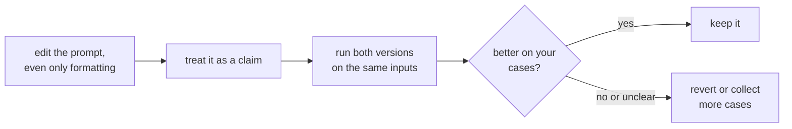

# Leçon 5. Sensibilité au format

**Lien avec la mission :** Si un changement qui ne signifie rien peut faire bouger les résultats, alors aucune modification de prompt ne peut être jugée fiable à la lecture, et tout le reste de ce parcours, jusqu'à la mesure d'une modification à l'étape 8, repose là-dessus.
**Source primaire :** [Article : "Quantifying Language Models' Sensitivity to Spurious Features in Prompt Design", Sclar et al., 2023](https://arxiv.org/abs/2310.11324)
**Prérequis :** [Leçon 4](0004-structure-and-delimiters.md), [Prompt few-shot](../GLOSSARY.md)

## Échauffement

1. ▢ Que fait un délimiteur, et que ne fait-il pas ?

Vérifier

Il marque où un type de contenu se termine et où un autre commence, ce qui réduit la confusion entre données et instructions. Il n'impose pas cette frontière face à une entrée qui l'imite.

2. ▢ Pourquoi « le prompt » dépend-il du modèle utilisé ?

Vérifier

Parce que le chat template, qui transforme les messages en séquence de tokens, diffère d'un modèle à l'autre, même entre des modèles fine-tunés à partir du même modèle de base.

## À savoir

### Un changement sans signification

Sclar et al. ont étudié des changements de formatage de prompt qui ne devraient pas modifier ce que le prompt signifie : le séparateur entre un label et son texte, la casse d'un label, les espaces entre les champs. L'un de leurs exemples est un format comme « Passage: text || Answer: text » comparé à ses variantes. Sur plusieurs modèles open source très utilisés en configuration few-shot, ils ont constaté des écarts de performance allant jusqu'à 76 points de précision, mesurés avec LLaMA-2-13B.

C'est le cas extrême. L'article note lui-même que son échantillon de formats est une borne inférieure de l'écart réel, et que la même sensibilité apparaît avec des modèles plus grands, davantage d'exemples few-shot et des modèles instruction-tuned.

### Cela ne se transfère pas proprement

Les auteurs rapportent aussi que le fait qu'un format fonctionne bien n'est que faiblement corrélé d'un modèle à l'autre. Un format qui convient à un modèle ne vous donne aucune information fiable sur un autre. Cela compte quand vous changez de modèle : un prompt réglé pour un modèle se reporte comme point de départ, pas comme résultat.

### Ce que cela signifie pour l'auteur de prompt

La recommandation de l'article s'adresse aux évaluateurs : rapporter une plage de performance sur des formats plausibles, pas un chiffre unique issu d'un seul format. Il propose un algorithme, FormatSpread, pour estimer cette plage sans accès aux poids du modèle. Pour un auteur de prompt, la lecture pratique est la suivante :

- Traitez chaque modification, même cosmétique, comme une hypothèse, pas comme un correctif.
- Comparez deux versions de prompt sur les mêmes entrées, pas sur le souvenir de l'impression que les sorties vous ont laissée.
- Ne concluez pas qu'une technique est mauvaise parce qu'elle a échoué dans un format, ni bonne parce qu'elle a marché dans un seul.

La portée de ces preuves se limite aux modèles open source et aux tâches few-shot de type classification. L'ampleur de l'effet pour les modèles de chat hébergés d'aujourd'hui sur votre tâche n'est pas ce que cette leçon peut vous dire, et c'est tout l'intérêt de la mesurer vous-même.

L'étape 8 transforme cette boucle en jeu de régression et en comparaison appariée.

## Pratique

1. ▢ Deux prompts ne diffèrent que par « Answer: » contre « ANSWER - ». Le résultat de l'article dit-il qu'ils auront les mêmes performances ?

Vérifier

Non. Il dit que des changements de ce type, qui préservent le sens, peuvent faire beaucoup varier la précision dans certaines configurations. Il ne dit pas que les deux différeront sur votre modèle et votre tâche, seulement que vous ne pouvez pas supposer qu'ils ne différeront pas.

2. ▢ Un collègue rapporte : « J'ai passé notre prompt aux titres Markdown et c'est devenu meilleur. » Que demandez-vous avant d'accepter cela ?

Vérifier

Combien d'entrées il a comparées, si les deux versions ont vu les mêmes entrées, et si la différence dépasse la variation d'une exécution à l'autre. Une poignée de sorties lues à l'œil est une anecdote. Vu les résultats de l'article, le changement peut être réel, mais un échantillon chanceux aussi.

3. ▢ Quelle conclusion les résultats des auteurs soutiennent-ils ?

    - a) Le formatage ne compte que pour les petits modèles, et disparaît quand les modèles grandissent
    - b) Un format qui fonctionne bien sur un modèle fonctionnera bien sur les autres
    - c) La sensibilité a persisté avec des modèles plus grands, davantage d'exemples et l'instruction tuning
    - d) Les effets du formatage n'apparaissent que lorsqu'un prompt n'a aucun exemple few-shot

Vérifier

**c)** L'abstract dit que la sensibilité subsiste même lorsqu'on augmente la taille du modèle, le nombre d'exemples few-shot, ou qu'on applique l'instruction tuning. (a) et (d) le contredisent. (b) contredit leur constat que la performance d'un format n'est que faiblement corrélée d'un modèle à l'autre.

4. ▢ Prédisez, puis exécutez. Choisissez une courte tâche de classification que vous pouvez juger, par exemple étiqueter dix phrases comme positives ou négatives. Écrivez le prompt dans deux formats qui veulent dire la même chose, par exemple « Sentence: ... Label: » et « TEXT >> ... ANSWER >> ». Prédisez si le nombre d'étiquettes correctes différera, exécutez les deux sur les mêmes dix phrases et comptez.

Indice

Utilisez les mêmes dix phrases dans le même ordre. Exécutez chaque version deux fois si l'outil le permet, pour voir si une différence dépasse la variation entre exécutions répétées.

Vérifier

Il n'y a pas de réponse fixe. Des totaux identiques sont possibles, et ils ne prouvent pas que le formatage n'a pas d'importance : les grands effets de l'article ont été mesurés en few-shot sur des modèles open source, et dix phrases ne permettent pas de résoudre une petite différence. Si les totaux diffèrent, un écart d'une ou deux phrases peut n'être que du bruit. L'exercice montre le peu qu'une comparaison sur dix cas peut vous apprendre, ce qui explique pourquoi les leçons suivantes construisent un jeu de régression et testent face au bruit.

## Exercices en situation réelle

- [ ] Prenez un prompt sur lequel vous vous appuyez et réécrivez uniquement son formatage (séparateurs, casse et espacement), puis exécutez les deux versions sur les trois mêmes entrées et notez si une sortie change.
- [ ] Écrivez, pour un prompt que vous avez modifié récemment, quelle preuve vous aviez que la modification avait aidé.
- [ ] Demain : la prochaine fois que vous modifiez un prompt, gardez l'ancienne et la nouvelle version côte à côte et envoyez les deux avant de décider.

## Pour aller plus loin

- [Article : "Quantifying Language Models' Sensitivity to Spurious Features in Prompt Design", Sclar et al., 2023](https://arxiv.org/abs/2310.11324) : les chiffres sur l'écart, et la méthode FormatSpread.
- [Anatomie d'un prompt](../reference/prompt-anatomy.md)
- [Ressources](../RESOURCES.md)

---

Ça ne passe pas ? Relisez la source primaire en haut de page, car cette leçon la condense et c'est dans la condensation que la compréhension s'échappe. Consultez le [glossaire](../GLOSSARY.md) pour tout terme qui vous a paru glissant.

Si c'est la leçon elle-même qui n'est pas claire plutôt que la matière, c'est un défaut : [ouvrez une issue](https://github.com/TokenCemetery/teach/issues).
