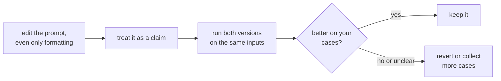

# पाठ 5. Format के प्रति संवेदनशीलता

**मिशन से संबंध:** अगर जिस बदलाव का कोई अर्थ नहीं, वह भी नतीजे हिला सकता है, तो कोई भी prompt edit सिर्फ़ पढ़कर भरोसे लायक नहीं माना जा सकता, और इस track का बाक़ी हिस्सा, चरण 8 में बदलाव मापने तक, इसी पर टिका है।
**मुख्य स्रोत:** [Paper: "Quantifying Language Models' Sensitivity to Spurious Features in Prompt Design", Sclar et al., 2023](https://arxiv.org/abs/2310.11324)
**पूर्व-आवश्यकताएँ:** [पाठ 4](0004-structure-and-delimiters.md), [Few-shot prompt](../GLOSSARY.md)

## वार्म-अप

1. ▢ Delimiter क्या करता है, और क्या नहीं करता?

जाँचें

यह बताता है कि एक प्रकार का content कहाँ ख़त्म होता है और दूसरा कहाँ शुरू होता है, जिससे data और instructions के बीच उलझन घटती है। वह उस सीमा की नक़ल करने वाले input के ख़िलाफ़ उसे लागू नहीं करता।

2. ▢ "The prompt" इस पर क्यों निर्भर करता है कि कौन-सा model इस्तेमाल हो रहा है?

जाँचें

क्योंकि chat template, जो messages को token sequence में render करता है, models के बीच अलग होता है, उनके बीच भी जिन्हें एक ही base से fine-tune किया गया हो।

## यह जानें

### बिना अर्थ वाला बदलाव

Sclar et al. ने prompt के ऐसे formatting बदलावों का अध्ययन किया जिनसे prompt का अर्थ नहीं बदलना चाहिए: label और उसके text के बीच का separator, label का casing, fields के बीच की spaces। उनका एक उदाहरण "Passage: text || Answer: text" जैसा format और उसके रूप हैं। Few-shot सेटिंग में कई व्यापक रूप से इस्तेमाल होने वाले open-source models पर, उन्होंने accuracy में 76 अंकों तक का अंतर पाया, जो LLaMA-2-13B से मापा गया।

यह चरम मामला है। पेपर ख़ुद कहता है कि उसके formats का नमूना असली फैलाव की निचली सीमा है, और यही संवेदनशीलता बड़े models, ज़्यादा few-shot examples और instruction-tuned models के साथ भी दिखती है।

### यह साफ़-साफ़ एक model से दूसरे में नहीं जाता

लेखक यह भी बताते हैं कि कौन-सा format अच्छा चलता है, इसका models के बीच सिर्फ़ कमज़ोर संबंध है। जो format एक model को सूट करता है, वह दूसरे के बारे में कोई भरोसेमंद जानकारी नहीं देता। जब आप model बदलते हैं तो यह मायने रखता है: एक model के लिए ट्यून किया गया prompt शुरुआती बिंदु के रूप में आगे जाता है, नतीजे के रूप में नहीं।

### Prompt के लेखक के लिए इसका मतलब

पेपर की सिफ़ारिश evaluators के लिए है: किसी एक format से एक संख्या बताने के बजाय, संभावित formats पर performance की एक range बताएँ। वह model weights तक पहुँच के बिना उस range का अनुमान लगाने के लिए FormatSpread नाम का एक algorithm सुझाता है। Prompt के लेखक के लिए व्यावहारिक पढ़ाई यह है:

- हर edit को, कॉस्मेटिक वाले को भी, एक परिकल्पना मानें, ठीक कर देने वाला समाधान नहीं।
- Prompt के दो versions की तुलना एक ही inputs पर करें, outputs कैसे लगे थे उसकी याद पर नहीं।
- यह नतीजा न निकालें कि कोई technique बुरी है क्योंकि वह एक format में नाकाम रही, या अच्छी है क्योंकि वह एक में चली।

इस प्रमाण का दायरा open-source models और few-shot classification-style tasks हैं। आज के hosted chat models पर आपके task के लिए असर कितना बड़ा है, यह यह पाठ नहीं बता सकता, और ख़ुद मापने का मक़सद यही है।

चरण 8 इस चक्र को regression set और paired comparison में बदलता है।

## अभ्यास

1. ▢ दो prompts में सिर्फ़ "Answer:" और "ANSWER -" का फ़र्क़ है। क्या पेपर की खोज कहती है कि वे एक जैसा प्रदर्शन करेंगे?

जाँचें

नहीं। वह कहती है कि इस तरह के अर्थ न बदलने वाले बदलाव कुछ सेटिंग्स में accuracy को बहुत हिला सकते हैं। वह यह नहीं कहती कि आपके model और task पर दोनों अलग होंगे, सिर्फ़ यह कि आप यह मानकर नहीं चल सकते कि वे अलग नहीं होंगे।

2. ▢ एक सहकर्मी बताता है "मैंने हमारा prompt Markdown headings पर बदला और वह बेहतर हो गया।" इसे मानने से पहले आप क्या पूछते हैं?

जाँचें

उन्होंने कितने inputs की तुलना की, क्या दोनों versions ने वही inputs देखे, और क्या अंतर हर run के बीच के उतार-चढ़ाव से बड़ा है। आँख से पढ़े गए मुट्ठी भर outputs किस्सा हैं। पेपर के नतीजों को देखते हुए, बदलाव असली हो सकता है, पर क़िस्मत वाला नमूना भी हो सकता है।

3. ▢ लेखकों के नतीजे कौन-सा निष्कर्ष समर्थित करते हैं?

    - a) Formatting सिर्फ़ छोटे models के लिए मायने रखती है, और models बड़े होने पर मिट जाती है
    - b) जो format एक model पर अच्छा चलता है वह दूसरों पर भी अच्छा चलेगा
    - c) संवेदनशीलता बड़े models, ज़्यादा examples और instruction tuning के साथ भी बनी रही
    - d) Formatting का असर तभी दिखता है जब prompt में कोई few-shot example न हो

जाँचें

**c)** Abstract कहता है कि model का आकार, few-shot examples की संख्या बढ़ाने, या instruction tuning करने पर भी संवेदनशीलता बनी रहती है। (a) और (d) उसके उलट हैं। (b) उनकी इस खोज के उलट है कि format का प्रदर्शन models के बीच सिर्फ़ कमज़ोर रूप से जुड़ा है।

4. ▢ पहले अनुमान लगाएँ, फिर चलाएँ। कोई छोटा classification task चुनें जिसे आप परख सकें, जैसे दस वाक्यों को positive या negative के रूप में label करना। Prompt को दो formats में लिखें जिनका एक ही मतलब हो, जैसे "Sentence: ... Label:" और "TEXT >> ... ANSWER >>". अनुमान लगाएँ कि सही labels की संख्या अलग होगी या नहीं, दोनों को उन्हीं दस वाक्यों पर चलाएँ और गिनें।

संकेत

उन्हीं दस वाक्यों को उसी क्रम में इस्तेमाल करें। अगर tool इजाज़त दे तो हर version को दो बार चलाएँ, ताकि आप देख सकें कि अंतर दोहराए गए runs के उतार-चढ़ाव से बड़ा है या नहीं।

जाँचें

कोई तय उत्तर नहीं है। एक जैसी गिनती संभव है, और वह इस बात का प्रमाण नहीं कि formatting मायने नहीं रखती: पेपर के बड़े असर open-source models पर few-shot सेटिंग में मापे गए थे, और दस वाक्य छोटे अंतर को सुलझा नहीं सकते। अगर गिनती अलग है, तो एक-दो वाक्यों का अंतर noise हो सकता है। यह अभ्यास दिखाता है कि दस cases की तुलना कितना कम बता सकती है, और इसीलिए आगे के पाठ regression set बनाते हैं और noise के सामने परखते हैं।

## असली दुनिया का अभ्यास

- [ ] कोई एक prompt लें जिस पर आप निर्भर हैं और सिर्फ़ उसकी formatting दोबारा लिखें, separators, casing और spacing के साथ, फिर दोनों versions को उन्हीं तीन inputs पर चलाएँ और नोट करें कि कोई output बदला या नहीं।
- [ ] हाल में बदले किसी एक prompt के लिए लिखें कि आपके पास इस बात का क्या प्रमाण था कि बदलाव से फ़ायदा हुआ।
- [ ] कल: अगली बार जब आप कोई prompt edit करें, तो उसका पुराना और नया version साथ-साथ रखें और फ़ैसला करने से पहले दोनों भेजें।

## आगे बढ़ने के लिए

- [Paper: "Quantifying Language Models' Sensitivity to Spurious Features in Prompt Design", Sclar et al., 2023](https://arxiv.org/abs/2310.11324): फैलाव के आँकड़े, और FormatSpread तरीक़ा।
- [Prompt Anatomy](../reference/prompt-anatomy.md)
- [संसाधन](../RESOURCES.md)

---

बात नहीं बन रही? ऊपर दिए primary source को दोबारा पढ़ें, क्योंकि यह पाठ उसे संक्षिप्त करता है और समझ संक्षेप में ही रिसती है। जो शब्द फिसलन भरा लगे, उसके लिए [शब्दावली](../GLOSSARY.md) देखें।

अगर दिक़्क़त सामग्री की नहीं बल्कि पाठ की ही है, तो वह एक खोट है: [issue खोलें](https://github.com/TokenCemetery/teach/issues)।
