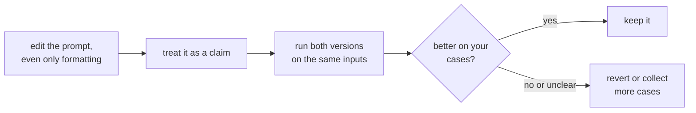

# Lesson 5. Format Sensitivity

**Mission link:** If a change that means nothing can move results, then no prompt edit can be trusted by reading it, and the rest of this track, down to measuring a change in stage 8, rests on that.
**Primary source:** [Paper: "Quantifying Language Models' Sensitivity to Spurious Features in Prompt Design", Sclar et al., 2023](https://arxiv.org/abs/2310.11324)
**Prerequisites:** [Lesson 4](0004-structure-and-delimiters.md), [Few-shot prompt](../GLOSSARY.md)

## Warm-up

1. ▢ What does a delimiter do, and what does it not do?

Check

It marks where one kind of content ends and another begins, which reduces confusion between data and instructions. It does not enforce that boundary against input that imitates it.

2. ▢ Why does "the prompt" depend on which model is used?

Check

Because the chat template, which renders messages into the token sequence, differs between models, even ones fine-tuned from the same base.

## Know this

### A change with no meaning

Sclar et al. studied prompt formatting changes that should not change what a prompt means: the separator between a label and its text, the casing of a label, the spaces between fields. One of their examples is a format like "Passage: text || Answer: text" against variants of it. Across several widely used open-source models in few-shot settings, they found performance differences of up to 76 accuracy points, measured with LLaMA-2-13B.

That is the extreme case. The paper itself notes that its sample of formats is a lower bound on the true spread, and that the same sensitivity appears with larger models, more few-shot examples and instruction-tuned models.

### It does not transfer cleanly

The authors also report that which format works well only weakly correlates between models. A format that suits one model gives you no reliable information about another. This matters when you change models: a prompt tuned for one model carries over as a starting point, not as a result.

### What this means for the prompt author

The paper's recommendation is aimed at evaluators: report a range of performance across plausible formats, not a single number from one format. It proposes an algorithm, FormatSpread, to estimate that range without access to model weights. For a prompt author, the practical reading is:

- Treat every edit, even a cosmetic one, as a hypothesis, not a fix.
- Compare two prompt versions on the same inputs, not on a memory of how the outputs felt.
- Do not conclude a technique is bad because it failed in one format, or good because it worked in one.

The scope of this evidence is open-source models and few-shot classification-style tasks. How large the effect is for today's hosted chat models on your task is not something this lesson can tell you, which is the point of measuring it yourself.

Stage 8 turns this loop into a regression set and a paired comparison.

## Practice

1. ▢ Two prompts differ only in "Answer:" against "ANSWER -". Does the paper's finding say they will perform the same?

Check

No. It says meaning-preserving changes of this kind can move accuracy a lot in some settings. It does not say the two will differ on your model and task, only that you cannot assume they will not.

2. ▢ A colleague reports "I switched our prompt to Markdown headings and it got better." What do you ask before accepting that?

Check

How many inputs they compared, whether both versions saw the same inputs, and whether the difference is larger than run-to-run variation. A handful of outputs read by eye is an anecdote. Given the paper's findings, the change might be real, but so might a lucky sample.

3. ▢ Which conclusion do the authors' results support?

    - a) Formatting only matters for small models, and vanishes as models grow
    - b) A format that works well on one model will work well on others
    - c) Sensitivity persisted with larger models, more examples and instruction tuning
    - d) Formatting effects appear only when a prompt has no few-shot examples

Check

**c)** The abstract says sensitivity remains even when increasing model size, the number of few-shot examples, or performing instruction tuning. (a) and (d) contradict that. (b) contradicts their finding that format performance only weakly correlates between models.

4. ▢ Predict, then run. Pick a short classification task you can judge, such as labelling ten sentences as positive or negative. Write the prompt in two formats that mean the same, for example "Sentence: ... Label:" and "TEXT >> ... ANSWER >>". Predict whether the number of correct labels will differ, run both on the same ten sentences, and count.

Hint

Use the same ten sentences in the same order. Run each version twice if the tool allows it, so you can see whether a difference is bigger than repeat-run variation.

Check

There is no fixed answer. Identical counts are possible, and they are not evidence that formatting does not matter: the paper's large effects were measured in few-shot settings on open-source models, and ten sentences cannot resolve a small difference. If the counts differ, a gap of one or two sentences may be noise. The exercise shows how little a ten-case comparison can tell you, which is why later lessons build a regression set and test against noise.

## Real-world reps

- [ ] Take one prompt you rely on and rewrite its formatting only, with separators, casing and spacing, then run both versions on the same three inputs and note whether any output changes.
- [ ] Write down, for one prompt you changed recently, what evidence you had that the change helped.
- [ ] Tomorrow: keep the old and new version of a prompt side by side the next time you edit one, and send both before deciding.

## Going further

- [Paper: "Quantifying Language Models' Sensitivity to Spurious Features in Prompt Design", Sclar et al., 2023](https://arxiv.org/abs/2310.11324): the figures on spread, and the FormatSpread method.
- [Prompt Anatomy](../reference/prompt-anatomy.md)
- [Resources](../RESOURCES.md)

---

Not landing? Reread the primary source at the top, since this lesson compresses it and compression is where understanding leaks. Check the [glossary](../GLOSSARY.md) for any term that felt slippery.

If the lesson itself is unclear rather than the material, that is a defect: [open an issue](https://github.com/TokenCemetery/teach/issues).
