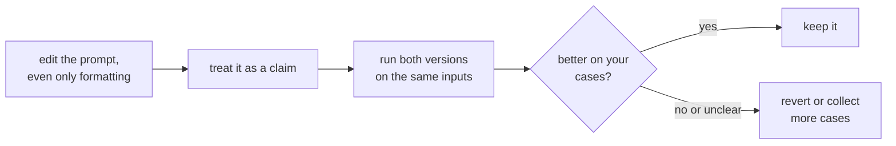

# Lição 5. Sensibilidade ao formato

**Ligação com a missão:** Se uma mudança que não significa nada pode alterar os resultados, então nenhuma edição de prompt pode ser confiável só de ser lida, e o resto desta trilha, até medir uma mudança na etapa 8, se apoia nisso.
**Fonte principal:** [Paper: "Quantifying Language Models' Sensitivity to Spurious Features in Prompt Design", Sclar et al., 2023](https://arxiv.org/abs/2310.11324)
**Pré-requisitos:** [Lição 4](0004-structure-and-delimiters.md), [Prompt few-shot](../GLOSSARY.md)

## Aquecimento

1. ▢ O que um delimitador faz, e o que ele não faz?

Verificação

Ele marca onde um tipo de conteúdo termina e outro começa, o que reduz a confusão entre dados e instruções. Ele não impõe essa fronteira contra uma entrada que a imita.

2. ▢ Por que "o prompt" depende de qual modelo é usado?

Verificação

Porque o chat template, que renderiza as mensagens na sequência de tokens, difere entre modelos, mesmo entre os que passaram por fine-tuning a partir do mesmo modelo base.

## Saiba isto

### Uma mudança sem significado

Sclar et al. estudaram mudanças de formatação de prompt que não deveriam alterar o que o prompt significa: o separador entre um rótulo e seu texto, a caixa (maiúsculas e minúsculas) de um rótulo, os espaços entre campos. Um dos exemplos deles é um formato como "Passage: text || Answer: text" comparado com variantes dele. Em vários modelos open-source amplamente usados, em cenários few-shot, eles encontraram diferenças de desempenho de até 76 pontos de acurácia, medidas com o LLaMA-2-13B.

Esse é o caso extremo. O próprio paper observa que sua amostra de formatos é um limite inferior da dispersão real, e que a mesma sensibilidade aparece com modelos maiores, mais exemplos few-shot e modelos ajustados por instruções.

### Ela não se transfere de forma limpa

Os autores também relatam que qual formato funciona bem tem apenas uma correlação fraca entre modelos. Um formato que serve a um modelo não dá nenhuma informação confiável sobre outro. Isso importa quando você troca de modelo: um prompt ajustado para um modelo se transfere como ponto de partida, e não como resultado.

### O que isso significa para quem escreve o prompt

A recomendação do paper é voltada a quem avalia: relate uma faixa de desempenho entre formatos plausíveis, e não um único número de um só formato. Ele propõe um algoritmo, o FormatSpread, para estimar essa faixa sem acesso aos pesos do modelo. Para quem escreve prompts, a leitura prática é:

- Trate cada edição, mesmo uma cosmética, como uma hipótese, e não como uma correção.
- Compare duas versões de prompt sobre as mesmas entradas, e não sobre a memória de como as saídas pareceram.
- Não conclua que uma técnica é ruim porque falhou em um formato, nem que é boa porque funcionou em um.

O alcance dessa evidência são modelos open-source e tarefas few-shot do tipo classificação. Quão grande é o efeito para os modelos de chat hospedados de hoje na sua tarefa não é algo que esta lição possa dizer, e é isso que justifica medir você mesmo.

A etapa 8 transforma esse ciclo em um conjunto de regressão e uma comparação pareada.

## Prática

1. ▢ Dois prompts diferem apenas em "Answer:" contra "ANSWER -". A conclusão do paper diz que eles terão o mesmo desempenho?

Verificação

Não. Ela diz que mudanças desse tipo, que preservam o significado, podem alterar muito a acurácia em alguns cenários. Não diz que os dois diferirão no seu modelo e na sua tarefa, apenas que você não pode presumir que não diferirão.

2. ▢ Um colega relata: "Troquei nosso prompt para títulos em Markdown e melhorou." O que você pergunta antes de aceitar isso?

Verificação

Quantas entradas ele comparou, se as duas versões viram as mesmas entradas e se a diferença é maior que a variação entre execuções. Um punhado de saídas lidas a olho é uma anedota. Dadas as conclusões do paper, a mudança pode ser real, mas uma amostra de sorte também pode.

3. ▢ Qual conclusão os resultados dos autores sustentam?

    - a) A formatação só importa para modelos pequenos e desaparece à medida que os modelos crescem
    - b) Um formato que funciona bem em um modelo funcionará bem em outros
    - c) A sensibilidade persistiu com modelos maiores, mais exemplos e ajuste por instruções
    - d) Os efeitos de formatação aparecem apenas quando um prompt não tem exemplos few-shot

Verificação

**c)** O abstract diz que a sensibilidade permanece mesmo ao aumentar o tamanho do modelo, o número de exemplos few-shot ou ao realizar ajuste por instruções. (a) e (d) contradizem isso. (b) contradiz a conclusão deles de que o desempenho de um formato tem apenas correlação fraca entre modelos.

4. ▢ Preveja, depois execute. Escolha uma tarefa curta de classificação que você consiga julgar, como rotular dez frases como positivas ou negativas. Escreva o prompt em dois formatos que significam o mesmo, por exemplo "Sentence: ... Label:" e "TEXT >> ... ANSWER >>". Preveja se o número de rótulos corretos será diferente, execute os dois sobre as mesmas dez frases e conte.

Dica

Use as mesmas dez frases na mesma ordem. Execute cada versão duas vezes, se a ferramenta permitir, para ver se uma diferença é maior que a variação entre repetições.

Verificação

Não há resposta fixa. Contagens idênticas são possíveis, e não são evidência de que a formatação não importa: os grandes efeitos do paper foram medidos em cenários few-shot com modelos open-source, e dez frases não conseguem resolver uma diferença pequena. Se as contagens diferem, uma diferença de uma ou duas frases pode ser ruído. O exercício mostra quão pouco uma comparação de dez casos pode dizer, e é por isso que as lições seguintes constroem um conjunto de regressão e testam contra o ruído.

## Prática no mundo real

- [ ] Pegue um prompt em que você confia e reescreva apenas a formatação dele, com separadores, caixa e espaçamento, depois execute as duas versões sobre as mesmas três entradas e anote se alguma saída muda.
- [ ] Anote, para um prompt que você mudou recentemente, qual evidência você tinha de que a mudança ajudou.
- [ ] Amanhã: na próxima vez que editar um prompt, mantenha a versão antiga e a nova lado a lado e envie as duas antes de decidir.

## Para ir além

- [Paper: "Quantifying Language Models' Sensitivity to Spurious Features in Prompt Design", Sclar et al., 2023](https://arxiv.org/abs/2310.11324): os números sobre a dispersão e o método FormatSpread.
- [Anatomia do Prompt](../reference/prompt-anatomy.md)
- [Recursos](../RESOURCES.md)

---

Não ficou claro? Releia a fonte principal no topo, já que esta lição a comprime e é na compressão que o entendimento escapa. Consulte o [glossário](../GLOSSARY.md) para qualquer termo que pareceu escorregadio.

Se o problema é a lição em si, e não o material, isso é um defeito: [abra uma issue](https://github.com/TokenCemetery/teach/issues).
