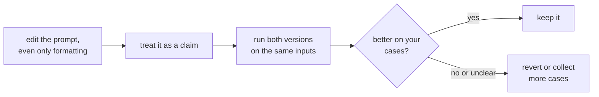

# Урок 5. Чувствительность к формату

**Связь с целью курса:** Если изменение, не несущее смысла, может сдвинуть результаты, то ни одной правке промпта нельзя доверять, прочитав её, и на этом держится весь остальной трек вплоть до измерения изменения на этапе 8.
**Первоисточник:** [Статья: "Quantifying Language Models' Sensitivity to Spurious Features in Prompt Design", Sclar et al., 2023](https://arxiv.org/abs/2310.11324)
**Предварительные требования:** [Урок 4](0004-structure-and-delimiters.md), [Few-shot-промпт](../GLOSSARY.md)

## Разминка

1. ▢ Что делает разделитель и чего он не делает?

Проверка

Он показывает, где один вид содержимого заканчивается и начинается другой, что уменьшает путаницу между данными и инструкциями. Он не обеспечивает эту границу против ввода, который ей подражает.

2. ▢ Почему «промпт» зависит от того, какая модель используется?

Проверка

Потому что чат-шаблон, который превращает сообщения в последовательность токенов, различается у разных моделей, даже у дообученных из одной базовой.

## Что нужно знать

### Изменение без смысла

Sclar et al. изучали изменения форматирования промпта, которые не должны менять его смысл: разделитель между меткой и её текстом, регистр метки, пробелы между полями. Один из их примеров это формат вроде "Passage: text || Answer: text" в сравнении с его вариантами. На нескольких широко используемых открытых моделях в few-shot-постановках они обнаружили разницу в качестве до 76 пунктов точности, измеренную на LLaMA-2-13B.

Это крайний случай. Сама статья отмечает, что её выборка форматов даёт нижнюю границу реального разброса и что та же чувствительность проявляется у более крупных моделей, при большем числе few-shot-примеров и у моделей с инструктивным дообучением.

### Она не переносится чисто

Авторы также сообщают, что то, какой формат работает хорошо, лишь слабо коррелирует между моделями. Формат, подходящий одной модели, не даёт надёжной информации о другой. Это важно при смене модели: промпт, настроенный под одну модель, переносится как отправная точка, а не как результат.

### Что это значит для автора промпта

Рекомендация статьи адресована тем, кто проводит оценку: сообщайте диапазон качества по правдоподобным форматам, а не одно число для одного формата. Она предлагает алгоритм FormatSpread, который оценивает этот диапазон без доступа к весам модели. Для автора промпта практическое прочтение таково:

- Относитесь к каждой правке, даже косметической, как к гипотезе, а не как к исправлению.
- Сравнивайте две версии промпта на одних и тех же входах, а не по воспоминанию о том, как ощущались выводы.
- Не заключайте, что приём плох, потому что он не сработал в одном формате, или хорош, потому что сработал в одном.

Область этих данных это открытые модели и few-shot-задачи типа классификации. Насколько велик эффект для сегодняшних облачных чат-моделей на вашей задаче, этот урок сказать не может, в чём и состоит смысл измерять его самостоятельно.

Этап 8 превращает этот цикл в регрессионный набор и парное сравнение.

## Практика

1. ▢ Два промпта различаются только "Answer:" против "ANSWER -". Говорит ли вывод статьи, что они покажут одинаковый результат?

Проверка

Нет. Он говорит, что изменения такого рода, сохраняющие смысл, могут сильно сдвигать точность в некоторых постановках. Он не говорит, что эти два промпта будут различаться на вашей модели и задаче, лишь что нельзя считать, что не будут.

2. ▢ Коллега сообщает: «Я перевёл наш промпт на заголовки Markdown, и стало лучше». О чём вы спросите, прежде чем с этим согласиться?

Проверка

Сколько входов он сравнил, видели ли обе версии одни и те же входы и больше ли разница, чем вариация между прогонами. Несколько выводов, прочитанных на глаз, это анекдот. Учитывая выводы статьи, изменение может быть реальным, но может быть и удачной выборкой.

3. ▢ Какой вывод поддерживают результаты авторов?

    - a) Форматирование важно только для небольших моделей и исчезает с ростом моделей
    - b) Формат, который хорошо работает на одной модели, будет хорошо работать и на других
    - c) Чувствительность сохранялась у более крупных моделей, при большем числе примеров и при инструктивном дообучении
    - d) Эффекты форматирования проявляются только тогда, когда в промпте нет few-shot-примеров

Проверка

**c)** В аннотации сказано, что чувствительность сохраняется даже при увеличении размера модели, числа few-shot-примеров или инструктивном дообучении. (a) и (d) этому противоречат. (b) противоречит их выводу, что качество формата лишь слабо коррелирует между моделями.

4. ▢ Сначала предскажите, потом запустите. Выберите короткую задачу классификации, которую вы можете оценить, например разметить десять предложений как положительные или отрицательные. Напишите промпт в двух форматах, означающих одно и то же, например "Sentence: ... Label:" и "TEXT >> ... ANSWER >>". Предскажите, будет ли различаться число верных меток, запустите оба на одних и тех же десяти предложениях и посчитайте.

Подсказка

Используйте те же десять предложений в том же порядке. Если инструмент позволяет, запустите каждую версию дважды, чтобы увидеть, больше ли разница, чем вариация между повторными прогонами.

Проверка

Фиксированного ответа нет. Одинаковые счёты возможны, и они не свидетельствуют, что форматирование не важно: большие эффекты в статье измерены в few-shot-постановках на открытых моделях, а десять предложений не позволяют различить малую разницу. Если счёты различаются, разрыв в одно-два предложения может быть шумом. Упражнение показывает, как мало может сказать сравнение на десяти случаях, поэтому следующие уроки строят регрессионный набор и проверяют на фоне шума.

## Практика в реальной работе

- [ ] Возьмите один промпт, на который вы полагаетесь, и перепишите только его форматирование: разделители, регистр и пробелы. Затем запустите обе версии на одних и тех же трёх входах и отметьте, изменился ли какой-нибудь вывод.
- [ ] Для одного промпта, который вы недавно меняли, запишите, какие свидетельства у вас были, что изменение помогло.
- [ ] Завтра: в следующий раз, когда будете править промпт, держите старую и новую версии рядом и отправьте обе, прежде чем решать.

## Что почитать дальше

- [Статья: "Quantifying Language Models' Sensitivity to Spurious Features in Prompt Design", Sclar et al., 2023](https://arxiv.org/abs/2310.11324): цифры о разбросе и метод FormatSpread.
- [Анатомия промпта](../reference/prompt-anatomy.md)
- [Ресурсы](../RESOURCES.md)

---

Не доходит? Перечитайте первоисточник в начале: этот урок его сжимает, а при сжатии понимание как раз и теряется. Загляните в [глоссарий](../GLOSSARY.md), если какой-то термин показался скользким.

Если неясен сам урок, а не материал, это дефект: [откройте issue](https://github.com/TokenCemetery/teach/issues).
