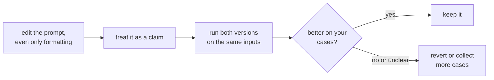

# 第 5 课：格式敏感性

**使命关联:** 如果一处毫无意义的改动都能让结果波动，那么任何提示词修改都不能靠读一读就信任，本系列的其余部分，直到第 8 阶段的度量一次改动，都建立在这一点之上。
**主要来源:** [论文：“Quantifying Language Models' Sensitivity to Spurious Features in Prompt Design”，Sclar 等，2023](https://arxiv.org/abs/2310.11324)
**前置知识:** [第 4 课](0004-structure-and-delimiters.md)、[少样本提示词](../GLOSSARY.md)

## 热身

1. ▢ 分隔符有什么作用，又没有什么作用？

检查

它标明一种内容在哪里结束、另一种内容从哪里开始，从而减少数据和指令之间的混淆。它不能强制这条边界，挡不住模仿这条边界的输入。

2. ▢ 为什么“这个提示词”取决于使用的是哪个模型？

检查

因为把消息渲染成 token 序列的聊天模板因模型而异，即使是从同一个基础模型微调出来的模型也是如此。

## 要点

### 一处没有含义的改动

Sclar 等人研究了一些本不该改变提示词含义的格式改动：标签和文本之间的分隔符、标签的大小写、字段之间的空格。他们的一个例子是 “Passage: text || Answer: text” 这样的格式及其各种变体。在少样本设置下，对几个被广泛使用的开源模型，他们发现性能差异最高达 76 个准确率点，这是用 LLaMA-2-13B 测得的。

这是极端情况。论文自己指出，它所取样的格式只是真实波动范围的下界，而且在更大的模型、更多的少样本示例以及指令微调模型上，同样的敏感性依然存在。

### 它不能干净地迁移

作者还报告说，哪种格式效果好，在不同模型之间只有很弱的相关性。适合某个模型的格式，对另一个模型并不能提供可靠的信息。这在换模型时很重要：为某个模型调好的提示词，可以作为起点带过去，而不能当作结果直接沿用。

### 这对提示词作者意味着什么

论文的建议是针对评估者的：报告在各种合理格式下的性能范围，而不是只报告某一种格式下的单个数字。它提出了一个算法 FormatSpread，不需要访问模型权重就能估计这个范围。对提示词作者来说，实际的解读是：

- 把每一次修改，哪怕只是外观上的，都当作假设，而不是修复。
- 在相同的输入上比较两个版本的提示词，而不是凭对输出感觉如何的记忆。
- 不要因为某种技巧在一种格式下失败了就断定它不好，也不要因为它在一种格式下有效就断定它好。

这份证据的范围是开源模型和少样本的分类类任务。对如今的托管聊天模型，在你的任务上这种影响有多大，本课无法告诉你，这也正是要自己去度量的原因。

第 8 阶段会把这个循环变成回归集和成对比较。

## 练习

1. ▢ 两个提示词只在 “Answer:” 与 “ANSWER -” 上不同。论文的发现是否说明它们表现相同？

检查

不是。它说的是，这类保持含义不变的改动，在某些设置下可以让准确率大幅波动。它没有说这两个在你的模型和任务上一定不同，只是说你不能假定它们不会不同。

2. ▢ 一位同事说：“我把我们的提示词改成了 Markdown 标题，效果变好了。”接受这个说法之前你要问什么？

检查

他比较了多少个输入，两个版本是否看的是相同的输入，差异是否大于每次运行之间的波动。靠眼睛读几条输出只是一则轶事。结合论文的发现，这个改动可能是真的有效，但也可能只是运气好的样本。

3. ▢ 作者的结果支持下面哪个结论？

    - a) 格式只对小模型有影响，随着模型变大就消失了
    - b) 在一个模型上效果好的格式，在其他模型上也会效果好
    - c) 在更大的模型、更多的示例和指令微调下，敏感性依然存在
    - d) 只有提示词没有少样本示例时，才会出现格式的影响

检查

**c)** 摘要说，即使增大模型规模、增加少样本示例的数量或进行指令微调，敏感性依然存在。(a) 和 (d) 与此相矛盾。(b) 与他们的发现相矛盾，即格式的表现在模型之间只有很弱的相关性。

4. ▢ 先预测，再运行。选一个你能自己判断的简短分类任务，比如把十个句子标为正面或负面。用两种含义相同的格式写出提示词，例如 “Sentence: ... Label:” 和 “TEXT >> ... ANSWER >>”。预测正确标注的数量是否会不同，在同样的十个句子上运行两个版本，并数一数。

提示

使用同样的十个句子，顺序也相同。如果工具允许，每个版本运行两次，这样可以看出差异是否大于重复运行之间的波动。

检查

没有固定的答案。数量完全相同是可能的，而这并不能证明格式不重要：论文中的大幅影响是在开源模型的少样本设置下测得的，而十个句子分辨不出细小的差异。如果数量不同，一两个句子的差距也可能只是噪声。这个练习说明了十个用例的比较能告诉你的东西有多少，这也是后面的课程要建立回归集并针对噪声做测试的原因。

## 实战练习

- [ ] 拿一个你依赖的提示词，只改它的格式，包括分隔符、大小写和空格，然后在同样的三个输入上运行两个版本，记下是否有任何输出发生了变化。
- [ ] 针对你最近改过的一个提示词，写下你有什么证据说明这个改动有帮助。
- [ ] 明天：下次修改提示词时，把新旧两个版本并排放着，发出两个版本之后再做决定。

## 延伸阅读

- [论文：“Quantifying Language Models' Sensitivity to Spurious Features in Prompt Design”，Sclar 等，2023](https://arxiv.org/abs/2310.11324)：关于波动范围的数据，以及 FormatSpread 方法。
- [提示词的构成](../reference/prompt-anatomy.md)
- [资源](../RESOURCES.md)

---

没学明白？请重读顶部的主要来源，因为本课是对它的压缩，而理解正是在压缩中流失的。如果有哪个术语觉得含糊，可以查看[术语表](../GLOSSARY.md)。

如果问题出在课程本身，而不是学习材料，那就是一个缺陷：[提交 issue](https://github.com/TokenCemetery/teach/issues)。
