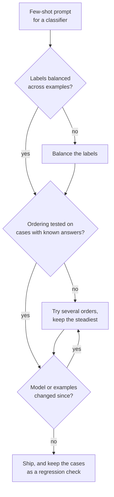

# Lección 7. Sesgos del few-shot

**Vínculo con la misión:** Qué ejemplos entran y en qué orden son decisiones que por sí solas pueden hacer oscilar la precisión, así que quien escribe prompts tiene que conocer los sesgos que arriesga y probar el orden en lugar de confiar en el primero que parezca bien.
**Fuente principal:** [Paper: "Calibrate Before Use: Improving Few-Shot Performance of Language Models", Zhao et al., 2021](https://arxiv.org/abs/2102.09690)
**Requisitos previos:** [Lección 6](0006-what-examples-teach.md), [Prompt few-shot](../GLOSSARY.md)

## Calentamiento

1. ▢ La lección 6 listó lo que enseñan los ejemplos. ¿Cuál de esas tres cosas distorsionaría un conjunto de ejemplos que llevan todos la misma etiqueta?

<details markdown="1"><summary>Comprobación</summary>

El espacio de etiquetas: el modelo ve una respuesta como la única que aparece. Sigue viendo el formato y la distribución de entrada, y por eso el fallo se ve como un sesgo en las respuestas y no como una salida rota.

</details>

2. ▢ La lección 2 dijo que el modelo clasifica las instrucciones según dónde están. Nombra una razón por la que un efecto de posición en los ejemplos también es plausible.

<details markdown="1"><summary>Comprobación</summary>

Todo es una única secuencia de tokens (lección 1), así que la posición es información sobre la que el modelo condiciona. Nada en la plantilla marca el primer ejemplo como igual al último, y el modelo continúa la secuencia desde el final.

</details>

## Qué debes saber

### Tres sesgos del mismo prompt

Zhao et al. encontraron que la precisión few-shot en GPT-3 puede oscilar de casi el azar a casi el estado del arte según la elección de ejemplos, su orden y el formato del prompt. Atribuyen la inestabilidad a un sesgo hacia ciertas respuestas, y nombran tres.

| Sesgo | Qué hace el modelo |
|---|---|
| Etiqueta mayoritaria | Predice la respuesta que aparece con más frecuencia entre los ejemplos |
| Recencia | Predice la respuesta que aparece cerca del final del prompt |
| Token común | Prefiere respuestas frecuentes en sus datos de preentrenamiento, como "United States" frente a "Saint Lucia" |

Los dos interactúan. En una tarea de sentimiento con cuatro ejemplos, un prompt ordenado positivo, positivo, positivo, negativo envió casi el 90% de las predicciones a Negative, aunque tres de los cuatro ejemplos eran positivos. La recencia pesó más que la mayoría.

### Solo el orden mueve la precisión

Lu et al. mantienen fijos los ejemplos y permutan solo su orden. Algunos órdenes llegan casi al estado del arte y otros están cerca de adivinar al azar. Tres hallazgos más importan en la práctica:

- Aparece en todos los tamaños de modelo que probaron, incluido el mayor de entonces, aunque los modelos más grandes lo redujeron algo.
- No está ligado a un subconjunto concreto de ejemplos: los mismos ejemplos pueden ser buenos o malos según el orden.
- Un buen orden para un modelo no se transfiere a otro, así que un orden es una propiedad de un prompt y un modelo juntos.

### Lo que los números no te dicen

Ambos papers probaron modelos de la era de GPT-3. Muestran que el mecanismo existe. No muestran qué tan grande es el efecto en un modelo de chat actual, así que la respuesta es medir en el tuyo, no asumir que el efecto desapareció ni que tiene el mismo tamaño.

### Mitigaciones



- **Equilibra las etiquetas** para que ninguna respuesta sea la mayoritaria, y evita terminar con una racha de una misma etiqueta.
- **Varía el orden** en unas pocas permutaciones y mira la dispersión. Una dispersión amplia significa que el prompt depende de la suerte.
- **Prueba los órdenes** con casos de respuesta conocida, idealmente de fallos reales. Es una versión pequeña del conjunto de regresión de la etapa 8.
- **Vuelve a probar cuando cambie el modelo**, ya que Lu et al. encontraron que los buenos órdenes no se transfieren entre modelos.
- **La calibración contextual** es la solución de Zhao et al.: alimenta una entrada sin contenido como "N/A", mira qué respuesta prefiere el modelo y ajusta las puntuaciones de respuesta para que esa entrada salga uniforme. Funciona sobre las puntuaciones del modelo para cada respuesta, así que sirve a un pipeline que pueda leerlas, no a una ventana de chat.

## Práctica

1. ▢ Predice y luego ejecuta. Pega este prompt en una ventana de chat y predice la etiqueta de la última reseña antes de ejecutarlo. Luego mueve el ejemplo Negative al principio de la lista y ejecútalo de nuevo.

    ```text
    Classify each review as Positive or Negative.

    Review: Great value, would buy again.
    Label: Positive

    Review: Works well and arrived early.
    Label: Positive

    Review: Does what it says on the box.
    Label: Positive

    Review: Broke after a week.
    Label: Negative

    Review: It is fine, nothing special.
    Label:
    ```

<details markdown="1"><summary>Pista</summary>

El último ejemplo tiene una etiqueta distinta de las otras tres, y la reseña de prueba no es claramente positiva ni claramente negativa.

</details>

<details markdown="1"><summary>Comprobación</summary>

Los hallazgos de Zhao et al. predicen una inclinación hacia Negative, porque la recencia puede pesar más que la mayoría de tres a uno de Positive. Esto es una tendencia de modelos de la era de GPT-3, así que un modelo actual puede responder Positive, o titubear. El resultado útil es si la respuesta cambia cuando reordenas: si cambia, el orden de los ejemplos está decidiendo un caso ambiguo, que es exactamente el riesgo que nombra esta lección.

</details>

2. ▢ Tienes 3 ejemplos positivos y 3 negativos para un clasificador. ¿Qué orden es el mejor punto de partida?

    - a) Todos los ejemplos positivos primero y luego todos los negativos
    - b) Alternar las etiquetas y probar unas pocas alternancias sobre casos conocidos
    - c) Poner al final el ejemplo más claro de la etiqueta más común
    - d) Ordenar los ejemplos por longitud y usar ese único orden

<details markdown="1"><summary>Comprobación</summary>

**b)** Equilibra las etiquetas y trata el orden como algo que probar. (a) termina con una racha de una misma etiqueta, la configuración detrás del efecto de recencia. (c) pone la etiqueta más común al final, sumando la presión de la mayoría y la de la recencia. (d) elige un orden por una razón ajena al sesgo y nunca lo comprueba.

</details>

3. ▢ Puntúas tres órdenes de los mismos seis ejemplos en 20 casos de respuesta conocida y obtienes 17, 16 y 11 aciertos. ¿Qué concluyes y qué haces antes de entregarlo?

<details markdown="1"><summary>Comprobación</summary>

La dispersión (de 11 a 17 sobre 20) es en sí el hallazgo: el prompt es sensible al orden, así que el 17 puede ser en parte suerte en estos 20 casos. No entregues el orden de mayor puntuación solo con esa evidencia. Puntúa los órdenes en más casos (20 casos es una muestra pequeña, así que el ruido es grande), prefiere un orden que puntúe de forma estable y vuelve a ejecutar la comprobación siempre que cambien el modelo o los ejemplos, porque un buen orden para un modelo no se traslada a otro.

</details>

4. ▢ Un prompt de filtro de spam muestra primero un correo legítimo y luego cinco correos de spam. Casi todos los correos reales vuelven etiquetados como spam. Nombra los dos sesgos que empujan en ese sentido y una solución.

<details markdown="1"><summary>Pista</summary>

Cuenta las etiquetas y luego mira en qué etiqueta terminan los ejemplos.

</details>

<details markdown="1"><summary>Comprobación</summary>

Sesgo de etiqueta mayoritaria: cinco de los seis ejemplos son spam. Sesgo de recencia: el prompt termina con una racha de spam, y en la prueba de sentimiento de Zhao et al. los últimos ejemplos podían pesar más que la mayoría. Ambos empujan hacia spam. Solución: equilibrar las etiquetas (por ejemplo tres de cada), alternarlas para que el prompt no termine con una racha y probar el resultado con correos de etiqueta conocida.

</details>

## Prácticas en el mundo real

- [ ] Cuenta las etiquetas entre los ejemplos de un prompt few-shot en el que confíes. Si una etiqueta supera la mitad, reequilíbrala.
- [ ] Ejecuta un prompt few-shot sobre las mismas cinco entradas con los ejemplos en dos órdenes distintos y anota si alguna respuesta cambió.
- [ ] Mañana: elige un prompt que no hayas cambiado en semanas y vuelve a ejecutarlo sobre tres entradas de respuesta conocida. Si alguna falla ahora, comprueba si cambió el modelo, ya que un buen orden no se traslada entre modelos.

## Para profundizar

- [Few-Shot y razonamiento](../reference/few-shot-and-reasoning.md)
- [Paper: "Fantastically Ordered Prompts and Where to Find Them", Lu et al., 2021](https://arxiv.org/abs/2104.08786)
- [Recursos](../RESOURCES.md)

---

¿No termina de quedar claro? Vuelve a leer la fuente primaria de arriba, ya que esta lección la comprime y en la compresión es donde se escapa la comprensión. Consulta el [glosario](../GLOSSARY.md) por si algún término te resultó resbaladizo.

Si lo poco claro es la propia lección y no el material, eso es un defecto: [abre un issue](https://github.com/TokenCemetery/teach/issues).
