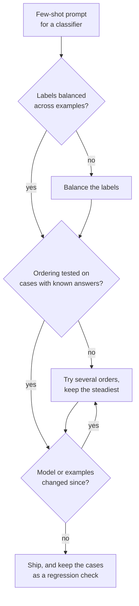

# Leçon 7. Biais du few-shot

**Lien avec la mission :** Les exemples qui entrent dans le prompt et leur ordre sont des choix qui peuvent à eux seuls faire osciller la précision. Un auteur de prompt doit donc connaître les biais qu'il risque et tester l'ordre au lieu de faire confiance au premier qui semble convenir.
**Source primaire :** [Article : "Calibrate Before Use: Improving Few-Shot Performance of Language Models", Zhao et al., 2021](https://arxiv.org/abs/2102.09690)
**Prérequis :** [Leçon 6](0006-what-examples-teach.md), [Prompt few-shot](../GLOSSARY.md)

## Échauffement

1. ▢ La leçon 6 listait ce qu'enseignent les exemples. Lequel de ces trois éléments un ensemble d'exemples portant tous le même label fausserait-il ?

<details markdown="1"><summary>Vérifier</summary>

L'espace des labels : le modèle voit une réponse comme la seule qui apparaisse. Il voit toujours le format et la distribution des entrées, ce qui explique que l'échec ressemble à un biais dans les réponses plutôt qu'à une sortie cassée.

</details>

2. ▢ La leçon 2 disait que le modèle classe les instructions selon leur emplacement. Donnez une raison pour laquelle un effet de position dans les exemples est lui aussi plausible.

<details markdown="1"><summary>Vérifier</summary>

Tout est une seule séquence de tokens (leçon 1), donc la position est une information sur laquelle le modèle se conditionne. Rien dans le gabarit ne marque le premier exemple comme l'égal du dernier, et le modèle prolonge la séquence à partir de la fin.

</details>

## À savoir

### Trois biais issus d'un même prompt

Zhao et al. ont constaté que la précision few-shot de GPT-3 peut osciller d'un niveau proche du hasard à un niveau proche de l'état de l'art selon le choix des exemples, leur ordre et le format du prompt. Ils font remonter cette instabilité à un biais en faveur de certaines réponses, et en nomment trois.

| Biais | Ce que fait le modèle |
|---|---|
| Label majoritaire | Prédit la réponse qui apparaît le plus souvent parmi les exemples |
| Récence | Prédit la réponse qui apparaît près de la fin du prompt |
| Token commun | Préfère les réponses fréquentes dans ses données de pré-entraînement, comme « United States » plutôt que « Saint Lucia » |

Les deux interagissent. Dans une tâche de sentiment avec quatre exemples, un prompt ordonné positif, positif, positif, négatif envoyait près de 90 % des prédictions vers Negative, alors que trois exemples sur quatre étaient positifs. La récence l'a emporté sur la majorité.

### L'ordre seul fait varier la précision

Lu et al. fixent les exemples et ne permutent que leur ordre. Certains ordres atteignent presque l'état de l'art et d'autres sont proches d'une réponse au hasard. Trois autres constats comptent en pratique :

- Cela apparaît à toutes les tailles de modèle testées, y compris la plus grande de l'époque, même si les modèles plus grands l'ont réduit quelque peu.
- Ce n'est pas lié à un sous-ensemble particulier d'exemples : les mêmes exemples peuvent être bons ou mauvais selon l'ordre.
- Un bon ordre pour un modèle ne se transfère pas à un autre, donc un ordre est une propriété d'un prompt et d'un modèle ensemble.

### Ce que les chiffres ne disent pas

Les deux articles ont testé des modèles de l'ère GPT-3. Ils montrent que le mécanisme existe. Ils ne montrent pas son ampleur sur un modèle de chat actuel, donc la réponse consiste à mesurer sur le vôtre, sans supposer que l'effet a disparu ou qu'il a la même taille.

### Parades



- **Équilibrez les labels** pour qu'aucune réponse ne soit majoritaire, et évitez de terminer sur une série d'un même label.
- **Variez l'ordre** sur quelques permutations et regardez l'écart. Un écart large signifie que le prompt repose sur la chance.
- **Testez les ordres** sur des cas aux réponses connues, idéalement issus de vrais échecs. C'est une petite version du jeu de régression de l'étape 8.
- **Re-testez quand le modèle change**, puisque Lu et al. ont constaté que les bons ordres ne se transfèrent pas d'un modèle à l'autre.
- **La calibration contextuelle** est le remède de Zhao et al. : fournir une entrée sans contenu comme « N/A », observer quelle réponse le modèle préfère, et ajuster les scores des réponses pour que cette entrée sorte uniforme. Elle agit sur les scores du modèle pour chaque réponse, donc elle convient à un pipeline qui peut les lire, pas à une fenêtre de chat.

## Pratique

1. ▢ Prédisez, puis exécutez. Collez ce prompt dans une fenêtre de chat et prédisez le label du dernier avis avant d'exécuter. Déplacez ensuite l'exemple Negative en haut de la liste et exécutez à nouveau.

    ```text
    Classify each review as Positive or Negative.

    Review: Great value, would buy again.
    Label: Positive

    Review: Works well and arrived early.
    Label: Positive

    Review: Does what it says on the box.
    Label: Positive

    Review: Broke after a week.
    Label: Negative

    Review: It is fine, nothing special.
    Label:
    ```

<details markdown="1"><summary>Indice</summary>

Le dernier exemple porte un label différent des trois autres, et l'avis de test n'est ni clairement positif ni clairement négatif.

</details>

<details markdown="1"><summary>Vérifier</summary>

Les constats de Zhao et al. prédisent une inclinaison vers Negative, car la récence peut l'emporter sur la majorité de trois contre un pour Positive. C'est une tendance observée sur des modèles de l'ère GPT-3, donc un modèle actuel peut répondre Positive, ou nuancer. Le résultat utile est de savoir si la réponse change quand vous réordonnez : si oui, l'ordre des exemples tranche un cas ambigu, ce qui est exactement le risque que nomme cette leçon.

</details>

2. ▢ Vous avez 3 exemples positifs et 3 négatifs pour un classifieur. Quel ordre est le meilleur point de départ ?

    - a) Tous les exemples positifs d'abord, puis tous les négatifs
    - b) Alterner les labels et tester quelques alternances sur des cas connus
    - c) Mettre en dernier l'exemple le plus clair du label le plus courant
    - d) Trier les exemples par longueur et utiliser cet unique ordre

<details markdown="1"><summary>Vérifier</summary>

**b)** Il équilibre les labels et traite l'ordre comme quelque chose à tester. (a) se termine sur une série d'un même label, la configuration derrière l'effet de récence. (c) place le label le plus courant à la fin, cumulant les pressions de majorité et de récence. (d) choisit un ordre pour une raison sans rapport avec le biais et ne le vérifie jamais.

</details>

3. ▢ Vous évaluez trois ordres des mêmes six exemples sur 20 cas aux réponses connues et obtenez 17, 16 et 11 bonnes réponses. Que concluez-vous, et que faites-vous avant de livrer ?

<details markdown="1"><summary>Vérifier</summary>

L'écart (de 11 à 17 sur 20) est en lui-même le constat : le prompt est sensible à l'ordre, donc le 17 peut devoir une part à la chance sur ces 20 cas. Ne livrez pas l'ordre qui a le meilleur score sur cette seule preuve. Évaluez les ordres sur davantage de cas (20 cas est un petit échantillon, donc le bruit est grand), préférez un ordre dont le score est stable, et refaites la vérification chaque fois que le modèle ou les exemples changent, car un bon ordre pour un modèle ne se reporte pas sur un autre.

</details>

4. ▢ Un prompt de filtre anti-spam montre d'abord un e-mail légitime, puis cinq e-mails de spam. Presque tous les vrais e-mails reviennent étiquetés spam. Nommez les deux biais qui poussent dans ce sens et une correction.

<details markdown="1"><summary>Indice</summary>

Comptez les labels, puis regardez sur quel label se terminent les exemples.

</details>

<details markdown="1"><summary>Vérifier</summary>

Biais de label majoritaire : cinq exemples sur six sont du spam. Biais de récence : le prompt se termine sur une série de spam, et dans le test de sentiment de Zhao et al., les derniers exemples pouvaient l'emporter sur la majorité. Les deux poussent vers le spam. Correction : équilibrer les labels (par exemple trois de chaque), les alterner pour que le prompt ne se termine pas sur une série, et tester le résultat sur des e-mails aux labels connus.

</details>

## Exercices en situation réelle

- [ ] Comptez les labels parmi les exemples d'un prompt few-shot sur lequel vous vous appuyez. Si un label en représente plus de la moitié, rééquilibrez.
- [ ] Exécutez un prompt few-shot sur les cinq mêmes entrées avec les exemples dans deux ordres différents, et notez si une réponse a changé.
- [ ] Demain : choisissez un prompt que vous n'avez pas modifié depuis des semaines et relancez-le sur trois entrées aux réponses connues. Si certaines échouent maintenant, vérifiez si le modèle a changé, puisqu'un bon ordre ne se reporte pas d'un modèle à l'autre.

## Pour aller plus loin

- [Few-shot et raisonnement](../reference/few-shot-and-reasoning.md)
- [Article : "Fantastically Ordered Prompts and Where to Find Them", Lu et al., 2021](https://arxiv.org/abs/2104.08786)
- [Ressources](../RESOURCES.md)

---

Ça ne passe pas ? Relisez la source primaire en haut de page, car cette leçon la condense et c'est dans la condensation que la compréhension s'échappe. Consultez le [glossaire](../GLOSSARY.md) pour tout terme qui vous a paru glissant.

Si c'est la leçon elle-même qui n'est pas claire plutôt que la matière, c'est un défaut : [ouvrez une issue](https://github.com/TokenCemetery/teach/issues).
