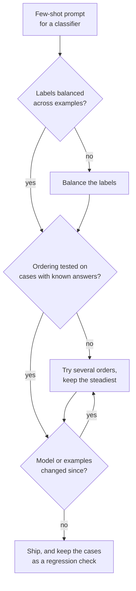

# पाठ 7. Few-Shot Biases

**मिशन से संबंध:** कौन-से examples जाएँ और किस क्रम में, ये ऐसे फ़ैसले हैं जो अकेले accuracy को झुला सकते हैं, इसलिए prompt के लेखक को उन biases का पता होना चाहिए जिनका जोखिम है, और पहले ठीक दिखने वाले क्रम पर भरोसा करने के बजाय क्रम को परखना चाहिए।
**मुख्य स्रोत:** [Paper: "Calibrate Before Use: Improving Few-Shot Performance of Language Models", Zhao et al., 2021](https://arxiv.org/abs/2102.09690)
**पूर्व-आवश्यकताएँ:** [पाठ 6](0006-what-examples-teach.md), [Few-shot prompt](../GLOSSARY.md)

## वार्म-अप

1. ▢ पाठ 6 ने गिनाया था कि examples क्या सिखाते हैं। उन तीन में से किसे वह examples का सेट बिगाड़ेगा जिसके सभी examples का label एक ही हो?

<details markdown="1"><summary>जाँचें</summary>

Label space: model को एक ही उत्तर ऐसा दिखता है जो आता है। उसे format और input distribution फिर भी दिखते हैं, इसीलिए विफलता टूटे हुए output जैसी नहीं, उत्तरों में झुकाव जैसी दिखती है।

</details>

2. ▢ पाठ 2 ने कहा था कि model instructions को उनकी जगह के आधार पर क्रम देता है। एक वजह बताएँ कि examples में position का असर भी क्यों संभव है।

<details markdown="1"><summary>जाँचें</summary>

सब कुछ एक token sequence है (पाठ 1), इसलिए position वह जानकारी है जिस पर model निर्भर करता है। Template में कुछ भी पहले example को आख़िरी के बराबर नहीं ठहराता, और model sequence को अंत से आगे बढ़ा रहा होता है।

</details>

## यह जानें

### एक ही prompt से तीन biases

Zhao et al. ने पाया कि GPT-3 पर few-shot accuracy examples के चुनाव, उनके क्रम और prompt format से लगभग संयोग के स्तर से लगभग state of the art तक झूल सकती है। वे इस अस्थिरता को कुछ उत्तरों की ओर झुकाव से जोड़ते हैं, और तीन नाम देते हैं।

| Bias | Model क्या करता है |
|---|---|
| Majority label | वह उत्तर predict करता है जो examples में सबसे ज़्यादा बार आता है |
| Recency | वह उत्तर predict करता है जो prompt के अंत के पास आता है |
| Common token | उन उत्तरों को तरजीह देता है जो उसके pre-training data में आम हैं, जैसे "Saint Lucia" के मुक़ाबले "United States" |

दोनों एक-दूसरे पर असर डालते हैं। चार examples वाले sentiment task में, positive, positive, positive, negative क्रम वाले prompt ने लगभग 90% predictions Negative की ओर भेजीं, जबकि चार में से तीन examples positive थे। Recency ने majority को पछाड़ दिया।

### अकेला क्रम accuracy हिला देता है

Lu et al. examples को स्थिर रखते हैं और सिर्फ़ उनका क्रम बदलते हैं। कुछ क्रम state of the art के क़रीब पहुँचते हैं और कुछ लगभग random अंदाज़े पर। व्यवहार के लिए तीन और खोजें मायने रखती हैं:

- यह उनके परखे हर model आकार पर दिखता है, उस समय के सबसे बड़े पर भी, हालाँकि बड़े models ने इसे कुछ घटाया।
- यह examples के किसी ख़ास उपसमूह से बँधा नहीं है: क्रम के हिसाब से वही examples अच्छे या बुरे हो सकते हैं।
- एक model के लिए अच्छा क्रम दूसरे पर नहीं जाता, इसलिए क्रम prompt और model, दोनों की मिली-जुली ख़ासियत है।

### संख्याएँ क्या नहीं बतातीं

दोनों पेपर GPT-3 युग के models पर परखे गए थे। वे दिखाते हैं कि यह तंत्र मौजूद है। वे यह नहीं दिखाते कि आज के chat model पर असर कितना बड़ा है, इसलिए जवाब यह है कि अपने model पर मापें, यह मानकर न चलें कि असर चला गया या उतना ही है।

### उपाय



- **Labels को संतुलित करें** ताकि कोई उत्तर बहुमत में न हो, और एक ही label की क़तार पर ख़त्म होने से बचें।
- **क्रम बदलें**, कुछ permutations में, और फैलाव देखें। चौड़ा फैलाव बताता है कि prompt क़िस्मत पर टिका है।
- **क्रमों को परखें** ऐसे cases पर जिनके उत्तर पता हैं, बेहतर होगा असली विफलताओं वाले। यह चरण 8 के regression set का छोटा रूप है।
- **Model बदलने पर दोबारा परखें**, क्योंकि Lu et al. ने पाया कि अच्छे क्रम models के बीच नहीं जाते।
- **Contextual calibration** Zhao et al. का उपाय है: "N/A" जैसा content-रहित input दें, देखें कि model कौन-सा उत्तर पसंद करता है, और उत्तरों के scores इस तरह समायोजित करें कि वह input एकसमान निकले। यह हर उत्तर के लिए model के scores पर काम करता है, इसलिए उस pipeline के लिए ठीक है जो उन्हें पढ़ सके, chat window के लिए नहीं।

## अभ्यास

1. ▢ पहले अनुमान लगाएँ, फिर चलाएँ। यह prompt एक chat window में paste करें और चलाने से पहले आख़िरी review का label अनुमान लगाएँ। फिर Negative example को सूची में सबसे ऊपर ले जाएँ और दोबारा चलाएँ।

    ```text
    Classify each review as Positive or Negative.

    Review: Great value, would buy again.
    Label: Positive

    Review: Works well and arrived early.
    Label: Positive

    Review: Does what it says on the box.
    Label: Positive

    Review: Broke after a week.
    Label: Negative

    Review: It is fine, nothing special.
    Label:
    ```

<details markdown="1"><summary>संकेत</summary>

आख़िरी example का label बाक़ी तीनों से अलग है, और test review न साफ़ तौर पर positive है न negative।

</details>

<details markdown="1"><summary>जाँचें</summary>

Zhao et al. की खोजें Negative की ओर झुकाव की भविष्यवाणी करती हैं, क्योंकि recency Positive के तीन-एक के बहुमत पर भारी पड़ सकती है। यह GPT-3 युग के models की प्रवृत्ति है, इसलिए आज का model Positive कह सकता है, या टाल-मटोल कर सकता है। उपयोगी नतीजा यह है कि क्रम बदलने पर उत्तर बदलता है या नहीं: अगर बदलता है, तो examples का क्रम एक अस्पष्ट मामले का फ़ैसला कर रहा है, यही वह जोखिम है जिसे यह पाठ नाम देता है।

</details>

2. ▢ आपके पास classifier के लिए 3 positive और 3 negative examples हैं। कौन-सा क्रम सबसे अच्छा शुरुआती बिंदु है?

    - a) पहले सारे positive examples, फिर सारे negative
    - b) Labels को बारी-बारी से रखें और कुछ बारी-बारी वाले क्रम ज्ञात cases पर परखें
    - c) सबसे आम label का सबसे साफ़ example आख़िर में रखें
    - d) Examples को लंबाई के हिसाब से क्रम दें और उसी एक क्रम का इस्तेमाल करें

<details markdown="1"><summary>जाँचें</summary>

**b)** यह labels को संतुलित करता है और क्रम को ऐसी चीज़ मानता है जिसे परखना है। (a) एक label की क़तार पर ख़त्म होता है, जो recency के असर वाली व्यवस्था है। (c) सबसे आम label को अंत में रखता है, जिससे majority और recency का दबाव एक साथ पड़ता है। (d) bias से अनजुड़ी वजह से एक क्रम चुनता है और उसे कभी जाँचता नहीं।

</details>

3. ▢ आप उन्हीं छह examples के तीन क्रमों को ज्ञात उत्तरों वाले 20 cases पर score करते हैं और 17, 16 और 11 सही पाते हैं। आप क्या निष्कर्ष निकालते हैं, और ship करने से पहले क्या करते हैं?

<details markdown="1"><summary>जाँचें</summary>

फैलाव (20 में से 11 से 17) ख़ुद ही खोज है: prompt क्रम के प्रति संवेदनशील है, इसलिए 17 इन 20 cases पर कुछ हद तक क़िस्मत हो सकती है। सिर्फ़ इसी प्रमाण पर सबसे ज़्यादा score वाला क्रम ship न करें। क्रमों को ज़्यादा cases पर score करें (20 cases छोटा नमूना है, इसलिए noise बड़ा है), ऐसा क्रम पसंद करें जो लगातार score करे, और model या examples बदलने पर जाँच दोबारा चलाएँ, क्योंकि एक model के लिए अच्छा क्रम दूसरे पर नहीं जाता।

</details>

4. ▢ Spam filter का एक prompt पहले एक वैध email और फिर पाँच spam emails दिखाता है। लगभग हर असली email spam label होकर लौटता है। उस ओर धकेलने वाले दोनों biases के नाम और एक सुधार बताएँ।

<details markdown="1"><summary>संकेत</summary>

Labels गिनें, फिर देखें कि examples किस label पर ख़त्म होते हैं।

</details>

<details markdown="1"><summary>जाँचें</summary>

Majority-label bias: छह में से पाँच examples spam हैं। Recency bias: prompt spam की क़तार पर ख़त्म होता है, और Zhao et al. के sentiment test में आख़िरी examples बहुमत पर भारी पड़ सकते थे। दोनों spam की ओर धकेलते हैं। सुधार: labels को संतुलित करें (उदाहरण के लिए हर एक के तीन), उन्हें बारी-बारी से रखें ताकि prompt क़तार पर ख़त्म न हो, और नतीजे को ज्ञात labels वाले emails पर परखें।

</details>

## असली दुनिया का अभ्यास

- [ ] जिस एक few-shot prompt पर आप निर्भर हैं उसके examples में labels गिनें। अगर किसी एक label के आधे से ज़्यादा हैं, तो उसे दोबारा संतुलित करें।
- [ ] एक few-shot prompt को उन्हीं पाँच inputs पर examples के दो अलग क्रमों के साथ चलाएँ, और नोट करें कि कोई उत्तर बदला या नहीं।
- [ ] कल: कोई ऐसा prompt चुनें जिसे आपने हफ़्तों से नहीं बदला और उसे ज्ञात उत्तरों वाले तीन inputs पर दोबारा चलाएँ। अगर अब कोई नाकाम हो, तो जाँचें कि model बदला तो नहीं, क्योंकि अच्छा क्रम models के बीच नहीं जाता।

## आगे बढ़ने के लिए

- [Few-Shot और Reasoning](../reference/few-shot-and-reasoning.md)
- [Paper: "Fantastically Ordered Prompts and Where to Find Them", Lu et al., 2021](https://arxiv.org/abs/2104.08786)
- [संसाधन](../RESOURCES.md)

---

बात नहीं बन रही? ऊपर दिए primary source को दोबारा पढ़ें, क्योंकि यह पाठ उसे संक्षिप्त करता है और समझ संक्षेप में ही रिसती है। जो शब्द फिसलन भरा लगे, उसके लिए [शब्दावली](../GLOSSARY.md) देखें।

अगर दिक़्क़त सामग्री की नहीं बल्कि पाठ की ही है, तो वह एक खोट है: [issue खोलें](https://github.com/TokenCemetery/teach/issues)।
