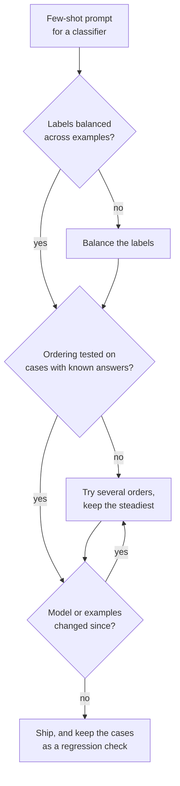

# Lesson 7. Few-Shot Biases

**Mission link:** Which examples go in and in what order are choices that can swing accuracy on their own, so a prompt author has to know the biases they risk and test the order instead of trusting the first one that looks fine.
**Primary source:** [Paper: "Calibrate Before Use: Improving Few-Shot Performance of Language Models", Zhao et al., 2021](https://arxiv.org/abs/2102.09690)
**Prerequisites:** [Lesson 6](0006-what-examples-teach.md), [Few-shot prompt](../GLOSSARY.md)

## Warm-up

1. ▢ Lesson 6 listed what examples teach. Which of those three would a set of examples that all carry the same label distort?

<details markdown="1"><summary>Check</summary>

The label space: the model sees one answer as the only one that appears. It still sees the format and the input distribution, which is why the failure looks like a skew in answers rather than a broken output.

</details>

2. ▢ Lesson 2 said the model ranks instructions by where they sit. Name one reason a position effect in the examples is plausible too.

<details markdown="1"><summary>Check</summary>

Everything is one token sequence (lesson 1), so position is information the model conditions on. Nothing in the template marks the first example as equal to the last, and the model is continuing the sequence from the end.

</details>

## Know this

### Three biases from the same prompt

Zhao et al. found that few-shot accuracy on GPT-3 can swing from near chance to near state of the art with the choice of examples, their order and the prompt format. They trace the instability to a bias toward certain answers, and name three.

| Bias | What the model does |
|---|---|
| Majority label | Predicts the answer that appears most often among the examples |
| Recency | Predicts the answer that appears near the end of the prompt |
| Common token | Prefers answers that are frequent in its pre-training data, such as "United States" over "Saint Lucia" |

The two interact. In a sentiment task with four examples, a prompt ordered positive, positive, positive, negative sent nearly 90% of predictions to Negative, even though three of the four examples were positive. Recency outweighed the majority.

### Order alone moves accuracy

Lu et al. hold the examples fixed and permute only their order. Some orders reach near state of the art and others are near random guessing. Three further findings matter for practice:

- It appears at every model size they tested, including the largest at the time, though larger models reduced it somewhat.
- It is not tied to a particular subset of examples: the same examples can be good or bad depending on order.
- A good order for one model does not transfer to another, so an order is a property of a prompt and a model together.

### What the numbers do not tell you

Both papers tested GPT-3 era models. They show the mechanism exists. They do not show how large the effect is on a current chat model, so the response is to measure on yours, not to assume the effect is gone or the same size.

### Mitigations



- **Balance the labels** so no answer is the majority, and avoid ending on a run of one label.
- **Vary the order** across a few permutations and look at the spread. A wide spread means the prompt leans on luck.
- **Test the orders** on cases with known answers, ideally ones from real failures. This is a small version of the regression set from stage 8.
- **Re-test when the model changes**, since Lu et al. found good orders do not transfer between models.
- **Contextual calibration** is Zhao et al.'s fix: feed a content-free input such as "N/A", see which answer the model prefers, and adjust the answer scores so that input comes out uniform. It works on the model's scores for each answer, so it suits a pipeline that can read them, not a chat window.

## Practice

1. ▢ Predict, then run. Paste this prompt into a chat window and predict the label for the last review before you run it. Then move the Negative example to the top of the list and run it again.

    ```text
    Classify each review as Positive or Negative.

    Review: Great value, would buy again.
    Label: Positive

    Review: Works well and arrived early.
    Label: Positive

    Review: Does what it says on the box.
    Label: Positive

    Review: Broke after a week.
    Label: Negative

    Review: It is fine, nothing special.
    Label:
    ```

<details markdown="1"><summary>Hint</summary>

The last example is a different label from the other three, and the test review is neither clearly positive nor clearly negative.

</details>

<details markdown="1"><summary>Check</summary>

Zhao et al.'s findings predict a lean toward Negative, because recency can outweigh the three-to-one majority for Positive. This is a tendency from GPT-3 era models, so a current model may answer Positive, or hedge. The useful result is whether the answer changes when you reorder: if it does, the example order is deciding an ambiguous case, which is exactly the risk this lesson names.

</details>

2. ▢ You have 3 positive and 3 negative examples for a classifier. Which ordering is the best starting point?

    - a) All the positive examples first, then all the negative ones
    - b) Alternate the labels and test a few alternations on known cases
    - c) Put the clearest example of the most common label last
    - d) Sort the examples by length and use that single order

<details markdown="1"><summary>Check</summary>

**b)** It balances labels and treats order as something to test. (a) ends on a run of one label, the setup behind the recency effect. (c) puts the most common label at the end, stacking majority and recency pressure. (d) picks one order for a reason unrelated to the bias and never checks it.

</details>

3. ▢ You score three orderings of the same six examples on 20 cases with known answers and get 17, 16 and 11 correct. What do you conclude, and what do you do before shipping?

<details markdown="1"><summary>Check</summary>

The spread (11 to 17 of 20) is itself the finding: the prompt is sensitive to order, so the 17 may be partly luck on these 20 cases. Do not ship the best-scoring order on that evidence alone. Score the orders on more cases (20 cases is a small sample, so the noise is large), prefer an order that scores steadily, and re-run the check whenever the model or the examples change, because a good order for one model does not carry over to another.

</details>

4. ▢ A spam filter prompt shows one legitimate email first, then five spam emails. Almost every real email comes back labelled spam. Name the two biases pushing that way and a fix.

<details markdown="1"><summary>Hint</summary>

Count the labels, then look at which label the examples end on.

</details>

<details markdown="1"><summary>Check</summary>

Majority-label bias: five of the six examples are spam. Recency bias: the prompt ends on a run of spam, and in Zhao et al.'s sentiment test the last examples could outweigh the majority. Both push toward spam. Fix: balance the labels (for instance three of each), alternate them so the prompt does not end on a run, and test the result on emails with known labels.

</details>

## Real-world reps

- [ ] Count the labels across the examples in one few-shot prompt you rely on. If one label has more than half of them, rebalance it.
- [ ] Run one few-shot prompt on the same five inputs with the examples in two different orders, and note whether any answer changed.
- [ ] Tomorrow: pick a prompt you have not changed in weeks and re-run it on three inputs with known answers. If any now fail, check whether the model changed, since a good order does not carry between models.

## Going further

- [Few-Shot and Reasoning](../reference/few-shot-and-reasoning.md)
- [Paper: "Fantastically Ordered Prompts and Where to Find Them", Lu et al., 2021](https://arxiv.org/abs/2104.08786)
- [Resources](../RESOURCES.md)

---

Not landing? Reread the primary source at the top, since this lesson compresses it and compression is where understanding leaks. Check the [glossary](../GLOSSARY.md) for any term that felt slippery.

If the lesson itself is unclear rather than the material, that is a defect: [open an issue](https://github.com/TokenCemetery/teach/issues).
