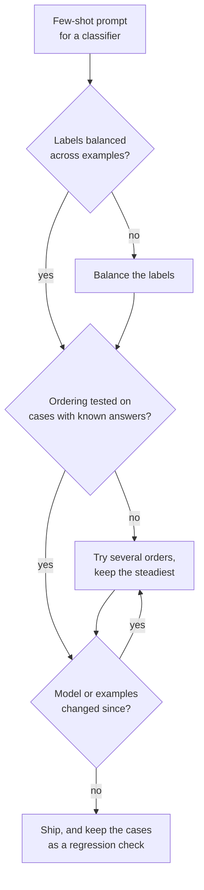

# Lição 7. Vieses do few-shot

**Ligação com a missão:** Quais exemplos entram e em que ordem são escolhas que, sozinhas, podem mudar a acurácia, então quem escreve prompts precisa conhecer os vieses a que se expõe e testar a ordem em vez de confiar na primeira que parece boa.
**Fonte principal:** [Paper: "Calibrate Before Use: Improving Few-Shot Performance of Language Models", Zhao et al., 2021](https://arxiv.org/abs/2102.09690)
**Pré-requisitos:** [Lição 6](0006-what-examples-teach.md), [Prompt few-shot](../GLOSSARY.md)

## Aquecimento

1. ▢ A lição 6 listou o que os exemplos ensinam. Qual desses três itens seria distorcido por um conjunto de exemplos que têm todos o mesmo rótulo?

<details markdown="1"><summary>Verificação</summary>

O espaço de rótulos: o modelo vê uma única resposta como a única que existe. Ele ainda vê o formato e a distribuição das entradas, e é por isso que a falha aparece como um viés nas respostas e não como uma saída quebrada.

</details>

2. ▢ A lição 2 disse que o modelo ordena as instruções pela posição em que aparecem. Cite um motivo pelo qual um efeito de posição nos exemplos também é plausível.

<details markdown="1"><summary>Verificação</summary>

Tudo é uma única sequência de tokens (lição 1), então a posição é informação em que o modelo se baseia. Nada no template marca o primeiro exemplo como igual ao último, e o modelo continua a sequência a partir do fim.

</details>

## Saiba isto

### Três vieses no mesmo prompt

Zhao et al. descobriram que a acurácia de few-shot no GPT-3 pode oscilar de quase o acaso até quase o estado da arte conforme a escolha dos exemplos, a ordem deles e o formato do prompt. Eles atribuem a instabilidade a um viés em favor de certas respostas e nomeiam três.

| Viés | O que o modelo faz |
|---|---|
| Rótulo majoritário | Prevê a resposta que aparece com mais frequência entre os exemplos |
| Recência | Prevê a resposta que aparece perto do fim do prompt |
| Token comum | Prefere respostas frequentes em seus dados de pré-treinamento, como "United States" em vez de "Saint Lucia" |

Os dois interagem. Em uma tarefa de sentimento com quatro exemplos, um prompt ordenado como positivo, positivo, positivo, negativo mandou quase 90% das previsões para Negativo, embora três dos quatro exemplos fossem positivos. A recência pesou mais que a maioria.

### Só a ordem já muda a acurácia

Lu et al. mantêm os exemplos fixos e permutam apenas a ordem. Algumas ordens chegam perto do estado da arte e outras ficam perto de um palpite aleatório. Três outras descobertas importam na prática:

- O efeito aparece em todos os tamanhos de modelo que eles testaram, inclusive o maior da época, embora modelos maiores o reduzissem um pouco.
- Ele não está ligado a um subconjunto específico de exemplos: os mesmos exemplos podem ser bons ou ruins conforme a ordem.
- Uma boa ordem para um modelo não se transfere para outro, então a ordem é uma propriedade do conjunto prompt e modelo.

### O que os números não dizem

Os dois artigos testaram modelos da era do GPT-3. Eles mostram que o mecanismo existe. Não mostram o tamanho do efeito em um modelo de chat atual, então a resposta é medir no seu, em vez de supor que o efeito sumiu ou que tem o mesmo tamanho.

### Mitigações



- **Equilibre os rótulos** para que nenhuma resposta seja a maioria, e evite terminar com uma sequência do mesmo rótulo.
- **Varie a ordem** em algumas permutações e observe a dispersão. Uma dispersão grande significa que o prompt depende de sorte.
- **Teste as ordens** em casos com respostas conhecidas, de preferência casos vindos de falhas reais. É uma versão pequena do conjunto de regressão da etapa 8.
- **Teste de novo quando o modelo mudar**, já que Lu et al. descobriram que boas ordens não se transferem entre modelos.
- **A calibração contextual** é a correção de Zhao et al.: envie uma entrada sem conteúdo, como "N/A", veja qual resposta o modelo prefere e ajuste as pontuações das respostas para que essa entrada fique uniforme. Ela atua sobre as pontuações do modelo para cada resposta, então serve a um pipeline que consegue lê-las, não a uma janela de chat.

## Prática

1. ▢ Preveja e depois execute. Cole este prompt em uma janela de chat e preveja o rótulo da última avaliação antes de executar. Depois mova o exemplo Negative para o topo da lista e execute de novo.

    ```text
    Classify each review as Positive or Negative.

    Review: Great value, would buy again.
    Label: Positive

    Review: Works well and arrived early.
    Label: Positive

    Review: Does what it says on the box.
    Label: Positive

    Review: Broke after a week.
    Label: Negative

    Review: It is fine, nothing special.
    Label:
    ```

<details markdown="1"><summary>Dica</summary>

O último exemplo tem um rótulo diferente dos outros três, e a avaliação de teste não é claramente positiva nem claramente negativa.

</details>

<details markdown="1"><summary>Verificação</summary>

As descobertas de Zhao et al. preveem uma inclinação para Negative, porque a recência pode pesar mais que a maioria de três para um a favor de Positive. Essa é uma tendência de modelos da era do GPT-3, então um modelo atual pode responder Positive ou ficar em cima do muro. O resultado útil é saber se a resposta muda quando você reordena: se mudar, a ordem dos exemplos está decidindo um caso ambíguo, que é exatamente o risco que esta lição nomeia.

</details>

2. ▢ Você tem 3 exemplos positivos e 3 negativos para um classificador. Qual ordenação é o melhor ponto de partida?

    - a) Todos os exemplos positivos primeiro, depois todos os negativos
    - b) Alternar os rótulos e testar algumas alternâncias em casos conhecidos
    - c) Colocar por último o exemplo mais claro do rótulo mais comum
    - d) Ordenar os exemplos por tamanho e usar essa única ordem

<details markdown="1"><summary>Verificação</summary>

**b)** Ela equilibra os rótulos e trata a ordem como algo a testar. (a) termina em uma sequência de um só rótulo, o cenário por trás do efeito de recência. (c) coloca o rótulo mais comum no fim, somando pressão de maioria e de recência. (d) escolhe uma ordem por um motivo sem relação com o viés e nunca a verifica.

</details>

3. ▢ Você pontua três ordenações dos mesmos seis exemplos em 20 casos com respostas conhecidas e obtém 17, 16 e 11 acertos. O que você conclui e o que faz antes de colocar em produção?

<details markdown="1"><summary>Verificação</summary>

A dispersão (de 11 a 17 em 20) é, por si só, a descoberta: o prompt é sensível à ordem, então o 17 pode ser em parte sorte nesses 20 casos. Não coloque em produção a ordem de maior pontuação só com essa evidência. Pontue as ordens em mais casos (20 casos é uma amostra pequena, então o ruído é grande), prefira uma ordem que pontue de forma estável e refaça a verificação sempre que o modelo ou os exemplos mudarem, porque uma boa ordem para um modelo não vale para outro.

</details>

4. ▢ Um prompt de filtro de spam mostra primeiro um e-mail legítimo e depois cinco e-mails de spam. Quase todo e-mail real volta rotulado como spam. Nomeie os dois vieses que empurram nessa direção e uma correção.

<details markdown="1"><summary>Dica</summary>

Conte os rótulos e depois veja em qual rótulo os exemplos terminam.

</details>

<details markdown="1"><summary>Verificação</summary>

Viés de rótulo majoritário: cinco dos seis exemplos são spam. Viés de recência: o prompt termina em uma sequência de spam e, no teste de sentimento de Zhao et al., os últimos exemplos puderam pesar mais que a maioria. Os dois empurram para spam. Correção: equilibre os rótulos (por exemplo, três de cada), alterne-os para que o prompt não termine em uma sequência e teste o resultado em e-mails com rótulos conhecidos.

</details>

## Prática no mundo real

- [ ] Conte os rótulos entre os exemplos de um prompt few-shot em que você confia. Se um rótulo tiver mais da metade deles, reequilibre.
- [ ] Execute um prompt few-shot nas mesmas cinco entradas com os exemplos em duas ordens diferentes e anote se alguma resposta mudou.
- [ ] Amanhã: escolha um prompt que você não muda há semanas e execute-o de novo em três entradas com respostas conhecidas. Se alguma falhar agora, verifique se o modelo mudou, já que uma boa ordem não passa de um modelo para outro.

## Para ir além

- [Few-Shot e Raciocínio](../reference/few-shot-and-reasoning.md)
- [Paper: "Fantastically Ordered Prompts and Where to Find Them", Lu et al., 2021](https://arxiv.org/abs/2104.08786)
- [Recursos](../RESOURCES.md)

---

Não ficou claro? Releia a fonte primária no topo, já que esta lição a comprime e é na compressão que o entendimento escapa. Consulte o [glossário](../GLOSSARY.md) para qualquer termo que tenha parecido escorregadio.

Se o problema é a própria lição e não o material, isso é um defeito: [abra uma issue](https://github.com/TokenCemetery/teach/issues).
