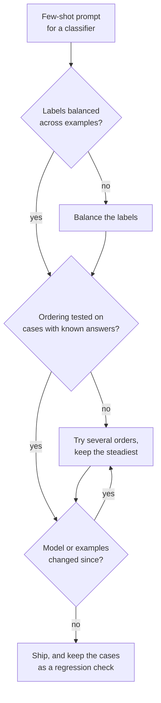

# Урок 7. Смещения few-shot-промптов

**Связь с целью курса:** Какие примеры войдут в промпт и в каком порядке, это выбор, который сам по себе может резко менять точность, поэтому автор промпта должен знать, какими смещениями рискует, и проверять порядок, а не доверять первому, который выглядит нормально.
**Первоисточник:** [Статья: "Calibrate Before Use: Improving Few-Shot Performance of Language Models", Zhao et al., 2021](https://arxiv.org/abs/2102.09690)
**Предварительные требования:** [Урок 6](0006-what-examples-teach.md), [Few-shot-промпт](../GLOSSARY.md)

## Разминка

1. ▢ В уроке 6 перечислено, чему учат примеры. Что из этих трёх искажает набор примеров, у которых одна и та же метка?

<details markdown="1"><summary>Проверка</summary>

Пространство меток: модель видит, что встречается только один ответ. Формат и распределение входов она по-прежнему видит, поэтому сбой выглядит как перекос в ответах, а не как испорченный вывод.

</details>

2. ▢ В уроке 2 говорилось, что модель ранжирует инструкции по их положению. Назовите одну причину, по которой эффект положения правдоподобен и для примеров.

<details markdown="1"><summary>Проверка</summary>

Всё это одна последовательность токенов (урок 1), так что положение это информация, от которой зависит модель. Ничто в шаблоне не отмечает первый пример как равный последнему, а модель продолжает последовательность с конца.

</details>

## Что нужно знать

### Три смещения из одного промпта

Zhao et al. обнаружили, что точность few-shot на GPT-3 может колебаться от почти случайной до почти рекордной в зависимости от выбора примеров, их порядка и формата промпта. Нестабильность они объясняют смещением к определённым ответам и называют три вида.

| Смещение | Что делает модель |
|---|---|
| К мажоритарной метке | Предсказывает ответ, который чаще всего встречается среди примеров |
| К недавнему | Предсказывает ответ, который стоит ближе к концу промпта |
| К частому токену | Предпочитает ответы, частые в данных предобучения, например «United States» вместо «Saint Lucia» |

Первые два взаимодействуют. В задаче на тональность с четырьмя примерами промпт с порядком «положительный, положительный, положительный, отрицательный» отправлял почти 90% предсказаний в Negative, хотя три примера из четырёх были положительными. Недавность перевесила большинство.

### Один только порядок двигает точность

Lu et al. фиксируют примеры и переставляют только их порядок. Некоторые порядки дают почти рекордный результат, а другие почти случайное угадывание. Ещё три вывода важны на практике:

- Эффект проявляется при любом размере модели из протестированных, включая самую большую на тот момент, хотя у больших моделей он несколько слабее.
- Он не привязан к конкретному подмножеству примеров: одни и те же примеры могут быть хорошими или плохими в зависимости от порядка.
- Хороший порядок для одной модели не переносится на другую, поэтому порядок это свойство пары «промпт и модель».

### Чего числа не говорят

Обе статьи тестировали модели эпохи GPT-3. Они показывают, что механизм существует. Они не показывают, насколько велик эффект на современной чат-модели, поэтому правильная реакция: измерить на своей модели, а не считать, что эффект исчез или того же размера.

### Способы смягчения



- **Балансируйте метки**, чтобы ни один ответ не был мажоритарным, и не заканчивайте серией одной метки.
- **Варьируйте порядок**: прогоните несколько перестановок и посмотрите на разброс. Широкий разброс значит, что промпт держится на удаче.
- **Проверяйте порядки** на случаях с известными ответами, лучше всего взятых из реальных сбоев. Это маленькая версия регрессионного набора из этапа 8.
- **Перепроверяйте при смене модели**, поскольку Lu et al. нашли, что хорошие порядки не переносятся между моделями.
- **Контекстная калибровка** это решение Zhao et al.: подайте вход без содержания, например «N/A», посмотрите, какой ответ модель предпочитает, и поправьте оценки ответов так, чтобы для этого входа они стали равномерными. Она работает с оценками модели для каждого ответа, поэтому подходит конвейеру, который умеет их читать, а не окну чата.

## Практика

1. ▢ Предскажите, затем запустите. Вставьте этот промпт в окно чата и предскажите метку для последнего отзыва до запуска. Затем переместите пример с Negative в начало списка и запустите снова.

    ```text
    Classify each review as Positive or Negative.

    Review: Great value, would buy again.
    Label: Positive

    Review: Works well and arrived early.
    Label: Positive

    Review: Does what it says on the box.
    Label: Positive

    Review: Broke after a week.
    Label: Negative

    Review: It is fine, nothing special.
    Label:
    ```

<details markdown="1"><summary>Подсказка</summary>

У последнего примера метка отличается от остальных трёх, а тестовый отзыв не ясно положительный и не ясно отрицательный.

</details>

<details markdown="1"><summary>Проверка</summary>

Выводы Zhao et al. предсказывают наклон к Negative, потому что недавность может перевесить большинство Positive три к одному. Это тенденция моделей эпохи GPT-3, поэтому современная модель может ответить Positive или уклониться. Полезно другое: меняется ли ответ при перестановке. Если меняется, порядок примеров решает неоднозначный случай, а именно этот риск и называет урок.

</details>

2. ▢ У вас есть 3 положительных и 3 отрицательных примера для классификатора. Какой порядок лучше взять за отправную точку?

    - a) Сначала все положительные примеры, потом все отрицательные
    - b) Чередовать метки и проверить несколько чередований на известных случаях
    - c) Поставить последним самый ясный пример самой частой метки
    - d) Отсортировать примеры по длине и использовать этот единственный порядок

<details markdown="1"><summary>Проверка</summary>

**b)** Он балансирует метки и считает порядок тем, что нужно проверять. Вариант (a) заканчивается серией одной метки, именно такая настройка стоит за эффектом недавности. Вариант (c) ставит самую частую метку в конец и складывает давление большинства и недавности. Вариант (d) выбирает один порядок по причине, не связанной со смещением, и никогда его не проверяет.

</details>

3. ▢ Вы оцениваете три порядка одних и тех же шести примеров на 20 случаях с известными ответами и получаете 17, 16 и 11 верных. Какой вывод вы делаете и что делаете перед выпуском?

<details markdown="1"><summary>Проверка</summary>

Сам разброс (от 11 до 17 из 20) и есть вывод: промпт чувствителен к порядку, поэтому 17 может быть отчасти удачей на этих 20 случаях. Не выпускайте порядок с лучшим результатом только на этом основании. Оцените порядки на большем числе случаев (20 случаев это малая выборка, шум велик), предпочтите порядок, который даёт стабильный результат, и повторяйте проверку при каждой смене модели или примеров, потому что хороший порядок для одной модели не переносится на другую.

</details>

4. ▢ Промпт спам-фильтра показывает сначала одно легитимное письмо, затем пять спам-писем. Почти каждое настоящее письмо возвращается с меткой «спам». Назовите два смещения, которые тянут в эту сторону, и способ исправить.

<details markdown="1"><summary>Подсказка</summary>

Посчитайте метки, затем посмотрите, на какой метке примеры заканчиваются.

</details>

<details markdown="1"><summary>Проверка</summary>

Смещение к мажоритарной метке: пять примеров из шести это спам. Смещение к недавнему: промпт заканчивается серией спама, а в тесте тональности Zhao et al. последние примеры могли перевесить большинство. Оба тянут к спаму. Исправление: сбалансировать метки (например, по три каждой), чередовать их, чтобы промпт не заканчивался серией, и проверить результат на письмах с известными метками.

</details>

## Практика в реальной работе

- [ ] Посчитайте метки среди примеров в одном few-shot-промпте, на который вы полагаетесь. Если у одной метки больше половины примеров, перебалансируйте.
- [ ] Запустите один few-shot-промпт на тех же пяти входах с примерами в двух разных порядках и отметьте, изменился ли какой-нибудь ответ.
- [ ] Завтра: возьмите промпт, который не менялся несколько недель, и перезапустите его на трёх входах с известными ответами. Если какие-то теперь не проходят, проверьте, не сменилась ли модель, поскольку хороший порядок не переносится между моделями.

## Что почитать дальше

- [Few-shot и рассуждение](../reference/few-shot-and-reasoning.md)
- [Статья: "Fantastically Ordered Prompts and Where to Find Them", Lu et al., 2021](https://arxiv.org/abs/2104.08786)
- [Ресурсы](../RESOURCES.md)

---

Не доходит? Перечитайте первоисточник в начале: этот урок его сжимает, а при сжатии понимание как раз и теряется. Загляните в [глоссарий](../GLOSSARY.md), если какой-то термин показался скользким.

Если неясен сам урок, а не материал, это дефект: [откройте issue](https://github.com/TokenCemetery/teach/issues).
