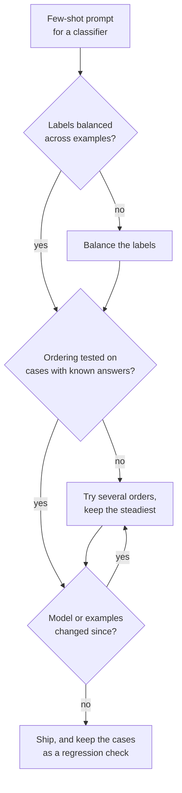

# 第 7 课：少样本偏差

**使命关联:** 放进哪些示例、按什么顺序放，这些选择本身就足以让准确率大幅波动，所以提示词作者必须知道自己可能面临哪些偏差，并且要测试顺序，而不是相信第一个看起来没问题的顺序。
**主要来源:** [论文：“Calibrate Before Use: Improving Few-Shot Performance of Language Models”，Zhao 等，2021](https://arxiv.org/abs/2102.09690)
**前置知识:** [第 6 课](0006-what-examples-teach.md)、[少样本提示词](../GLOSSARY.md)

## 热身

1. ▢ 第 6 课列出了示例教给模型的东西。如果一组示例全都带有同一个标签，会扭曲这三样中的哪一样？

<details markdown="1"><summary>检查</summary>

标签空间：模型看到的是只有一个答案出现过。它仍然能看到格式和输入分布，所以这种失败表现为答案的偏斜，而不是输出被破坏。

</details>

2. ▢ 第 2 课说过，模型会按指令所处的位置给它们排序。说出一个理由，说明示例中存在位置效应同样是合理的。

<details markdown="1"><summary>检查</summary>

一切都是同一条 token 序列（第 1 课），所以位置就是模型据以做条件判断的信息。模板里没有任何东西表明第一个示例与最后一个示例同等重要，而且模型是从末尾接着往下续写的。

</details>

## 要点

### 同一个提示词中的三种偏差

Zhao 等人发现，GPT-3 上少样本的准确率会随着示例的选择、顺序和提示词格式，从接近随机猜测一路波动到接近当时的最优水平。他们把这种不稳定性追溯到对某些答案的偏向，并指出了三种。

| 偏差 | 模型的表现 |
|---|---|
| 多数标签 | 预测在示例中出现次数最多的答案 |
| 近因 | 预测出现在提示词靠近末尾位置的答案 |
| 常见 token | 偏好在其预训练数据中常见的答案，比如 “United States” 胜过 “Saint Lucia” |

两者会相互作用。在一个有四个示例的情感任务中，按正面、正面、正面、负面排序的提示词，把近 90% 的预测都送向了 Negative，尽管四个示例中有三个是正面的。近因压过了多数。

### 仅仅是顺序就会让准确率波动

Lu 等人保持示例不变，只对它们的顺序做排列。有些顺序能达到接近当时的最优水平，另一些则接近随机猜测。还有三点发现对实践有意义：

- 在他们测试的每一种模型规模下都会出现，包括当时最大的模型，不过更大的模型在一定程度上减弱了这种现象。
- 它并不局限于某个特定的示例子集：同样的示例，随顺序不同可能表现好也可能表现差。
- 对某个模型来说好的顺序，不能迁移到另一个模型，所以顺序是提示词和模型共同的属性。

### 这些数字没有告诉你的事

两篇论文测试的都是 GPT-3 时代的模型。它们证明了这种机制存在，但没有说明它在当前聊天模型上的影响有多大，所以应对的办法是在你自己的模型上测量，而不是假定这种影响已经消失，或者大小不变。

### 缓解办法



- **平衡标签**：让没有哪个答案占多数，并避免以连续出现同一标签的一串示例收尾。
- **改变顺序**：试几种排列，观察波动幅度。波动幅度大，说明这个提示词在靠运气。
- **测试各种顺序**：在已知答案的用例上测试，最好用来自真实失败的用例。这是第 8 阶段回归集的一个小版本。
- **模型变化时重新测试**：因为 Lu 等人发现，好的顺序不能在模型之间迁移。
- **上下文校准**（contextual calibration）是 Zhao 等人的解决办法：输入一个没有内容的输入，比如 “N/A”，看模型偏好哪个答案，再调整各个答案的得分，使这个输入的结果变得均匀。它作用于模型对每个答案给出的得分，所以适合能读取这些得分的流水线，不适合聊天窗口。

## 练习

1. ▢ 先预测，再运行。把这个提示词粘贴到聊天窗口里，运行之前先预测最后一条评论的标签。然后把 Negative 示例移到列表最上面，再运行一次。

    ```text
    Classify each review as Positive or Negative.

    Review: Great value, would buy again.
    Label: Positive

    Review: Works well and arrived early.
    Label: Positive

    Review: Does what it says on the box.
    Label: Positive

    Review: Broke after a week.
    Label: Negative

    Review: It is fine, nothing special.
    Label:
    ```

<details markdown="1"><summary>提示</summary>

最后一个示例的标签和其他三个不同，而且待测的评论既不明显是正面，也不明显是负面。

</details>

<details markdown="1"><summary>检查</summary>

Zhao 等人的发现预测会偏向 Negative，因为近因可能压过 Positive 三比一的多数。这是 GPT-3 时代模型的倾向，所以当前的模型可能回答 Positive，或者含糊其辞。有用的结果是：重新排序之后答案是否变化。如果变了，说明示例顺序在决定一个模棱两可的用例，这正是本课点出的风险。

</details>

2. ▢ 你有 3 个正面和 3 个负面的示例用于一个分类器。哪种排序是最好的起点？

    - a) 所有正面示例在前，然后是所有负面示例
    - b) 交替排列标签，并在已知用例上测试几种交替方式
    - c) 把最常见标签中最清晰的示例放在最后
    - d) 按长度对示例排序，只使用这一种顺序

<details markdown="1"><summary>检查</summary>

**b)** 它平衡了标签，并把顺序当作需要测试的东西。(a) 以连续同一标签的一串示例收尾，这正是近因效应的成因。(c) 把最常见的标签放在末尾，叠加了多数和近因两种压力。(d) 出于与偏差无关的理由选定一种顺序，而且从不检验。

</details>

3. ▢ 你在 20 个已知答案的用例上，给同样六个示例的三种排序打分，分别答对 17、16 和 11 个。你得出什么结论，上线之前要做什么？

<details markdown="1"><summary>检查</summary>

波动幅度（20 个中的 11 到 17 个）本身就是发现：这个提示词对顺序敏感，所以那个 17 可能有一部分是在这 20 个用例上碰巧的运气。不要仅凭这点证据就上线得分最高的顺序。在更多用例上给各种顺序打分（20 个用例是很小的样本，所以噪声很大），优先选择得分稳定的顺序，并且每当模型或示例变化时就重新运行检查，因为对一个模型好的顺序不能带到另一个模型上。

</details>

4. ▢ 一个垃圾邮件过滤器的提示词先给出一封正常邮件，然后是五封垃圾邮件。几乎每封真实邮件都被标成了垃圾邮件。指出推动这个结果的两种偏差，并给出一个修复办法。

<details markdown="1"><summary>提示</summary>

数一数标签，再看示例是以哪个标签结尾的。

</details>

<details markdown="1"><summary>检查</summary>

多数标签偏差：六个示例中有五个是垃圾邮件。近因偏差：提示词以连续的垃圾邮件结尾，而在 Zhao 等人的情感测试中，最后几个示例可以压过多数。两者都把结果推向垃圾邮件。修复办法：平衡标签（比如各三封），交替排列，避免提示词以连续同一标签结尾，并在已知标签的邮件上测试结果。

</details>

## 实战练习

- [ ] 数一数你所依赖的某个少样本提示词里各示例的标签。如果某个标签占到一半以上，就重新平衡。
- [ ] 把一个少样本提示词的示例按两种不同的顺序，在同样的五个输入上各运行一次，记下是否有答案发生变化。
- [ ] 明天：挑一个你好几周没改过的提示词，在三个已知答案的输入上重新运行。如果现在有失败的，检查模型是否变了，因为好的顺序不能在模型之间迁移。

## 延伸阅读

- [少样本与推理](../reference/few-shot-and-reasoning.md)
- [论文：“Fantastically Ordered Prompts and Where to Find Them”，Lu 等，2021](https://arxiv.org/abs/2104.08786)
- [资源](../RESOURCES.md)

---

没学明白？请重读顶部的主要来源，因为本课是对它的压缩，而理解正是在压缩中流失的。如果有哪个术语觉得含糊，可以查看[术语表](../GLOSSARY.md)。

如果问题出在课程本身，而不是学习材料，那就是一个缺陷：[提交 issue](https://github.com/TokenCemetery/teach/issues)。
