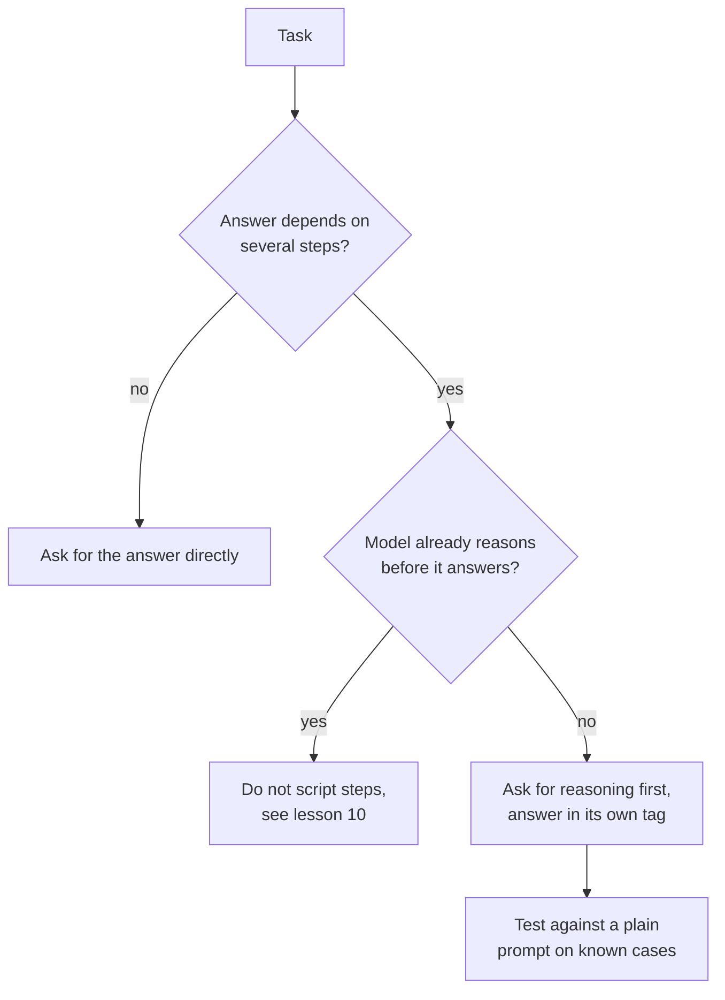

# Lección 8. Chain-of-thought

**Vínculo con la misión:** Pedir razonamiento es el cambio de prompt más barato que puede elevar la precisión y también el más fácil de aplicar donde no hace nada, así que la habilidad es decidir cuándo una tarea se lo gana.
**Fuente principal:** [Paper: "Chain-of-Thought Prompting Elicits Reasoning in Large Language Models", Wei et al., 2022](https://arxiv.org/abs/2201.11903)
**Requisitos previos:** [Lección 7](0007-few-shot-biases.md), [Chain-of-thought](../GLOSSARY.md), [Prompt zero-shot](../GLOSSARY.md)

## Calentamiento

1. ▢ La lección 3 dijo que una buena instrucción indica cómo se ve algo terminado. ¿Cómo se ve algo terminado para un prompt que pide razonamiento seguido de una respuesta que lee un programa?

<details markdown="1"><summary>Comprobación</summary>

El razonamiento y la respuesta final están separados, y la respuesta está en un lugar donde el programa puede encontrarla, por ejemplo dentro de su propia etiqueta (lección 4). Sin eso, el programa tiene que adivinar dónde termina el razonamiento.

</details>

2. ▢ La lección 6 dijo que los ejemplos enseñan formato, espacio de etiquetas y distribución de entrada. Si demuestras razonamiento en tus ejemplos, ¿cuál de esas tres cosas lo transporta?

<details markdown="1"><summary>Comprobación</summary>

El formato. La salida de cada ejemplo es ahora razonamiento seguido de una respuesta, así que el modelo continúa con esa forma. Por eso el estilo, la longitud y el final del razonamiento de los ejemplos importan tanto como las respuestas finales.

</details>

## Qué debes saber

### Qué es el chain-of-thought

**Chain-of-thought** es razonamiento intermedio que el modelo escribe antes de su respuesta final. Wei et al. lo provocaron con un prompt few-shot: cada ejemplo mostraba una solución resuelta, no solo la respuesta. Con ocho ejemplos así, un modelo de 540B parámetros alcanzó una precisión de estado del arte en GSM8K, un benchmark de problemas matemáticos con enunciado, por delante de un GPT-3 con fine-tuning y un verificador.

El razonamiento no es decoración. En una ablación los autores dieron la cadena de pensamiento solo después de la respuesta, y el rendimiento se mantuvo casi igual que con el prompting estándar. Así que el razonamiento tiene que ir antes de la respuesta para que ayude.

### Chain-of-thought zero-shot

Kojima et al. mostraron que los ejemplos no eran necesarios. Añadir "Let's think step by step" antes de cada respuesta elevó un **prompt zero-shot**: con text-davinci-002, MultiArith pasó de 17.7% a 78.7% y GSM8K de 10.4% a 40.7%.

```text
Q: A shop sells pens in packs of 12 and notebooks in packs of 5.
I need exactly 60 of each. How many packs of each do I buy in total?
A: Let's think step by step.
```

### Cuándo ayuda y cuándo solo añade tokens

Ambos papers apuntan en la misma dirección: ayuda en tareas que necesitan varios pasos.

- Wei et al. encontraron mayores ganancias en problemas más complicados. En GSM8K, el dataset con la línea base más baja, el rendimiento más que se duplicó en los modelos GPT y PaLM más grandes. En SingleOp, el subconjunto más fácil de MAWPS (un paso para resolverlo), las mejoras fueron negativas o muy pequeñas.
- Kojima et al. encontraron que Zero-shot-CoT igualaba al prompting simple en los dos datasets aritméticos que no necesitan cálculo de varios pasos, y que no daba ganancia en los dos datasets de sentido común que probaron.
- Wei et al. encontraron también que la escala importa: el chain-of-thought no ayudó a los modelos pequeños y solo dio ganancias hacia los 100B parámetros, porque los modelos más pequeños escribían cadenas fluidas pero ilógicas.

Esos resultados vienen de modelos de 2022, y el hallazgo de escala dice dónde empezó a funcionar la técnica, no dónde se sitúa un modelo actual dado. La lección portable es la de la tarea: el razonamiento tiene un costo en tokens de salida y latencia, y compra precisión sobre todo cuando la respuesta depende de pasos intermedios.



Ejecuta la prueba del último paso. Si el razonamiento ayuda a tu tarea en tu modelo es una pregunta empírica, y la lección 5 ya dijo que la edición de un prompt es una afirmación que probar.

## Práctica

1. ▢ Predice y luego ejecuta. Predice cuál de estos dos prompts acierta la aritmética más a menudo, luego ejecuta cada uno tres veces en chats nuevos.

    ```text
    Prompt A:
    A train leaves at 9:40 and the trip takes 2 hours 35 minutes.
    It then waits 50 minutes and a second leg takes 1 hour 20 minutes.
    What time does it arrive? Reply with only the time.

    Prompt B:
    A train leaves at 9:40 and the trip takes 2 hours 35 minutes.
    It then waits 50 minutes and a second leg takes 1 hour 20 minutes.
    What time does it arrive? Work through it step by step, then
    give the final time on its own line after "Answer:".
    ```

<details markdown="1"><summary>Pista</summary>

Cuenta de cuántos cálculos separados depende la respuesta y si el Prompt A le deja al modelo algún margen para hacerlos.

</details>

<details markdown="1"><summary>Comprobación</summary>

La respuesta correcta es 14:25. Los papers predicen que el Prompt B lo hace al menos igual de bien, porque la pregunta necesita tres sumas encadenadas y el Prompt A no deja margen para el trabajo intermedio. Un modelo actual puede acertar también con el Prompt A, sobre todo si razona internamente, así que la lectura correcta de un empate es que el razonamiento no compró nada aquí. Tu propio recuento sobre las ejecuciones es la evidencia.

</details>

2. ▢ Predice y luego ejecuta. Pregunta a un modelo de chat "What is the capital of Australia?" una vez de forma simple y otra con "Let's think step by step." Predice qué añade la segunda.

<details markdown="1"><summary>Comprobación</summary>

La misma respuesta (Canberra) con texto adicional. Las búsquedas de un solo paso son el caso en el que Wei et al. vieron ganancias negativas o insignificantes y Kojima et al. no vieron ganancia, así que lo que pagas son tokens de salida y latencia.

</details>

3. ▢ Un compañero añade "Let's think step by step" a cada prompt de una app, incluidos un clasificador de sentimiento y una tarea que extrae una fecha de un correo. ¿Cuál es el argumento en contra de hacerlo en esos dos y qué debería hacer en su lugar?

<details markdown="1"><summary>Comprobación</summary>

Ambas son casi tareas de un solo paso, donde los papers encontraron poca o ninguna ganancia, mientras que cada llamada ahora paga tokens de salida adicionales y respuestas más lentas. El texto extra además puede romper un parser que esperaba una etiqueta o una fecha sin más. En su lugar, debería añadir razonamiento solo a los prompts cuyas tareas necesiten varios pasos y, para cada cambio, compararlo con el prompt simple en casos conocidos antes de conservarlo.

</details>

4. ▢ ¿Qué afirmación sobre el chain-of-thought está respaldada por Wei et al.?

    - a) El razonamiento escrito después de la respuesta ayuda tanto como antes
    - b) Da sus mayores ganancias en los problemas más simples de un solo paso
    - c) Ayuda sobre todo en problemas de varios pasos y necesita un modelo suficientemente grande
    - d) Ayuda por igual a todos los modelos una vez que los ejemplos incluyen una cadena de razonamiento

<details markdown="1"><summary>Comprobación</summary>

**c)** Las ganancias fueron mayores en problemas más difíciles y aparecieron solo hacia los 100B parámetros. (a) está invertida: el razonamiento después de la respuesta rindió casi igual que el prompting estándar. (b) también está invertida: los problemas de un paso mostraron ganancias negativas o muy pequeñas. (d) contradice el hallazgo de escala, ya que los modelos más pequeños escribían cadenas fluidas pero ilógicas y rindieron peor que con el prompting estándar.

</details>

## Prácticas en el mundo real

- [ ] Elige un prompt tuyo que necesite varios pasos y añade una línea que pida razonar primero, con la respuesta final después de un marcador fijo. Ejecútalo sobre cinco casos cuyas respuestas ya conozcas.
- [ ] Encuentra un prompt tuyo que pida una sola búsqueda o etiqueta y comprueba si pide un razonamiento que no necesita.
- [ ] Mañana: ejecuta la misma pregunta de varios pasos con y sin la línea de razonamiento, tres chats nuevos cada una, y cuenta las respuestas correctas.

## Para profundizar

- [Few-Shot y razonamiento](../reference/few-shot-and-reasoning.md)
- [Paper: "Large Language Models are Zero-Shot Reasoners", Kojima et al., 2022](https://arxiv.org/abs/2205.11916)
- [Recursos](../RESOURCES.md)

---

¿No termina de quedar claro? Vuelve a leer la fuente primaria de arriba, ya que esta lección la comprime y en la compresión es donde se escapa la comprensión. Consulta el [glosario](../GLOSSARY.md) por si algún término te resultó resbaladizo.

Si lo poco claro es la propia lección y no el material, eso es un defecto: [abre un issue](https://github.com/TokenCemetery/teach/issues).
