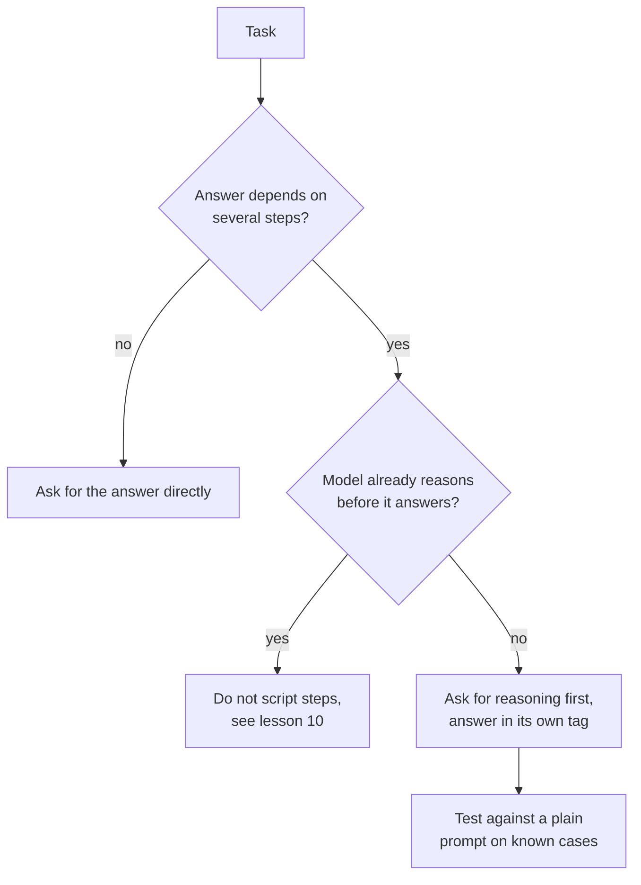

# Leçon 8. Chain-of-thought

**Lien avec la mission :** Demander du raisonnement est la modification de prompt la moins coûteuse qui puisse améliorer la précision, et aussi la plus facile à appliquer là où elle ne sert à rien. La compétence consiste donc à décider quand une tâche la mérite.
**Source primaire :** [Article : "Chain-of-Thought Prompting Elicits Reasoning in Large Language Models", Wei et al., 2022](https://arxiv.org/abs/2201.11903)
**Prérequis :** [Leçon 7](0007-few-shot-biases.md), [Chain-of-thought](../GLOSSARY.md), [Prompt zero-shot](../GLOSSARY.md)

## Échauffement

1. ▢ La leçon 3 disait qu'une bonne instruction énonce à quoi ressemble « terminé ». À quoi ressemble « terminé » pour un prompt qui demande du raisonnement suivi d'une réponse lue par un programme ?

<details markdown="1"><summary>Vérifier</summary>

Le raisonnement et la réponse finale sont séparés, et la réponse se trouve à un endroit que le programme peut repérer, par exemple dans sa propre balise (leçon 4). Sans cela, le programme doit deviner où le raisonnement se termine.

</details>

2. ▢ La leçon 6 disait que les exemples enseignent le format, l'espace des labels et la distribution des entrées. Si vous démontrez du raisonnement dans vos exemples, lequel de ces trois éléments le porte ?

<details markdown="1"><summary>Vérifier</summary>

Le format. La sortie de chaque exemple est désormais du raisonnement suivi d'une réponse, donc le modèle poursuit sous cette forme. C'est pourquoi le style de raisonnement des exemples, sa longueur et sa conclusion comptent autant que les réponses finales.

</details>

## À savoir

### Ce qu'est le chain-of-thought

Le **chain-of-thought** est un raisonnement intermédiaire que le modèle écrit avant sa réponse finale. Wei et al. l'ont suscité avec un prompt few-shot : chaque exemple montrait une solution détaillée, pas seulement la réponse. Avec huit exemples de ce type, un modèle de 540 Md de paramètres a atteint une précision à l'état de l'art sur GSM8K, un benchmark de problèmes de mathématiques en langage naturel, devant un GPT-3 fine-tuné avec un vérificateur.

Le raisonnement n'est pas décoratif. Dans une ablation, les auteurs ont donné la chaîne de raisonnement seulement après la réponse, et la performance est restée à peu près la même que celle du prompting standard. Le raisonnement doit donc venir avant la réponse pour aider.

### Chain-of-thought zero-shot

Kojima et al. ont montré que les exemples n'étaient pas indispensables. Ajouter « Let's think step by step » avant chaque réponse a amélioré un **prompt zero-shot** : avec text-davinci-002, MultiArith est passé de 17,7 % à 78,7 % et GSM8K de 10,4 % à 40,7 %.

```text
Q: A shop sells pens in packs of 12 and notebooks in packs of 5.
I need exactly 60 of each. How many packs of each do I buy in total?
A: Let's think step by step.
```

### Quand cela aide, quand cela ne fait qu'ajouter des tokens

Les deux articles vont dans le même sens : cela aide sur les tâches qui demandent plusieurs étapes.

- Wei et al. ont constaté des gains plus importants sur les problèmes plus compliqués. Sur GSM8K, le jeu de données au niveau de base le plus bas, la performance a plus que doublé pour les plus grands modèles GPT et PaLM. Sur SingleOp, le sous-ensemble le plus facile de MAWPS (une seule étape pour résoudre), les améliorations étaient négatives ou très faibles.
- Kojima et al. ont constaté que le Zero-shot-CoT était au niveau du prompting simple sur les deux jeux de données d'arithmétique qui ne demandent aucun calcul en plusieurs étapes, et n'apportait aucun gain sur les deux jeux de données de bon sens qu'ils ont testés.
- Wei et al. ont aussi constaté que l'échelle compte : le chain-of-thought n'aidait pas les petits modèles et ne gagnait qu'autour de 100 Md de paramètres, parce que les modèles plus petits écrivaient des chaînes fluides mais illogiques.

Ces résultats proviennent de modèles de 2022, et le constat sur l'échelle dit où la technique a commencé à fonctionner, pas où se situe un modèle actuel donné. La leçon transposable concerne la tâche : le raisonnement a un coût en tokens de sortie et en latence, et il n'achète de la précision que lorsque la réponse dépend d'étapes intermédiaires.



Faites le test de la dernière étape. Savoir si le raisonnement aide votre tâche sur votre modèle est une question empirique, et la leçon 5 disait déjà qu'une modification de prompt est une affirmation à tester.

## Pratique

1. ▢ Prédisez, puis exécutez. Prédisez lequel de ces deux prompts obtient le plus souvent la bonne arithmétique, puis exécutez chacun trois fois dans des chats neufs.

    ```text
    Prompt A:
    A train leaves at 9:40 and the trip takes 2 hours 35 minutes.
    It then waits 50 minutes and a second leg takes 1 hour 20 minutes.
    What time does it arrive? Reply with only the time.

    Prompt B:
    A train leaves at 9:40 and the trip takes 2 hours 35 minutes.
    It then waits 50 minutes and a second leg takes 1 hour 20 minutes.
    What time does it arrive? Work through it step by step, then
    give the final time on its own line after "Answer:".
    ```

<details markdown="1"><summary>Indice</summary>

Comptez de combien de calculs distincts dépend la réponse, et si le Prompt A laisse au modèle une marge pour les faire.

</details>

<details markdown="1"><summary>Vérifier</summary>

La bonne réponse est 14:25. Les articles prédisent que le Prompt B fait au moins aussi bien, car la question demande trois additions enchaînées et le Prompt A ne laisse aucune place à un travail intermédiaire. Un modèle actuel peut aussi réussir le Prompt A, surtout s'il raisonne en interne : la bonne lecture d'une égalité est donc que le raisonnement n'a rien apporté ici. Votre propre décompte sur les exécutions est la preuve.

</details>

2. ▢ Prédisez, puis exécutez. Demandez à un modèle de chat « What is the capital of Australia? » une fois simplement et une fois avec « Let's think step by step. » Prédisez ce qu'ajoute la seconde.

<details markdown="1"><summary>Vérifier</summary>

La même réponse (Canberra) avec du texte en plus. Les recherches en une seule étape sont le cas où Wei et al. ont observé des gains négatifs ou négligeables et où Kojima et al. n'ont observé aucun gain : ce que vous payez, ce sont des tokens de sortie et de la latence.

</details>

3. ▢ Un coéquipier ajoute « Let's think step by step » à chaque prompt d'une application, y compris un classifieur de sentiment et une tâche qui extrait une date d'un e-mail. Quel est l'argument contre le fait de le faire pour ces deux-là, et que devrait-il faire à la place ?

<details markdown="1"><summary>Vérifier</summary>

Les deux sont proches de tâches en une seule étape, où les articles ont trouvé peu ou pas de gain, alors que chaque appel paie désormais des tokens de sortie en plus et des réponses plus lentes. Le texte supplémentaire peut aussi casser un parseur qui attendait un label ou une date seuls. À la place, ajoutez du raisonnement uniquement aux prompts dont les tâches demandent plusieurs étapes, et pour chaque modification, comparez-la au prompt simple sur des cas connus avant de la conserver.

</details>

4. ▢ Quelle affirmation sur le chain-of-thought est soutenue par Wei et al. ?

    - a) Un raisonnement écrit après la réponse aide autant qu'avant
    - b) Il donne ses plus grands gains sur les problèmes les plus simples en une étape
    - c) Il aide surtout sur les problèmes en plusieurs étapes et demande un modèle assez grand
    - d) Il aide tous les modèles de la même façon dès que les exemples incluent une chaîne de raisonnement

<details markdown="1"><summary>Vérifier</summary>

**c)** Les gains étaient plus grands sur les problèmes plus difficiles et n'apparaissaient qu'autour de 100 Md de paramètres. (a) est inversé : le raisonnement après la réponse donnait à peu près la même performance que le prompting standard. (b) est inversé aussi : les problèmes en une étape montraient des gains négatifs ou très faibles. (d) contredit le constat sur l'échelle, puisque les modèles plus petits écrivaient des chaînes fluides mais illogiques et faisaient moins bien que le prompting standard.

</details>

## Exercices en situation réelle

- [ ] Choisissez un de vos prompts qui demande plusieurs étapes et ajoutez une ligne demandant d'abord le raisonnement, avec la réponse finale après un marqueur fixe. Exécutez-le sur cinq cas dont vous connaissez déjà les réponses.
- [ ] Trouvez un de vos prompts qui demande une seule recherche ou un seul label et vérifiez s'il demande un raisonnement dont il n'a pas besoin.
- [ ] Demain : exécutez la même question en plusieurs étapes avec et sans la ligne de raisonnement, trois chats neufs chacune, et comptez les bonnes réponses.

## Pour aller plus loin

- [Few-shot et raisonnement](../reference/few-shot-and-reasoning.md)
- [Article : "Large Language Models are Zero-Shot Reasoners", Kojima et al., 2022](https://arxiv.org/abs/2205.11916)
- [Ressources](../RESOURCES.md)

---

Ça ne passe pas ? Relisez la source primaire en haut de page, car cette leçon la condense et c'est dans la condensation que la compréhension s'échappe. Consultez le [glossaire](../GLOSSARY.md) pour tout terme qui vous a paru glissant.

Si c'est la leçon elle-même qui n'est pas claire plutôt que la matière, c'est un défaut : [ouvrez une issue](https://github.com/TokenCemetery/teach/issues).
