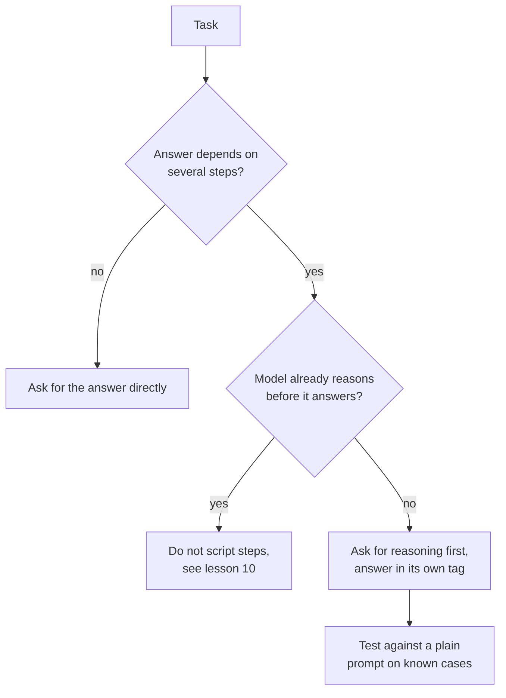

# पाठ 8. Chain-of-Thought

**मिशन से संबंध:** Reasoning माँगना वह सबसे सस्ता prompt बदलाव है जो accuracy बढ़ा सकता है, और उसे वहाँ लगाना भी सबसे आसान है जहाँ वह कुछ नहीं करता। इसलिए skill यह तय करना है कि कोई task उसके लायक कब है।
**मुख्य स्रोत:** [Paper: "Chain-of-Thought Prompting Elicits Reasoning in Large Language Models", Wei et al., 2022](https://arxiv.org/abs/2201.11903)
**पूर्व-आवश्यकताएँ:** [पाठ 7](0007-few-shot-biases.md), [Chain-of-thought](../GLOSSARY.md), [Zero-shot prompt](../GLOSSARY.md)

## वार्म-अप

1. ▢ पाठ 3 ने कहा था कि अच्छा instruction बताता है कि पूरा होना कैसा दिखता है। उस prompt के लिए पूरा होना कैसा दिखता है जो reasoning और उसके बाद ऐसा उत्तर माँगता है जिसे कोई program पढ़ता है?

<details markdown="1"><summary>जाँचें</summary>

Reasoning और अंतिम उत्तर अलग होते हैं, और उत्तर ऐसी जगह होता है जहाँ program उसे पा सके, उदाहरण के लिए अपने ही tag के भीतर (पाठ 4)। इसके बिना program को अंदाज़ा लगाना पड़ता है कि reasoning कहाँ ख़त्म होती है।

</details>

2. ▢ पाठ 6 ने कहा था कि examples format, label space और input distribution सिखाते हैं। अगर आप अपने examples में reasoning दिखाते हैं, तो उन तीनों में से कौन-सा उसे ढोता है?

<details markdown="1"><summary>जाँचें</summary>

Format। हर example का output अब reasoning और उसके बाद उत्तर है, इसलिए model उसी आकार में आगे बढ़ता है। इसीलिए examples की reasoning की शैली, लंबाई और अंत उतने ही मायने रखते हैं जितने अंतिम उत्तर।

</details>

## यह जानें

### Chain-of-thought क्या है

**Chain-of-thought** वह बीच की reasoning है जो model अपने अंतिम उत्तर से पहले लिखता है। Wei et al. ने इसे few-shot prompt से करवाया: हर example में सिर्फ़ उत्तर नहीं, हल किया हुआ समाधान दिखाया गया था। ऐसे आठ examples के साथ, 540B-parameter model GSM8K पर, जो गणित के शब्द-प्रश्नों का benchmark है, state-of-the-art accuracy तक पहुँचा, verifier वाले fine-tuned GPT-3 से आगे।

Reasoning सजावट नहीं है। एक ablation में लेखकों ने chain of thought सिर्फ़ उत्तर के बाद दिया, और performance लगभग standard prompting जैसा ही रहा। इसलिए मदद के लिए reasoning को उत्तर से पहले आना होगा।

### Zero-shot chain-of-thought

Kojima et al. ने दिखाया कि examples ज़रूरी नहीं थे। हर उत्तर से पहले "Let's think step by step" जोड़ने से **zero-shot prompt** बेहतर हुआ: text-davinci-002 के साथ, MultiArith 17.7% से 78.7% और GSM8K 10.4% से 40.7% पर पहुँचा।

```text
Q: A shop sells pens in packs of 12 and notebooks in packs of 5.
I need exactly 60 of each. How many packs of each do I buy in total?
A: Let's think step by step.
```

### कब मदद करता है, कब सिर्फ़ tokens बढ़ाता है

दोनों पेपर एक ही ओर इशारा करते हैं: यह उन tasks पर मदद करता है जिनमें कई चरण चाहिए।

- Wei et al. ने ज़्यादा जटिल समस्याओं पर बड़े फ़ायदे पाए। GSM8K पर, जिस dataset का baseline सबसे कम है, सबसे बड़े GPT और PaLM models के लिए performance दोगुने से ज़्यादा हुआ। SingleOp पर, जो सबसे आसान MAWPS उपसमूह है (हल करने का एक चरण), सुधार नकारात्मक या बहुत छोटे रहे।
- Kojima et al. ने Zero-shot-CoT को उन दो arithmetic datasets पर सादे prompting के बराबर पाया जिन्हें multi-step गणना नहीं चाहिए, और उनके परखे दो commonsense datasets पर कोई फ़ायदा नहीं।
- Wei et al. ने यह भी पाया कि scale मायने रखता है: chain-of-thought ने छोटे models की मदद नहीं की और लगभग 100B parameters पर ही फ़ायदा दिया, क्योंकि छोटे models ने धाराप्रवाह पर अतार्किक chains लिखीं।

वे नतीजे 2022 के models से आते हैं, और scale की खोज यह बताती है कि technique कहाँ काम करना शुरू हुई, यह नहीं कि कोई मौजूदा model कहाँ खड़ा है। साथ ले जाने लायक सबक़ task वाला है: reasoning की क़ीमत output tokens और latency में चुकानी पड़ती है, और वह accuracy मुख्य रूप से तभी ख़रीदती है जब उत्तर बीच के चरणों पर निर्भर हो।



आख़िरी चरण का test चलाएँ। आपके task पर आपके model में reasoning मदद करती है या नहीं, यह अनुभवजन्य सवाल है, और पाठ 5 पहले ही कह चुका है कि prompt edit एक परखने लायक दावा है।

## अभ्यास

1. ▢ पहले अनुमान लगाएँ, फिर चलाएँ। अनुमान लगाएँ कि इन दो prompts में से कौन arithmetic ज़्यादा बार सही करता है, फिर हर एक को नई chats में तीन बार चलाएँ।

    ```text
    Prompt A:
    A train leaves at 9:40 and the trip takes 2 hours 35 minutes.
    It then waits 50 minutes and a second leg takes 1 hour 20 minutes.
    What time does it arrive? Reply with only the time.

    Prompt B:
    A train leaves at 9:40 and the trip takes 2 hours 35 minutes.
    It then waits 50 minutes and a second leg takes 1 hour 20 minutes.
    What time does it arrive? Work through it step by step, then
    give the final time on its own line after "Answer:".
    ```

<details markdown="1"><summary>संकेत</summary>

गिनें कि उत्तर कितनी अलग-अलग गणनाओं पर निर्भर है, और क्या Prompt A model को उन्हें करने की कोई गुंजाइश छोड़ता है।

</details>

<details markdown="1"><summary>जाँचें</summary>

सही उत्तर 14:25 है। पेपर भविष्यवाणी करते हैं कि Prompt B कम से कम उतना ही अच्छा करता है, क्योंकि सवाल को तीन जुड़े हुए जोड़ चाहिए और Prompt A बीच के हिसाब की कोई गुंजाइश नहीं छोड़ता। आज का model Prompt A भी सही कर सकता है, ख़ासकर अगर वह भीतर ही भीतर reasoning करता हो, इसलिए बराबरी का सही अर्थ यह है कि यहाँ reasoning ने कुछ नहीं ख़रीदा। runs पर आपकी अपनी गिनती ही प्रमाण है।

</details>

2. ▢ पहले अनुमान लगाएँ, फिर चलाएँ। किसी chat model से "What is the capital of Australia?" एक बार सादे रूप में और एक बार "Let's think step by step." के साथ पूछें। अनुमान लगाएँ कि दूसरा क्या जोड़ता है।

<details markdown="1"><summary>जाँचें</summary>

वही उत्तर (Canberra), अतिरिक्त text के साथ। एक-चरण वाली lookups वह मामला हैं जहाँ Wei et al. ने नकारात्मक या नगण्य फ़ायदे देखे और Kojima et al. ने कोई फ़ायदा नहीं देखा, इसलिए जिसकी आप क़ीमत चुकाते हैं वह output tokens और latency है।

</details>

3. ▢ एक साथी app के हर prompt में "Let's think step by step" जोड़ देता है, जिसमें एक sentiment classifier और ईमेल से तारीख़ निकालने वाला task भी शामिल हैं। उन दोनों के साथ ऐसा करने के ख़िलाफ़ तर्क क्या है, और उसे इसके बजाय क्या करना चाहिए?

<details markdown="1"><summary>जाँचें</summary>

दोनों लगभग एक-चरण वाले tasks हैं, जहाँ पेपरों ने बहुत कम या कोई फ़ायदा नहीं पाया, जबकि अब हर call अतिरिक्त output tokens और धीमे replies की क़ीमत चुकाती है। अतिरिक्त text उस parser को भी तोड़ सकता है जो सिर्फ़ label या तारीख़ की उम्मीद करता था। इसके बजाय, reasoning सिर्फ़ उन prompts में जोड़ें जिनके tasks में कई चरण चाहिए, और हर बदलाव को रखने से पहले उसकी तुलना ज्ञात cases पर सादे prompt से करें।

</details>

4. ▢ Chain-of-thought के बारे में कौन-सा कथन Wei et al. से समर्थित है?

    - a) उत्तर के बाद लिखी reasoning उतनी ही मदद करती है जितनी पहले वाली
    - b) यह सबसे सरल एक-चरण वाली समस्याओं पर सबसे बड़े फ़ायदे देती है
    - c) यह multi-step समस्याओं पर सबसे ज़्यादा मदद करती है और इसे पर्याप्त बड़ा model चाहिए
    - d) examples में reasoning chain होने पर यह हर model की बराबर मदद करती है

<details markdown="1"><summary>जाँचें</summary>

**c)** फ़ायदे कठिन समस्याओं पर बड़े थे और सिर्फ़ लगभग 100B parameters पर दिखे। (a) उलटा है: उत्तर के बाद की reasoning का प्रदर्शन लगभग standard prompting जैसा था। (b) भी उलटा है: एक-चरण वाली समस्याओं पर नकारात्मक या बहुत छोटे फ़ायदे दिखे। (d) scale की खोज के उलट है, क्योंकि छोटे models ने धाराप्रवाह पर अतार्किक chains लिखीं और standard prompting से बदतर किया।

</details>

## असली दुनिया का अभ्यास

- [ ] अपना कोई ऐसा prompt चुनें जिसमें कई चरण चाहिए और पहले reasoning माँगने वाली एक पंक्ति जोड़ें, अंतिम उत्तर एक तय marker के बाद रखकर। उसे पाँच ऐसे cases पर चलाएँ जिनके उत्तर आपको पहले से पता हैं।
- [ ] अपना कोई एक prompt खोजें जो एक lookup या label माँगता है और जाँचें कि क्या वह ऐसी reasoning माँगता है जिसकी उसे ज़रूरत नहीं।
- [ ] कल: वही multi-step सवाल reasoning वाली पंक्ति के साथ और उसके बिना चलाएँ, हर एक की तीन नई chats, और सही उत्तर गिनें।

## आगे बढ़ने के लिए

- [Few-Shot और Reasoning](../reference/few-shot-and-reasoning.md)
- [Paper: "Large Language Models are Zero-Shot Reasoners", Kojima et al., 2022](https://arxiv.org/abs/2205.11916)
- [संसाधन](../RESOURCES.md)

---

बात नहीं बन रही? ऊपर दिए primary source को दोबारा पढ़ें, क्योंकि यह पाठ उसे संक्षिप्त करता है और समझ संक्षेप में ही रिसती है। जो शब्द फिसलन भरा लगे, उसके लिए [शब्दावली](../GLOSSARY.md) देखें।

अगर दिक़्क़त सामग्री की नहीं बल्कि पाठ की ही है, तो वह एक खोट है: [issue खोलें](https://github.com/TokenCemetery/teach/issues)।
