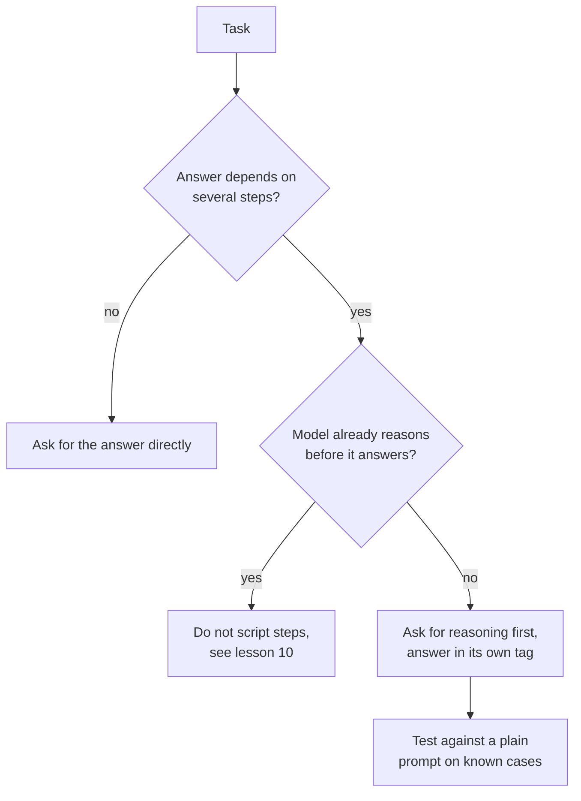

# Lesson 8. Chain-of-Thought

**Mission link:** Asking for reasoning is the cheapest prompt change that can lift accuracy and also the easiest to apply where it does nothing, so the skill is deciding when a task earns it.
**Primary source:** [Paper: "Chain-of-Thought Prompting Elicits Reasoning in Large Language Models", Wei et al., 2022](https://arxiv.org/abs/2201.11903)
**Prerequisites:** [Lesson 7](0007-few-shot-biases.md), [Chain-of-thought](../GLOSSARY.md), [Zero-shot prompt](../GLOSSARY.md)

## Warm-up

1. ▢ Lesson 3 said a good instruction states what done looks like. What does done look like for a prompt that asks for reasoning followed by an answer a program reads?

<details markdown="1"><summary>Check</summary>

The reasoning and the final answer are separate, and the answer sits in a place the program can find, for example inside its own tag (lesson 4). Without that, the program has to guess where the reasoning ends.

</details>

2. ▢ Lesson 6 said examples teach format, label space and input distribution. If you demonstrate reasoning in your examples, which of those three carries it?

<details markdown="1"><summary>Check</summary>

The format. Each example's output is now reasoning followed by an answer, so the model continues in that shape. That is why the examples' reasoning style, length and ending matter as much as the final answers.

</details>

## Know this

### What chain-of-thought is

**Chain-of-thought** is intermediate reasoning the model writes before its final answer. Wei et al. elicited it with a few-shot prompt: each example showed a worked solution, not only the answer. With eight such examples, a 540B-parameter model reached state-of-the-art accuracy on GSM8K, a benchmark of math word problems, ahead of a fine-tuned GPT-3 with a verifier.

The reasoning is not decoration. In one ablation the authors gave the chain of thought only after the answer, and performance stayed about the same as standard prompting. So the reasoning has to come before the answer for it to help.

### Zero-shot chain-of-thought

Kojima et al. showed the examples were not required. Adding "Let's think step by step" before each answer lifted a **zero-shot prompt**: with text-davinci-002, MultiArith went from 17.7% to 78.7% and GSM8K from 10.4% to 40.7%.

```text
Q: A shop sells pens in packs of 12 and notebooks in packs of 5.
I need exactly 60 of each. How many packs of each do I buy in total?
A: Let's think step by step.
```

### When it helps, when it only adds tokens

Both papers point the same way: it helps on tasks that need several steps.

- Wei et al. found larger gains on more complicated problems. On GSM8K, the dataset with the lowest baseline, performance more than doubled for the largest GPT and PaLM models. On SingleOp, the easiest MAWPS subset (one step to solve), improvements were negative or very small.
- Kojima et al. found Zero-shot-CoT on par with plain prompting on the two arithmetic datasets that need no multi-step calculation, and no gain on the two commonsense datasets they tested.
- Wei et al. also found scale matters: chain-of-thought did not help small models and only gained at about 100B parameters, because smaller models wrote fluent but illogical chains.

Those results come from 2022 models, and the scale finding says where the technique began to work, not where a given current model sits. The portable lesson is the task one: reasoning has a cost in output tokens and latency, and it buys accuracy mainly when the answer depends on intermediate steps.



Run the test in the last step. Whether reasoning helps your task on your model is an empirical question, and lesson 5 already said a prompt edit is a claim to test.

## Practice

1. ▢ Predict, then run. Predict which of these two prompts gets the arithmetic right more often, then run each three times in fresh chats.

    ```text
    Prompt A:
    A train leaves at 9:40 and the trip takes 2 hours 35 minutes.
    It then waits 50 minutes and a second leg takes 1 hour 20 minutes.
    What time does it arrive? Reply with only the time.

    Prompt B:
    A train leaves at 9:40 and the trip takes 2 hours 35 minutes.
    It then waits 50 minutes and a second leg takes 1 hour 20 minutes.
    What time does it arrive? Work through it step by step, then
    give the final time on its own line after "Answer:".
    ```

<details markdown="1"><summary>Hint</summary>

Count how many separate calculations the answer depends on, and whether Prompt A leaves the model any room to do them.

</details>

<details markdown="1"><summary>Check</summary>

The correct answer is 14:25. The papers predict Prompt B does at least as well, because the question needs three chained additions and Prompt A leaves no room for intermediate working. A current model may get Prompt A right as well, especially if it reasons internally, so the right reading of a tie is that reasoning bought nothing here. Your own tally over the runs is the evidence.

</details>

2. ▢ Predict, then run. Ask a chat model "What is the capital of Australia?" once plainly and once with "Let's think step by step." Predict what the second adds.

<details markdown="1"><summary>Check</summary>

Same answer (Canberra) with extra text. Single-step lookups are the case where Wei et al. saw negative or negligible gains and Kojima et al. saw no gain, so what you pay for is output tokens and latency.

</details>

3. ▢ A teammate adds "Let's think step by step" to every prompt in an app, including a sentiment classifier and a task that extracts a date from an email. What is the argument against doing that to those two, and what should they do instead?

<details markdown="1"><summary>Check</summary>

Both are close to single-step tasks, where the papers found little or no gain, while every call now pays for extra output tokens and slower replies. The extra text can also break a parser that expected a bare label or date. Instead, add reasoning only to the prompts whose tasks need several steps, and for each change compare it against the plain prompt on known cases before keeping it.

</details>

4. ▢ Which statement about chain-of-thought is supported by Wei et al.?

    - a) Reasoning written after the answer helps as much as before
    - b) It gives its largest gains on the simplest one-step problems
    - c) It helps most on multi-step problems and needs a large enough model
    - d) It helps every model equally once examples include a reasoning chain

<details markdown="1"><summary>Check</summary>

**c)** Gains were larger on harder problems and appeared only at around 100B parameters. (a) is reversed: reasoning after the answer performed about the same as standard prompting. (b) is reversed too: one-step problems showed negative or very small gains. (d) contradicts the scale finding, since smaller models wrote fluent but illogical chains and did worse than standard prompting.

</details>

## Real-world reps

- [ ] Pick a prompt of yours that needs several steps and add one line asking for reasoning first, with the final answer after a fixed marker. Run it on five cases you already know the answers to.
- [ ] Find one prompt of yours that asks for a single lookup or label and check whether it asks for reasoning it does not need.
- [ ] Tomorrow: run the same multi-step question with and without the reasoning line, three fresh chats each, and tally the correct answers.

## Going further

- [Few-Shot and Reasoning](../reference/few-shot-and-reasoning.md)
- [Paper: "Large Language Models are Zero-Shot Reasoners", Kojima et al., 2022](https://arxiv.org/abs/2205.11916)
- [Resources](../RESOURCES.md)

---

Not landing? Reread the primary source at the top, since this lesson compresses it and compression is where understanding leaks. Check the [glossary](../GLOSSARY.md) for any term that felt slippery.

If the lesson itself is unclear rather than the material, that is a defect: [open an issue](https://github.com/TokenCemetery/teach/issues).
