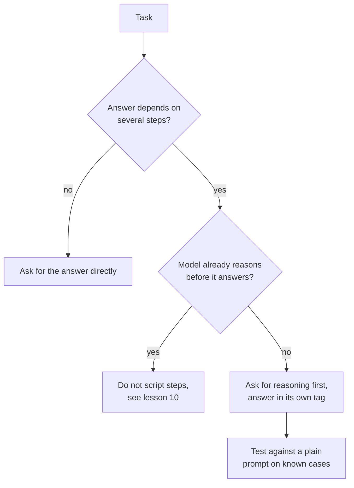

# Lição 8. Chain-of-thought

**Ligação com a missão:** Pedir raciocínio é a mudança de prompt mais barata que pode aumentar a acurácia e também a mais fácil de aplicar onde não faz nada, então a habilidade está em decidir quando uma tarefa merece isso.
**Fonte principal:** [Paper: "Chain-of-Thought Prompting Elicits Reasoning in Large Language Models", Wei et al., 2022](https://arxiv.org/abs/2201.11903)
**Pré-requisitos:** [Lição 7](0007-few-shot-biases.md), [Chain-of-thought](../GLOSSARY.md), [Prompt zero-shot](../GLOSSARY.md)

## Aquecimento

1. ▢ A lição 3 disse que uma boa instrução afirma como é o "pronto". Como é o "pronto" para um prompt que pede raciocínio seguido de uma resposta que um programa lê?

<details markdown="1"><summary>Verificação</summary>

O raciocínio e a resposta final ficam separados, e a resposta está em um lugar que o programa consegue encontrar, por exemplo dentro de uma tag própria (lição 4). Sem isso, o programa precisa adivinhar onde o raciocínio termina.

</details>

2. ▢ A lição 6 disse que os exemplos ensinam formato, espaço de rótulos e distribuição das entradas. Se você demonstra raciocínio nos exemplos, qual desses três o carrega?

<details markdown="1"><summary>Verificação</summary>

O formato. A saída de cada exemplo agora é raciocínio seguido de uma resposta, então o modelo continua nesse formato. É por isso que o estilo, o tamanho e o fechamento do raciocínio dos exemplos importam tanto quanto as respostas finais.

</details>

## Saiba isto

### O que é chain-of-thought

**Chain-of-thought** é o raciocínio intermediário que o modelo escreve antes da resposta final. Wei et al. o provocaram com um prompt few-shot: cada exemplo mostrava uma solução desenvolvida, não apenas a resposta. Com oito exemplos assim, um modelo de 540B parâmetros alcançou acurácia de estado da arte no GSM8K, um benchmark de problemas de matemática em texto, à frente de um GPT-3 com fine-tuning e um verificador.

O raciocínio não é decoração. Em uma ablação, os autores deram o chain-of-thought só depois da resposta, e o desempenho ficou quase igual ao do prompt padrão. Então o raciocínio precisa vir antes da resposta para ajudar.

### Chain-of-thought zero-shot

Kojima et al. mostraram que os exemplos não eram necessários. Acrescentar "Let's think step by step" antes de cada resposta melhorou um **prompt zero-shot**: com o text-davinci-002, o MultiArith foi de 17,7% para 78,7% e o GSM8K de 10,4% para 40,7%.

```text
Q: A shop sells pens in packs of 12 and notebooks in packs of 5.
I need exactly 60 of each. How many packs of each do I buy in total?
A: Let's think step by step.
```

### Quando ajuda e quando só acrescenta tokens

Os dois artigos apontam na mesma direção: ajuda em tarefas que exigem vários passos.

- Wei et al. encontraram ganhos maiores em problemas mais complicados. No GSM8K, o conjunto de dados com a menor linha de base, o desempenho mais que dobrou para os maiores modelos GPT e PaLM. No SingleOp, o subconjunto mais fácil do MAWPS (um passo para resolver), as melhorias foram negativas ou muito pequenas.
- Kojima et al. encontraram o Zero-shot-CoT no mesmo nível do prompt simples nos dois conjuntos de aritmética que não exigem cálculo em vários passos, e nenhum ganho nos dois conjuntos de senso comum que testaram.
- Wei et al. também descobriram que a escala importa: o chain-of-thought não ajudou modelos pequenos e só trouxe ganho a partir de cerca de 100B parâmetros, porque os modelos menores escreviam cadeias fluentes, mas ilógicas.

Esses resultados vêm de modelos de 2022, e a descoberta sobre escala diz onde a técnica começou a funcionar, não onde está um modelo atual específico. A lição portátil é a da tarefa: raciocinar tem um custo em tokens de saída e latência, e compra acurácia principalmente quando a resposta depende de passos intermediários.



Faça o teste do último passo. Se o raciocínio ajuda na sua tarefa, no seu modelo, é uma questão empírica, e a lição 5 já disse que uma edição de prompt é uma afirmação a testar.

## Prática

1. ▢ Preveja e depois execute. Preveja qual destes dois prompts acerta a aritmética com mais frequência e então execute cada um três vezes em chats novos.

    ```text
    Prompt A:
    A train leaves at 9:40 and the trip takes 2 hours 35 minutes.
    It then waits 50 minutes and a second leg takes 1 hour 20 minutes.
    What time does it arrive? Reply with only the time.

    Prompt B:
    A train leaves at 9:40 and the trip takes 2 hours 35 minutes.
    It then waits 50 minutes and a second leg takes 1 hour 20 minutes.
    What time does it arrive? Work through it step by step, then
    give the final time on its own line after "Answer:".
    ```

<details markdown="1"><summary>Dica</summary>

Conte de quantos cálculos separados a resposta depende e se o Prompt A deixa algum espaço para o modelo fazê-los.

</details>

<details markdown="1"><summary>Verificação</summary>

A resposta correta é 14:25. Os artigos preveem que o Prompt B se sai pelo menos tão bem, porque a pergunta exige três somas encadeadas e o Prompt A não deixa espaço para contas intermediárias. Um modelo atual pode acertar o Prompt A também, sobretudo se raciocina internamente, então a leitura certa de um empate é que o raciocínio não rendeu nada aqui. A sua própria contagem ao longo das execuções é a evidência.

</details>

2. ▢ Preveja e depois execute. Pergunte a um modelo de chat "What is the capital of Australia?" uma vez de forma direta e outra com "Let's think step by step." Preveja o que a segunda acrescenta.

<details markdown="1"><summary>Verificação</summary>

A mesma resposta (Canberra) com texto extra. Consultas de um só passo são o caso em que Wei et al. viram ganhos negativos ou desprezíveis e Kojima et al. não viram ganho, então o que você paga são tokens de saída e latência.

</details>

3. ▢ Um colega acrescenta "Let's think step by step" a todo prompt de um app, inclusive a um classificador de sentimento e a uma tarefa que extrai uma data de um e-mail. Qual é o argumento contra fazer isso nesses dois casos e o que ele deveria fazer em vez disso?

<details markdown="1"><summary>Verificação</summary>

Os dois são quase tarefas de um só passo, em que os artigos encontraram pouco ou nenhum ganho, enquanto cada chamada agora paga por tokens de saída extras e respostas mais lentas. O texto extra também pode quebrar um parser que esperava um rótulo ou uma data puros. Em vez disso, acrescente raciocínio apenas aos prompts cujas tarefas exigem vários passos e, para cada mudança, compare com o prompt simples em casos conhecidos antes de mantê-la.

</details>

4. ▢ Qual afirmação sobre chain-of-thought é sustentada por Wei et al.?

    - a) O raciocínio escrito depois da resposta ajuda tanto quanto antes
    - b) Ele dá os maiores ganhos nos problemas mais simples, de um só passo
    - c) Ajuda mais em problemas de vários passos e exige um modelo grande o bastante
    - d) Ajuda todos os modelos igualmente quando os exemplos incluem uma cadeia de raciocínio

<details markdown="1"><summary>Verificação</summary>

**c)** Os ganhos foram maiores em problemas mais difíceis e só apareceram a partir de cerca de 100B parâmetros. (a) está invertida: o raciocínio depois da resposta teve desempenho quase igual ao do prompt padrão. (b) também está invertida: problemas de um só passo tiveram ganhos negativos ou muito pequenos. (d) contradiz a descoberta sobre escala, já que os modelos menores escreviam cadeias fluentes, mas ilógicas, e foram pior que o prompt padrão.

</details>

## Prática no mundo real

- [ ] Escolha um prompt seu que exige vários passos e acrescente uma linha pedindo raciocínio primeiro, com a resposta final depois de um marcador fixo. Execute em cinco casos cujas respostas você já conhece.
- [ ] Encontre um prompt seu que pede uma única consulta ou rótulo e verifique se ele pede um raciocínio de que não precisa.
- [ ] Amanhã: execute a mesma pergunta de vários passos com e sem a linha de raciocínio, três chats novos para cada, e conte as respostas corretas.

## Para ir além

- [Few-Shot e Raciocínio](../reference/few-shot-and-reasoning.md)
- [Paper: "Large Language Models are Zero-Shot Reasoners", Kojima et al., 2022](https://arxiv.org/abs/2205.11916)
- [Recursos](../RESOURCES.md)

---

Não ficou claro? Releia a fonte primária no topo, já que esta lição a comprime e é na compressão que o entendimento escapa. Consulte o [glossário](../GLOSSARY.md) para qualquer termo que tenha parecido escorregadio.

Se o problema é a própria lição e não o material, isso é um defeito: [abra uma issue](https://github.com/TokenCemetery/teach/issues).
