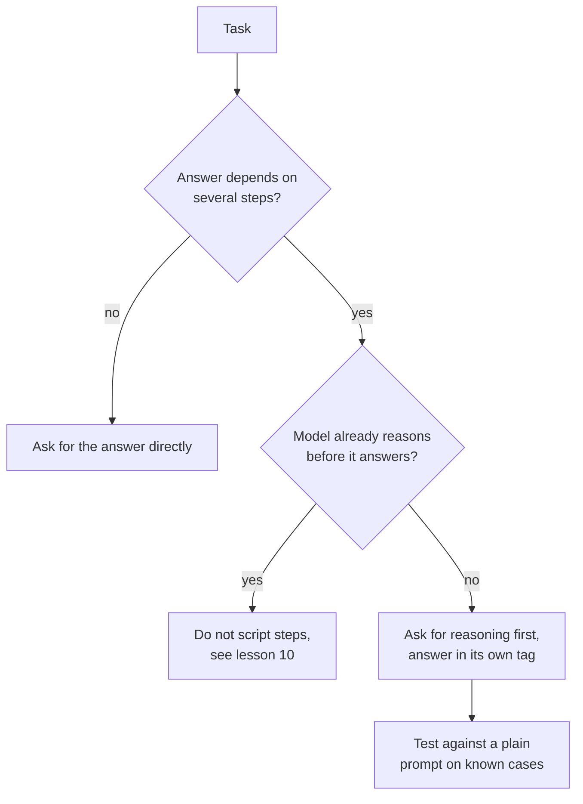

# Урок 8. Цепочка рассуждений

**Связь с целью курса:** Просьба о рассуждении это самое дешёвое изменение промпта, способное поднять точность, и одновременно самое легкое для применения там, где оно ничего не даёт, поэтому навык состоит в том, чтобы решать, когда задача его заслуживает.
**Первоисточник:** [Статья: "Chain-of-Thought Prompting Elicits Reasoning in Large Language Models", Wei et al., 2022](https://arxiv.org/abs/2201.11903)
**Предварительные требования:** [Урок 7](0007-few-shot-biases.md), [Цепочка рассуждений](../GLOSSARY.md), [Zero-shot-промпт](../GLOSSARY.md)

## Разминка

1. ▢ В уроке 3 говорилось, что хорошая инструкция описывает, как выглядит готовый результат. Как выглядит готовый результат для промпта, который просит рассуждение, а затем ответ, читаемый программой?

<details markdown="1"><summary>Проверка</summary>

Рассуждение и итоговый ответ разделены, а ответ лежит там, где программа может его найти, например в собственном теге (урок 4). Без этого программе приходится гадать, где кончается рассуждение.

</details>

2. ▢ В уроке 6 говорилось, что примеры учат формату, пространству меток и распределению входов. Если вы показываете рассуждение в примерах, что из этих трёх его несёт?

<details markdown="1"><summary>Проверка</summary>

Формат. Выход каждого примера теперь это рассуждение, за которым следует ответ, и модель продолжает в той же форме. Поэтому стиль, длина и завершение рассуждения в примерах важны не меньше, чем итоговые ответы.

</details>

## Что нужно знать

### Что такое цепочка рассуждений

**Цепочка рассуждений** (chain-of-thought) это промежуточные рассуждения, которые модель пишет перед окончательным ответом. Wei et al. вызывали её few-shot-промптом: каждый пример показывал разобранное решение, а не только ответ. С восемью такими примерами модель на 540B параметров достигла рекордной точности на GSM8K, бенчмарке текстовых математических задач, обогнав дообученную GPT-3 с верификатором.

Рассуждение не украшение. В одной абляции авторы давали цепочку рассуждений только после ответа, и качество оставалось примерно таким же, как при обычном промптинге. Так что рассуждение должно идти перед ответом, чтобы помогать.

### Zero-shot-цепочка рассуждений

Kojima et al. показали, что примеры не обязательны. Добавление «Let's think step by step» перед каждым ответом улучшило **zero-shot-промпт**: на text-davinci-002 MultiArith вырос с 17,7% до 78,7%, а GSM8K с 10,4% до 40,7%.

```text
Q: A shop sells pens in packs of 12 and notebooks in packs of 5.
I need exactly 60 of each. How many packs of each do I buy in total?
A: Let's think step by step.
```

### Когда это помогает, а когда только добавляет токены

Обе статьи указывают в одну сторону: помогает на задачах, требующих нескольких шагов.

- Wei et al. нашли больший выигрыш на более сложных задачах. На GSM8K, наборе с самым низким базовым уровнем, качество выросло более чем вдвое у самых больших моделей GPT и PaLM. На SingleOp, самом лёгком подмножестве MAWPS (решается за один шаг), улучшения были отрицательными или очень малыми.
- Kojima et al. нашли, что Zero-shot-CoT на уровне обычного промптинга на двух арифметических наборах, где не нужно многошаговых вычислений, и не даёт выигрыша на двух протестированных наборах на здравый смысл.
- Wei et al. также обнаружили, что важен масштаб: цепочка рассуждений не помогала малым моделям и давала выигрыш только примерно от 100B параметров, потому что меньшие модели писали гладкие, но нелогичные цепочки.

Эти результаты получены на моделях 2022 года, а вывод о масштабе говорит, с чего техника начала работать, а не где находится конкретная нынешняя модель. Переносимый урок касается задачи: рассуждение стоит выходных токенов и задержки, и покупает точность главным образом тогда, когда ответ зависит от промежуточных шагов.



Выполните проверку на последнем шаге. Помогает ли рассуждение вашей задаче на вашей модели, это эмпирический вопрос, а урок 5 уже говорил, что правка промпта это утверждение, которое нужно проверять.

## Практика

1. ▢ Предскажите, затем запустите. Предскажите, какой из двух промптов чаще даёт верную арифметику, затем запустите каждый по три раза в новых чатах.

    ```text
    Prompt A:
    A train leaves at 9:40 and the trip takes 2 hours 35 minutes.
    It then waits 50 minutes and a second leg takes 1 hour 20 minutes.
    What time does it arrive? Reply with only the time.

    Prompt B:
    A train leaves at 9:40 and the trip takes 2 hours 35 minutes.
    It then waits 50 minutes and a second leg takes 1 hour 20 minutes.
    What time does it arrive? Work through it step by step, then
    give the final time on its own line after "Answer:".
    ```

<details markdown="1"><summary>Подсказка</summary>

Сосчитайте, от скольких отдельных вычислений зависит ответ и оставляет ли Промпт A модели место для них.

</details>

<details markdown="1"><summary>Проверка</summary>

Правильный ответ: 14:25. Статьи предсказывают, что Промпт B справится не хуже, потому что вопрос требует трёх последовательных сложений, а Промпт A не оставляет места для промежуточных выкладок. Современная модель может верно ответить и на Промпт A, особенно если она рассуждает внутри себя, поэтому правильное прочтение ничьей такое: рассуждение здесь ничего не дало. Доказательство это ваш собственный подсчёт по запускам.

</details>

2. ▢ Предскажите, затем запустите. Спросите чат-модель «What is the capital of Australia?» один раз просто и один раз с «Let's think step by step.» Предскажите, что добавит второй вариант.

<details markdown="1"><summary>Проверка</summary>

Тот же ответ (Canberra) с лишним текстом. Одношаговые справки это тот случай, где Wei et al. видели отрицательный или ничтожный выигрыш, а Kojima et al. не видели выигрыша, так что платите вы выходными токенами и задержкой.

</details>

3. ▢ Коллега добавляет «Let's think step by step» в каждый промпт приложения, включая классификатор тональности и задачу извлечения даты из письма. Какой довод против того, чтобы делать это с этими двумя, и что им следует делать вместо этого?

<details markdown="1"><summary>Проверка</summary>

Обе задачи близки к одношаговым, где статьи нашли малый выигрыш или никакого, а каждый вызов теперь платит за лишние выходные токены и более медленные ответы. Лишний текст может также сломать парсер, ожидавший голую метку или дату. Вместо этого добавляйте рассуждение только в промпты с задачами из нескольких шагов, а каждое изменение перед тем, как оставить, сравнивайте с обычным промптом на известных случаях.

</details>

4. ▢ Какое утверждение о цепочке рассуждений подтверждается Wei et al.?

    - a) Рассуждение, записанное после ответа, помогает так же, как до него
    - b) Наибольший выигрыш она даёт на самых простых одношаговых задачах
    - c) Она помогает больше всего на многошаговых задачах и требует достаточно большой модели
    - d) Она помогает всем моделям одинаково, как только примеры включают цепочку рассуждений

<details markdown="1"><summary>Проверка</summary>

**c)** Выигрыш был больше на более трудных задачах и появлялся только примерно от 100B параметров. Вариант (a) перевёрнут: рассуждение после ответа давало примерно то же, что обычный промптинг. Вариант (b) тоже перевёрнут: на одношаговых задачах выигрыш был отрицательным или очень малым. Вариант (d) противоречит выводу о масштабе: меньшие модели писали гладкие, но нелогичные цепочки и справлялись хуже обычного промптинга.

</details>

## Практика в реальной работе

- [ ] Возьмите свой промпт, которому нужно несколько шагов, и добавьте одну строку с просьбой сначала рассуждать, а итоговый ответ дать после фиксированного маркера. Запустите его на пяти случаях, ответы на которые вы уже знаете.
- [ ] Найдите один свой промпт, который просит одну справку или метку, и проверьте, не просит ли он ненужного рассуждения.
- [ ] Завтра: запустите один и тот же многошаговый вопрос с строкой про рассуждение и без неё, по три новых чата каждый, и подсчитайте верные ответы.

## Что почитать дальше

- [Few-shot и рассуждение](../reference/few-shot-and-reasoning.md)
- [Статья: "Large Language Models are Zero-Shot Reasoners", Kojima et al., 2022](https://arxiv.org/abs/2205.11916)
- [Ресурсы](../RESOURCES.md)

---

Не доходит? Перечитайте первоисточник в начале: этот урок его сжимает, а при сжатии понимание как раз и теряется. Загляните в [глоссарий](../GLOSSARY.md), если какой-то термин показался скользким.

Если неясен сам урок, а не материал, это дефект: [откройте issue](https://github.com/TokenCemetery/teach/issues).
