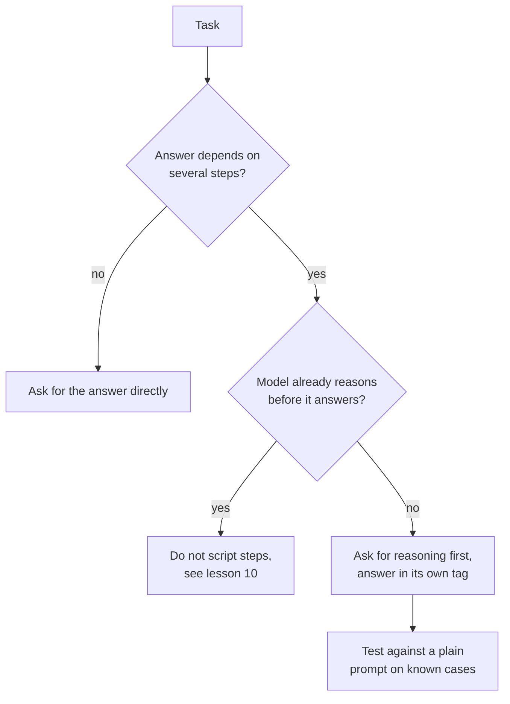

# 第 8 课：思维链

**使命关联:** 要求模型给出推理，是能提升准确率的成本最低的提示词改动，同时也是最容易用在毫无作用之处的改动，所以这项技能在于判断一项任务是否值得用它。
**主要来源:** [论文：“Chain-of-Thought Prompting Elicits Reasoning in Large Language Models”，Wei 等，2022](https://arxiv.org/abs/2201.11903)
**前置知识:** [第 7 课](0007-few-shot-biases.md)、[思维链](../GLOSSARY.md)、[零样本提示词](../GLOSSARY.md)

## 热身

1. ▢ 第 3 课说过，好的指令要说明完成后是什么样子。对于一个先要求推理、再给出程序读取的答案的提示词，完成后是什么样子？

<details markdown="1"><summary>检查</summary>

推理和最终答案是分开的，而且答案位于程序能找到的位置，比如放在它自己的标签里（第 4 课）。否则，程序就得猜推理在哪里结束。

</details>

2. ▢ 第 6 课说过，示例教给模型的是格式、标签空间和输入分布。如果你在示例中演示推理，这三样中是哪一样承载了它？

<details markdown="1"><summary>检查</summary>

格式。每个示例的输出现在是推理加上答案，所以模型会以这种形状接着续写。这就是为什么示例中推理的风格、长度和收尾方式，与最终答案同样重要。

</details>

## 要点

### 什么是思维链

**思维链**是模型在给出最终答案之前写出的中间推理。Wei 等人用少样本提示词引出它：每个示例展示的是一个完整的解题过程，而不只是答案。用八个这样的示例，一个 5400 亿参数的模型在 GSM8K 这个数学应用题基准上达到了当时最优的准确率，超过了带验证器的微调 GPT-3。

推理并不是装饰。在一项消融实验中，作者让思维链只出现在答案之后，性能与标准提示词大致相同。所以推理必须出现在答案之前才有帮助。

### 零样本思维链

Kojima 等人表明，示例并不是必需的。在每个答案之前加上 “Let's think step by step”，就提升了**零样本提示词**的表现：用 text-davinci-002，MultiArith 从 17.7% 升到 78.7%，GSM8K 从 10.4% 升到 40.7%。

```text
Q: A shop sells pens in packs of 12 and notebooks in packs of 5.
I need exactly 60 of each. How many packs of each do I buy in total?
A: Let's think step by step.
```

### 何时有帮助，何时只是多花 token

两篇论文指向同一个方向：它对需要多个步骤的任务有帮助。

- Wei 等人发现，问题越复杂，提升越大。在基线最低的数据集 GSM8K 上，最大的 GPT 和 PaLM 模型的性能翻了一倍多。在 SingleOp（MAWPS 中最简单的子集，一步就能解出）上，提升为负或者非常小。
- Kojima 等人发现，在两个不需要多步计算的算术数据集上，零样本思维链与普通提示词持平，在他们测试的两个常识数据集上则没有提升。
- Wei 等人还发现规模很重要：思维链对小模型没有帮助，要到大约 1000 亿参数才开始有收益，因为较小的模型写出的链条行文流畅却不合逻辑。

这些结果来自 2022 年的模型，而规模方面的发现说明的是这项技术从哪里开始起作用，而不是某个当前模型处在什么位置。可以迁移的经验是关于任务的：推理要消耗输出 token 和延迟，只有当答案依赖中间步骤时，它换来的准确率才主要体现出来。



最后一步的测试要去做。推理对你的任务在你的模型上是否有帮助，是一个经验性问题，而第 5 课已经说过，提示词的修改是一个需要检验的论断。

## 练习

1. ▢ 先预测，再运行。预测这两个提示词哪个算术做对的次数更多，然后在全新的聊天中各运行三次。

    ```text
    Prompt A:
    A train leaves at 9:40 and the trip takes 2 hours 35 minutes.
    It then waits 50 minutes and a second leg takes 1 hour 20 minutes.
    What time does it arrive? Reply with only the time.

    Prompt B:
    A train leaves at 9:40 and the trip takes 2 hours 35 minutes.
    It then waits 50 minutes and a second leg takes 1 hour 20 minutes.
    What time does it arrive? Work through it step by step, then
    give the final time on its own line after "Answer:".
    ```

<details markdown="1"><summary>提示</summary>

数一数答案依赖多少个独立的计算，以及提示词 A 有没有给模型留出做这些计算的空间。

</details>

<details markdown="1"><summary>检查</summary>

正确答案是 14:25。论文预测提示词 B 至少不会更差，因为这道题需要连续三次加法，而提示词 A 没有给中间运算留出空间。当前的模型也可能把提示词 A 做对，尤其是在它内部会推理的情况下，所以对平局的正确解读是：推理在这里什么也没换来。你自己统计的各次运行结果才是证据。

</details>

2. ▢ 先预测，再运行。问聊天模型 “What is the capital of Australia?”，一次直接问，一次加上 “Let's think step by step.”。预测第二次多了什么。

<details markdown="1"><summary>检查</summary>

答案相同（Canberra），只是多了一些文字。单步查询正是 Wei 等人看到提升为负或可以忽略、Kojima 等人看到没有提升的情形，所以你付出的是输出 token 和延迟。

</details>

3. ▢ 一位队友给应用里的每个提示词都加上 “Let's think step by step”，包括一个情感分类器和一个从邮件里提取日期的任务。对这两个任务这样做，反对的理由是什么？他们应该怎么做？

<details markdown="1"><summary>检查</summary>

两者都接近单步任务，论文发现这类任务提升很小或没有提升，而每次调用现在都要为额外的输出 token 和更慢的回复付出代价。多出来的文字还可能破坏期望只拿到一个标签或日期的解析器。正确的做法是只给任务需要多个步骤的提示词加上推理，并且每处改动在保留之前，都要在已知用例上与普通提示词做比较。

</details>

4. ▢ 下面哪个关于思维链的说法得到了 Wei 等人的支持？

    - a) 在答案之后写出的推理，帮助和写在之前一样大
    - b) 它在最简单的一步问题上提升最大
    - c) 它在多步问题上帮助最大，并且需要足够大的模型
    - d) 一旦示例包含推理链，它对每个模型的帮助都一样

<details markdown="1"><summary>检查</summary>

**c)** 问题越难提升越大，并且只在大约 1000 亿参数处才出现。(a) 说反了：答案之后的推理，表现与标准提示词大致相同。(b) 也说反了：一步问题的提升为负或非常小。(d) 与规模方面的发现相矛盾，因为较小的模型写出的链条行文流畅却不合逻辑，表现比标准提示词更差。

</details>

## 实战练习

- [ ] 挑一个你需要多个步骤的提示词，加上一行要求先推理、再把最终答案放在固定标记之后。在五个你已经知道答案的用例上运行。
- [ ] 找出你的一个只要求单次查询或单个标签的提示词，检查它是否要求了并不需要的推理。
- [ ] 明天：对同一个多步问题，分别带着和不带推理那一行运行，各在三个全新的聊天中进行，并统计正确的答案数。

## 延伸阅读

- [少样本与推理](../reference/few-shot-and-reasoning.md)
- [论文：“Large Language Models are Zero-Shot Reasoners”，Kojima 等，2022](https://arxiv.org/abs/2205.11916)
- [资源](../RESOURCES.md)

---

没学明白？请重读顶部的主要来源，因为本课是对它的压缩，而理解正是在压缩中流失的。如果有哪个术语觉得含糊，可以查看[术语表](../GLOSSARY.md)。

如果问题出在课程本身，而不是学习材料，那就是一个缺陷：[提交 issue](https://github.com/TokenCemetery/teach/issues)。
