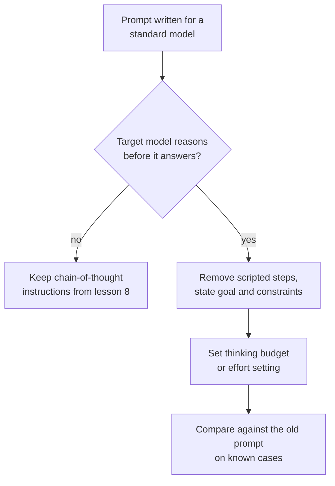

# Lección 10. Prompting de modelos de razonamiento

**Vínculo con la misión:** La etapa 4 termina en una decisión: pedir o no razonamiento depende del modelo, y para un modelo que ya razona el viejo hábito de dictar los pasos puede jugar en su contra.
**Fuente principal:** [Documentación: "Prompting best practices", Claude Platform Docs](https://platform.claude.com/docs/en/build-with-claude/prompt-engineering/claude-prompting-best-practices#leverage-thinking-and-interleaved-thinking-capabilities)
**Requisitos previos:** [Lección 9](0009-self-consistency-and-faithfulness.md), [Modelo de razonamiento](../GLOSSARY.md), [Chain-of-thought](../GLOSSARY.md)

## Calentamiento

1. ▢ La lección 8 pedía razonamiento en el prompt porque, de lo contrario, el modelo respondería de inmediato. ¿Qué cambia si el modelo razona antes de cada respuesta sin que se lo pidan?

<details markdown="1"><summary>Comprobación</summary>

El razonamiento que pedirías ya está ocurriendo, así que la instrucción o lo duplica o intenta dirigirlo. La pregunta pasa de "¿debo pedir razonamiento?" a "¿cuánto debe pensar el modelo y qué debo decirle sobre el objetivo?".

</details>

2. ▢ La lección 9 decía que el razonamiento escrito puede omitir lo que impulsó una respuesta. ¿Eso te impide usar el razonamiento de un modelo para depurar una mala respuesta?

<details markdown="1"><summary>Comprobación</summary>

No, pero limita lo que puedes concluir. El razonamiento es evidencia de lo que el modelo escribió en el camino hacia la respuesta, lo cual suele ser una pista útil, y no es prueba de la causa. Confirma una causa sospechada cambiando el prompt y volviendo a ejecutar (lección 9).

</details>

## Qué debes saber

### Qué cambia con un modelo de razonamiento

Un **modelo de razonamiento** produce una fase de razonamiento interna antes de su respuesta visible, de modo que razona sin que se le pida. Las lecciones 8 y 9 trataban de lograr que un modelo escribiera razonamiento. Con un modelo de razonamiento, ese trabajo lo hace el modelo, y la tarea de tu prompt pasa a ser decir qué quieres y qué límites se aplican.

Esta lección usa la documentación de Anthropic como fuente, así que lo que sigue es el comportamiento documentado por un solo proveedor. Los modelos de razonamiento de otros proveedores tienen sus propios controles y consejos, y el principio de aquí debe comprobarse con la documentación de tu modelo. Las guías de OpenAI no pudieron verificarse (consulta RESOURCES.md), así que esta lección no las cubre.

### Da objetivos, no pasos escritos de antemano

La guía de buenas prácticas de Anthropic dice que se prefieran instrucciones generales a pasos prescriptivos: un prompt como "piensa a fondo" suele producir mejor razonamiento que un plan paso a paso escrito a mano, porque el razonamiento del modelo con frecuencia supera lo que prescribiría una persona.

Por eso no pegues un guion paso a paso en un modelo que ya razona. Un guion fija la ruta y limita al modelo a la ruta que tú pudiste imaginar. Enuncia el objetivo, las restricciones y cómo es una buena respuesta (lección 3), y deja que el modelo elija los pasos.

```text
Instead of this:
Step 1: list the facts. Step 2: list the unknowns. Step 3: pick
a formula. Step 4: substitute. Step 5: check units.
Solve: ...

Write this:
Find the shortest route that visits every depot once and returns
to the start. Distances are in the table. Give the route and its
total length. Check the total against the table before you answer.
```

La segunda versión sigue teniendo estructura: un objetivo, una restricción y una comprobación de aceptación. Lo que descarta es la ruta.

### Qué sigue ayudando

- **Ejemplos.** La guía dice que los ejemplos resueltos moldean cómo aborda el modelo problemas similares en su propio pensamiento, y sugiere presentar cada uno como el problema, el método que aplicar y la respuesta esperada.
- **Una comprobación al final.** La guía sugiere añadir una instrucción de verificación como "Before you finish, verify your answer against" tus criterios de prueba. También señala que un modelo, Claude Opus 5, verifica por su cuenta, y que las instrucciones de verificación heredadas pueden causar sobreverificación en él, así que vuelve a probar los prompts antiguos cuando cambies de modelo.
- **Chain-of-thought como alternativa.** Cuando el pensamiento está desactivado, la guía dice que aún puedes pedirle al modelo que piense el problema antes de responder y que ponga la respuesta final en etiquetas `<answer>`. Para varios modelos más recientes recomienda apoyarse en el pensamiento, y advierte que un prompt que le pide al modelo escribir su razonamiento en etiquetas puede ser rechazado.

### El presupuesto es un control aparte

En el modo manual de extended thinking de Anthropic, la cantidad de pensamiento se fija fuera del texto del prompt, mediante `budget_tokens`, un objetivo de cuántos tokens puede usar el modelo para su razonamiento interno. La documentación dice que el presupuesto es un objetivo y no un tope estricto, que los tokens de pensamiento cuentan para `max_tokens`, que el mínimo es 1.024, y que se empiece cerca de ese mínimo para tareas simples y desde 16.000 tokens o más para las complejas, y luego se ajuste. Cuánto pensar es, por tanto, un ajuste que afinas frente al costo y la latencia, no una frase que añades.

Para el razonamiento dentro de un bucle de agente, incluido cuándo los pasos de reflexión siguen valiendo su costo, consulta la [lección 17 de llm/agents](../../agents/lessons/0017-self-critique-and-reasoning-models.md).



## Práctica

1. ▢ Predice y luego ejecuta. Toma una pregunta de varios pasos que puedas verificar. Escribe un prompt que dicte cinco pasos numerados y otro que enuncie solo el objetivo y la comprobación. Predice cuál responde con más fiabilidad en un modelo de razonamiento, y luego ejecuta cada uno tres veces.

<details markdown="1"><summary>Pista</summary>

La afirmación de la guía trata de la ruta: quién la elige, el modelo o tú. Piensa en un caso en que tu ruta no sea la mejor.

</details>

<details markdown="1"><summary>Comprobación</summary>

La guía predice que el prompt basado en el objetivo rinde igual o mejor, porque el razonamiento del modelo suele superar el plan que tú dictarías. Si ambos rinden igual en tu modelo y tu tarea, aprendiste que el guion son tokens innecesarios, y eso sigue siendo un resultado. La guía no da ninguna cifra, así que solo tus tres ejecuciones de cada uno lo deciden.

</details>

2. ▢ Un prompt escrito para un modelo estándar dice "Think step by step, then answer in `<answer>` tags." Lo pasas a un modelo de razonamiento. ¿Qué conservas, qué quitas y qué pruebas?

<details markdown="1"><summary>Comprobación</summary>

Conserva la etiqueta de respuesta, ya que un programa puede leerla. Quita la instrucción "think step by step" como primera cosa que probar, porque el modelo ya razona y la guía prefiere instrucciones generales a pasos prescritos. Prueba el prompt nuevo frente al antiguo en casos conocidos, porque en algunos modelos más recientes un prompt que pide el razonamiento escrito en etiquetas puede ser rechazado, así que la línea antigua puede hacer daño y no solo desperdiciar tokens.

</details>

3. ▢ Tu presupuesto para una llamada de razonamiento es de 800 tokens y la API lo rechaza. ¿Por qué, y qué fijas para una tarea fácil?

<details markdown="1"><summary>Comprobación</summary>

En el modo manual de extended thinking de Anthropic, `budget_tokens` debe ser al menos 1.024, por lo que 800 se rechaza. Para una tarea fácil empieza cerca de 1.024 y súbelo solo si las respuestas son malas. Como los tokens de pensamiento cuentan para `max_tokens`, deja también margen bajo `max_tokens` para la respuesta final.

</details>

4. ▢ ¿Qué reescritura sigue el consejo para un modelo que ya razona?

    - a) Enumerar nueve pasos numerados que el modelo debe seguir en orden
    - b) Enunciar el objetivo, los límites y una comprobación que ejecutar antes de responder
    - c) Decirle al modelo que escriba primero todo su razonamiento en etiquetas
    - d) Quitar el objetivo para que el modelo sea libre de elegir cualquier tarea

<details markdown="1"><summary>Comprobación</summary>

**b)** Conserva la estructura que importa (objetivo, restricción, comprobación de aceptación) y deja la ruta al modelo. (a) es el plan dictado que la guía desaconseja. (c) es chain-of-thought manual, una alternativa para cuando el pensamiento está desactivado, y puede ser rechazada en algunos modelos más recientes. (d) se pasa de largo: las instrucciones generales siguen necesitando un objetivo claro.

</details>

## Prácticas en el mundo real

- [ ] Encuentra un prompt tuyo que numere sus pasos. Reescríbelo como un objetivo, restricciones y una comprobación, y luego ejecuta ambos en tres casos conocidos.
- [ ] Busca en la documentación de tu modelo sus controles de pensamiento o razonamiento, y anota el nombre del ajuste que gobierna cuánto piensa.
- [ ] Mañana: toma un prompt que afinaste para un modelo más antiguo, quítale la línea "think step by step" y compara las respuestas en cinco casos conocidos.

## Para profundizar

- [Few-Shot y razonamiento](../reference/few-shot-and-reasoning.md)
- [Documentación: "Extended thinking", Claude Platform Docs](https://platform.claude.com/docs/en/build-with-claude/extended-thinking)
- [Recursos](../RESOURCES.md)

---

¿No termina de quedar claro? Vuelve a leer la fuente principal del inicio, porque esta lección la comprime y en la compresión es donde se pierde la comprensión. Consulta el [glosario](../GLOSSARY.md) para cualquier término que te haya parecido resbaladizo.

Si lo poco claro es la lección y no el material, eso es un defecto: [abre un issue](https://github.com/TokenCemetery/teach/issues).
