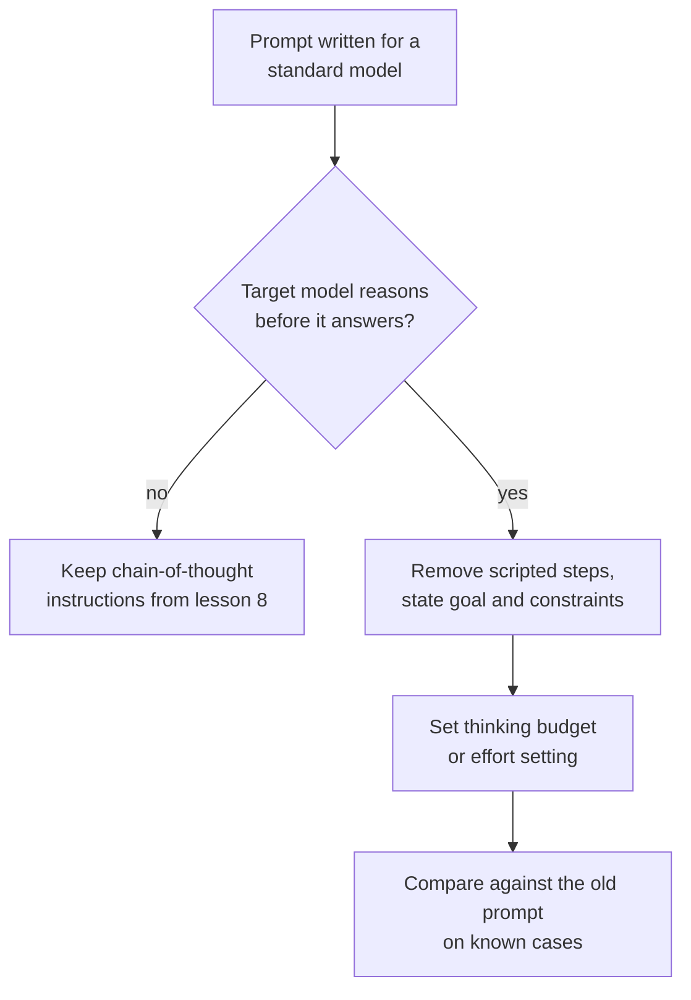

# Leçon 10. Prompter les modèles de raisonnement

**Lien avec la mission :** L'étape 4 se termine sur une décision : demander ou non du raisonnement dépend du modèle, et pour un modèle qui raisonne déjà, la vieille habitude de scénariser les étapes peut jouer contre lui.
**Source primaire :** [Doc : "Prompting best practices", Claude Platform Docs](https://platform.claude.com/docs/en/build-with-claude/prompt-engineering/claude-prompting-best-practices#leverage-thinking-and-interleaved-thinking-capabilities)
**Prérequis :** [Leçon 9](0009-self-consistency-and-faithfulness.md), [Modèle de raisonnement](../GLOSSARY.md), [Chain-of-thought](../GLOSSARY.md)

## Échauffement

1. ▢ La leçon 8 demandait du raisonnement dans le prompt parce que le modèle répondrait sinon immédiatement. Que change-t-il si le modèle raisonne avant chaque réponse sans qu'on le lui demande ?

<details markdown="1"><summary>Vérifier</summary>

Le raisonnement que vous demanderiez a déjà lieu, donc l'instruction soit le duplique, soit tente de l'orienter. La question passe de « dois-je demander du raisonnement » à « quelle quantité de réflexion le modèle doit-il faire, et que dois-je lui dire de l'objectif ».

</details>

2. ▢ La leçon 9 disait que le raisonnement écrit peut omettre ce qui a motivé une réponse. Cela vous empêche-t-il d'utiliser le raisonnement d'un modèle pour déboguer une mauvaise réponse ?

<details markdown="1"><summary>Vérifier</summary>

Non, mais cela limite ce que vous pouvez conclure. Le raisonnement est une trace de ce que le modèle a écrit en chemin vers la réponse, ce qui est souvent une piste utile, et ce n'est pas la preuve de la cause. Confirmez une cause soupçonnée en modifiant le prompt et en relançant (leçon 9).

</details>

## À savoir

### Ce que change un modèle de raisonnement

Un **modèle de raisonnement** produit une phase de raisonnement interne avant sa réponse visible, de sorte qu'il raisonne sans qu'on le lui demande. Les leçons 8 et 9 portaient sur la façon de faire écrire du raisonnement à un modèle. Avec un modèle de raisonnement, ce travail est fait par le modèle, et le rôle de votre prompt se déplace vers l'expression de ce que vous voulez et des limites qui s'appliquent.

Cette leçon prend pour source la documentation d'Anthropic : ce qui suit est donc le comportement documenté d'un seul éditeur. Les modèles de raisonnement des autres fournisseurs ont leurs propres réglages et conseils, et le principe énoncé ici doit être vérifié dans la documentation de votre modèle. Les guides d'OpenAI n'ont pas pu être vérifiés (voir RESOURCES.md), donc cette leçon ne les couvre pas.

### Donnez des objectifs, pas des étapes scénarisées

Le guide des bonnes pratiques d'Anthropic dit de préférer les instructions générales aux étapes prescriptives : un prompt comme « think thoroughly » produit souvent un meilleur raisonnement qu'un plan pas à pas écrit à la main, parce que le raisonnement du modèle dépasse fréquemment ce qu'un humain prescrirait.

Ne collez donc pas un script pas à pas dans un modèle qui raisonne déjà. Un script fige l'itinéraire et limite le modèle à l'itinéraire auquel vous avez pensé. Énoncez l'objectif, les contraintes et à quoi ressemble une bonne réponse (leçon 3), et laissez le modèle choisir les étapes.

```text
Instead of this:
Step 1: list the facts. Step 2: list the unknowns. Step 3: pick
a formula. Step 4: substitute. Step 5: check units.
Solve: ...

Write this:
Find the shortest route that visits every depot once and returns
to the start. Distances are in the table. Give the route and its
total length. Check the total against the table before you answer.
```

La seconde version garde une structure : un objectif, une contrainte et un contrôle d'acceptation. Ce qu'elle abandonne, c'est l'itinéraire.

### Ce qui aide encore

- **Les exemples.** Le guide dit que des exemples détaillés façonnent la façon dont le modèle aborde des problèmes similaires dans sa propre réflexion, et suggère de présenter chacun comme le problème, la méthode à appliquer et la réponse attendue.
- **Une vérification à la fin.** Le guide suggère d'ajouter une instruction de vérification comme « Before you finish, verify your answer against » vos critères de test. Il note aussi qu'un modèle, Claude Opus 5, vérifie de lui-même, et que des instructions de vérification reprises d'anciens prompts peuvent provoquer une sur-vérification dans ce cas : retestez donc les anciens prompts quand vous changez de modèle.
- **Le chain-of-thought en solution de repli.** Quand le thinking est désactivé, le guide dit que vous pouvez toujours demander au modèle de réfléchir au problème avant de répondre et de mettre la réponse finale dans des balises `<answer>`. Pour plusieurs modèles plus récents, il recommande de s'appuyer plutôt sur le thinking, et prévient qu'un prompt demandant au modèle d'écrire son raisonnement dans des balises peut être décliné.

### Le budget est un réglage distinct

Dans le mode manuel d'extended thinking d'Anthropic, la quantité de réflexion est fixée en dehors du texte du prompt, par `budget_tokens`, une cible pour le nombre de tokens que le modèle peut utiliser pour son raisonnement interne. La documentation dit que le budget est une cible et non un plafond strict, que les tokens de thinking comptent dans `max_tokens`, que le minimum est de 1 024, et de commencer près de ce minimum pour les tâches simples et à partir de 16 000 tokens ou plus pour les tâches complexes, puis d'ajuster. Combien réfléchir est donc un réglage que vous ajustez face au coût et à la latence, pas une phrase que vous ajoutez.

Pour le raisonnement dans une boucle d'agent, y compris les cas où les étapes de réflexion justifient encore leur coût, voir la [leçon 17 de llm/agents](../../agents/lessons/0017-self-critique-and-reasoning-models.md).



## Pratique

1. ▢ Prédisez, puis exécutez. Prenez une question en plusieurs étapes que vous pouvez vérifier. Écrivez un prompt qui scénarise cinq étapes numérotées et un qui n'énonce que l'objectif et le contrôle. Prédisez lequel répond le plus fiablement sur un modèle de raisonnement, puis exécutez chacun trois fois.

<details markdown="1"><summary>Indice</summary>

L'affirmation du guide porte sur l'itinéraire : qui le choisit, le modèle ou vous. Pensez à un cas où votre itinéraire n'est pas le meilleur.

</details>

<details markdown="1"><summary>Vérifier</summary>

Le guide prédit que le prompt fondé sur l'objectif fait aussi bien ou mieux, parce que le raisonnement du modèle dépasse souvent le plan que vous scénariseriez. Si les deux sont égaux sur votre modèle et votre tâche, vous avez appris que le script est du token superflu, et c'est quand même un résultat. Le guide ne donne aucun chiffre : seules vos trois exécutions de chaque version tranchent.

</details>

2. ▢ Un prompt écrit pour un modèle standard dit « Think step by step, then answer in `<answer>` tags. » Vous le passez sur un modèle de raisonnement. Que gardez-vous, supprimez-vous et testez-vous ?

<details markdown="1"><summary>Vérifier</summary>

Gardez la balise de réponse, puisqu'un programme peut la lire. Supprimez l'instruction « think step by step » comme première chose à essayer, car le modèle raisonne déjà et le guide préfère les instructions générales aux étapes prescrites. Testez le nouveau prompt contre l'ancien sur des cas connus, car pour certains modèles plus récents un prompt qui demande d'écrire le raisonnement dans des balises peut être décliné : l'ancienne ligne peut donc nuire et pas seulement gaspiller des tokens.

</details>

3. ▢ Votre budget pour un appel de raisonnement est de 800 tokens et l'API le rejette. Pourquoi, et que fixez-vous pour une tâche facile ?

<details markdown="1"><summary>Vérifier</summary>

Dans le mode manuel d'extended thinking d'Anthropic, `budget_tokens` doit être d'au moins 1 024, donc 800 est rejeté. Pour une tâche facile, commencez près de 1 024 et ne l'augmentez que si les réponses sont mauvaises. Comme les tokens de thinking comptent dans `max_tokens`, laissez aussi de la place sous `max_tokens` pour la réponse finale.

</details>

4. ▢ Quelle réécriture suit le conseil pour un modèle qui raisonne déjà ?

    - a) Lister neuf étapes numérotées que le modèle doit suivre dans l'ordre
    - b) Énoncer l'objectif, les limites et un contrôle à effectuer avant de répondre
    - c) Dire au modèle d'écrire d'abord tout son raisonnement dans des balises
    - d) Supprimer l'objectif pour que le modèle soit libre de choisir n'importe quelle tâche

<details markdown="1"><summary>Vérifier</summary>

**b)** Elle garde la structure qui compte (objectif, contrainte, contrôle d'acceptation) et laisse l'itinéraire au modèle. (a) est le plan scénarisé que déconseille le guide. (c) est du chain-of-thought manuel, une solution de repli quand le thinking est désactivé, qui peut être déclinée sur certains modèles plus récents. (d) va trop loin : des instructions générales ont encore besoin d'un objectif clair.

</details>

## Exercices en situation réelle

- [ ] Trouvez un de vos prompts qui numérote ses étapes. Réécrivez-le sous forme d'objectif, de contraintes et de contrôle, puis exécutez les deux sur trois cas connus.
- [ ] Consultez la documentation de votre modèle pour ses réglages de thinking ou de raisonnement, et notez le nom du paramètre qui gouverne la quantité de réflexion.
- [ ] Demain : prenez un prompt que vous avez réglé pour un modèle plus ancien, supprimez sa ligne « think step by step », et comparez les réponses sur cinq cas connus.

## Pour aller plus loin

- [Few-shot et raisonnement](../reference/few-shot-and-reasoning.md)
- [Doc : "Extended thinking", Claude Platform Docs](https://platform.claude.com/docs/en/build-with-claude/extended-thinking)
- [Ressources](../RESOURCES.md)

---

Ça ne passe pas ? Relisez la source primaire en haut de page, car cette leçon la condense et c'est dans la condensation que la compréhension s'échappe. Consultez le [glossaire](../GLOSSARY.md) pour tout terme qui vous a paru glissant.

Si c'est la leçon elle-même qui n'est pas claire plutôt que la matière, c'est un défaut : [ouvrez une issue](https://github.com/TokenCemetery/teach/issues).
