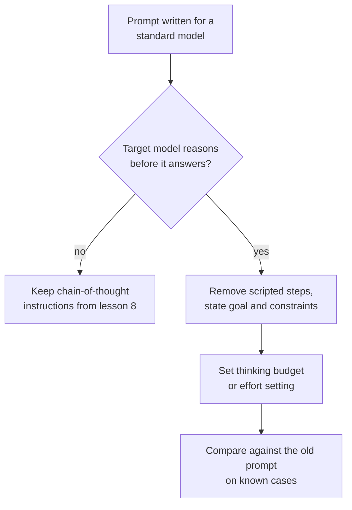

# पाठ 10. Reasoning Models को Prompt करना

**मिशन से संबंध:** चरण 4 एक फ़ैसले पर ख़त्म होता है: reasoning माँगनी है या नहीं, यह model पर निर्भर करता है, और जो model पहले से reasoning करता है उसके लिए चरणों की स्क्रिप्ट लिखने की पुरानी आदत उसके ख़िलाफ़ जा सकती है।
**मुख्य स्रोत:** [Docs: "Prompting best practices", Claude Platform Docs](https://platform.claude.com/docs/en/build-with-claude/prompt-engineering/claude-prompting-best-practices#leverage-thinking-and-interleaved-thinking-capabilities)
**पूर्व-आवश्यकताएँ:** [पाठ 9](0009-self-consistency-and-faithfulness.md), [Reasoning model](../GLOSSARY.md), [Chain-of-thought](../GLOSSARY.md)

## वार्म-अप

1. ▢ पाठ 8 ने prompt में reasoning माँगी थी क्योंकि model वरना सीधे उत्तर दे देता। अगर model बिना कहे हर उत्तर से पहले reasoning करता है, तो क्या बदलता है?

<details markdown="1"><summary>जाँचें</summary>

जो reasoning आप माँगते, वह पहले से हो रही है, इसलिए instruction या तो उसे दोहराता है या उसे दिशा देने की कोशिश करता है। सवाल "क्या मुझे reasoning माँगनी चाहिए" से हटकर "model को कितना सोचना चाहिए, और लक्ष्य के बारे में उसे क्या बताना चाहिए" पर आ जाता है।

</details>

2. ▢ पाठ 9 ने कहा था कि लिखी हुई reasoning उसे छोड़ सकती है जिसने उत्तर चलाया। क्या यह आपको ख़राब उत्तर को debug करने के लिए model की reasoning इस्तेमाल करने से रोकता है?

<details markdown="1"><summary>जाँचें</summary>

नहीं, पर यह सीमित करता है कि आप क्या निष्कर्ष निकाल सकते हैं। Reasoning इस बात का प्रमाण है कि model ने उत्तर तक पहुँचते हुए क्या लिखा, जो अक्सर उपयोगी सुराग़ होता है, और वह कारण का प्रमाण नहीं है। संदिग्ध कारण की पुष्टि prompt बदलकर और दोबारा चलाकर करें (पाठ 9)।

</details>

## यह जानें

### Reasoning model क्या बदलता है

**Reasoning model** अपने दिखने वाले उत्तर से पहले आंतरिक reasoning चरण पैदा करता है, इसलिए वह बिना कहे reasoning करता है। पाठ 8 और 9 model से reasoning लिखवाने के बारे में थे। Reasoning model के साथ वह काम model कर देता है, और आपके prompt का काम यह बताने में बदल जाता है कि आप क्या चाहते हैं और कौन-सी सीमाएँ लागू हैं।

यह पाठ Anthropic के दस्तावेज़ को अपने स्रोत के रूप में इस्तेमाल करता है, इसलिए आगे जो है वह एक vendor का दस्तावेज़ी व्यवहार है। दूसरे providers के reasoning models के अपने controls और सलाह हैं, और यहाँ का सिद्धांत आपके model के दस्तावेज़ से जाँच लेना चाहिए। OpenAI की गाइडें पुष्ट नहीं की जा सकीं (RESOURCES.md देखें), इसलिए यह पाठ उन्हें कवर नहीं करता।

### लक्ष्य दें, लिखे हुए चरण नहीं

Anthropic की best-practices गाइड कहती है कि निर्देशात्मक चरणों के बजाय सामान्य instructions को तरजीह दें: "think thoroughly" जैसा prompt अक्सर हाथ से लिखी step-by-step योजना से बेहतर reasoning पैदा करता है, क्योंकि model की reasoning अक्सर उससे आगे जाती है जो कोई इंसान तय करता।

इसलिए जो model पहले से reasoning करता है उसमें step-by-step स्क्रिप्ट paste न करें। स्क्रिप्ट रास्ता बाँध देती है और model को उस रास्ते तक सीमित कर देती है जो आप सोच सके। लक्ष्य, constraints और अच्छा उत्तर कैसा दिखता है बताएँ (पाठ 3), और चरण model को चुनने दें।

```text
Instead of this:
Step 1: list the facts. Step 2: list the unknowns. Step 3: pick
a formula. Step 4: substitute. Step 5: check units.
Solve: ...

Write this:
Find the shortest route that visits every depot once and returns
to the start. Distances are in the table. Give the route and its
total length. Check the total against the table before you answer.
```

दूसरे रूप में अब भी structure है: एक लक्ष्य, एक constraint और एक स्वीकृति जाँच। जो वह छोड़ता है वह रास्ता है।

### क्या अब भी मदद करता है

- **Examples।** गाइड कहती है कि हल किए हुए examples तय करते हैं कि model अपनी सोच में मिलती-जुलती समस्याओं तक कैसे पहुँचे, और सुझाव देती है कि हर एक को समस्या, लागू करने की विधि और अपेक्षित उत्तर के रूप में पेश करें।
- **अंत में एक जाँच।** गाइड सुझाव देती है कि अंत में सत्यापन का instruction जोड़ें, जैसे "Before you finish, verify your answer against" आपके test criteria। वह यह भी नोट करती है कि एक model, Claude Opus 5, अपने आप सत्यापन करता है, और साथ लाए गए सत्यापन instructions वहाँ ज़रूरत से ज़्यादा सत्यापन करवा सकते हैं, इसलिए model बदलने पर पुराने prompts दोबारा परखें।
- **Fallback के रूप में chain-of-thought।** जब thinking बंद हो, तो गाइड के अनुसार आप फिर भी model से उत्तर देने से पहले समस्या पर सोचने और अंतिम उत्तर `<answer>` tags में रखने को कह सकते हैं। कई नए models के लिए वह इसके बजाय thinking पर निर्भर रहने की सिफ़ारिश करती है, और चेताती है कि model से tags में अपनी reasoning लिखने को कहने वाला prompt ठुकराया जा सकता है।

### Budget एक अलग control है

Anthropic के manual extended thinking mode में, कितना सोचना है वह prompt text के बाहर `budget_tokens` से तय होता है, जो इसका लक्ष्य है कि model अपनी आंतरिक reasoning के लिए कितने tokens इस्तेमाल कर सकता है। दस्तावेज़ कहता है कि budget एक लक्ष्य है, कड़ी सीमा नहीं, कि thinking tokens `max_tokens` में गिने जाते हैं, कि न्यूनतम 1,024 है, और कि सरल tasks के लिए उस न्यूनतम के पास से शुरू करें और जटिल के लिए 16,000 tokens या उससे ज़्यादा से, फिर समायोजित करें। इसलिए कितना सोचना है, यह एक setting है जिसे आप लागत और latency के हिसाब से ट्यून करते हैं, कोई वाक्य नहीं जो आप जोड़ें।

Agent loop के भीतर reasoning के लिए, यह भी कि reflection चरण अपनी क़ीमत कब वसूलते हैं, [llm/agents पाठ 17](../../agents/lessons/0017-self-critique-and-reasoning-models.md) देखें।



## अभ्यास

1. ▢ पहले अनुमान लगाएँ, फिर चलाएँ। कोई multi-step सवाल लें जिसे आप जाँच सकें। एक prompt लिखें जो पाँच क्रमांकित चरणों की स्क्रिप्ट देता है और एक जो सिर्फ़ लक्ष्य और जाँच बताता है। अनुमान लगाएँ कि reasoning model पर कौन ज़्यादा भरोसे से उत्तर देता है, फिर हर एक को तीन बार चलाएँ।

<details markdown="1"><summary>संकेत</summary>

गाइड का दावा रास्ते के बारे में है: उसे कौन चुनता है, model या आप। ऐसे मामले के बारे में सोचें जहाँ आपका रास्ता सबसे अच्छा नहीं है।

</details>

<details markdown="1"><summary>जाँचें</summary>

गाइड भविष्यवाणी करती है कि लक्ष्य-आधारित prompt उतना ही या बेहतर करता है, क्योंकि model की reasoning अक्सर उस योजना से आगे जाती है जो आप स्क्रिप्ट करते। अगर आपके model और task पर दोनों बराबर हैं, तो आपने सीखा कि स्क्रिप्ट फ़ालतू tokens है, और वह भी एक नतीजा है। गाइड कोई संख्या नहीं देती, इसलिए फ़ैसला हर एक के आपके तीन runs ही करते हैं।

</details>

2. ▢ Standard model के लिए लिखा prompt कहता है "Think step by step, then answer in `<answer>` tags." आप उसे reasoning model पर ले जाते हैं। आप क्या रखते हैं, क्या हटाते हैं और क्या परखते हैं?

<details markdown="1"><summary>जाँचें</summary>

Answer tag रखें, क्योंकि कोई program उसे पढ़ सकता है। "Think step by step" instruction को आज़माने की पहली चीज़ के रूप में हटाएँ, क्योंकि model पहले से reasoning करता है और गाइड निर्देशात्मक चरणों से सामान्य instructions को तरजीह देती है। नए prompt को पुराने के सामने ज्ञात cases पर परखें, क्योंकि कुछ नए models के लिए tags में लिखी reasoning माँगने वाला prompt ठुकराया जा सकता है, इसलिए पुरानी पंक्ति सिर्फ़ tokens बर्बाद नहीं, नुक़सान भी कर सकती है।

</details>

3. ▢ Reasoning call के लिए आपका budget 800 tokens है और API उसे ठुकरा देता है। क्यों, और आसान task के लिए आप क्या set करते हैं?

<details markdown="1"><summary>जाँचें</summary>

Anthropic के manual extended thinking mode में `budget_tokens` कम से कम 1,024 होना चाहिए, इसलिए 800 ठुकरा दिया जाता है। आसान task के लिए 1,024 के पास से शुरू करें और उत्तर ख़राब हों तभी बढ़ाएँ। चूँकि thinking tokens `max_tokens` में गिने जाते हैं, इसलिए `max_tokens` के भीतर अंतिम उत्तर के लिए भी जगह छोड़ें।

</details>

4. ▢ कौन-सा नया रूप उस model के लिए सलाह मानता है जो पहले से reasoning करता है?

    - a) नौ क्रमांकित चरण सूचीबद्ध करें जिन्हें model को क्रम से मानना है
    - b) लक्ष्य, सीमाएँ और उत्तर देने से पहले चलाने की एक जाँच बताएँ
    - c) Model से कहें कि पहले अपनी सारी reasoning tags में लिखे
    - d) लक्ष्य हटा दें ताकि model कोई भी task चुनने को आज़ाद रहे

<details markdown="1"><summary>जाँचें</summary>

**b)** यह वह structure रखता है जो मायने रखता है (लक्ष्य, constraint, स्वीकृति जाँच) और रास्ता model पर छोड़ता है। (a) वही लिखी हुई योजना है जिसके ख़िलाफ़ गाइड सलाह देती है। (c) manual chain-of-thought है, जो thinking बंद होने पर fallback है, और कुछ नए models पर ठुकराया जा सकता है। (d) हद पार कर देता है: सामान्य instructions को भी स्पष्ट लक्ष्य चाहिए।

</details>

## असली दुनिया का अभ्यास

- [ ] अपना कोई ऐसा prompt खोजें जो अपने चरणों को क्रमांकित करता है। उसे लक्ष्य, constraints और एक जाँच के रूप में दोबारा लिखें, फिर दोनों को तीन ज्ञात cases पर चलाएँ।
- [ ] अपने model के दस्तावेज़ में उसके thinking या reasoning controls देखें, और उस setting का नाम नोट करें जो तय करती है कि वह कितना सोचता है।
- [ ] कल: कोई prompt लें जिसे आपने पुराने model के लिए ट्यून किया था, उसकी "think step by step" वाली पंक्ति हटाएँ, और पाँच ज्ञात cases पर उत्तरों की तुलना करें।

## आगे बढ़ने के लिए

- [Few-Shot और Reasoning](../reference/few-shot-and-reasoning.md)
- [Docs: "Extended thinking", Claude Platform Docs](https://platform.claude.com/docs/en/build-with-claude/extended-thinking)
- [संसाधन](../RESOURCES.md)

---

बात नहीं बन रही? ऊपर दिए primary source को दोबारा पढ़ें, क्योंकि यह पाठ उसे संक्षिप्त करता है और समझ संक्षेप में ही रिसती है। जो शब्द फिसलन भरा लगे, उसके लिए [शब्दावली](../GLOSSARY.md) देखें।

अगर दिक़्क़त सामग्री की नहीं बल्कि पाठ की ही है, तो वह एक खोट है: [issue खोलें](https://github.com/TokenCemetery/teach/issues)।
