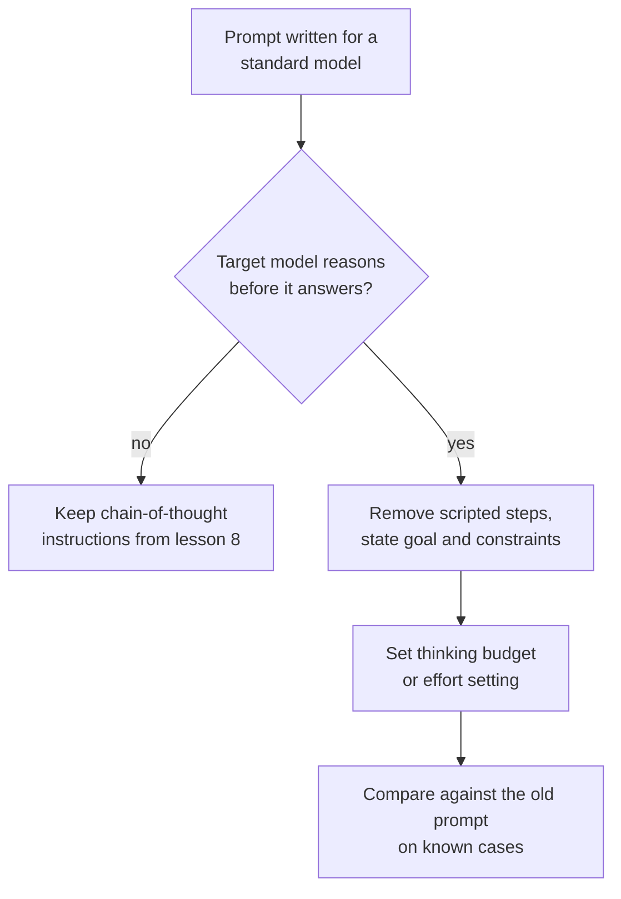

# Lesson 10. Prompting Reasoning Models

**Mission link:** Stage 4 ends on a decision: whether to ask for reasoning depends on the model, and for a model that already reasons the old habit of scripting the steps can work against it.
**Primary source:** [Docs: "Prompting best practices", Claude Platform Docs](https://platform.claude.com/docs/en/build-with-claude/prompt-engineering/claude-prompting-best-practices#leverage-thinking-and-interleaved-thinking-capabilities)
**Prerequisites:** [Lesson 9](0009-self-consistency-and-faithfulness.md), [Reasoning model](../GLOSSARY.md), [Chain-of-thought](../GLOSSARY.md)

## Warm-up

1. ▢ Lesson 8 asked for reasoning in the prompt because the model would otherwise answer straight away. What changes if the model reasons before every answer without being asked?

<details markdown="1"><summary>Check</summary>

The reasoning you would be asking for is already happening, so the instruction either duplicates it or tries to steer it. The question moves from "should I ask for reasoning" to "how much thinking should the model do, and what should I tell it about the goal".

</details>

2. ▢ Lesson 9 said written reasoning can omit what drove an answer. Does that stop you from using a model's reasoning to debug a bad answer?

<details markdown="1"><summary>Check</summary>

No, but it limits what you can conclude. The reasoning is evidence of what the model wrote on the way to the answer, which is often a useful lead, and it is not proof of the cause. Confirm a suspected cause by changing the prompt and rerunning (lesson 9).

</details>

## Know this

### What a reasoning model changes

A **reasoning model** produces an internal reasoning phase before its visible answer, so it reasons without being asked to. Lessons 8 and 9 were about getting a model to write reasoning. With a reasoning model that job is done by the model, and your prompt's job shifts to saying what you want and what limits apply.

This lesson uses Anthropic's documentation as its source, so what follows is one vendor's documented behaviour. Other providers' reasoning models have their own controls and advice, and the principle here should be checked against your model's documentation. OpenAI's guides could not be verified (see RESOURCES.md), so this lesson does not cover them.

### Give goals, not scripted steps

Anthropic's best-practices guide says to prefer general instructions over prescriptive steps: a prompt like "think thoroughly" often produces better reasoning than a hand-written step-by-step plan, because the model's reasoning frequently exceeds what a human would prescribe.

So do not paste a step-by-step script into a model that already reasons. A script fixes the route and limits the model to the route you could think of. State the goal, the constraints and what a good answer looks like (lesson 3), and let the model choose the steps.

```text
Instead of this:
Step 1: list the facts. Step 2: list the unknowns. Step 3: pick
a formula. Step 4: substitute. Step 5: check units.
Solve: ...

Write this:
Find the shortest route that visits every depot once and returns
to the start. Distances are in the table. Give the route and its
total length. Check the total against the table before you answer.
```

The second version still has structure: a goal, a constraint and an acceptance check. What it drops is the route.

### What still helps

- **Examples.** The guide says worked examples shape how the model approaches similar problems in its own thinking, and suggests presenting each as the problem, the method to apply and the expected answer.
- **A check at the end.** The guide suggests appending a verification instruction such as "Before you finish, verify your answer against" your test criteria. It also notes one model, Claude Opus 5, verifies on its own, and that carried-over verification instructions can cause over-verification there, so retest old prompts when you change models.
- **Chain-of-thought as a fallback.** When thinking is off, the guide says you can still ask the model to think through the problem before it answers and to put the final answer in `<answer>` tags. For several newer models it recommends relying on thinking instead, and warns that a prompt asking the model to write out its reasoning in tags may be declined.

### The budget is a separate control

In Anthropic's manual extended thinking mode, the amount of thinking is set outside the prompt text, by `budget_tokens`, a target for how many tokens the model can use for its internal reasoning. The documentation says the budget is a target and not a strict cap, that thinking tokens count toward `max_tokens`, that the minimum is 1,024, and to start near that minimum for simple tasks and from 16,000 tokens or more for complex ones, then adjust. How much to think is therefore a setting you tune against cost and latency, not a sentence you add.

For reasoning inside an agent loop, including when reflection steps still earn their cost, see [llm/agents lesson 17](../../agents/lessons/0017-self-critique-and-reasoning-models.md).



## Practice

1. ▢ Predict, then run. Take a multi-step question you can verify. Write one prompt that scripts five numbered steps and one that states only the goal and the check. Predict which answers more reliably on a reasoning model, then run each three times.

<details markdown="1"><summary>Hint</summary>

The guide's claim is about the route: who chooses it, the model or you. Think about a case where your route is not the best one.

</details>

<details markdown="1"><summary>Check</summary>

The guide predicts the goal-based prompt does as well or better, because the model's reasoning often exceeds the plan you would script. If both are equal on your model and task, you learned the script is unnecessary tokens, and that is still a result. The guide gives no number, so only your three runs each decide it.

</details>

2. ▢ A prompt written for a standard model says "Think step by step, then answer in `<answer>` tags." You move it to a reasoning model. What do you keep, drop and test?

<details markdown="1"><summary>Check</summary>

Keep the answer tag, since a program may read it. Drop the "think step by step" instruction as the first thing to try, because the model already reasons and the guide prefers general instructions to prescribed steps. Test the new prompt against the old on known cases, because for some newer models a prompt that asks for reasoning written out in tags may be declined, so the old line can do harm and not only waste tokens.

</details>

3. ▢ Your budget for a reasoning call is 800 tokens and the API rejects it. Why, and what do you set for an easy task?

<details markdown="1"><summary>Check</summary>

In Anthropic's manual extended thinking mode, `budget_tokens` must be at least 1,024, so 800 is rejected. For an easy task start near 1,024 and raise it only if answers are poor. Because thinking tokens count toward `max_tokens`, also leave room under `max_tokens` for the final answer.

</details>

4. ▢ Which rewrite follows the advice for a model that already reasons?

    - a) List nine numbered steps that the model must follow in order
    - b) State the goal, the limits and a check to run before answering
    - c) Tell the model to write all its reasoning out in tags first
    - d) Remove the goal so the model is free to choose any task

<details markdown="1"><summary>Check</summary>

**b)** It keeps the structure that matters (goal, constraint, acceptance check) and leaves the route to the model. (a) is the scripted plan the guide advises against. (c) is manual chain-of-thought, a fallback for when thinking is off, and may be declined on some newer models. (d) goes too far: general instructions still need a clear goal.

</details>

## Real-world reps

- [ ] Find a prompt of yours that numbers its steps. Rewrite it as a goal, constraints and a check, then run both on three known cases.
- [ ] Look up your model's documentation for its thinking or reasoning controls, and note the name of the setting that governs how much it thinks.
- [ ] Tomorrow: take one prompt you tuned for an older model, remove its "think step by step" line, and compare answers on five known cases.

## Going further

- [Few-Shot and Reasoning](../reference/few-shot-and-reasoning.md)
- [Docs: "Extended thinking", Claude Platform Docs](https://platform.claude.com/docs/en/build-with-claude/extended-thinking)
- [Resources](../RESOURCES.md)

---

Not landing? Reread the primary source at the top, since this lesson compresses it and compression is where understanding leaks. Check the [glossary](../GLOSSARY.md) for any term that felt slippery.

If the lesson itself is unclear rather than the material, that is a defect: [open an issue](https://github.com/TokenCemetery/teach/issues).
