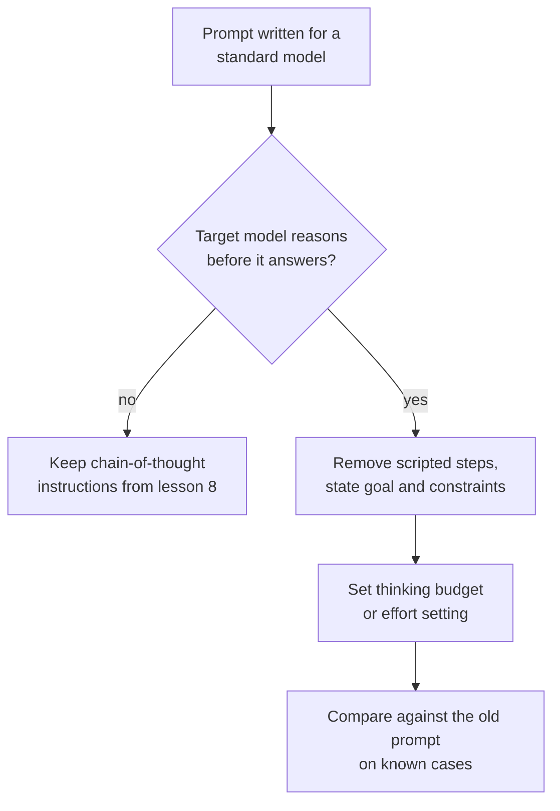

# Lição 10. Prompting de modelos de raciocínio

**Ligação com a missão:** A etapa 4 termina em uma decisão: pedir ou não raciocínio depende do modelo, e para um modelo que já raciocina o velho hábito de roteirizar os passos pode atrapalhar.
**Fonte principal:** [Docs: "Prompting best practices", Claude Platform Docs](https://platform.claude.com/docs/en/build-with-claude/prompt-engineering/claude-prompting-best-practices#leverage-thinking-and-interleaved-thinking-capabilities)
**Pré-requisitos:** [Lição 9](0009-self-consistency-and-faithfulness.md), [Modelo de raciocínio](../GLOSSARY.md), [Chain-of-thought](../GLOSSARY.md)

## Aquecimento

1. ▢ A lição 8 pedia raciocínio no prompt porque, do contrário, o modelo responderia de imediato. O que muda se o modelo raciocina antes de cada resposta sem que lhe peçam?

<details markdown="1"><summary>Verificação</summary>

O raciocínio que você pediria já está acontecendo, então a instrução ou o duplica ou tenta direcioná-lo. A pergunta passa de "devo pedir raciocínio?" para "quanto o modelo deve pensar e o que devo dizer a ele sobre o objetivo?".

</details>

2. ▢ A lição 9 disse que o raciocínio escrito pode omitir o que levou a uma resposta. Isso impede você de usar o raciocínio de um modelo para depurar uma resposta ruim?

<details markdown="1"><summary>Verificação</summary>

Não, mas limita o que você pode concluir. O raciocínio é evidência do que o modelo escreveu a caminho da resposta, o que costuma ser uma pista útil, e não é prova da causa. Confirme uma causa suspeita mudando o prompt e executando de novo (lição 9).

</details>

## Saiba isto

### O que um modelo de raciocínio muda

Um **modelo de raciocínio** produz uma fase interna de raciocínio antes da resposta visível, então raciocina sem que lhe peçam. As lições 8 e 9 tratavam de fazer um modelo escrever raciocínio. Com um modelo de raciocínio, esse trabalho é feito pelo próprio modelo, e o papel do seu prompt passa a ser dizer o que você quer e quais limites se aplicam.

Esta lição usa a documentação da Anthropic como fonte, então o que se segue é o comportamento documentado por um único fornecedor. Os modelos de raciocínio de outros provedores têm controles e recomendações próprios, e o princípio aqui deve ser conferido na documentação do seu modelo. Os guias da OpenAI não puderam ser verificados (veja RESOURCES.md), então esta lição não os cobre.

### Dê objetivos, não passos roteirizados

O guia de boas práticas da Anthropic diz para preferir instruções gerais a passos prescritivos: um prompt como "think thoroughly" costuma produzir um raciocínio melhor do que um plano passo a passo escrito à mão, porque o raciocínio do modelo muitas vezes excede o que uma pessoa prescreveria.

Então não cole um roteiro passo a passo em um modelo que já raciocina. Um roteiro fixa o caminho e limita o modelo ao caminho que você foi capaz de imaginar. Declare o objetivo, as restrições e como é uma boa resposta (lição 3), e deixe o modelo escolher os passos.

```text
Instead of this:
Step 1: list the facts. Step 2: list the unknowns. Step 3: pick
a formula. Step 4: substitute. Step 5: check units.
Solve: ...

Write this:
Find the shortest route that visits every depot once and returns
to the start. Distances are in the table. Give the route and its
total length. Check the total against the table before you answer.
```

A segunda versão ainda tem estrutura: um objetivo, uma restrição e uma verificação de aceitação. O que ela abandona é o caminho.

### O que ainda ajuda

- **Exemplos.** O guia diz que exemplos desenvolvidos moldam como o modelo aborda problemas parecidos no próprio raciocínio dele, e sugere apresentar cada um como o problema, o método a aplicar e a resposta esperada.
- **Uma verificação no final.** O guia sugere acrescentar uma instrução de verificação como "Before you finish, verify your answer against" seus critérios de teste. Ele também observa que um modelo, o Claude Opus 5, verifica por conta própria, e que instruções de verificação herdadas podem causar verificação excessiva nele, então teste de novo os prompts antigos quando trocar de modelo.
- **Chain-of-thought como alternativa.** Quando o thinking está desligado, o guia diz que você ainda pode pedir ao modelo que pense no problema antes de responder e que ponha a resposta final em tags `<answer>`. Para vários modelos mais novos, ele recomenda confiar no thinking e avisa que um prompt que pede ao modelo para escrever o raciocínio dentro de tags pode ser recusado.

### O orçamento é um controle separado

No modo manual de extended thinking da Anthropic, a quantidade de thinking é definida fora do texto do prompt, por `budget_tokens`, uma meta de quantos tokens o modelo pode usar em seu raciocínio interno. A documentação diz que o orçamento é uma meta e não um limite rígido, que os tokens de thinking contam para `max_tokens`, que o mínimo é 1.024, e que se deve começar perto desse mínimo em tarefas simples e a partir de 16.000 tokens ou mais nas complexas, ajustando depois. Quanto pensar é, portanto, uma configuração que você ajusta contra custo e latência, não uma frase que você acrescenta.

Para raciocínio dentro de um loop de agente, inclusive quando os passos de reflexão ainda compensam o custo, veja a [lição 17 da trilha de agentes](../../agents/lessons/0017-self-critique-and-reasoning-models.md).



## Prática

1. ▢ Preveja e depois execute. Pegue uma pergunta de vários passos que você consiga verificar. Escreva um prompt que roteiriza cinco passos numerados e outro que declara apenas o objetivo e a verificação. Preveja qual responde com mais confiabilidade em um modelo de raciocínio e então execute cada um três vezes.

<details markdown="1"><summary>Dica</summary>

A afirmação do guia é sobre o caminho: quem o escolhe, o modelo ou você. Pense em um caso em que o seu caminho não é o melhor.

</details>

<details markdown="1"><summary>Verificação</summary>

O guia prevê que o prompt baseado em objetivo se sai igual ou melhor, porque o raciocínio do modelo muitas vezes excede o plano que você roteirizaria. Se os dois empatarem no seu modelo e na sua tarefa, você aprendeu que o roteiro são tokens desnecessários, e isso ainda é um resultado. O guia não dá número, então só as suas três execuções de cada um decidem.

</details>

2. ▢ Um prompt escrito para um modelo padrão diz "Think step by step, then answer in `<answer>` tags." Você o move para um modelo de raciocínio. O que você mantém, tira e testa?

<details markdown="1"><summary>Verificação</summary>

Mantenha a tag de resposta, já que um programa pode lê-la. Tire a instrução "think step by step" como a primeira coisa a tentar, porque o modelo já raciocina e o guia prefere instruções gerais a passos prescritos. Teste o prompt novo contra o antigo em casos conhecidos, porque em alguns modelos mais novos um prompt que pede raciocínio escrito em tags pode ser recusado, então a linha antiga pode causar dano e não só desperdiçar tokens.

</details>

3. ▢ Seu orçamento para uma chamada de raciocínio é 800 tokens e a API a rejeita. Por quê, e o que você define para uma tarefa fácil?

<details markdown="1"><summary>Verificação</summary>

No modo manual de extended thinking da Anthropic, `budget_tokens` precisa ser de pelo menos 1.024, então 800 é rejeitado. Para uma tarefa fácil, comece perto de 1.024 e aumente só se as respostas forem ruins. Como os tokens de thinking contam para `max_tokens`, deixe também espaço sob `max_tokens` para a resposta final.

</details>

4. ▢ Qual reescrita segue a recomendação para um modelo que já raciocina?

    - a) Listar nove passos numerados que o modelo deve seguir em ordem
    - b) Declarar o objetivo, os limites e uma verificação a fazer antes de responder
    - c) Dizer ao modelo para escrever todo o raciocínio em tags primeiro
    - d) Remover o objetivo para que o modelo fique livre para escolher qualquer tarefa

<details markdown="1"><summary>Verificação</summary>

**b)** Ela mantém a estrutura que importa (objetivo, restrição, verificação de aceitação) e deixa o caminho para o modelo. (a) é o plano roteirizado contra o qual o guia aconselha. (c) é chain-of-thought manual, uma alternativa para quando o thinking está desligado, e pode ser recusada em alguns modelos mais novos. (d) vai longe demais: instruções gerais ainda precisam de um objetivo claro.

</details>

## Prática no mundo real

- [ ] Encontre um prompt seu que numera seus passos. Reescreva-o como objetivo, restrições e uma verificação e execute os dois em três casos conhecidos.
- [ ] Consulte a documentação do seu modelo sobre os controles de thinking ou de raciocínio e anote o nome da configuração que governa quanto ele pensa.
- [ ] Amanhã: pegue um prompt que você ajustou para um modelo mais antigo, remova a linha "think step by step" e compare as respostas em cinco casos conhecidos.

## Para ir além

- [Few-Shot e Raciocínio](../reference/few-shot-and-reasoning.md)
- [Docs: "Extended thinking", Claude Platform Docs](https://platform.claude.com/docs/en/build-with-claude/extended-thinking)
- [Recursos](../RESOURCES.md)

---

Não ficou claro? Releia a fonte primária no topo, já que esta lição a comprime e é na compressão que o entendimento escapa. Consulte o [glossário](../GLOSSARY.md) para qualquer termo que tenha parecido escorregadio.

Se o problema é a própria lição e não o material, isso é um defeito: [abra uma issue](https://github.com/TokenCemetery/teach/issues).
