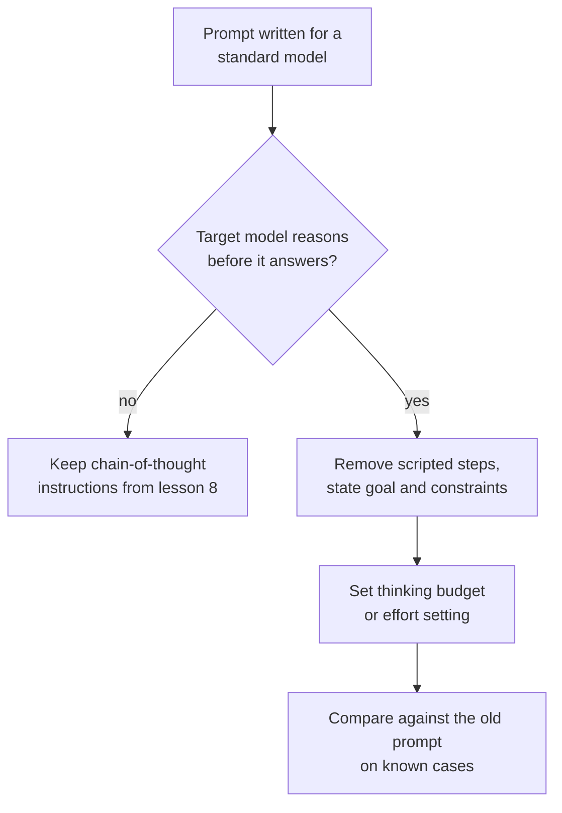

# Урок 10. Промптинг рассуждающих моделей

**Связь с целью курса:** Этап 4 заканчивается решением: просить ли рассуждение, зависит от модели, а для модели, которая уже рассуждает, старая привычка расписывать шаги может работать против неё.
**Первоисточник:** [Документация: "Prompting best practices", Claude Platform Docs](https://platform.claude.com/docs/en/build-with-claude/prompt-engineering/claude-prompting-best-practices#leverage-thinking-and-interleaved-thinking-capabilities)
**Предварительные требования:** [Урок 9](0009-self-consistency-and-faithfulness.md), [Рассуждающая модель](../GLOSSARY.md), [Цепочка рассуждений](../GLOSSARY.md)

## Разминка

1. ▢ В уроке 8 рассуждение запрашивалось в промпте, потому что иначе модель отвечала бы сразу. Что меняется, если модель рассуждает перед каждым ответом без просьбы?

<details markdown="1"><summary>Проверка</summary>

Рассуждение, о котором вы бы просили, уже происходит, поэтому инструкция либо дублирует его, либо пытается им управлять. Вопрос смещается с «просить ли рассуждение» на «сколько модели нужно думать и что ей сказать о цели».

</details>

2. ▢ В уроке 9 говорилось, что записанное рассуждение может опускать то, что привело к ответу. Мешает ли это использовать рассуждение модели для отладки плохого ответа?

<details markdown="1"><summary>Проверка</summary>

Нет, но это ограничивает выводы. Рассуждение свидетельствует о том, что модель написала на пути к ответу, и это часто полезная зацепка, но не доказательство причины. Подтверждайте предполагаемую причину, изменяя промпт и перезапуская (урок 9).

</details>

## Что нужно знать

### Что меняет рассуждающая модель

**Рассуждающая модель** создаёт внутреннюю фазу рассуждения перед видимым ответом, поэтому она рассуждает без просьбы. Уроки 8 и 9 были о том, как заставить модель писать рассуждение. С рассуждающей моделью эту работу делает сама модель, а задача вашего промпта смещается к тому, чтобы сказать, чего вы хотите и какие действуют ограничения.

Этот урок опирается на документацию Anthropic, поэтому дальнейшее это задокументированное поведение одного вендора. У рассуждающих моделей других провайдеров свои настройки и советы, а принцип отсюда нужно сверять с документацией вашей модели. Руководства OpenAI проверить не удалось (см. RESOURCES.md), поэтому урок их не охватывает.

### Давайте цели, а не расписанные шаги

Руководство Anthropic по лучшим практикам советует предпочитать общие инструкции предписывающим шагам: промпт вроде «think thoroughly» часто даёт рассуждение лучше, чем написанный вручную пошаговый план, потому что рассуждение модели нередко превосходит то, что предписал бы человек.

Поэтому не вставляйте пошаговый сценарий в модель, которая уже рассуждает. Сценарий фиксирует маршрут и ограничивает модель тем маршрутом, который смогли придумать вы. Укажите цель, ограничения и то, как выглядит хороший ответ (урок 3), и позвольте модели выбрать шаги.

```text
Instead of this:
Step 1: list the facts. Step 2: list the unknowns. Step 3: pick
a formula. Step 4: substitute. Step 5: check units.
Solve: ...

Write this:
Find the shortest route that visits every depot once and returns
to the start. Distances are in the table. Give the route and its
total length. Check the total against the table before you answer.
```

У второго варианта структура по-прежнему есть: цель, ограничение и проверка приёмки. Он отбрасывает лишь маршрут.

### Что всё ещё помогает

- **Примеры.** Руководство говорит, что разобранные примеры формируют то, как модель подходит к похожим задачам в собственном размышлении, и советует подавать каждый как задачу, применяемый метод и ожидаемый ответ.
- **Проверка в конце.** Руководство советует добавлять инструкцию верификации вроде «Before you finish, verify your answer against» ваши критерии проверки. Оно также отмечает, что одна модель, Claude Opus 5, проверяет сама, и что перенесённые инструкции верификации могут вызвать у неё избыточную проверку, поэтому при смене модели старые промпты нужно перепроверять.
- **Цепочка рассуждений как запасной вариант.** Когда размышление выключено, руководство говорит, что можно по-прежнему просить модель продумать задачу перед ответом и поместить итоговый ответ в теги `<answer>`. Для нескольких новых моделей оно рекомендует полагаться на размышление и предупреждает, что промпт с просьбой записать рассуждение в тегах может быть отклонён.

### Бюджет это отдельная настройка

В ручном режиме расширенного размышления у Anthropic объём размышления задаётся вне текста промпта параметром `budget_tokens`, целевым числом токенов, которое модель может потратить на внутреннее рассуждение. Документация говорит, что бюджет это цель, а не жёсткий предел, что токены размышления входят в `max_tokens`, что минимум составляет 1 024 и что для простых задач стоит начинать около этого минимума, а для сложных от 16 000 токенов и больше, затем подстраивать. Сколько думать, это поэтому настройка, которую вы подбираете с учётом стоимости и задержки, а не предложение, которое вы добавляете.

О рассуждении внутри цикла агента, в том числе о том, когда шаги рефлексии всё ещё окупаются, см. [llm/agents, урок 17](../../agents/lessons/0017-self-critique-and-reasoning-models.md).



## Практика

1. ▢ Предскажите, затем запустите. Возьмите многошаговый вопрос, ответ на который можно проверить. Напишите один промпт, расписывающий пять нумерованных шагов, и один, указывающий только цель и проверку. Предскажите, какой надёжнее отвечает на рассуждающей модели, затем запустите каждый по три раза.

<details markdown="1"><summary>Подсказка</summary>

Утверждение руководства касается маршрута: кто его выбирает, модель или вы. Подумайте о случае, когда ваш маршрут не лучший.

</details>

<details markdown="1"><summary>Проверка</summary>

Руководство предсказывает, что промпт с целью справляется не хуже или лучше, потому что рассуждение модели часто превосходит план, который вы бы расписали. Если на вашей модели и задаче оба равны, вы узнали, что сценарий это лишние токены, и это тоже результат. Руководство не даёт чисел, поэтому решают только ваши три запуска каждого.

</details>

2. ▢ Промпт, написанный для обычной модели, говорит «Think step by step, then answer in `<answer>` tags.» Вы переносите его на рассуждающую модель. Что вы оставите, что уберёте и что проверите?

<details markdown="1"><summary>Проверка</summary>

Тег ответа оставьте, поскольку его может читать программа. Инструкцию «think step by step» уберите первой, потому что модель уже рассуждает, а руководство предпочитает общие инструкции предписанным шагам. Проверьте новый промпт против старого на известных случаях: у некоторых новых моделей промпт с просьбой записать рассуждение в тегах может быть отклонён, так что старая строка способна не только тратить токены впустую, но и вредить.

</details>

3. ▢ Ваш бюджет для вызова с рассуждением равен 800 токенам, и API его отклоняет. Почему, и что вы зададите для лёгкой задачи?

<details markdown="1"><summary>Проверка</summary>

В ручном режиме расширенного размышления у Anthropic `budget_tokens` должен быть не меньше 1 024, поэтому 800 отклоняется. Для лёгкой задачи начните около 1 024 и повышайте, только если ответы плохие. Так как токены размышления входят в `max_tokens`, оставьте в `max_tokens` и запас под итоговый ответ.

</details>

4. ▢ Какая переработка следует совету для модели, которая уже рассуждает?

    - a) Перечислить девять нумерованных шагов, которым модель обязана следовать по порядку
    - b) Указать цель, ограничения и проверку, которую нужно выполнить перед ответом
    - c) Велеть модели сначала записать всё своё рассуждение в тегах
    - d) Убрать цель, чтобы модель могла свободно выбрать любую задачу

<details markdown="1"><summary>Проверка</summary>

**b)** Она сохраняет важную структуру (цель, ограничение, проверка приёмки) и оставляет маршрут модели. Вариант (a) это расписанный план, против которого советует руководство. Вариант (c) это ручная цепочка рассуждений, запасной вариант на случай, когда размышление выключено, и на некоторых новых моделях её могут отклонить. Вариант (d) заходит слишком далеко: общим инструкциям всё равно нужна ясная цель.

</details>

## Практика в реальной работе

- [ ] Найдите свой промпт с нумерованными шагами. Перепишите его как цель, ограничения и проверку, затем запустите оба на трёх известных случаях.
- [ ] Найдите в документации вашей модели её настройки размышления или рассуждения и запишите название параметра, который определяет, сколько она думает.
- [ ] Завтра: возьмите один промпт, настроенный под старую модель, уберите из него строку «think step by step» и сравните ответы на пяти известных случаях.

## Что почитать дальше

- [Few-shot и рассуждение](../reference/few-shot-and-reasoning.md)
- [Документация: "Extended thinking", Claude Platform Docs](https://platform.claude.com/docs/en/build-with-claude/extended-thinking)
- [Ресурсы](../RESOURCES.md)

---

Не доходит? Перечитайте первоисточник в начале: этот урок его сжимает, а при сжатии понимание как раз и теряется. Загляните в [глоссарий](../GLOSSARY.md), если какой-то термин показался скользким.

Если неясен сам урок, а не материал, это дефект: [откройте issue](https://github.com/TokenCemetery/teach/issues).
