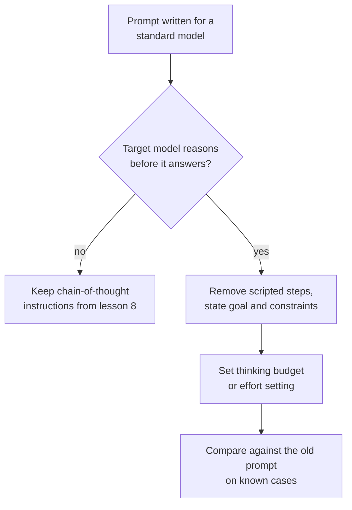

# 第 10 课：为推理模型写提示词

**使命关联:** 第 4 阶段以一个决定收尾：是否要求推理取决于模型，对于本身就会推理的模型，过去那种把步骤写死的习惯反而可能起反作用。
**主要来源:** [文档：“Prompting best practices”，Claude Platform Docs](https://platform.claude.com/docs/en/build-with-claude/prompt-engineering/claude-prompting-best-practices#leverage-thinking-and-interleaved-thinking-capabilities)
**前置知识:** [第 9 课](0009-self-consistency-and-faithfulness.md)、[推理模型](../GLOSSARY.md)、[思维链](../GLOSSARY.md)

## 热身

1. ▢ 第 8 课在提示词中要求推理，是因为模型否则会直接给出答案。如果模型在每次回答之前都会推理，不需要被要求，情况会有什么变化？

<details markdown="1"><summary>检查</summary>

你要求的推理本来就在发生，所以这条指令要么是重复，要么是想去引导它。问题从“我该不该要求推理”变成了“模型应该思考多少，以及我该告诉它哪些关于目标的信息”。

</details>

2. ▢ 第 9 课说过，写出来的推理可能略去驱动答案的因素。这是否意味着你不能用模型的推理来调试一个糟糕的答案？

<details markdown="1"><summary>检查</summary>

不是，但它限制了你能得出的结论。推理是模型在得出答案的过程中写下了什么的证据，往往是一条有用的线索，但并不能证明原因。要确认一个怀疑的原因，就改动提示词并重新运行（第 9 课）。

</details>

## 要点

### 推理模型带来了什么变化

**推理模型**会在可见的回答之前产生一个内部推理阶段，所以不需要被要求就会推理。第 8 课和第 9 课讲的是如何让模型写出推理。对于推理模型，这项工作由模型自己完成，而你的提示词的任务变成了说明你想要什么，以及有哪些限制。

本课以 Anthropic 的文档为来源，所以下面的内容是一家厂商有文档记载的行为。其他服务商的推理模型有各自的控制方式和建议，这里的原则应当对照你所用模型的文档来核实。OpenAI 的指南无法核实（见 RESOURCES.md），所以本课不涉及它们。

### 给目标，而不是写死的步骤

Anthropic 的最佳实践指南说，相比规定好的步骤，更应当采用通用的指令：像“think thoroughly”这样的提示词，往往比手写的分步计划产生更好的推理，因为模型的推理经常超出人类会规定的内容。

所以，不要把分步骤的脚本粘贴给一个本来就会推理的模型。脚本固定了路线，把模型限制在你能想到的路线上。说明目标、约束和好的答案是什么样子（第 3 课），让模型自己选择步骤。

```text
Instead of this:
Step 1: list the facts. Step 2: list the unknowns. Step 3: pick
a formula. Step 4: substitute. Step 5: check units.
Solve: ...

Write this:
Find the shortest route that visits every depot once and returns
to the start. Distances are in the table. Give the route and its
total length. Check the total against the table before you answer.
```

第二个版本仍然有结构：一个目标、一条约束和一项验收检查。它去掉的是路线。

### 仍然有帮助的做法

- **示例。** 指南说，完整的示例会影响模型在自己的思考中如何处理类似的问题，并建议把每个示例写成问题、要应用的方法和期望的答案。
- **结尾的检查。** 指南建议附加一条验证指令，比如“Before you finish, verify your answer against”你的测试标准。它还指出有一个模型 Claude Opus 5 会自行验证，沿用旧的验证指令可能会导致它过度验证，所以换模型时要重新测试旧提示词。
- **思维链作为后备。** 当思考功能关闭时，指南说你仍然可以要求模型在回答之前先思考问题，并把最终答案放在 `<answer>` 标签里。对于几个较新的模型，它建议改为依靠思考功能，并提醒说，要求模型把推理写在标签里的提示词可能会被拒绝。

### 预算是另一个独立的控制项

在 Anthropic 的手动扩展思考模式下，思考量是在提示词文本之外设定的，通过 `budget_tokens`，这是模型可用于内部推理的 token 数目标。文档说，这个预算是目标而不是硬上限，思考 token 计入 `max_tokens`，最小值是 1,024，简单任务应从接近这个最小值开始，复杂任务则从 16,000 token 或更多开始，然后再调整。所以思考多少是一个要结合成本和延迟来调的设置，而不是你多加一句话就能解决的。

关于智能体循环中的推理，包括反思步骤何时仍然值得其成本，请参阅 [智能体系列第 17 课：自我批评与推理模型带来的变化](../../agents/lessons/0017-self-critique-and-reasoning-models.md)。



## 练习

1. ▢ 先预测，再运行。选一个你能验证答案的多步骤问题。写一个提示词，把五个编号步骤写死，再写一个只说明目标和检查。预测在推理模型上哪个答得更可靠，然后各运行三次。

<details markdown="1"><summary>提示</summary>

指南的主张针对的是路线：由谁来选，是模型还是你。想一想你的路线并非最佳路线的情形。

</details>

<details markdown="1"><summary>检查</summary>

指南预测基于目标的提示词表现相当或更好，因为模型的推理往往超出你会写死的计划。如果在你的模型和任务上两者不相上下，你就得知了脚本是不必要的 token，这同样是一个结果。指南没有给出数字，所以只有你各自的三次运行才能决定。

</details>

2. ▢ 一个为标准模型写的提示词说：“Think step by step, then answer in `<answer>` tags.” 你把它迁移到推理模型上。你保留什么、去掉什么、测试什么？

<details markdown="1"><summary>检查</summary>

保留答案标签，因为程序可能会读取它。先试着去掉“think step by step”这条指令，因为模型本来就会推理，而且指南更倾向通用指令而不是规定好的步骤。把新提示词和旧提示词在已知用例上对比测试，因为对某些较新的模型，要求把推理写在标签里的提示词可能会被拒绝，所以旧的那一行不只是浪费 token，还可能造成危害。

</details>

3. ▢ 你为一次推理调用设置的预算是 800 token，API 拒绝了它。原因是什么？对于一个简单任务你该设多少？

<details markdown="1"><summary>检查</summary>

在 Anthropic 的手动扩展思考模式下，`budget_tokens` 必须至少为 1,024，所以 800 会被拒绝。对简单任务，从接近 1,024 开始，只在答案不佳时再调高。由于思考 token 计入 `max_tokens`，还要在 `max_tokens` 之内给最终答案留出空间。

</details>

4. ▢ 对于一个本来就会推理的模型，哪种改写符合本课的建议？

    - a) 列出九个编号步骤，要求模型按顺序执行
    - b) 说明目标、限制，以及回答之前要做的检查
    - c) 让模型先把全部推理写在标签里
    - d) 去掉目标，让模型自由选择任何任务

<details markdown="1"><summary>检查</summary>

**b)** 它保留了重要的结构（目标、约束、验收检查），并把路线留给模型。(a) 就是指南建议避免的写死的计划。(c) 是手动思维链，是思考功能关闭时的后备做法，在一些较新的模型上可能被拒绝。(d) 走得太远了：通用指令仍然需要一个明确的目标。

</details>

## 实战练习

- [ ] 找一个你写的、给步骤编了号的提示词。把它改写成目标、约束和检查，然后在三个已知用例上把两个版本都运行一遍。
- [ ] 查阅你所用模型的文档，找到它的思考或推理控制项，记下控制思考量的那个设置的名称。
- [ ] 明天：拿一个你为旧模型调好的提示词，去掉其中的“think step by step”这一行，在五个已知用例上比较答案。

## 延伸阅读

- [少样本与推理](../reference/few-shot-and-reasoning.md)
- [文档：“Extended thinking”，Claude Platform Docs](https://platform.claude.com/docs/en/build-with-claude/extended-thinking)
- [资源](../RESOURCES.md)

---

没学明白？请重读顶部的主要来源，因为本课是对它的压缩，而理解正是在压缩中流失的。如果有哪个术语觉得含糊，可以查看[术语表](../GLOSSARY.md)。

如果问题出在课程本身，而不是学习材料，那就是一个缺陷：[提交 issue](https://github.com/TokenCemetery/teach/issues)。
