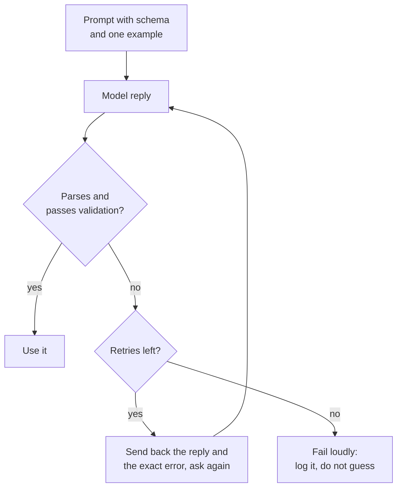

# Lección 11. Salida estructurada desde el prompt

**Vínculo con la misión:** Una funcionalidad con LLM solo le sirve al programa que hay detrás si la respuesta se puede interpretar, así que esta lección consigue una salida que un programa pueda leer y trata cada respuesta como una entrada que hay que comprobar.
**Fuente principal:** [Documentación: "Structured outputs", Claude Platform Docs](https://platform.claude.com/docs/en/build-with-claude/structured-outputs)
**Requisitos previos:** [Lección 10](0010-prompting-reasoning-models.md), [Salida estructurada](../GLOSSARY.md), [Delimitador](../GLOSSARY.md)

## Calentamiento

1. ▢ La lección 3 decía que una instrucción debe indicar cómo se ve el trabajo terminado. ¿Por qué eso importa más cuando quien lee la respuesta es un programa y no una persona?

<details markdown="1"><summary>Comprobación</summary>

Una persona pasa de largo ante una frase de apertura amable o una nota suelta. Un parser no: todo lo que quede fuera del formato acordado es un error. Por eso "terminado" debe nombrar la forma exacta de la respuesta, incluido que no puede aparecer nada más a su alrededor.

</details>

2. ▢ La lección 4 usó delimitadores para mantener los datos separados de las instrucciones. Nombra un lugar donde un delimitador ayuda en un prompt que pide salida estructurada.

<details markdown="1"><summary>Comprobación</summary>

Envolver el texto de entrada en etiquetas para que el modelo no lo confunda con parte de la instrucción y, en la instrucción, delimitar la salida de ejemplo para que quede claro que es un ejemplo y no texto que continuar.

</details>

## Qué debes saber

### Describe el esquema y muestra un ejemplo

Un prompt que pide **salida estructurada** necesita tres cosas: los campos con una breve descripción de cada uno, los valores permitidos para cualquier campo que sea un conjunto fijo, y un ejemplo completo de una respuesta correcta. El ejemplo es lo que más trabajo hace, ya que la lección 6 mostró que las demostraciones enseñan sobre todo el formato.

```text
Extract the contact details from the email below.
Reply with one JSON object and nothing else, no text before or after it.

Fields:
- name: string, the sender's full name
- email: string, the sender's address
- plan_interest: one of "Free", "Pro", "Enterprise"
- demo_requested: true or false

Example reply:
{"name": "Ana Lopez", "email": "ana@example.com", "plan_interest": "Pro", "demo_requested": false}

<email>
John Smith (john@example.com) is interested in our Enterprise plan and wants to schedule a demo for next Tuesday at 2pm.
</email>
```

### Interpreta y valida cada respuesta

Trata la respuesta como entrada no confiable. Interprétala y luego compárala con el esquema: las claves obligatorias están presentes, los tipos son correctos y un campo de conjunto fijo contiene uno de los valores permitidos. Interpretarla no basta, porque una respuesta puede ser JSON válido y aun así incorrecta para tu programa.



### Repara mostrando el error

Un reintento funciona mejor cuando lleva consigo el fallo: la respuesta anterior y el problema concreto, como una clave ausente o un valor fuera del conjunto permitido. Limita los reintentos. La guía de prompting de Anthropic dice que los modelos más recientes pueden ajustarse de forma fiable a esquemas complejos cuando se les pide, sobre todo si se implementa con reintentos, que es el bucle de arriba.

### Pedir no es una garantía

Un prompt es una petición. El modelo suele cumplirla y a veces no, así que un bucle de interpretar, validar y reintentar forma parte del diseño, no es un parche.

Algunos proveedores ofrecen imponer el esquema en su lugar. La función de structured outputs de Anthropic recibe un esquema JSON en `output_config.format` y devuelve un JSON que lo cumple. Esa es una función de un solo proveedor, y es un mecanismo distinto de pedir: el esquema restringe la generación. El lado del servicio de esa idea se cubre en [Muestreo y decodificación restringida al servir](../../inference/lessons/0019-sampling-and-constrained-decoding-at-serve-time.md).

Aun así, la misma página enumera casos en que la salida puede no coincidir: un rechazo, una respuesta cortada en el límite de tokens y valores de enum cuyas mayúsculas y minúsculas pueden variar. Por eso se valida en ambos casos.

La misma guía de prompting enumera el prefilling de respuesta, donde empiezas tú la respuesta del modelo para forzar un formato como JSON, entre los patrones de los que se está alejando, y remite a structured outputs o a una instrucción. Esta lección no enseña el prefilling.

## Práctica

1. ▢ Predice y luego comprueba. Un prompt pide un objeto JSON con tres campos. El modelo responde: `Sure! Here is the JSON you asked for:` seguido de un objeto correcto en la línea siguiente. ¿`json.loads` sobre la respuesta completa tiene éxito, y cuál es la corrección del lado del prompt?

<details markdown="1"><summary>Pista</summary>

Un parser lee la respuesta desde su primer carácter.

</details>

<details markdown="1"><summary>Comprobación</summary>

Falla: el saludo no es JSON. La corrección del lado del prompt es decir que la respuesta debe ser solo el objeto, sin texto antes ni después, y la corrección del lado del programa es validar y reintentar cuando falla la interpretación. Que el objeto sea correcto no ayuda, porque el parser nunca llega a él.

</details>

2. ▢ Una respuesta falla la validación porque falta un campo obligatorio. ¿Cuál es el mejor mensaje de reintento?

    - a) Your reply was invalid. Try again and be more careful this time.
    - b) Your reply was missing the required key "email". Return the full object again, including it.
    - c) Please reply again in JSON, since the last reply did not work for us.
    - d) The format was wrong. Follow the instructions at the top of this prompt.

<details markdown="1"><summary>Comprobación</summary>

b. Nombra el problema exacto y la corrección. Las opciones a, c y d solo dicen que la respuesta falló, así que el modelo tiene que adivinar qué cambiar y puede repetir el mismo error.

</details>

3. ▢ Predice y luego comprueba. El esquema dice que `plan_interest` es uno de "Free", "Pro", "Enterprise" y que `email` y `demo_requested` (true o false) son obligatorios. La respuesta es `{"name": "John Smith", "plan_interest": "enterprise", "demo_requested": "yes"}`. Enumera todas las formas en que falla la validación.

<details markdown="1"><summary>Pista</summary>

Comprueba las claves obligatorias, luego el tipo de cada valor y luego cada conjunto fijo.

</details>

<details markdown="1"><summary>Comprobación</summary>

Tres fallos. Falta la clave obligatoria `email`. `plan_interest` es "enterprise", que se diferencia de "Enterprise" solo en las mayúsculas, así que no está en el conjunto permitido. `demo_requested` es la cadena "yes" donde se exigía un booleano. La respuesta se interpreta como JSON válido, y por eso interpretar no equivale a validar.

</details>

4. ▢ Escribe el prompt para esta tarea: leer una reseña de cliente y devolver su sentimiento (una de tres etiquetas) y una puntuación de 1 a 5. Incluye los campos, los valores permitidos, una respuesta de ejemplo y la instrucción sobre texto adicional.

<details markdown="1"><summary>Comprobación</summary>

Una buena respuesta tiene: una instrucción de que la respuesta es un único objeto JSON y nada más; una lista de campos como `sentiment` ("positive", "neutral" o "negative") y `score` (entero de 1 a 5); una respuesta de ejemplo completa con ambos campos; y la reseña dentro de delimitadores. Lo que suele faltar es el ejemplo o la línea de valores permitidos, ya que son los que llevan el formato.

</details>

5. ▢ Un compañero dice: "Le dijimos al modelo que devolviera solo JSON, así que no necesitamos validación". ¿Qué respuesta es la más acertada?

    - a) Correcto, porque una instrucción en el prompt fija el formato.
    - b) Incorrecto, ya que una instrucción pide el formato y no impone nada.
    - c) Correcto, siempre que la respuesta de ejemplo del prompt también sea válida.
    - d) Incorrecto, porque la validación solo hace falta cuando un proveedor impone esquemas.

<details markdown="1"><summary>Comprobación</summary>

b. Una instrucción de prompt es una petición que el modelo suele seguir, así que las respuestas aún deben comprobarse. Las opciones a y c tratan la petición como imposición. La opción d invierte el punto: la validación hace falta en ambos casos, y la página de Anthropic enumera rechazos, cortes por límite de tokens y mayúsculas de enum como casos en que incluso la salida impuesta puede no coincidir.

</details>

## Prácticas en el mundo real

- [ ] Hoy: en una ventana de chat, pide un objeto JSON pequeño (tres campos) usando la lista de campos y el ejemplo de esta lección. Pega la respuesta en un validador de JSON o ejecuta `python3 -m json.tool` sobre ella, y anota si se interpretó y si cada valor está permitido.
- [ ] Mañana: reutiliza el prompt de ayer con tres entradas distintas, una de ellas incómoda (información ausente o texto con comillas). Registra qué respuestas fallaron la validación y por qué.
- [ ] Encuentra un prompt que uses que pida una lista o una tabla, y reescríbelo para pedir JSON con una lista de campos y un ejemplo. Compara las respuestas.

## Para profundizar

- [Documentación: "Structured outputs", Claude Platform Docs](https://platform.claude.com/docs/en/build-with-claude/structured-outputs)
- [Documentación: "Prompting best practices", Claude Platform Docs](https://platform.claude.com/docs/en/build-with-claude/prompt-engineering/claude-prompting-best-practices)
- [Salida estructurada y contexto largo](../reference/structured-output-and-long-context.md)
- [Recursos](../RESOURCES.md)

---

¿No termina de quedar claro? Vuelve a leer la fuente principal del inicio, porque esta lección la comprime y en la compresión es donde se pierde la comprensión. Consulta el [glosario](../GLOSSARY.md) para cualquier término que te haya parecido resbaladizo.

Si lo poco claro es la lección y no el material, eso es un defecto: [abre un issue](https://github.com/TokenCemetery/teach/issues).
