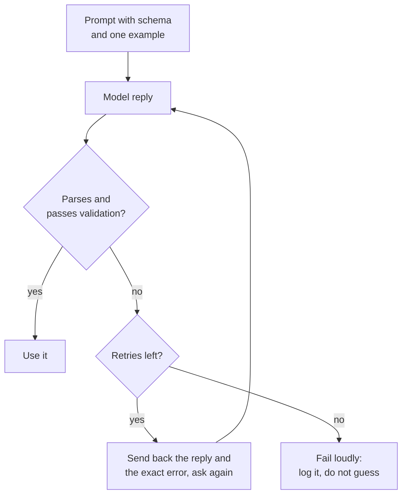

# Leçon 11. Sortie structurée depuis le prompt

**Lien avec la mission :** Une fonctionnalité LLM n'est utile au programme qui la sert que si la réponse peut être analysée. Cette leçon obtient donc une sortie qu'un programme peut lire et traite chaque réponse comme une entrée à vérifier.
**Source primaire :** [Doc : "Structured outputs", Claude Platform Docs](https://platform.claude.com/docs/en/build-with-claude/structured-outputs)
**Prérequis :** [Leçon 10](0010-prompting-reasoning-models.md), [Sortie structurée](../GLOSSARY.md), [Délimiteur](../GLOSSARY.md)

## Échauffement

1. ▢ La leçon 3 disait qu'une instruction doit énoncer à quoi ressemble « terminé ». Pourquoi cela compte-t-il davantage quand c'est un programme, et non une personne, qui lit la réponse ?

<details markdown="1"><summary>Vérifier</summary>

Une personne survole une phrase d'ouverture aimable ou une note parasite. Un parseur, non : tout ce qui sort du format convenu est une erreur. « Terminé » doit donc nommer la forme exacte de la réponse, y compris le fait que rien d'autre ne doit apparaître autour.

</details>

2. ▢ La leçon 4 utilisait des délimiteurs pour séparer les données des instructions. Nommez un endroit où un délimiteur aide dans un prompt qui demande une sortie structurée.

<details markdown="1"><summary>Vérifier</summary>

Envelopper le texte d'entrée dans des balises pour que le modèle ne le prenne pas pour une partie de l'instruction, et, dans l'instruction, délimiter la sortie d'exemple pour qu'elle soit clairement un exemple et non un texte à poursuivre.

</details>

## À savoir

### Décrire le schéma et montrer un exemple

Un prompt qui demande une **sortie structurée** a besoin de trois choses : les champs avec une courte description de chacun, les valeurs autorisées pour tout champ qui relève d'un ensemble fixe, et un exemple complet d'une réponse correcte. L'exemple fait le plus gros du travail, puisque la leçon 6 a montré que les démonstrations enseignent surtout le format.

```text
Extract the contact details from the email below.
Reply with one JSON object and nothing else, no text before or after it.

Fields:
- name: string, the sender's full name
- email: string, the sender's address
- plan_interest: one of "Free", "Pro", "Enterprise"
- demo_requested: true or false

Example reply:
{"name": "Ana Lopez", "email": "ana@example.com", "plan_interest": "Pro", "demo_requested": false}

<email>
John Smith (john@example.com) is interested in our Enterprise plan and wants to schedule a demo for next Tuesday at 2pm.
</email>
```

### Analyser et valider chaque réponse

Traitez la réponse comme une entrée non fiable. Analysez-la, puis vérifiez-la par rapport au schéma : les clés requises sont présentes, les types sont corrects, et un champ à ensemble fixe contient l'une des valeurs autorisées. L'analyse seule ne suffit pas, car une réponse peut être du JSON valide et rester fausse pour votre programme.



### Réparer en montrant l'erreur

Une nouvelle tentative fonctionne mieux quand elle porte l'échec : la réponse précédente et le problème précis, comme une clé manquante ou une valeur hors de l'ensemble autorisé. Plafonnez les tentatives. Le guide de prompting d'Anthropic dit que les modèles récents peuvent respecter de façon fiable des schémas complexes quand on le leur demande, surtout avec des nouvelles tentatives, ce qui correspond à la boucle ci-dessus.

### Demander n'est pas une garantie

Un prompt est une demande. Le modèle s'y conforme généralement et parfois non : une boucle analyser-valider-réessayer fait donc partie de la conception, ce n'est pas une rustine.

Certains fournisseurs proposent à la place d'imposer le schéma. La fonctionnalité de sorties structurées d'Anthropic prend un schéma JSON dans `output_config.format` et renvoie un JSON qui lui correspond. C'est la fonctionnalité d'un seul éditeur, et c'est un mécanisme différent de la simple demande : le schéma contraint la génération. Le côté serving de cette idée est traité dans [Échantillonnage et décodage contraint au moment du serving](../../inference/lessons/0019-sampling-and-constrained-decoding-at-serve-time.md).

Même alors, la même page liste des cas où la sortie peut ne pas correspondre : un refus, une réponse coupée à la limite de tokens et des valeurs d'enum dont la casse peut différer. Validez donc dans les deux cas.

Le même guide de prompting classe le préremplissage de réponse (prefilling), où l'on commence soi-même la réponse du modèle pour forcer un format comme le JSON, parmi les schémas dont il s'éloigne, et renvoie vers les sorties structurées ou une instruction. Cette leçon n'enseigne pas le prefilling.

## Pratique

1. ▢ Prédisez, puis vérifiez. Un prompt demande un objet JSON à trois champs. Le modèle répond : `Sure! Here is the JSON you asked for:` suivi d'un objet correct à la ligne suivante. `json.loads` sur la réponse entière réussit-il, et quel est le correctif côté prompt ?

<details markdown="1"><summary>Indice</summary>

Un parseur lit la réponse dès son premier caractère.

</details>

<details markdown="1"><summary>Vérifier</summary>

Il échoue : la formule d'accueil n'est pas du JSON. Le correctif côté prompt est de dire que la réponse doit être l'objet seul, sans texte avant ni après, et le correctif côté programme est de valider et de réessayer quand l'analyse échoue. Que l'objet soit correct n'aide pas, car le parseur n'arrive jamais jusqu'à lui.

</details>

2. ▢ Une réponse échoue à la validation parce qu'un champ requis manque. Quel message de nouvelle tentative est le meilleur ?

    - a) Your reply was invalid. Try again and be more careful this time.
    - b) Your reply was missing the required key "email". Return the full object again, including it.
    - c) Please reply again in JSON, since the last reply did not work for us.
    - d) The format was wrong. Follow the instructions at the top of this prompt.

<details markdown="1"><summary>Vérifier</summary>

b. Il nomme le problème exact et la correction. Les options a, c et d disent seulement que la réponse a échoué, donc le modèle doit deviner quoi changer et peut répéter la même erreur.

</details>

3. ▢ Prédisez, puis vérifiez. Le schéma dit que `plan_interest` est l'un de "Free", "Pro", "Enterprise" et que `email` et `demo_requested` (true ou false) sont requis. La réponse est `{"name": "John Smith", "plan_interest": "enterprise", "demo_requested": "yes"}`. Listez toutes les façons dont elle échoue à la validation.

<details markdown="1"><summary>Indice</summary>

Vérifiez les clés requises, puis le type de chaque valeur, puis chaque ensemble fixe.

</details>

<details markdown="1"><summary>Vérifier</summary>

Trois échecs. La clé requise `email` est absente. `plan_interest` vaut "enterprise", qui ne diffère de "Enterprise" que par la casse, donc n'est pas dans l'ensemble autorisé. `demo_requested` est la chaîne "yes" là où un booléen était requis. La réponse s'analyse comme du JSON valide, ce qui explique que l'analyse seule ne soit pas une validation.

</details>

4. ▢ Écrivez le prompt de cette tâche : lire un avis client et renvoyer son sentiment (l'un de trois labels) et une note de 1 à 5. Incluez les champs, les valeurs autorisées, un exemple de réponse et l'instruction sur le texte superflu.

<details markdown="1"><summary>Vérifier</summary>

Une bonne réponse comporte : une instruction disant que la réponse est un unique objet JSON et rien d'autre ; une liste de champs comme `sentiment` ("positive", "neutral" ou "negative") et `score` (entier de 1 à 5) ; un exemple complet de réponse avec les deux champs ; et l'avis placé dans des délimiteurs. L'absence de l'exemple ou de la ligne des valeurs autorisées est la lacune habituelle, puisque ce sont eux qui portent le format.

</details>

5. ▢ Un coéquipier dit : « Nous avons dit au modèle de ne renvoyer que du JSON, donc nous n'avons pas besoin de validation. » Quelle réponse est la plus exacte ?

    - a) Correct, parce qu'une instruction dans le prompt fixe le format.
    - b) Faux, puisqu'une instruction demande le format et n'impose rien.
    - c) Correct, tant que l'exemple de réponse du prompt est lui aussi valide.
    - d) Faux, parce que la validation n'est nécessaire que lorsqu'un fournisseur impose des schémas.

<details markdown="1"><summary>Vérifier</summary>

b. Une instruction de prompt est une demande que le modèle suit généralement, donc les réponses doivent quand même être vérifiées. Les options a et c traitent la demande comme une contrainte imposée. L'option d inverse le propos : la validation est nécessaire dans les deux cas, et la page d'Anthropic liste les refus, les coupures à la limite de tokens et la casse des enums comme des cas où même une sortie imposée peut ne pas correspondre.

</details>

## Exercices en situation réelle

- [ ] Aujourd'hui : dans une fenêtre de chat, demandez un petit objet JSON (trois champs) en utilisant la liste de champs et l'exemple de cette leçon. Collez la réponse dans un validateur JSON ou exécutez `python3 -m json.tool` dessus, et notez si elle s'est analysée et si chaque valeur est autorisée.
- [ ] Demain : réutilisez le prompt d'hier sur trois entrées différentes, dont l'une est délicate (information manquante, ou texte avec des guillemets). Notez quelles réponses ont échoué à la validation et pourquoi.
- [ ] Trouvez un prompt que vous utilisez qui demande une liste ou un tableau, et réécrivez-le pour demander du JSON avec une liste de champs et un exemple. Comparez les réponses.

## Pour aller plus loin

- [Doc : "Structured outputs", Claude Platform Docs](https://platform.claude.com/docs/en/build-with-claude/structured-outputs)
- [Doc : "Prompting best practices", Claude Platform Docs](https://platform.claude.com/docs/en/build-with-claude/prompt-engineering/claude-prompting-best-practices)
- [Sortie structurée et long contexte](../reference/structured-output-and-long-context.md)
- [Ressources](../RESOURCES.md)

---

Ça ne passe pas ? Relisez la source primaire en haut de page, car cette leçon la condense et c'est dans la condensation que la compréhension s'échappe. Consultez le [glossaire](../GLOSSARY.md) pour tout terme qui vous a paru glissant.

Si c'est la leçon elle-même qui n'est pas claire plutôt que la matière, c'est un défaut : [ouvrez une issue](https://github.com/TokenCemetery/teach/issues).
