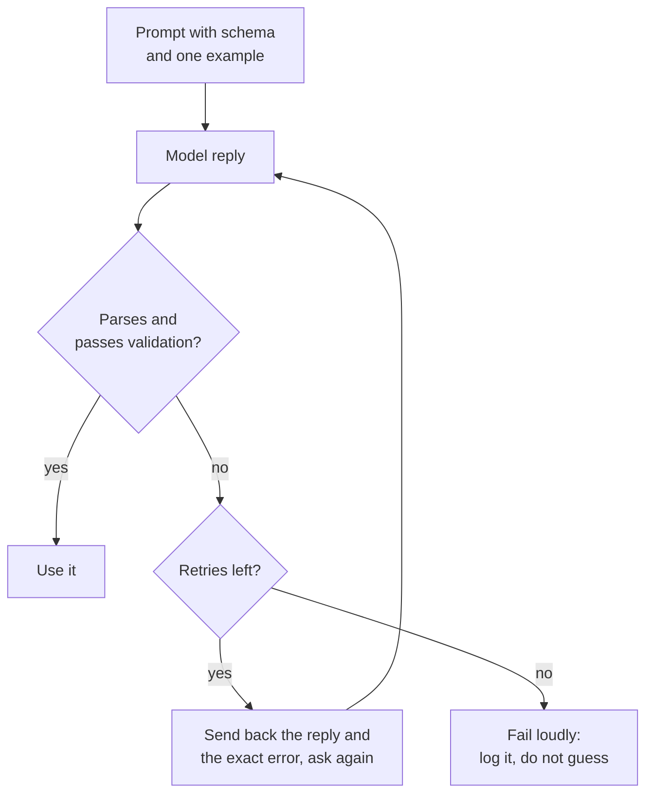

# पाठ 11. Prompt से Structured Output

**मिशन से संबंध:** LLM फ़ीचर उसके पीछे के program के काम का तभी है जब reply parse हो सके। इसलिए यह पाठ ऐसा output दिलाता है जिसे program पढ़ सके और हर reply को ऐसा input मानता है जिसकी जाँच होनी है।
**मुख्य स्रोत:** [Docs: "Structured outputs", Claude Platform Docs](https://platform.claude.com/docs/en/build-with-claude/structured-outputs)
**पूर्व-आवश्यकताएँ:** [पाठ 10](0010-prompting-reasoning-models.md), [Structured output](../GLOSSARY.md), [Delimiter](../GLOSSARY.md)

## वार्म-अप

1. ▢ पाठ 3 ने कहा था कि instruction को बताना चाहिए कि पूरा होना कैसा दिखता है। जब reply कोई इंसान नहीं बल्कि program पढ़ता है, तब यह ज़्यादा क्यों मायने रखता है?

<details markdown="1"><summary>जाँचें</summary>

इंसान दोस्ताना शुरुआती पंक्ति या भटके हुए नोट को छोड़कर आगे बढ़ जाता है। Parser नहीं बढ़ता: तय format के बाहर की हर चीज़ त्रुटि है। इसलिए "पूरा" को reply का सटीक आकार बताना होगा, यह भी कि उसके आसपास कुछ और नहीं आ सकता।

</details>

2. ▢ पाठ 4 ने delimiters से data को instructions से अलग रखा था। Structured output माँगने वाले prompt में एक जगह बताएँ जहाँ delimiter मदद करता है।

<details markdown="1"><summary>जाँचें</summary>

Input text को tags में लपेटना ताकि model उसे instruction का हिस्सा न समझ ले, और instruction में उदाहरण output को fence करना ताकि साफ़ रहे कि वह उदाहरण है, आगे बढ़ाने लायक text नहीं।

</details>

## यह जानें

### Schema बताएँ और एक उदाहरण दिखाएँ

**Structured output** माँगने वाले prompt को तीन चीज़ें चाहिए: fields, हर एक के छोटे वर्णन के साथ; ऐसे हर field के लिए अनुमत मान जो एक तय सेट है; और सही reply का एक पूरा उदाहरण। उदाहरण सबसे ज़्यादा काम करता है, क्योंकि पाठ 6 ने दिखाया था कि demonstrations ज़्यादातर format सिखाते हैं।

```text
Extract the contact details from the email below.
Reply with one JSON object and nothing else, no text before or after it.

Fields:
- name: string, the sender's full name
- email: string, the sender's address
- plan_interest: one of "Free", "Pro", "Enterprise"
- demo_requested: true or false

Example reply:
{"name": "Ana Lopez", "email": "ana@example.com", "plan_interest": "Pro", "demo_requested": false}

<email>
John Smith (john@example.com) is interested in our Enterprise plan and wants to schedule a demo for next Tuesday at 2pm.
</email>
```

### हर reply को parse और validate करें

Reply को untrusted input मानें। उसे parse करें, फिर schema से जाँचें: ज़रूरी keys मौजूद हैं, types सही हैं, और तय सेट वाला field अनुमत मानों में से एक रखता है। अकेला parsing काफ़ी नहीं है, क्योंकि reply वैध JSON होते हुए भी आपके program के लिए ग़लत हो सकती है।



### त्रुटि दिखाकर सुधार करवाएँ

Retry तब बेहतर काम करता है जब उसमें विफलता साथ हो: पिछला reply और ख़ास समस्या, जैसे कोई ग़ायब key या अनुमत सेट के बाहर का मान। Retries की सीमा तय करें। Anthropic की prompting गाइड कहती है कि नए models कहने पर जटिल schemas से भरोसे से मेल खा सकते हैं, ख़ासकर retries के साथ लागू किए जाने पर, और यही ऊपर का चक्र है।

### माँगना गारंटी नहीं है

Prompt एक अनुरोध है। Model आमतौर पर मानता है और कभी-कभी नहीं मानता, इसलिए parse-validate-retry का चक्र डिज़ाइन का हिस्सा है, कोई पैबंद नहीं।

कुछ providers इसके बजाय schema लागू करने की सुविधा देते हैं। Anthropic का structured outputs फ़ीचर `output_config.format` में JSON schema लेता है और उससे मेल खाता JSON लौटाता है। यह एक vendor का फ़ीचर है, और यह माँगने से अलग तंत्र है: schema generation को बाँधता है। उस विचार का serving वाला पक्ष [Serve Time पर Sampling और Constrained Decoding](../../inference/lessons/0019-sampling-and-constrained-decoding-at-serve-time.md) में है।

तब भी उसी पेज पर ऐसे मामले गिनाए गए हैं जहाँ output मेल न खाए: इनकार, token सीमा पर कटा हुआ reply, और enum मान जिनके capitalization अलग हो सकते हैं। इसलिए दोनों सूरतों में validate करें।

वही prompting गाइड response prefilling, जिसमें आप JSON जैसा format थोपने के लिए model का reply ख़ुद शुरू कर देते हैं, को उन patterns में गिनाती है जिनसे वह दूर जा रही है, और इसके बजाय structured outputs या instruction की ओर इशारा करती है। यह पाठ prefilling नहीं सिखाता।

## अभ्यास

1. ▢ पहले अनुमान लगाएँ, फिर जाँचें। एक prompt तीन fields वाला JSON object माँगता है। Model जवाब देता है: `Sure! Here is the JSON you asked for:` और अगली पंक्ति में सही object। क्या पूरे reply पर `json.loads` सफल होता है, और prompt की ओर का सुधार क्या है?

<details markdown="1"><summary>संकेत</summary>

Parser reply को उसके पहले अक्षर से पढ़ता है।

</details>

<details markdown="1"><summary>जाँचें</summary>

यह विफल होता है: अभिवादन JSON नहीं है। Prompt की ओर का सुधार यह कहना है कि reply सिर्फ़ object होना चाहिए, उसके पहले या बाद में कोई text नहीं, और program की ओर का सुधार parsing विफल होने पर validate और retry करना है। Object का सही होना मदद नहीं करता, क्योंकि parser उस तक पहुँचता ही नहीं।

</details>

2. ▢ एक reply validation में विफल होता है क्योंकि एक ज़रूरी field ग़ायब है। कौन-सा retry message सबसे अच्छा है?

    - a) Your reply was invalid. Try again and be more careful this time.
    - b) Your reply was missing the required key "email". Return the full object again, including it.
    - c) Please reply again in JSON, since the last reply did not work for us.
    - d) The format was wrong. Follow the instructions at the top of this prompt.

<details markdown="1"><summary>जाँचें</summary>

b। यह सटीक समस्या और उसका सुधार बताता है। विकल्प a, c और d सिर्फ़ इतना कहते हैं कि reply विफल रहा, इसलिए model को अंदाज़ा लगाना पड़ता है कि क्या बदलना है और वह वही त्रुटि दोहरा सकता है।

</details>

3. ▢ पहले अनुमान लगाएँ, फिर जाँचें। Schema कहता है कि `plan_interest` "Free", "Pro", "Enterprise" में से एक है और `email` और `demo_requested` (true या false) ज़रूरी हैं। Reply है `{"name": "John Smith", "plan_interest": "enterprise", "demo_requested": "yes"}`. validation में विफल होने के हर तरीक़े की सूची बनाएँ।

<details markdown="1"><summary>संकेत</summary>

पहले ज़रूरी keys जाँचें, फिर हर मान का type, फिर हर तय सेट।

</details>

<details markdown="1"><summary>जाँचें</summary>

तीन विफलताएँ। ज़रूरी key `email` ग़ायब है। `plan_interest` "enterprise" है, जो "Enterprise" से सिर्फ़ case में अलग है, इसलिए अनुमत सेट में नहीं है। `demo_requested` string "yes" है जहाँ boolean चाहिए था। Reply वैध JSON के रूप में parse हो जाता है, इसीलिए अकेला parsing validation नहीं है।

</details>

4. ▢ इस task के लिए prompt लिखें: किसी customer review को पढ़ें और उसका sentiment (तीन labels में से एक) और 1 से 5 का score लौटाएँ। Fields, अनुमत मान, एक उदाहरण reply और अतिरिक्त text के बारे में instruction शामिल करें।

<details markdown="1"><summary>जाँचें</summary>

अच्छे उत्तर में ये होते हैं: एक instruction कि reply एक JSON object है और कुछ नहीं; एक field सूची जैसे `sentiment` ("positive", "neutral" या "negative") और `score` (पूर्णांक 1 से 5); दोनों fields के साथ एक पूरा उदाहरण reply; और review delimiters के भीतर। उदाहरण या अनुमत-मान वाली पंक्ति का छूटना आम कमी है, क्योंकि वही format ढोते हैं।

</details>

5. ▢ एक साथी कहता है: "हमने model से कहा है कि सिर्फ़ JSON लौटाए, इसलिए हमें validation नहीं चाहिए।" कौन-सा उत्तर सबसे सटीक है?

    - a) सही, क्योंकि prompt का instruction format को तय कर देता है।
    - b) ग़लत, क्योंकि instruction format माँगता है और कुछ लागू नहीं करता।
    - c) सही, बशर्ते prompt में उदाहरण reply भी वैध हो।
    - d) ग़लत, क्योंकि validation तभी चाहिए जब provider schemas लागू करे।

<details markdown="1"><summary>जाँचें</summary>

b। Prompt का instruction एक अनुरोध है जिसे model आमतौर पर मानता है, इसलिए replies की जाँच फिर भी करनी होगी। विकल्प a और c अनुरोध को enforcement मान लेते हैं। विकल्प d बात उलट देता है: validation दोनों सूरतों में चाहिए, और Anthropic का पेज इनकार, token-सीमा पर कटाव और enum casing को ऐसे मामले बताता है जहाँ लागू किया हुआ output भी मेल न खाए।

</details>

## असली दुनिया का अभ्यास

- [ ] आज: chat window में इस पाठ की field सूची और एक उदाहरण से छोटा JSON object (तीन fields) माँगें। Reply को JSON validator में paste करें या उस पर `python3 -m json.tool` चलाएँ, और नोट करें कि वह parse हुआ या नहीं और हर मान अनुमत है या नहीं।
- [ ] कल: कल का prompt तीन अलग inputs पर फिर इस्तेमाल करें, एक उनमें से बेढब (जानकारी ग़ायब, या उद्धरण चिह्नों वाला text)। दर्ज करें कि कौन-से replies validation में विफल हुए और क्यों।
- [ ] अपना कोई prompt खोजें जो सूची या table माँगता है, और उसे field सूची और एक उदाहरण के साथ JSON माँगने के लिए दोबारा लिखें। Replies की तुलना करें।

## आगे बढ़ने के लिए

- [Docs: "Structured outputs", Claude Platform Docs](https://platform.claude.com/docs/en/build-with-claude/structured-outputs)
- [Docs: "Prompting best practices", Claude Platform Docs](https://platform.claude.com/docs/en/build-with-claude/prompt-engineering/claude-prompting-best-practices)
- [Structured Output और लंबा Context](../reference/structured-output-and-long-context.md)
- [संसाधन](../RESOURCES.md)

---

बात नहीं बन रही? ऊपर दिए primary source को दोबारा पढ़ें, क्योंकि यह पाठ उसे संक्षिप्त करता है और समझ संक्षेप में ही रिसती है। जो शब्द फिसलन भरा लगे, उसके लिए [शब्दावली](../GLOSSARY.md) देखें।

अगर दिक़्क़त सामग्री की नहीं बल्कि पाठ की ही है, तो वह एक खोट है: [issue खोलें](https://github.com/TokenCemetery/teach/issues)।
