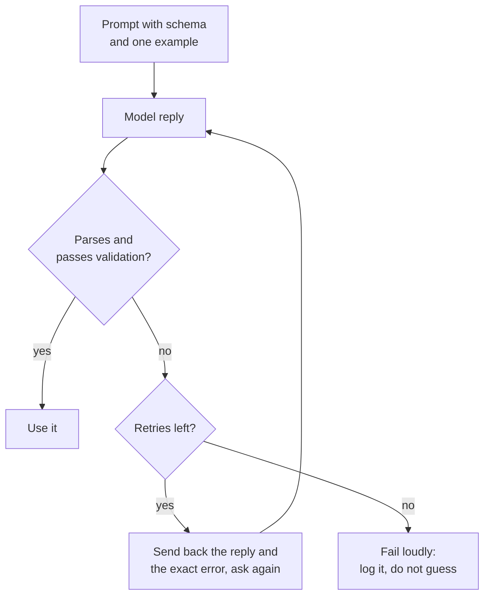

# Lesson 11. Structured Output from the Prompt

**Mission link:** An LLM feature is only useful to the program behind it if the reply can be parsed, so this lesson gets output a program can read and treats every reply as input to be checked.
**Primary source:** [Docs: "Structured outputs", Claude Platform Docs](https://platform.claude.com/docs/en/build-with-claude/structured-outputs)
**Prerequisites:** [Lesson 10](0010-prompting-reasoning-models.md), [Structured output](../GLOSSARY.md), [Delimiter](../GLOSSARY.md)

## Warm-up

1. ▢ Lesson 3 said an instruction should state what done looks like. Why does that matter more when a program, not a person, reads the reply?

<details markdown="1"><summary>Check</summary>

A person skims past a friendly opening line or a stray note. A parser does not: anything outside the agreed format is an error. So "done" has to name the exact shape of the reply, including that nothing else may appear around it.

</details>

2. ▢ Lesson 4 used delimiters to keep data apart from instructions. Name one place a delimiter helps in a prompt that asks for structured output.

<details markdown="1"><summary>Check</summary>

Wrapping the input text in tags so the model does not mistake it for part of the instruction, and, in the instruction, fencing the example output so it is clearly an example and not text to continue.

</details>

## Know this

### Describe the schema and show one example

A prompt that asks for **structured output** needs three things: the fields with a short description of each, the allowed values for any field that is a fixed set, and one complete example of a correct reply. The example does the most work, since lesson 6 showed that demonstrations mostly teach format.

```text
Extract the contact details from the email below.
Reply with one JSON object and nothing else, no text before or after it.

Fields:
- name: string, the sender's full name
- email: string, the sender's address
- plan_interest: one of "Free", "Pro", "Enterprise"
- demo_requested: true or false

Example reply:
{"name": "Ana Lopez", "email": "ana@example.com", "plan_interest": "Pro", "demo_requested": false}

<email>
John Smith (john@example.com) is interested in our Enterprise plan and wants to schedule a demo for next Tuesday at 2pm.
</email>
```

### Parse and validate every reply

Treat the reply as untrusted input. Parse it, then check it against the schema: the required keys are present, the types are right, and a fixed-set field holds one of the allowed values. Parsing alone is not enough, because a reply can be valid JSON and still wrong for your program.



### Repair by showing the error

A retry works better when it carries the failure: the previous reply and the specific problem, such as a missing key or a value outside the allowed set. Cap the retries. Anthropic's prompting guide says newer models can reliably match complex schemas when told to, especially if implemented with retries, which is the loop above.

### Asking is not a guarantee

A prompt is a request. The model usually complies and sometimes does not, so a parse-validate-retry loop is part of the design, not a patch.

Some providers offer to enforce the schema instead. Anthropic's structured outputs feature takes a JSON schema in `output_config.format` and returns JSON that matches it. That is one vendor's feature, and it is a different mechanism from asking: the schema constrains generation. The serving side of that idea is covered in [Sampling and Constrained Decoding at Serve Time](../../inference/lessons/0019-sampling-and-constrained-decoding-at-serve-time.md).

Even then the same page lists cases where the output may not match: a refusal, a reply cut off at the token limit, and enum values whose capitalization can differ. So validate in both cases.

The same prompting guide lists response prefilling, where you start the model's reply for it to force a format such as JSON, among patterns it migrates away from, and points to structured outputs or an instruction instead. This lesson does not teach prefilling.

## Practice

1. ▢ Predict, then check. A prompt asks for a JSON object with three fields. The model replies: `Sure! Here is the JSON you asked for:` followed by a correct object on the next line. Does `json.loads` on the whole reply succeed, and what is the prompt-side fix?

<details markdown="1"><summary>Hint</summary>

A parser reads the reply from its first character.

</details>

<details markdown="1"><summary>Check</summary>

It fails: the greeting is not JSON. The prompt-side fix is to say the reply must be the object alone, with no text before or after it, and the program-side fix is to validate and retry when parsing fails. The object being correct does not help, because the parser never gets to it.

</details>

2. ▢ A reply fails validation because a required field is missing. Which retry message is best?

    - a) Your reply was invalid. Try again and be more careful this time.
    - b) Your reply was missing the required key "email". Return the full object again, including it.
    - c) Please reply again in JSON, since the last reply did not work for us.
    - d) The format was wrong. Follow the instructions at the top of this prompt.

<details markdown="1"><summary>Check</summary>

b. It names the exact problem and the fix. Options a, c and d only say the reply failed, so the model has to guess what to change and may repeat the same error.

</details>

3. ▢ Predict, then check. The schema says `plan_interest` is one of "Free", "Pro", "Enterprise" and `email` and `demo_requested` (true or false) are required. The reply is `{"name": "John Smith", "plan_interest": "enterprise", "demo_requested": "yes"}`. List every way it fails validation.

<details markdown="1"><summary>Hint</summary>

Check required keys, then each value's type, then each fixed set.

</details>

<details markdown="1"><summary>Check</summary>

Three failures. The required key `email` is missing. `plan_interest` is "enterprise", which differs from "Enterprise" only in case, so it is not in the allowed set. `demo_requested` is the string "yes" where a boolean was required. The reply parses as valid JSON, which is why parsing alone is not validation.

</details>

4. ▢ Write the prompt for this task: read a customer review and return its sentiment (one of three labels) and a score from 1 to 5. Include the fields, the allowed values, one example reply, and the instruction about extra text.

<details markdown="1"><summary>Check</summary>

A good answer has: an instruction that the reply is one JSON object and nothing else; a field list such as `sentiment` ("positive", "neutral" or "negative") and `score` (integer 1 to 5); one complete example reply with both fields; and the review inside delimiters. Missing the example or the allowed-values line is the usual gap, since those carry the format.

</details>

5. ▢ A teammate says: "We told the model to return only JSON, so we do not need validation." Which reply is most accurate?

    - a) Correct, because an instruction in the prompt makes the format fixed.
    - b) Wrong, since an instruction asks for the format and enforces nothing.
    - c) Correct, as long as the example reply in the prompt is also valid.
    - d) Wrong, because validation is only needed when a provider enforces schemas.

<details markdown="1"><summary>Check</summary>

b. A prompt instruction is a request the model usually follows, so replies must still be checked. Options a and c treat the request as enforcement. Option d reverses the point: validation is needed in both cases, and the Anthropic page lists refusals, token-limit cutoffs and enum casing as cases where even enforced output may not match.

</details>

## Real-world reps

- [ ] Today: in a chat window, ask for a small JSON object (three fields) using the field list and one example from this lesson. Paste the reply into a JSON validator or run `python3 -m json.tool` on it, and note whether it parsed and whether every value is allowed.
- [ ] Tomorrow: reuse yesterday's prompt on three different inputs, one of them awkward (missing information, or text with quotation marks). Record which replies failed validation and why.
- [ ] Find a prompt you use that asks for a list or a table, and rewrite it to ask for JSON with a field list and one example. Compare the replies.

## Going further

- [Docs: "Structured outputs", Claude Platform Docs](https://platform.claude.com/docs/en/build-with-claude/structured-outputs)
- [Docs: "Prompting best practices", Claude Platform Docs](https://platform.claude.com/docs/en/build-with-claude/prompt-engineering/claude-prompting-best-practices)
- [Structured Output and Long Context](../reference/structured-output-and-long-context.md)
- [Resources](../RESOURCES.md)

---

Not landing? Reread the primary source at the top, since this lesson compresses it and compression is where understanding leaks. Check the [glossary](../GLOSSARY.md) for any term that felt slippery.

If the lesson itself is unclear rather than the material, that is a defect: [open an issue](https://github.com/TokenCemetery/teach/issues).
