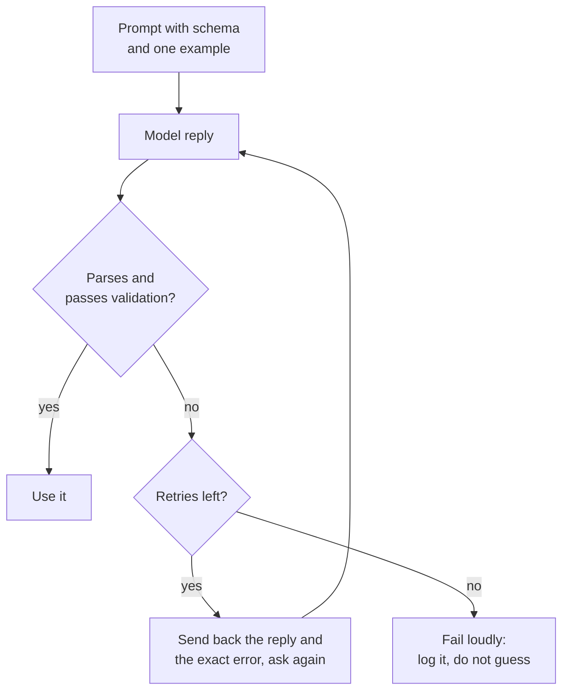

# Lição 11. Saída estruturada a partir do prompt

**Ligação com a missão:** Um recurso de LLM só é útil para o programa por trás dele se a resposta puder ser interpretada, então esta lição obtém uma saída que um programa consegue ler e trata toda resposta como uma entrada a ser verificada.
**Fonte principal:** [Docs: "Structured outputs", Claude Platform Docs](https://platform.claude.com/docs/en/build-with-claude/structured-outputs)
**Pré-requisitos:** [Lição 10](0010-prompting-reasoning-models.md), [Saída estruturada](../GLOSSARY.md), [Delimitador](../GLOSSARY.md)

## Aquecimento

1. ▢ A lição 3 disse que uma instrução deve afirmar como é o "pronto". Por que isso importa mais quando quem lê a resposta é um programa e não uma pessoa?

<details markdown="1"><summary>Verificação</summary>

Uma pessoa passa os olhos por uma frase de abertura simpática ou por uma nota solta. Um parser não: qualquer coisa fora do formato combinado é um erro. Então o "pronto" precisa nomear o formato exato da resposta, inclusive que nada mais pode aparecer ao redor dela.

</details>

2. ▢ A lição 4 usou delimitadores para manter os dados separados das instruções. Cite um lugar em que um delimitador ajuda em um prompt que pede saída estruturada.

<details markdown="1"><summary>Verificação</summary>

Envolver o texto de entrada em tags para que o modelo não o confunda com parte da instrução e, na instrução, cercar a saída de exemplo para que fique claro que é um exemplo e não um texto a continuar.

</details>

## Saiba isto

### Descreva o schema e mostre um exemplo

Um prompt que pede **saída estruturada** precisa de três coisas: os campos com uma breve descrição de cada um, os valores permitidos para qualquer campo que seja um conjunto fixo e um exemplo completo de uma resposta correta. O exemplo é o que mais trabalha, já que a lição 6 mostrou que demonstrações ensinam principalmente o formato.

```text
Extract the contact details from the email below.
Reply with one JSON object and nothing else, no text before or after it.

Fields:
- name: string, the sender's full name
- email: string, the sender's address
- plan_interest: one of "Free", "Pro", "Enterprise"
- demo_requested: true or false

Example reply:
{"name": "Ana Lopez", "email": "ana@example.com", "plan_interest": "Pro", "demo_requested": false}

<email>
John Smith (john@example.com) is interested in our Enterprise plan and wants to schedule a demo for next Tuesday at 2pm.
</email>
```

### Interprete e valide toda resposta

Trate a resposta como entrada não confiável. Interprete-a e depois confira com o schema: as chaves obrigatórias estão presentes, os tipos estão certos e um campo de conjunto fixo contém um dos valores permitidos. Interpretar não basta, porque uma resposta pode ser um JSON válido e ainda assim estar errada para o seu programa.



### Repare mostrando o erro

Uma nova tentativa funciona melhor quando leva a falha junto: a resposta anterior e o problema específico, como uma chave ausente ou um valor fora do conjunto permitido. Limite as tentativas. O guia de prompting da Anthropic diz que modelos mais novos conseguem seguir schemas complexos de forma confiável quando recebem essa instrução, sobretudo se implementada com novas tentativas, que é o loop acima.

### Pedir não é uma garantia

Um prompt é um pedido. O modelo geralmente atende e às vezes não, então um loop de interpretar, validar e tentar de novo faz parte do projeto, não é um remendo.

Alguns provedores oferecem impor o schema em vez disso. O recurso de saídas estruturadas da Anthropic recebe um schema JSON em `output_config.format` e devolve um JSON que corresponde a ele. Esse é um recurso de um único fornecedor, e é um mecanismo diferente de pedir: o schema restringe a geração. O lado de serviço dessa ideia é tratado em [Amostragem e decodificação restrita no serving](../../inference/lessons/0019-sampling-and-constrained-decoding-at-serve-time.md).

Mesmo assim, a mesma página lista casos em que a saída pode não corresponder: uma recusa, uma resposta cortada no limite de tokens e valores de enum cuja capitalização pode diferir. Portanto valide nos dois casos.

O mesmo guia de prompting lista o prefilling de resposta, em que você começa a resposta do modelo por ele para forçar um formato como JSON, entre os padrões dos quais está migrando, e aponta para saídas estruturadas ou uma instrução. Esta lição não ensina prefilling.

## Prática

1. ▢ Preveja e depois verifique. Um prompt pede um objeto JSON com três campos. O modelo responde: `Sure! Here is the JSON you asked for:` seguido de um objeto correto na linha seguinte. O `json.loads` sobre a resposta inteira funciona, e qual é a correção do lado do prompt?

<details markdown="1"><summary>Dica</summary>

Um parser lê a resposta a partir do primeiro caractere.

</details>

<details markdown="1"><summary>Verificação</summary>

Falha: o cumprimento não é JSON. A correção do lado do prompt é dizer que a resposta deve ser apenas o objeto, sem texto antes nem depois, e a correção do lado do programa é validar e tentar de novo quando a interpretação falhar. O objeto estar correto não ajuda, porque o parser nunca chega até ele.

</details>

2. ▢ Uma resposta falha na validação porque falta um campo obrigatório. Qual é a melhor mensagem de nova tentativa?

    - a) Sua resposta era inválida. Tente de novo e tenha mais cuidado desta vez.
    - b) Sua resposta não tinha a chave obrigatória "email". Devolva o objeto completo de novo, incluindo-a.
    - c) Responda de novo em JSON, pois a última resposta não funcionou para nós.
    - d) O formato estava errado. Siga as instruções no topo deste prompt.

<details markdown="1"><summary>Verificação</summary>

b. Ela nomeia o problema exato e a correção. As opções a, c e d dizem apenas que a resposta falhou, então o modelo precisa adivinhar o que mudar e pode repetir o mesmo erro.

</details>

3. ▢ Preveja e depois verifique. O schema diz que `plan_interest` é um de "Free", "Pro", "Enterprise" e que `email` e `demo_requested` (true ou false) são obrigatórios. A resposta é `{"name": "John Smith", "plan_interest": "enterprise", "demo_requested": "yes"}`. Liste todas as formas como ela falha na validação.

<details markdown="1"><summary>Dica</summary>

Confira as chaves obrigatórias, depois o tipo de cada valor, depois cada conjunto fixo.

</details>

<details markdown="1"><summary>Verificação</summary>

Três falhas. A chave obrigatória `email` está ausente. `plan_interest` é "enterprise", que difere de "Enterprise" apenas na capitalização, então não está no conjunto permitido. `demo_requested` é a string "yes" onde era exigido um booleano. A resposta é interpretada como um JSON válido, e é por isso que só interpretar não é validar.

</details>

4. ▢ Escreva o prompt para esta tarefa: ler uma avaliação de cliente e devolver o sentimento dela (um de três rótulos) e uma nota de 1 a 5. Inclua os campos, os valores permitidos, uma resposta de exemplo e a instrução sobre texto extra.

<details markdown="1"><summary>Verificação</summary>

Uma boa resposta tem: uma instrução de que a resposta é um objeto JSON e mais nada; uma lista de campos como `sentiment` ("positive", "neutral" ou "negative") e `score` (inteiro de 1 a 5); uma resposta de exemplo completa com os dois campos; e a avaliação dentro de delimitadores. A lacuna comum é faltar o exemplo ou a linha de valores permitidos, já que são eles que carregam o formato.

</details>

5. ▢ Um colega diz: "Dissemos ao modelo para devolver só JSON, então não precisamos de validação." Qual resposta é a mais precisa?

    - a) Correto, porque uma instrução no prompt torna o formato fixo.
    - b) Errado, já que uma instrução pede o formato e não impõe nada.
    - c) Correto, desde que a resposta de exemplo no prompt também seja válida.
    - d) Errado, porque a validação só é necessária quando um provedor impõe schemas.

<details markdown="1"><summary>Verificação</summary>

b. Uma instrução no prompt é um pedido que o modelo geralmente segue, então as respostas ainda precisam ser verificadas. As opções a e c tratam o pedido como imposição. A opção d inverte o ponto: a validação é necessária nos dois casos, e a página da Anthropic lista recusas, cortes no limite de tokens e capitalização de enum como casos em que até uma saída imposta pode não corresponder.

</details>

## Prática no mundo real

- [ ] Hoje: em uma janela de chat, peça um pequeno objeto JSON (três campos) usando a lista de campos e um exemplo desta lição. Cole a resposta em um validador de JSON ou execute `python3 -m json.tool` nela e anote se foi interpretada e se todos os valores são permitidos.
- [ ] Amanhã: reutilize o prompt de ontem em três entradas diferentes, uma delas complicada (informação faltando ou texto com aspas). Registre quais respostas falharam na validação e por quê.
- [ ] Encontre um prompt seu que pede uma lista ou uma tabela e reescreva-o para pedir JSON com uma lista de campos e um exemplo. Compare as respostas.

## Para ir além

- [Docs: "Structured outputs", Claude Platform Docs](https://platform.claude.com/docs/en/build-with-claude/structured-outputs)
- [Docs: "Prompting best practices", Claude Platform Docs](https://platform.claude.com/docs/en/build-with-claude/prompt-engineering/claude-prompting-best-practices)
- [Saída Estruturada e Contexto Longo](../reference/structured-output-and-long-context.md)
- [Recursos](../RESOURCES.md)

---

Não ficou claro? Releia a fonte primária no topo, já que esta lição a comprime e é na compressão que o entendimento escapa. Consulte o [glossário](../GLOSSARY.md) para qualquer termo que tenha parecido escorregadio.

Se o problema é a própria lição e não o material, isso é um defeito: [abra uma issue](https://github.com/TokenCemetery/teach/issues).
