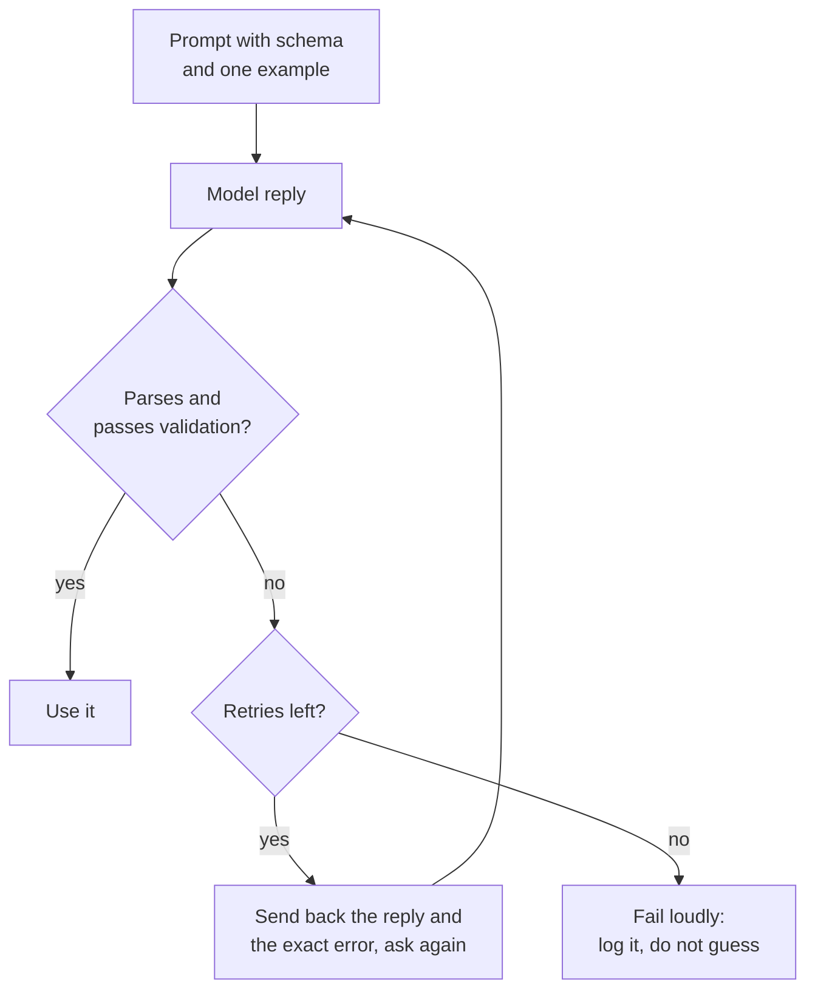

# Урок 11. Структурированный вывод из промпта

**Связь с целью курса:** Функция на основе LLM полезна программе за ней, только если ответ можно разобрать, поэтому этот урок добивается вывода, который программа умеет читать, и считает каждый ответ входными данными, которые нужно проверять.
**Первоисточник:** [Документация: "Structured outputs", Claude Platform Docs](https://platform.claude.com/docs/en/build-with-claude/structured-outputs)
**Предварительные требования:** [Урок 10](0010-prompting-reasoning-models.md), [Структурированный вывод](../GLOSSARY.md), [Разделитель](../GLOSSARY.md)

## Разминка

1. ▢ В уроке 3 говорилось, что инструкция должна описывать, как выглядит готовый результат. Почему это важнее, когда ответ читает программа, а не человек?

<details markdown="1"><summary>Проверка</summary>

Человек пропустит дружелюбную вводную строку или лишнюю заметку. Парсер нет: всё вне согласованного формата это ошибка. Поэтому «готово» должно называть точную форму ответа, включая то, что вокруг него ничего другого быть не должно.

</details>

2. ▢ В уроке 4 разделители отделяли данные от инструкций. Назовите одно место, где разделитель помогает в промпте, просящем структурированный вывод.

<details markdown="1"><summary>Проверка</summary>

Обернуть входной текст в теги, чтобы модель не приняла его за часть инструкции, и в самой инструкции выделить пример вывода так, чтобы было ясно, что это пример, а не текст для продолжения.

</details>

## Что нужно знать

### Опишите схему и покажите один пример

Промпту, просящему **структурированный вывод**, нужны три вещи: поля с коротким описанием каждого, допустимые значения для любого поля из фиксированного набора и один полный пример правильного ответа. Больше всего работает пример, поскольку урок 6 показал, что демонстрации в основном учат формату.

```text
Extract the contact details from the email below.
Reply with one JSON object and nothing else, no text before or after it.

Fields:
- name: string, the sender's full name
- email: string, the sender's address
- plan_interest: one of "Free", "Pro", "Enterprise"
- demo_requested: true or false

Example reply:
{"name": "Ana Lopez", "email": "ana@example.com", "plan_interest": "Pro", "demo_requested": false}

<email>
John Smith (john@example.com) is interested in our Enterprise plan and wants to schedule a demo for next Tuesday at 2pm.
</email>
```

### Разбирайте и валидируйте каждый ответ

Относитесь к ответу как к недоверенным входным данным. Разберите его, затем проверьте по схеме: обязательные ключи на месте, типы верные, а поле из фиксированного набора содержит одно из допустимых значений. Одного разбора недостаточно, потому что ответ может быть корректным JSON и всё равно не подходить вашей программе.



### Исправление через показ ошибки

Повторная попытка работает лучше, когда несёт с собой сбой: предыдущий ответ и конкретную проблему, например отсутствующий ключ или значение вне допустимого набора. Ограничьте число повторов. Руководство Anthropic по промптингу говорит, что новые модели умеют надёжно соответствовать сложным схемам, если им это сказать, особенно при реализации с повторными попытками, а это и есть цикл выше.

### Просьба не гарантия

Промпт это просьба. Модель обычно выполняет её и иногда нет, поэтому цикл «разобрать, провалидировать, повторить» входит в проект, а не является заплаткой.

Некоторые провайдеры предлагают вместо этого принудительно соблюдать схему. Функция structured outputs у Anthropic принимает JSON-схему в `output_config.format` и возвращает JSON, который ей соответствует. Это функция одного вендора, и это другой механизм, чем просьба: схема ограничивает генерацию. Серверная сторона этой идеи разобрана в [Сэмплирование и ограниченное декодирование при обслуживании](../../inference/lessons/0019-sampling-and-constrained-decoding-at-serve-time.md).

И всё же на той же странице перечислены случаи, когда вывод может не совпасть: отказ, ответ, обрезанный на лимите токенов, и значения enum, у которых может отличаться регистр. Поэтому валидируйте в обоих случаях.

То же руководство по промптингу относит предзаполнение ответа (response prefilling), когда вы начинаете ответ модели за неё, чтобы принудить формат вроде JSON, к паттернам, от которых оно уходит, и указывает вместо этого на structured outputs или инструкцию. Этот урок предзаполнению не учит.

## Практика

1. ▢ Предскажите, затем проверьте. Промпт просит JSON-объект с тремя полями. Модель отвечает: `Sure! Here is the JSON you asked for:` и следом на следующей строке правильный объект. Удастся ли `json.loads` на всём ответе, и как это исправить на стороне промпта?

<details markdown="1"><summary>Подсказка</summary>

Парсер читает ответ с первого символа.

</details>

<details markdown="1"><summary>Проверка</summary>

Не удастся: приветствие не JSON. Исправление на стороне промпта: сказать, что ответом должен быть один объект, без текста до и после него, а на стороне программы: валидировать и повторять, когда разбор не удался. Правильность объекта не помогает, потому что парсер до него не доходит.

</details>

2. ▢ Ответ не проходит валидацию, потому что отсутствует обязательное поле. Какое сообщение для повторной попытки лучше?

    - a) Your reply was invalid. Try again and be more careful this time.
    - b) Your reply was missing the required key "email". Return the full object again, including it.
    - c) Please reply again in JSON, since the last reply did not work for us.
    - d) The format was wrong. Follow the instructions at the top of this prompt.

<details markdown="1"><summary>Проверка</summary>

b. Оно называет точную проблему и исправление. Варианты a, c и d говорят лишь, что ответ не подошёл, так что модели приходится гадать, что менять, и она может повторить ту же ошибку.

</details>

3. ▢ Предскажите, затем проверьте. Схема говорит, что `plan_interest` это одно из "Free", "Pro", "Enterprise", а `email` и `demo_requested` (true или false) обязательны. Ответ: `{"name": "John Smith", "plan_interest": "enterprise", "demo_requested": "yes"}`. Перечислите все способы, которыми он не проходит валидацию.

<details markdown="1"><summary>Подсказка</summary>

Проверьте обязательные ключи, затем тип каждого значения, затем каждый фиксированный набор.

</details>

<details markdown="1"><summary>Проверка</summary>

Три сбоя. Обязательный ключ `email` отсутствует. `plan_interest` равно "enterprise", что отличается от "Enterprise" только регистром, а значит не входит в допустимый набор. `demo_requested` это строка "yes" там, где требовался булев тип. Ответ разбирается как корректный JSON, поэтому одного разбора мало для валидации.

</details>

4. ▢ Напишите промпт для такой задачи: прочитать отзыв клиента и вернуть его тональность (одна из трёх меток) и оценку от 1 до 5. Включите поля, допустимые значения, один пример ответа и инструкцию про лишний текст.

<details markdown="1"><summary>Проверка</summary>

В хорошем ответе есть: инструкция, что ответ это один JSON-объект и ничего больше; список полей, например `sentiment` ("positive", "neutral" или "negative") и `score` (целое от 1 до 5); один полный пример ответа с обоими полями; и отзыв внутри разделителей. Обычный пробел это отсутствие примера или строки с допустимыми значениями, ведь именно они несут формат.

</details>

5. ▢ Коллега говорит: «Мы сказали модели возвращать только JSON, так что валидация нам не нужна». Какой ответ точнее всего?

    - a) Верно, потому что инструкция в промпте делает формат фиксированным.
    - b) Неверно, поскольку инструкция просит формат и ничего не гарантирует.
    - c) Верно, если пример ответа в промпте тоже корректен.
    - d) Неверно, потому что валидация нужна, только когда провайдер принудительно применяет схемы.

<details markdown="1"><summary>Проверка</summary>

b. Инструкция в промпте это просьба, которой модель обычно следует, поэтому ответы всё равно нужно проверять. Варианты a и c принимают просьбу за принуждение. Вариант d переворачивает суть: валидация нужна в обоих случаях, а страница Anthropic перечисляет отказы, обрезание на лимите токенов и регистр enum как случаи, когда даже принудительный вывод может не совпасть.

</details>

## Практика в реальной работе

- [ ] Сегодня: в окне чата попросите небольшой JSON-объект (три поля), используя список полей и один пример из этого урока. Вставьте ответ в JSON-валидатор или запустите на нём `python3 -m json.tool` и отметьте, разобрался ли он и допустимо ли каждое значение.
- [ ] Завтра: используйте вчерашний промпт на трёх разных входах, один из них неудобный (нехватка информации или текст с кавычками). Запишите, какие ответы не прошли валидацию и почему.
- [ ] Найдите промпт, который просит список или таблицу, и перепишите его так, чтобы он просил JSON со списком полей и одним примером. Сравните ответы.

## Что почитать дальше

- [Документация: "Structured outputs", Claude Platform Docs](https://platform.claude.com/docs/en/build-with-claude/structured-outputs)
- [Документация: "Prompting best practices", Claude Platform Docs](https://platform.claude.com/docs/en/build-with-claude/prompt-engineering/claude-prompting-best-practices)
- [Структурированный вывод и длинный контекст](../reference/structured-output-and-long-context.md)
- [Ресурсы](../RESOURCES.md)

---

Не доходит? Перечитайте первоисточник в начале: этот урок его сжимает, а при сжатии понимание как раз и теряется. Загляните в [глоссарий](../GLOSSARY.md), если какой-то термин показался скользким.

Если неясен сам урок, а не материал, это дефект: [откройте issue](https://github.com/TokenCemetery/teach/issues).
