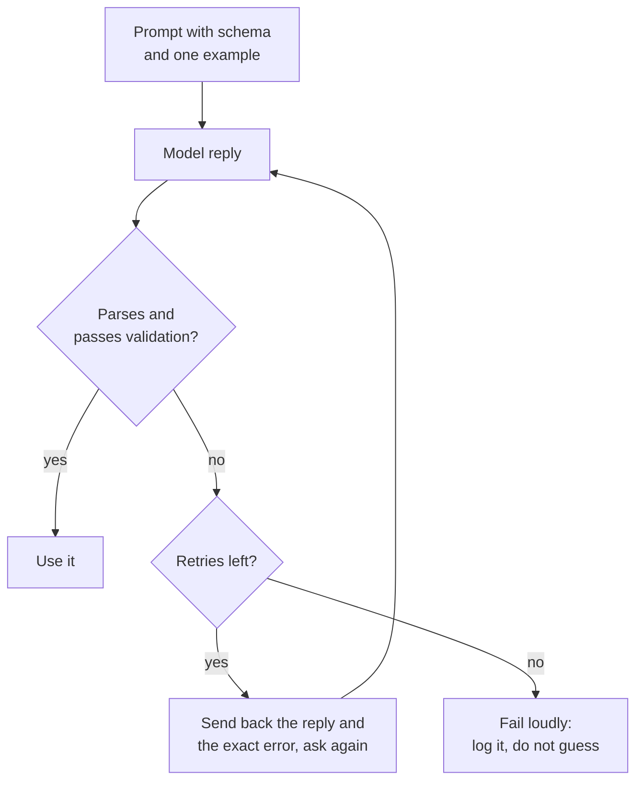

# 第 11 课：通过提示词获得结构化输出

**使命关联:** LLM 功能只有在回复可以被解析时，才对背后的程序有用，所以本课要得到程序能读取的输出，并把每一条回复都当作需要检查的输入。
**主要来源:** [文档：“Structured outputs”，Claude Platform Docs](https://platform.claude.com/docs/en/build-with-claude/structured-outputs)
**前置知识:** [第 10 课](0010-prompting-reasoning-models.md)、[结构化输出](../GLOSSARY.md)、[分隔符](../GLOSSARY.md)

## 热身

1. ▢ 第 3 课说过，指令应当说明完成后是什么样子。当读取回复的是程序而不是人时，为什么这一点更重要？

<details markdown="1"><summary>检查</summary>

人会略过一句客气的开场白或多余的说明，解析器不会：约定格式之外的任何内容都是错误。所以“完成”必须指明回复的确切形状，包括它的前后不得出现任何其他内容。

</details>

2. ▢ 第 4 课用分隔符把数据和指令分开。说出在要求结构化输出的提示词中，分隔符有帮助的一个地方。

<details markdown="1"><summary>检查</summary>

把输入文本包在标签里，这样模型就不会把它误当成指令的一部分；在指令中，把示例输出用围栏框起来，让它清楚地只是示例，而不是要接着写的文本。

</details>

## 要点

### 描述 schema，并给出一个示例

要求**结构化输出**的提示词需要三样东西：各个字段及其简短说明，凡是取值固定的字段要列出允许的值，以及一个正确回复的完整示例。示例的作用最大，因为第 6 课说明过，演示示例主要教的是格式。

```text
Extract the contact details from the email below.
Reply with one JSON object and nothing else, no text before or after it.

Fields:
- name: string, the sender's full name
- email: string, the sender's address
- plan_interest: one of "Free", "Pro", "Enterprise"
- demo_requested: true or false

Example reply:
{"name": "Ana Lopez", "email": "ana@example.com", "plan_interest": "Pro", "demo_requested": false}

<email>
John Smith (john@example.com) is interested in our Enterprise plan and wants to schedule a demo for next Tuesday at 2pm.
</email>
```

### 解析并校验每一条回复

把回复当作不可信的输入。先解析，再对照 schema 检查：必需的键都在，类型正确，取值固定的字段取的是允许的值之一。只解析是不够的，因为回复可能是合法的 JSON，却仍然不适合你的程序。



### 把错误展示给模型来修复

如果重试时带上失败的信息，效果会更好：上一条回复，以及具体的问题，比如缺少某个键，或某个值不在允许的集合内。要限制重试次数。Anthropic 的提示词指南说，较新的模型在被要求时可以可靠地匹配复杂的 schema，尤其是配合重试来实现时，这正是上面的循环。

### 提出要求并不等于有保证

提示词只是一个请求。模型通常会照做，偶尔不会，所以“解析、校验、重试”的循环是设计的一部分，而不是补丁。

有些服务商提供强制执行 schema 的功能。Anthropic 的结构化输出功能在 `output_config.format` 中接收一个 JSON schema，并返回与之匹配的 JSON。这是一家厂商的功能，与单纯提出要求是不同的机制：schema 约束的是生成过程。这个思路在服务端的实现见[服务时的采样与约束解码](../../inference/lessons/0019-sampling-and-constrained-decoding-at-serve-time.md)。

即便如此，同一页文档仍然列出了输出可能不匹配的情况：拒绝回答、在 token 上限处被截断的回复，以及大小写可能不同的枚举值。所以两种情况下都要校验。

同一份提示词指南还把响应预填充（你替模型写好回复的开头，以强制得到 JSON 之类的格式）列为它正在逐步淘汰的模式之一，并转而推荐使用结构化输出或一条指令。本课不讲预填充。

## 练习

1. ▢ 先预测，再检查。一个提示词要求返回带三个字段的 JSON 对象。模型回复 `Sure! Here is the JSON you asked for:`，下一行是一个正确的对象。对整条回复调用 `json.loads` 会成功吗？提示词一侧该怎么修复？

<details markdown="1"><summary>提示</summary>

解析器从回复的第一个字符开始读取。

</details>

<details markdown="1"><summary>检查</summary>

会失败：这句问候不是 JSON。提示词一侧的修复是写明回复必须只是这个对象，前后不得有任何文字；程序一侧的修复是在解析失败时校验并重试。对象本身正确也没有用，因为解析器根本读不到它。

</details>

2. ▢ 一条回复因为缺少必需字段而未通过校验。下面哪条重试消息最好？

    - a) Your reply was invalid. Try again and be more careful this time.
    - b) Your reply was missing the required key "email". Return the full object again, including it.
    - c) Please reply again in JSON, since the last reply did not work for us.
    - d) The format was wrong. Follow the instructions at the top of this prompt.

<details markdown="1"><summary>检查</summary>

b。它指出了确切的问题和修正办法。选项 a、c 和 d 只说回复失败了，模型只能猜该改什么，可能会重复同样的错误。

</details>

3. ▢ 先预测，再检查。schema 规定 `plan_interest` 是 "Free"、"Pro"、"Enterprise" 之一，`email` 和 `demo_requested`（true 或 false）是必需的。回复是 `{"name": "John Smith", "plan_interest": "enterprise", "demo_requested": "yes"}`。列出它未通过校验的所有原因。

<details markdown="1"><summary>提示</summary>

先检查必需的键，再检查每个值的类型，最后检查每个固定的集合。

</details>

<details markdown="1"><summary>检查</summary>

共有三处失败。必需的键 `email` 缺失。`plan_interest` 是 "enterprise"，与 "Enterprise" 只有大小写之差，所以不在允许的集合内。`demo_requested` 是字符串 "yes"，而要求的是布尔值。这条回复可以作为合法的 JSON 解析，这就是只解析并不等于校验的原因。

</details>

4. ▢ 为下面这个任务写出提示词：读取一条客户评论，返回它的情感倾向（三个标签之一）和一个 1 到 5 的分数。要包括字段、允许的值、一个示例回复，以及关于多余文字的指令。

<details markdown="1"><summary>检查</summary>

好的答案包括：说明回复只是一个 JSON 对象、别无其他的指令；字段列表，比如 `sentiment`（"positive"、"neutral" 或 "negative"）和 `score`（1 到 5 的整数）；一个包含两个字段的完整示例回复；以及放在分隔符里的评论。常见的疏漏是缺少示例或允许值那一行，因为它们承载着格式。

</details>

5. ▢ 一位队友说：“我们已经告诉模型只返回 JSON，所以不需要校验。”下面哪个回应最准确？

    - a) 对，因为提示词里的指令会把格式固定下来。
    - b) 不对，因为指令只是要求这种格式，并不强制执行任何东西。
    - c) 对，只要提示词里的示例回复本身也是合法的。
    - d) 不对，因为只有服务商强制执行 schema 时才需要校验。

<details markdown="1"><summary>检查</summary>

b。提示词里的指令是模型通常会遵循的请求，所以回复仍然必须检查。选项 a 和 c 把请求当成了强制执行。选项 d 把要点弄反了：两种情况下都需要校验，而且 Anthropic 那一页列出了拒绝回答、token 上限截断和枚举值大小写，说明即便是强制执行的输出也可能不匹配。

</details>

## 实战练习

- [ ] 今天：在聊天窗口里，用本课的字段列表和一个示例，要求返回一个小的 JSON 对象（三个字段）。把回复粘贴到 JSON 校验工具里，或者对它运行 `python3 -m json.tool`，记下它能否解析，以及每个值是否都在允许范围内。
- [ ] 明天：把昨天的提示词用在三个不同的输入上，其中一个比较棘手（信息缺失，或文本中带有引号）。记下哪些回复未通过校验，以及原因。
- [ ] 找一个你在用的、要求返回列表或表格的提示词，把它改写成要求返回 JSON，并附上字段列表和一个示例。比较两者的回复。

## 延伸阅读

- [文档：“Structured outputs”，Claude Platform Docs](https://platform.claude.com/docs/en/build-with-claude/structured-outputs)
- [文档：“Prompting best practices”，Claude Platform Docs](https://platform.claude.com/docs/en/build-with-claude/prompt-engineering/claude-prompting-best-practices)
- [结构化输出与长上下文](../reference/structured-output-and-long-context.md)
- [资源](../RESOURCES.md)

---

没学明白？请重读顶部的主要来源，因为本课是对它的压缩，而理解正是在压缩中流失的。如果有哪个术语觉得含糊，可以查看[术语表](../GLOSSARY.md)。

如果问题出在课程本身，而不是学习材料，那就是一个缺陷：[提交 issue](https://github.com/TokenCemetery/teach/issues)。
