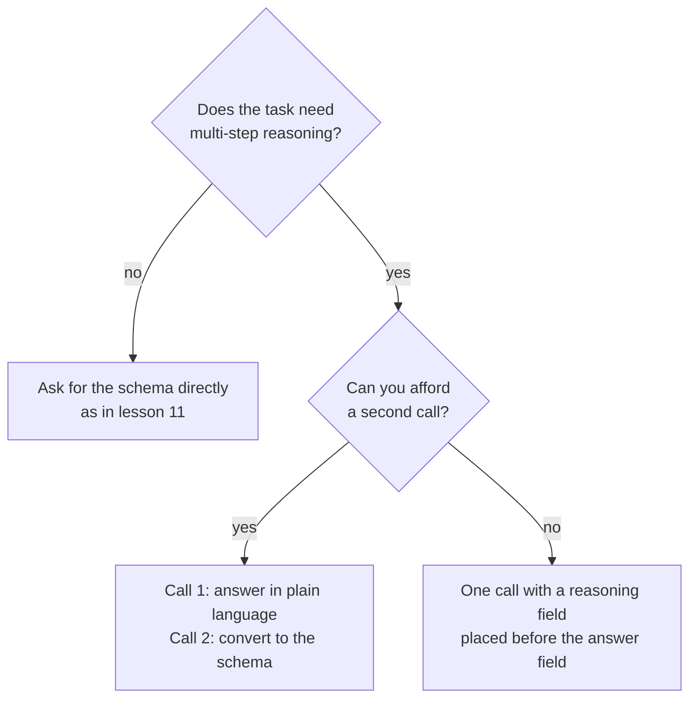

# Lección 12. Restricciones de formato y razonamiento

**Vínculo con la misión:** Una salida que un programa pueda interpretar vale poco si forzar el formato empeora las respuestas, así que esta lección muestra dónde aparece el costo y dos formas de no pagarlo.
**Fuente principal:** [Artículo: "Let Me Speak Freely? A Study on the Impact of Format Restrictions on Performance of Large Language Models", Tam et al., 2024](https://arxiv.org/abs/2408.02442)
**Requisitos previos:** [Lección 11](0011-structured-output-from-the-prompt.md), [Chain-of-thought](../GLOSSARY.md), [Salida estructurada](../GLOSSARY.md)

## Calentamiento

1. ▢ La lección 8 preguntó cuándo el razonamiento intermedio mejora una respuesta. Nombra una tarea en la que ayuda y una en la que solo añade tokens.

<details markdown="1"><summary>Comprobación</summary>

Ayuda en problemas de varios pasos, como los problemas aritméticos con enunciado, donde cada paso alimenta al siguiente. Aporta poco en una tarea que se responde en un solo paso, como elegir una etiqueta para una frase obvia.

</details>

2. ▢ La lección 9 decía que el razonamiento escrito no es una explicación fiel de la respuesta. ¿Eso lo vuelve inútil para el modelo que lo escribió?

<details markdown="1"><summary>Comprobación</summary>

No. La fidelidad trata de si el texto le explica a un lector la causa real de la respuesta. Los tokens de razonamiento siguen condicionando lo que el modelo escribe a continuación, y por eso pedirlos puede mejorar la respuesta incluso cuando son una mala explicación.

</details>

3. ▢ La lección 11 terminó con un bucle de interpretar, validar y reintentar. ¿De qué protege ese bucle?

<details markdown="1"><summary>Comprobación</summary>

De una respuesta que no se interpreta o que no coincide con el esquema. No dice nada sobre si la respuesta dentro de una respuesta válida es correcta, que es el tema de esta lección.

</details>

## Qué debes saber

### Qué midió el artículo

Tam et al. compararon las mismas preguntas bajo distintos grados de restricción de formato. Sus tres configuraciones, de la más estricta a la más laxa, fueron JSON-mode (decodificación restringida, donde la salida se limita a JSON válido durante la generación), instrucciones que restringen el formato (un prompt que pide un formato y un esquema, como en la lección 11) y NL-to-Format, un proceso de dos pasos que primero responde en lenguaje natural y luego convierte la respuesta al formato.

Su resumen reporta un descenso significativo de la capacidad de razonamiento bajo restricciones de formato, y que las restricciones más estrictas suelen causar una mayor degradación en tareas de razonamiento. En las tareas de razonamiento (GSM8K, Last Letter Concatenation, Shuffled Objects), los prompts más relajados solían rendir mejor, con JSON-mode como el peor en la mayoría de los casos. NL-to-Format rindió casi igual que el lenguaje natural sin restricciones en la mayoría de los modelos.

### Dos salvedades que conviene recordar

La propia conclusión del artículo dice que la decodificación restringida puede dificultar el razonamiento a la vez que mejora la precisión de clasificación. Así que el costo no es general: aparece en tareas de razonamiento, y una tarea simple de clasificación puede rendir mejor con un formato estricto.

El estudio usó los modelos de su época y reporta sus propios límites: se centró en tareas de razonamiento intensivo y deja el razonamiento más sencillo para trabajo futuro. Léelo como una razón para medir en tu tarea, no como una regla de que la estructura siempre perjudica.

### El orden de los campos es parte del prompt

Un objeto JSON se genera de izquierda a derecha, así que un campo se escribe antes que los campos que lo siguen. El artículo encontró que el 100 % de las respuestas de GPT-3.5 Turbo en JSON-mode en Last Letter ponían la clave `answer` antes de la clave `reason`, de modo que el modelo respondía directamente en lugar de razonar primero.

Si pones el campo de razonamiento antes del campo de respuesta, el razonamiento puede informar a la respuesta.

```json
{
  "reasoning": "The order has 3 items at 12 each, which is 36. Shipping is 5, so the total is 41.",
  "answer": 41
}
```

Una breve nota sobre proveedores: la página de structured outputs de Anthropic advierte que una propiedad que pida el pensamiento del modelo o su razonamiento paso a paso puede provocar un rechazo, y sugiere pedir en su lugar una explicación breve. También dice que la gramática del esquema se aplica a la salida directa, no a los bloques de pensamiento, así que un modelo con fase de pensamiento razona libremente antes de la respuesta estructurada.

### O razona primero y da formato después

La otra opción son dos llamadas. La primera plantea la pregunta en lenguaje llano y deja que el modelo razone. La segunda convierte esa respuesta en la estructura.



La segunda llamada cuesta una petición y añade un paso que puede introducir sus propios errores: el artículo señala que NL-to-Format ocasionalmente introduce errores de generación, con un rendimiento ligeramente menor en un modelo más pequeño. Elige midiendo ambas opciones en tu tarea.

## Práctica

1. ▢ Predice y luego comprueba. Un prompt pide JSON con las claves en este orden: `answer`, luego `reasoning`. La tarea es un problema aritmético de tres pasos. ¿Qué hace el modelo con el razonamiento y qué cambiarías?

<details markdown="1"><summary>Pista</summary>

Pregúntate cuál de los dos campos escribe primero el modelo.

</details>

<details markdown="1"><summary>Comprobación</summary>

Escribe primero la respuesta, así que el razonamiento que sigue no puede haberla producido: el modelo responde directamente y después explica. Invierte el orden para que `reasoning` vaya antes de `answer`. Este es el fallo que el artículo encontró en todas las respuestas de GPT-3.5 Turbo en JSON-mode en Last Letter.

</details>

2. ▢ ¿Qué tarea tiene más probabilidad de perder precisión por un formato de salida estricto, según los hallazgos del artículo?

    - a) Etiquetar una reseña corta como positiva o negativa.
    - b) Multiplicar tres números a lo largo de varios pasos escritos.
    - c) Clasificar un ticket de soporte en una de cuatro colas.
    - d) Elegir el deporte nombrado en una frase de una línea.

<details markdown="1"><summary>Comprobación</summary>

b. Es razonamiento de varios pasos, el tipo de tarea que el artículo encontró perjudicada por la restricción. Las demás son tareas de estilo clasificación, donde el artículo reporta que la decodificación restringida puede, por el contrario, mejorar la precisión.

</details>

3. ▢ Reescribe este esquema para que el modelo razone antes de responder, y di por qué funciona tu orden: `{"verdict": "...", "evidence": "...", "confidence": 0.0}` para una tarea que juzga si una afirmación se sigue de un párrafo.

<details markdown="1"><summary>Comprobación</summary>

Pon `evidence` primero, luego `verdict`, luego `confidence`: por ejemplo `{"evidence": "...", "verdict": "...", "confidence": 0.0}`. El modelo escribe primero la evidencia, así que el veredicto queda condicionado por ella. Una reescritura que mueva solo `confidence` o que mantenga `verdict` primero no ha corregido el problema.

</details>

4. ▢ Tienes una llamada por petición y un límite estricto de latencia, y la tarea es un problema con enunciado devuelto como JSON. ¿Qué diseño encaja mejor?

    - a) Dos llamadas: razonar en lenguaje llano y luego convertir a JSON.
    - b) Una llamada, un objeto JSON simple con solo un campo de respuesta.
    - c) Una llamada, JSON con un campo de razonamiento antes de la respuesta.
    - d) Una llamada, JSON con el campo de respuesta y luego el razonamiento.

<details markdown="1"><summary>Comprobación</summary>

c. Encaja con el presupuesto de llamadas y deja que el razonamiento llegue antes que la respuesta. La opción a necesita una segunda llamada. La opción b elimina el razonamiento que la tarea necesita. La opción d tiene el orden que hace que el modelo responda primero.

</details>

## Prácticas en el mundo real

- [ ] Hoy: en una ventana de chat, plantea un problema con enunciado de varios pasos y pide una respuesta en JSON con `answer` primero y luego `reasoning`. Vuelve a preguntarlo con `reasoning` primero. Anota si las respuestas difieren y dónde queda el razonamiento.
- [ ] Mañana: toma cinco preguntas que puedas comprobar, ejecuta cada una con ambos órdenes y cuenta las respuestas correctas de cada uno. Cinco son muy pocas para demostrar nada, así que trata el resultado como una pista para probar en un conjunto real.
- [ ] Mira un prompt de salida estructurada que uses y revisa el orden de sus campos. Si un campo de juicio va antes que la evidencia que lo respalda, intercámbialos.

## Para profundizar

- [Artículo: "Let Me Speak Freely?", Tam et al., 2024](https://arxiv.org/abs/2408.02442)
- [Documentación: "Structured outputs", Claude Platform Docs](https://platform.claude.com/docs/en/build-with-claude/structured-outputs)
- [Salida estructurada y contexto largo](../reference/structured-output-and-long-context.md)
- [Recursos](../RESOURCES.md)

---

¿No termina de quedar claro? Vuelve a leer la fuente principal del inicio, porque esta lección la comprime y en la compresión es donde se pierde la comprensión. Consulta el [glosario](../GLOSSARY.md) para cualquier término que te haya parecido resbaladizo.

Si lo poco claro es la lección y no el material, eso es un defecto: [abre un issue](https://github.com/TokenCemetery/teach/issues).
