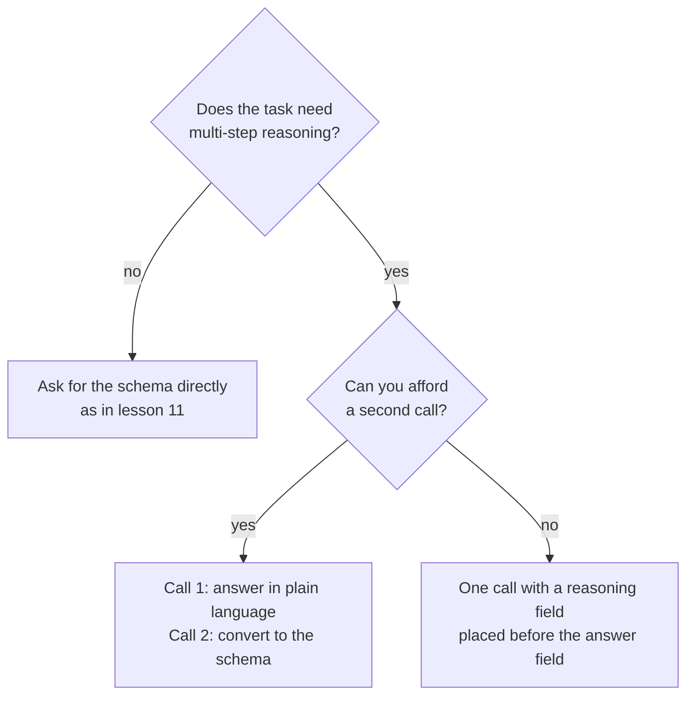

# Leçon 12. Contraintes de format et raisonnement

**Lien avec la mission :** Une sortie qu'un programme peut analyser vaut peu si imposer le format dégrade les réponses. Cette leçon montre où apparaît le coût et deux façons de ne pas le payer.
**Source primaire :** [Article : "Let Me Speak Freely? A Study on the Impact of Format Restrictions on Performance of Large Language Models", Tam et al., 2024](https://arxiv.org/abs/2408.02442)
**Prérequis :** [Leçon 11](0011-structured-output-from-the-prompt.md), [Chain-of-thought](../GLOSSARY.md), [Sortie structurée](../GLOSSARY.md)

## Échauffement

1. ▢ La leçon 8 demandait quand le raisonnement intermédiaire améliore une réponse. Nommez une tâche où il aide et une où il ne fait qu'ajouter des tokens.

<details markdown="1"><summary>Vérifier</summary>

Il aide sur les problèmes en plusieurs étapes comme les problèmes d'arithmétique en langage naturel, où chaque étape alimente la suivante. Il apporte peu sur une tâche résolue en une étape, comme choisir un label pour une phrase évidente.

</details>

2. ▢ La leçon 9 disait que le raisonnement écrit n'est pas une explication fidèle de la réponse. Cela le rend-il inutile pour le modèle qui l'a écrit ?

<details markdown="1"><summary>Vérifier</summary>

Non. La fidélité demande si le texte explique à un lecteur la cause réelle de la réponse. Les tokens de raisonnement conditionnent quand même ce que le modèle écrit ensuite, ce qui explique pourquoi les demander peut améliorer la réponse même quand ils sont une mauvaise explication.

</details>

3. ▢ La leçon 11 se terminait sur une boucle analyser-valider-réessayer. Contre quoi cette boucle protège-t-elle ?

<details markdown="1"><summary>Vérifier</summary>

Contre une réponse qui ne s'analyse pas ou ne correspond pas au schéma. Elle ne dit rien sur la justesse de la réponse contenue dans une réponse valide, ce qui est le sujet de cette leçon.

</details>

## À savoir

### Ce que l'article a mesuré

Tam et al. ont comparé les mêmes questions sous différents degrés de restriction de format. Leurs trois configurations, de la plus stricte à la plus souple, étaient le JSON-mode (décodage contraint, où la sortie est limitée à du JSON valide pendant la génération), les instructions restrictives de format (un prompt qui demande un format et un schéma, comme dans la leçon 11) et NL-to-Format, un processus en deux étapes qui répond d'abord en langage naturel puis convertit la réponse dans le format.

Leur abstract rapporte une baisse significative de la capacité de raisonnement sous restrictions de format, et que des contraintes plus strictes entraînent généralement une dégradation plus grande sur les tâches de raisonnement. Sur les tâches de raisonnement (GSM8K, Last Letter Concatenation, Shuffled Objects), les prompts plus souples faisaient généralement mieux, le JSON-mode étant le pire dans la plupart des cas. NL-to-Format donnait presque les mêmes résultats que le langage naturel sans restriction sur la plupart des modèles.

### Deux réserves à retenir

La conclusion de l'article dit que le décodage contraint peut gêner le raisonnement tout en améliorant la précision de classification. Le coût n'est donc pas général : il apparaît sur les tâches de raisonnement, et une simple tâche de classification peut mieux se porter avec un format strict.

L'étude a utilisé les modèles de son époque et rapporte ses propres limites : elle s'est concentrée sur des tâches à raisonnement intensif et laisse le raisonnement plus facile à des travaux futurs. Lisez-la comme une raison de mesurer sur votre tâche, pas comme une règle selon laquelle la structure nuit toujours.

### L'ordre des champs fait partie du prompt

Un objet JSON est généré de gauche à droite, donc un champ est écrit avant ceux qui le suivent. L'article a constaté que 100 % des réponses en JSON-mode de GPT-3.5 Turbo sur Last Letter plaçaient la clé `answer` avant la clé `reason`, de sorte que le modèle répondait directement au lieu de raisonner d'abord.

Placez le champ de raisonnement avant le champ de réponse et le raisonnement peut informer la réponse.

```json
{
  "reasoning": "The order has 3 items at 12 each, which is 36. Shipping is 5, so the total is 41.",
  "answer": 41
}
```

Une courte note sur les éditeurs : la page des sorties structurées d'Anthropic avertit qu'une propriété demandant la réflexion du modèle ou son raisonnement pas à pas peut mener à un refus, et suggère de demander plutôt une courte explication. Elle dit aussi que la grammaire du schéma s'applique à la sortie directe, pas aux blocs de thinking, donc un modèle doté d'une phase de thinking raisonne librement avant la réponse structurée.

### Ou raisonner d'abord, puis formater

L'autre option consiste à faire deux appels. Le premier pose la question en langage courant et laisse le modèle raisonner. Le second transforme cette réponse en structure.



Le second appel coûte une requête et ajoute une étape qui peut introduire ses propres erreurs : l'article note que NL-to-Format introduit occasionnellement des erreurs de génération, entraînant une performance légèrement inférieure pour un modèle plus petit. Choisissez en mesurant les deux sur votre tâche.

## Pratique

1. ▢ Prédisez, puis vérifiez. Un prompt demande du JSON avec les clés dans cet ordre : `answer`, puis `reasoning`. La tâche est un problème d'arithmétique en trois étapes. Que fait le modèle du raisonnement, et que changeriez-vous ?

<details markdown="1"><summary>Indice</summary>

Demandez-vous lequel des deux champs le modèle écrit en premier.

</details>

<details markdown="1"><summary>Vérifier</summary>

Il écrit la réponse en premier, donc le raisonnement qui suit ne peut pas l'avoir produite : le modèle répond directement puis explique. Inversez l'ordre pour que `reasoning` vienne avant `answer`. C'est l'échec que l'article a constaté dans chaque réponse en JSON-mode de GPT-3.5 Turbo sur Last Letter.

</details>

2. ▢ Quelle tâche risque le plus de perdre en précision à cause d'un format de sortie strict, d'après les constats de l'article ?

    - a) Étiqueter un court avis comme positif ou négatif.
    - b) Multiplier trois nombres en plusieurs étapes écrites.
    - c) Classer un ticket de support dans l'une de quatre files.
    - d) Choisir le sport nommé dans une phrase d'une ligne.

<details markdown="1"><summary>Vérifier</summary>

b. C'est du raisonnement en plusieurs étapes, le genre de tâche que l'article a trouvé pénalisé par la restriction. Les autres sont des tâches de type classification, où l'article rapporte que le décodage contraint peut au contraire améliorer la précision.

</details>

3. ▢ Réécrivez ce schéma pour que le modèle raisonne avant de répondre, et dites pourquoi votre ordre fonctionne : `{"verdict": "...", "evidence": "...", "confidence": 0.0}` pour une tâche qui juge si une affirmation découle d'un paragraphe.

<details markdown="1"><summary>Vérifier</summary>

Mettez `evidence` en premier, puis `verdict`, puis `confidence` : par exemple `{"evidence": "...", "verdict": "...", "confidence": 0.0}`. Le modèle écrit d'abord les éléments de preuve, donc le verdict est conditionné par eux. Une réécriture qui ne déplace que `confidence` ou garde `verdict` en premier n'a pas réglé le problème.

</details>

4. ▢ Vous avez un appel par requête et une limite stricte de latence, et la tâche est un problème en langage naturel rendu en JSON. Quelle conception convient le mieux ?

    - a) Deux appels : raisonner en langage courant, puis convertir en JSON.
    - b) Un appel, un objet JSON nu avec seulement un champ de réponse.
    - c) Un appel, du JSON avec un champ de raisonnement avant la réponse.
    - d) Un appel, du JSON avec le champ de réponse puis le raisonnement.

<details markdown="1"><summary>Vérifier</summary>

c. Elle respecte le budget d'appels et permet au raisonnement de venir avant la réponse. L'option a demande un second appel. L'option b supprime le raisonnement dont la tâche a besoin. L'option d a l'ordre qui pousse le modèle à répondre en premier.

</details>

## Exercices en situation réelle

- [ ] Aujourd'hui : dans une fenêtre de chat, posez un problème en plusieurs étapes et demandez une réponse JSON avec `answer` d'abord, puis `reasoning`. Reposez-le avec `reasoning` d'abord. Notez si les réponses diffèrent et où se situe le raisonnement.
- [ ] Demain : prenez cinq questions que vous pouvez vérifier, exécutez chacune dans les deux ordres, et comptez les bonnes réponses de chaque. Cinq, c'est trop peu pour prouver quoi que ce soit : voyez le résultat comme un indice à tester sur un vrai jeu.
- [ ] Regardez un prompt de sortie structurée que vous utilisez et vérifiez l'ordre de ses champs. Si un champ de jugement vient avant les éléments de preuve qui le justifient, inversez-les.

## Pour aller plus loin

- [Article : "Let Me Speak Freely?", Tam et al., 2024](https://arxiv.org/abs/2408.02442)
- [Doc : "Structured outputs", Claude Platform Docs](https://platform.claude.com/docs/en/build-with-claude/structured-outputs)
- [Sortie structurée et long contexte](../reference/structured-output-and-long-context.md)
- [Ressources](../RESOURCES.md)

---

Ça ne passe pas ? Relisez la source primaire en haut de page, car cette leçon la condense et c'est dans la condensation que la compréhension s'échappe. Consultez le [glossaire](../GLOSSARY.md) pour tout terme qui vous a paru glissant.

Si c'est la leçon elle-même qui n'est pas claire plutôt que la matière, c'est un défaut : [ouvrez une issue](https://github.com/TokenCemetery/teach/issues).
