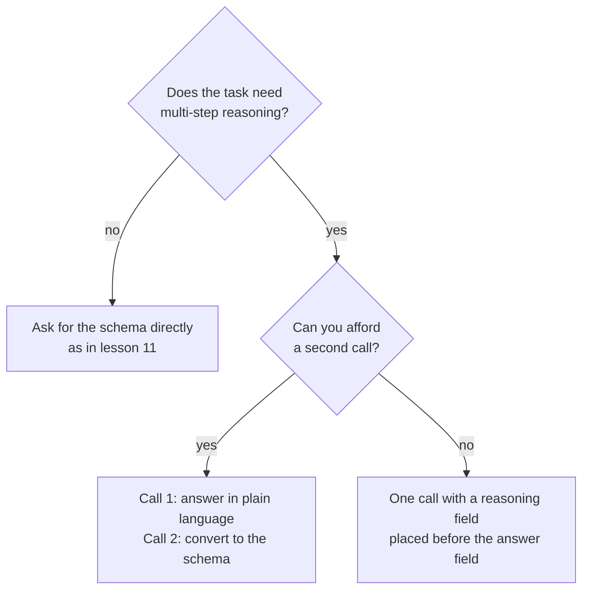

# पाठ 12. Format Constraints और Reasoning

**मिशन से संबंध:** जो output program parse कर सके उसकी क़ीमत कम है अगर format थोपने से उत्तर बदतर हो जाएँ। इसलिए यह पाठ दिखाता है कि क़ीमत कहाँ दिखती है और उसे चुकाने से बचने के दो तरीक़े क्या हैं।
**मुख्य स्रोत:** [Paper: "Let Me Speak Freely? A Study on the Impact of Format Restrictions on Performance of Large Language Models", Tam et al., 2024](https://arxiv.org/abs/2408.02442)
**पूर्व-आवश्यकताएँ:** [पाठ 11](0011-structured-output-from-the-prompt.md), [Chain-of-thought](../GLOSSARY.md), [Structured output](../GLOSSARY.md)

## वार्म-अप

1. ▢ पाठ 8 ने पूछा था कि बीच की reasoning उत्तर को कब बेहतर करती है। एक ऐसा task बताएँ जहाँ वह मदद करती है और एक जहाँ वह सिर्फ़ tokens बढ़ाती है।

<details markdown="1"><summary>जाँचें</summary>

वह multi-step समस्याओं पर मदद करती है, जैसे arithmetic के शब्द-प्रश्न, जहाँ हर चरण अगले को खिलाता है। वह एक चरण में हल होने वाले task पर बहुत कम जोड़ती है, जैसे साफ़ वाक्य के लिए label चुनना।

</details>

2. ▢ पाठ 9 ने कहा था कि लिखी हुई reasoning उत्तर की faithful व्याख्या नहीं है। क्या इससे वह उस model के लिए बेकार हो जाती है जिसने उसे लिखा?

<details markdown="1"><summary>जाँचें</summary>

नहीं। Faithfulness इस बारे में है कि क्या text पाठक को उत्तर का असली कारण समझाता है। Reasoning के tokens फिर भी तय करते हैं कि model आगे क्या लिखता है, इसीलिए उन्हें माँगना उत्तर बेहतर कर सकता है, भले ही वे बुरी व्याख्या हों।

</details>

3. ▢ पाठ 11 parse-validate-retry चक्र पर ख़त्म हुआ था। वह चक्र किससे बचाता है?

<details markdown="1"><summary>जाँचें</summary>

ऐसे reply से जो parse न हो या schema से मेल न खाए। वह इस बारे में कुछ नहीं कहता कि वैध reply के भीतर का उत्तर सही है या नहीं, जो इस पाठ का विषय है।

</details>

## यह जानें

### पेपर ने क्या मापा

Tam et al. ने format प्रतिबंध की अलग-अलग मात्राओं में वही सवाल परखे। उनकी तीन सेटिंग्स, सबसे सख़्त से सबसे ढीली तक, ये थीं: JSON-mode (constrained decoding, जहाँ generation के दौरान output वैध JSON तक सीमित रहता है), format-restricting instructions (ऐसा prompt जो format और schema माँगता है, जैसे पाठ 11 में), और NL-to-Format, दो चरणों की प्रक्रिया जो पहले प्राकृतिक भाषा में उत्तर देती है और फिर उत्तर को format में बदलती है।

उनका abstract format प्रतिबंधों में reasoning क्षमता में उल्लेखनीय गिरावट बताता है, और कि सख़्त constraints आमतौर पर reasoning tasks पर ज़्यादा बिगाड़ करते हैं। Reasoning tasks (GSM8K, Last Letter Concatenation, Shuffled Objects) पर, ज़्यादा ढीले prompts आमतौर पर बेहतर रहे, और JSON-mode ज़्यादातर मामलों में सबसे बुरा। NL-to-Format ने ज़्यादातर models पर बिना प्रतिबंध वाली प्राकृतिक भाषा के लगभग बराबर प्रदर्शन किया।

### दो चेतावनियाँ जो याद रखने लायक़ हैं

पेपर का अपना निष्कर्ष कहता है कि constrained decoding reasoning में बाधा डाल सकती है जबकि classification accuracy बढ़ा सकती है। इसलिए क़ीमत सामान्य नहीं है: वह reasoning tasks पर दिखती है, और सादा classification task सख़्त format के साथ बेहतर कर सकता है।

अध्ययन ने अपने समय के models इस्तेमाल किए और अपनी सीमाएँ बताता है: उसने reasoning-गहन tasks पर ध्यान दिया और आसान reasoning को भविष्य के काम पर छोड़ा। इसे अपने task पर मापने की वजह के रूप में पढ़ें, इस नियम के रूप में नहीं कि structure हमेशा नुक़सान करता है।

### Fields का क्रम prompt का हिस्सा है

JSON object बाएँ से दाएँ generate होता है, इसलिए एक field अपने बाद के fields से पहले लिखा जाता है। पेपर ने पाया कि Last Letter पर GPT-3.5 Turbo के 100% JSON-mode responses ने `answer` key को `reason` key से पहले रखा, इसलिए model ने पहले reasoning करने के बजाय सीधे उत्तर दिया।

Reasoning field को answer field से पहले रखें और reasoning उत्तर को जानकारी दे सकती है।

```json
{
  "reasoning": "The order has 3 items at 12 each, which is 36. Shipping is 5, so the total is 41.",
  "answer": 41
}
```

Vendors पर एक छोटा नोट: Anthropic का structured outputs पेज चेताता है कि model की thinking या step-by-step reasoning माँगने वाली property इनकार की ओर ले जा सकती है, और इसके बजाय छोटी व्याख्या माँगने का सुझाव देता है। वह यह भी कहता है कि schema grammar सीधे output पर लागू होता है, thinking blocks पर नहीं, इसलिए thinking चरण वाला model structured reply से पहले आज़ादी से reasoning करता है।

### या पहले reasoning करें, फिर format करें

दूसरा विकल्प दो calls है। पहली सवाल को सादी भाषा में पूछती है और model को reasoning करने देती है। दूसरी उस उत्तर को structure में बदलती है।



दूसरी call एक request की क़ीमत लेती है और एक ऐसा चरण जोड़ती है जो अपनी त्रुटियाँ ला सकता है: पेपर नोट करता है कि NL-to-Format कभी-कभी generation त्रुटियाँ लाता है, जिससे एक छोटे model का प्रदर्शन थोड़ा कम हुआ। अपने task पर दोनों को मापकर चुनें।

## अभ्यास

1. ▢ पहले अनुमान लगाएँ, फिर जाँचें। एक prompt JSON माँगता है जिसमें keys इस क्रम में हैं: `answer`, फिर `reasoning`. Task तीन चरणों वाली arithmetic समस्या है। Model reasoning के साथ क्या करता है, और आप क्या बदलेंगे?

<details markdown="1"><summary>संकेत</summary>

पूछें कि model दोनों fields में से कौन-सा पहले लिखता है।

</details>

<details markdown="1"><summary>जाँचें</summary>

वह उत्तर पहले लिखता है, इसलिए उसके बाद की reasoning उसे पैदा नहीं कर सकती थी: model सीधे उत्तर देता है और फिर समझाता है। क्रम बदलें ताकि `reasoning`, `answer` से पहले आए। यही वह विफलता है जो पेपर ने Last Letter पर GPT-3.5 Turbo के हर JSON-mode response में पाई।

</details>

2. ▢ पेपर की खोजों के अनुसार, कौन-सा task सख़्त output format से सबसे ज़्यादा accuracy खोने की संभावना रखता है?

    - a) किसी छोटे review को positive या negative label करना।
    - b) कई लिखित चरणों में तीन संख्याओं को गुणा करना।
    - c) Support ticket को चार queues में से एक में छाँटना।
    - d) एक पंक्ति के वाक्य में नामित खेल चुनना।

<details markdown="1"><summary>जाँचें</summary>

b। यह multi-step reasoning है, उस तरह का task जिसे पेपर ने प्रतिबंध से नुक़सान उठाते पाया। बाक़ी classification-style tasks हैं, जहाँ पेपर के अनुसार constrained decoding इसके बजाय accuracy बढ़ा सकती है।

</details>

3. ▢ इस schema को ऐसे दोबारा लिखें कि model उत्तर देने से पहले reasoning करे, और बताएँ कि आपका क्रम क्यों काम करता है: `{"verdict": "...", "evidence": "...", "confidence": 0.0}`, ऐसे task के लिए जो परखता है कि कोई दावा किसी अनुच्छेद से निकलता है या नहीं।

<details markdown="1"><summary>जाँचें</summary>

`evidence` पहले रखें, फिर `verdict`, फिर `confidence`: उदाहरण के लिए `{"evidence": "...", "verdict": "...", "confidence": 0.0}`. Model पहले evidence लिखता है, इसलिए verdict उस पर निर्भर होता है। जो नया रूप सिर्फ़ `confidence` को खिसकाता है या `verdict` को पहले रखता है, उसने समस्या ठीक नहीं की।

</details>

4. ▢ आपके पास हर request पर एक call है और कड़ी latency सीमा है, और task JSON के रूप में लौटाया जाने वाला शब्द-प्रश्न है। कौन-सा डिज़ाइन ज़्यादा ठीक बैठता है?

    - a) दो calls: सादी भाषा में reasoning करें, फिर JSON में बदलें।
    - b) एक call, सिर्फ़ answer field वाला सादा JSON object।
    - c) एक call, answer से पहले reasoning field वाला JSON।
    - d) एक call, answer field और फिर reasoning वाला JSON।

<details markdown="1"><summary>जाँचें</summary>

c। यह call के budget में बैठता है और reasoning को उत्तर से पहले आने देता है। विकल्प a को दूसरी call चाहिए। विकल्प b उस reasoning को हटा देता है जो task को चाहिए। विकल्प d में वह क्रम है जो model को पहले उत्तर देने पर मजबूर करता है।

</details>

## असली दुनिया का अभ्यास

- [ ] आज: chat window में कोई multi-step शब्द-प्रश्न पूछें और `answer` पहले, फिर `reasoning` वाला JSON reply माँगें। इसे फिर पूछें, इस बार `reasoning` पहले। नोट करें कि उत्तर अलग हैं या नहीं और reasoning कहाँ बैठती है।
- [ ] कल: पाँच ऐसे सवाल लें जिन्हें आप जाँच सकें, हर एक को दोनों क्रमों में चलाएँ, और हर एक के सही उत्तर गिनें। पाँच कुछ साबित करने के लिए बहुत कम हैं, इसलिए नतीजे को असली सेट पर परखने का संकेत मानें।
- [ ] अपना कोई structured-output prompt देखें और उसके fields का क्रम जाँचें। अगर कोई निर्णय वाला field उसके प्रमाण वाले field से पहले आता है, तो उन्हें बदल दें।

## आगे बढ़ने के लिए

- [Paper: "Let Me Speak Freely?", Tam et al., 2024](https://arxiv.org/abs/2408.02442)
- [Docs: "Structured outputs", Claude Platform Docs](https://platform.claude.com/docs/en/build-with-claude/structured-outputs)
- [Structured Output और लंबा Context](../reference/structured-output-and-long-context.md)
- [संसाधन](../RESOURCES.md)

---

बात नहीं बन रही? ऊपर दिए primary source को दोबारा पढ़ें, क्योंकि यह पाठ उसे संक्षिप्त करता है और समझ संक्षेप में ही रिसती है। जो शब्द फिसलन भरा लगे, उसके लिए [शब्दावली](../GLOSSARY.md) देखें।

अगर दिक़्क़त सामग्री की नहीं बल्कि पाठ की ही है, तो वह एक खोट है: [issue खोलें](https://github.com/TokenCemetery/teach/issues)।
