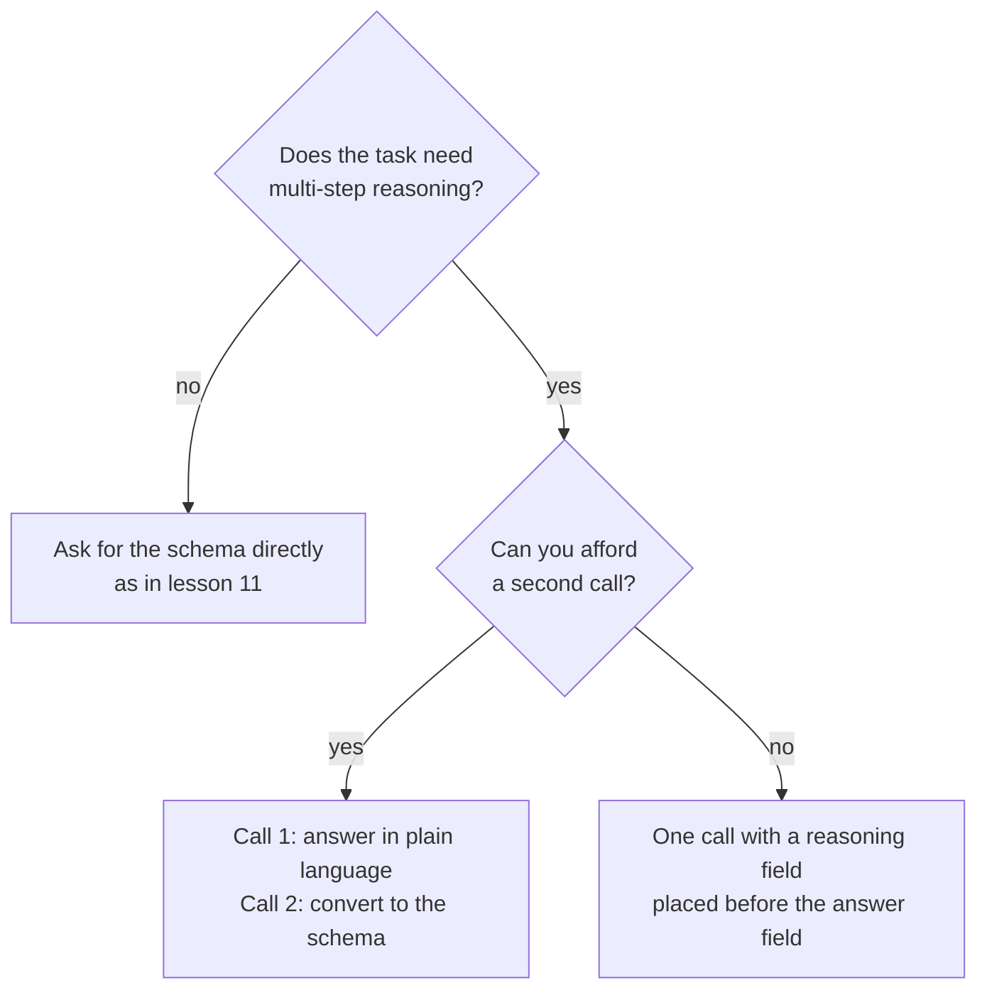

# Lesson 12. Format Constraints and Reasoning

**Mission link:** Output a program can parse is worth little if forcing the format makes the answers worse, so this lesson shows where the cost appears and two ways to avoid paying it.
**Primary source:** [Paper: "Let Me Speak Freely? A Study on the Impact of Format Restrictions on Performance of Large Language Models", Tam et al., 2024](https://arxiv.org/abs/2408.02442)
**Prerequisites:** [Lesson 11](0011-structured-output-from-the-prompt.md), [Chain-of-thought](../GLOSSARY.md), [Structured output](../GLOSSARY.md)

## Warm-up

1. ▢ Lesson 8 asked when intermediate reasoning improves an answer. Name a task where it helps and one where it only adds tokens.

<details markdown="1"><summary>Check</summary>

It helps on multi-step problems such as arithmetic word problems, where each step feeds the next. It adds little on a task answered in one step, such as picking a label for an obvious sentence.

</details>

2. ▢ Lesson 9 said the written reasoning is not a faithful explanation of the answer. Does that make it useless to the model that wrote it?

<details markdown="1"><summary>Check</summary>

No. Faithfulness is about whether the text explains the real cause of the answer to a reader. The reasoning tokens still condition what the model writes next, which is why asking for them can improve the answer even when they are a poor explanation.

</details>

3. ▢ Lesson 11 ended with a parse-validate-retry loop. What does that loop protect against?

<details markdown="1"><summary>Check</summary>

A reply that does not parse or does not match the schema. It says nothing about whether the answer inside a valid reply is correct, which is this lesson's subject.

</details>

## Know this

### What the paper measured

Tam et al. compared the same questions under different degrees of format restriction. Their three settings, from strictest to loosest, were JSON-mode (constrained decoding, where the output is limited to valid JSON during generation), format-restricting instructions (a prompt that asks for a format and a schema, as in lesson 11), and NL-to-Format, a two-step process that answers in natural language first and then converts the answer to the format.

Their abstract reports a significant decline in reasoning ability under format restrictions, and that stricter constraints generally cause greater degradation on reasoning tasks. On reasoning tasks (GSM8K, Last Letter Concatenation, Shuffled Objects), more relaxed prompts typically did better, with JSON-mode the worst in most cases. NL-to-Format performed nearly the same as unrestricted natural language on most models.

### Two caveats worth keeping

The paper's own conclusion says that constrained decoding can hinder reasoning while enhancing classification accuracy. So the cost is not general: it shows up on reasoning tasks, and a plain classification task may do better with a strict format.

The study used the models of its time and reports its own limits: it focused on reasoning-intensive tasks and leaves easier reasoning for future work. Read it as a reason to measure on your task, not as a rule that structure always hurts.

### Field order is part of the prompt

A JSON object is generated left to right, so a field is written before the fields that follow it. The paper found that 100% of the GPT-3.5 Turbo JSON-mode responses on Last Letter put the `answer` key before the `reason` key, so the model answered directly instead of reasoning first.

Put the reasoning field before the answer field and the reasoning can inform the answer.

```json
{
  "reasoning": "The order has 3 items at 12 each, which is 36. Shipping is 5, so the total is 41.",
  "answer": 41
}
```

A short note on vendors: Anthropic's structured outputs page warns that a property asking for the model's thinking or step-by-step reasoning may lead to a refusal, and suggests asking for a short explanation instead. It also says the schema grammar applies to the direct output, not to thinking blocks, so a model with a thinking phase reasons freely before the structured reply.

### Or reason first, then format

The other option is two calls. The first asks the question in plain language and lets the model reason. The second turns that answer into the structure.



The second call costs a request and adds a step that can introduce its own errors: the paper notes that NL-to-Format occasionally introduces generation errors, leading to slightly lower performance for one smaller model. Choose by measuring both on your task.

## Practice

1. ▢ Predict, then check. A prompt asks for JSON with the keys in this order: `answer`, then `reasoning`. The task is a three-step arithmetic problem. What does the model do with the reasoning, and what would you change?

<details markdown="1"><summary>Hint</summary>

Ask which of the two fields the model writes first.

</details>

<details markdown="1"><summary>Check</summary>

It writes the answer first, so the reasoning that follows cannot have produced it: the model answers directly and then explains. Swap the order so `reasoning` comes before `answer`. This is the failure the paper found in every GPT-3.5 Turbo JSON-mode response on Last Letter.

</details>

2. ▢ Which task is most likely to lose accuracy from a strict output format, according to the paper's findings?

    - a) Labelling a short review as positive or negative.
    - b) Multiplying three numbers across several written steps.
    - c) Sorting a support ticket into one of four queues.
    - d) Picking the sport named in a one-line sentence.

<details markdown="1"><summary>Check</summary>

b. It is multi-step reasoning, the kind of task the paper found hurt by restriction. The others are classification-style tasks, where the paper reports constrained decoding can instead enhance accuracy.

</details>

3. ▢ Rewrite this schema so the model reasons before it answers, and say why your order works: `{"verdict": "...", "evidence": "...", "confidence": 0.0}` for a task that judges whether a claim follows from a paragraph.

<details markdown="1"><summary>Check</summary>

Put `evidence` first, then `verdict`, then `confidence`: for example `{"evidence": "...", "verdict": "...", "confidence": 0.0}`. The model writes the evidence first, so the verdict is conditioned on it. A rewrite that moves only `confidence` or keeps `verdict` first has not fixed the problem.

</details>

4. ▢ You have one call per request and a hard latency limit, and the task is a word problem returned as JSON. Which design is the better fit?

    - a) Two calls: reason in plain language, then convert to JSON.
    - b) One call, a bare JSON object with only an answer field.
    - c) One call, JSON with a reasoning field before the answer.
    - d) One call, JSON with the answer field and then reasoning.

<details markdown="1"><summary>Check</summary>

c. It fits the call budget and lets reasoning come before the answer. Option a needs a second call. Option b removes the reasoning the task needs. Option d has the order that makes the model answer first.

</details>

## Real-world reps

- [ ] Today: in a chat window, ask a multi-step word problem and request a JSON reply with `answer` first, then `reasoning`. Ask it again with `reasoning` first. Note whether the answers differ and where the reasoning sits.
- [ ] Tomorrow: take five questions you can check, run each under both orders, and count the correct answers for each. Five is too few to prove anything, so treat the result as a hint to test on a real set.
- [ ] Look at a structured-output prompt you use and check the order of its fields. If a judgment field comes before the evidence for it, swap them.

## Going further

- [Paper: "Let Me Speak Freely?", Tam et al., 2024](https://arxiv.org/abs/2408.02442)
- [Docs: "Structured outputs", Claude Platform Docs](https://platform.claude.com/docs/en/build-with-claude/structured-outputs)
- [Structured Output and Long Context](../reference/structured-output-and-long-context.md)
- [Resources](../RESOURCES.md)

---

Not landing? Reread the primary source at the top, since this lesson compresses it and compression is where understanding leaks. Check the [glossary](../GLOSSARY.md) for any term that felt slippery.

If the lesson itself is unclear rather than the material, that is a defect: [open an issue](https://github.com/TokenCemetery/teach/issues).
