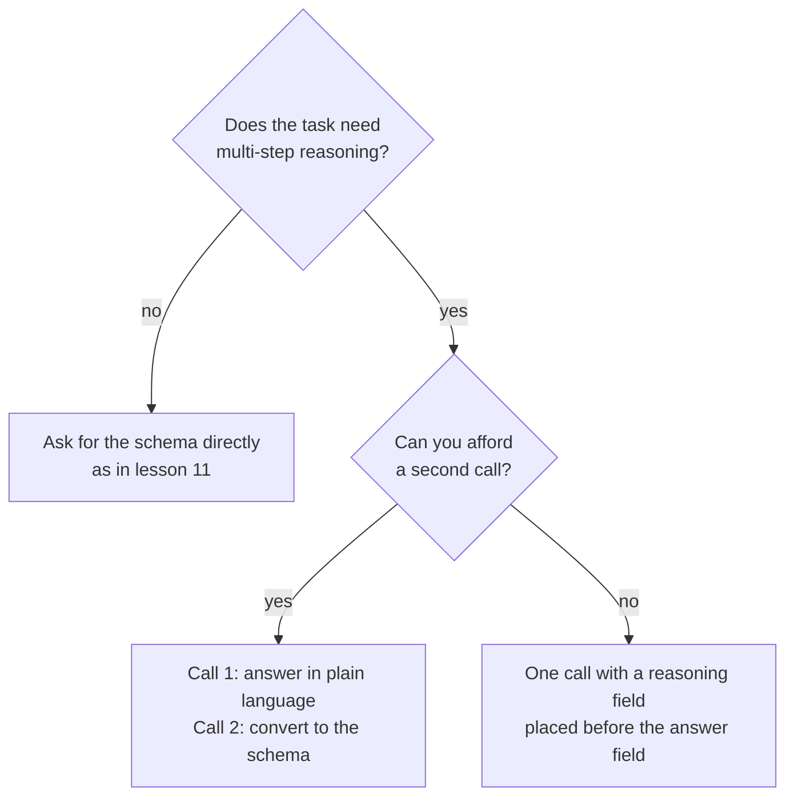

# Lição 12. Restrições de formato e raciocínio

**Ligação com a missão:** Uma saída que um programa consegue interpretar vale pouco se forçar o formato piora as respostas, então esta lição mostra onde o custo aparece e duas formas de não pagá-lo.
**Fonte principal:** [Paper: "Let Me Speak Freely? A Study on the Impact of Format Restrictions on Performance of Large Language Models", Tam et al., 2024](https://arxiv.org/abs/2408.02442)
**Pré-requisitos:** [Lição 11](0011-structured-output-from-the-prompt.md), [Chain-of-thought](../GLOSSARY.md), [Saída estruturada](../GLOSSARY.md)

## Aquecimento

1. ▢ A lição 8 perguntou quando o raciocínio intermediário melhora uma resposta. Cite uma tarefa em que ele ajuda e uma em que só acrescenta tokens.

<details markdown="1"><summary>Verificação</summary>

Ele ajuda em problemas de vários passos, como problemas aritméticos em texto, em que cada passo alimenta o seguinte. Acrescenta pouco em uma tarefa respondida em um passo, como escolher um rótulo para uma frase óbvia.

</details>

2. ▢ A lição 9 disse que o raciocínio escrito não é uma explicação fiel da resposta. Isso o torna inútil para o modelo que o escreveu?

<details markdown="1"><summary>Verificação</summary>

Não. Fidelidade diz respeito a se o texto explica a causa real da resposta para um leitor. Os tokens de raciocínio ainda condicionam o que o modelo escreve em seguida, e é por isso que pedi-los pode melhorar a resposta mesmo quando são uma explicação ruim.

</details>

3. ▢ A lição 11 terminou com um loop de interpretar, validar e tentar de novo. Contra o que esse loop protege?

<details markdown="1"><summary>Verificação</summary>

Contra uma resposta que não é interpretada ou que não corresponde ao schema. Ele não diz nada sobre se a resposta dentro de uma resposta válida está correta, que é o assunto desta lição.

</details>

## Saiba isto

### O que o artigo mediu

Tam et al. compararam as mesmas perguntas sob diferentes graus de restrição de formato. Seus três cenários, do mais estrito ao mais livre, foram JSON-mode (decodificação restrita, em que a saída é limitada a JSON válido durante a geração), instruções que restringem o formato (um prompt que pede um formato e um schema, como na lição 11) e NL-to-Format, um processo em dois passos que responde primeiro em linguagem natural e depois converte a resposta para o formato.

O resumo do artigo relata um declínio significativo da capacidade de raciocínio sob restrições de formato, e que restrições mais estritas geralmente causam maior degradação em tarefas de raciocínio. Em tarefas de raciocínio (GSM8K, Last Letter Concatenation, Shuffled Objects), prompts mais relaxados costumavam se sair melhor, com o JSON-mode pior na maioria dos casos. O NL-to-Format teve desempenho quase igual ao da linguagem natural sem restrição na maioria dos modelos.

### Duas ressalvas que vale guardar

A própria conclusão do artigo diz que a decodificação restrita pode atrapalhar o raciocínio e ao mesmo tempo melhorar a acurácia de classificação. Então o custo não é geral: aparece em tarefas de raciocínio, e uma tarefa simples de classificação pode se sair melhor com um formato estrito.

O estudo usou os modelos da sua época e relata seus próprios limites: focou em tarefas de raciocínio intensivo e deixa o raciocínio mais fácil para trabalhos futuros. Leia-o como um motivo para medir na sua tarefa, não como uma regra de que a estrutura sempre prejudica.

### A ordem dos campos faz parte do prompt

Um objeto JSON é gerado da esquerda para a direita, então um campo é escrito antes dos campos que o seguem. O artigo descobriu que 100% das respostas em JSON-mode do GPT-3.5 Turbo em Last Letter colocaram a chave `answer` antes da chave `reason`, então o modelo respondeu direto em vez de raciocinar primeiro.

Ponha o campo de raciocínio antes do campo de resposta e o raciocínio poderá informar a resposta.

```json
{
  "reasoning": "The order has 3 items at 12 each, which is 36. Shipping is 5, so the total is 41.",
  "answer": 41
}
```

Uma breve nota sobre fornecedores: a página de saídas estruturadas da Anthropic avisa que uma propriedade que pede o thinking do modelo ou o raciocínio passo a passo pode levar a uma recusa, e sugere pedir uma explicação curta em vez disso. Ela também diz que a gramática do schema se aplica à saída direta, não aos blocos de thinking, então um modelo com fase de thinking raciocina livremente antes da resposta estruturada.

### Ou raciocine primeiro e formate depois

A outra opção são duas chamadas. A primeira faz a pergunta em linguagem comum e deixa o modelo raciocinar. A segunda transforma essa resposta na estrutura.



A segunda chamada custa uma requisição e acrescenta um passo que pode introduzir os próprios erros: o artigo observa que o NL-to-Format ocasionalmente introduz erros de geração, levando a um desempenho um pouco menor em um modelo menor. Escolha medindo os dois na sua tarefa.

## Prática

1. ▢ Preveja e depois verifique. Um prompt pede JSON com as chaves nesta ordem: `answer`, depois `reasoning`. A tarefa é um problema aritmético de três passos. O que o modelo faz com o raciocínio e o que você mudaria?

<details markdown="1"><summary>Dica</summary>

Pergunte qual dos dois campos o modelo escreve primeiro.

</details>

<details markdown="1"><summary>Verificação</summary>

Ele escreve a resposta primeiro, então o raciocínio que vem depois não pode tê-la produzido: o modelo responde direto e depois explica. Troque a ordem para que `reasoning` venha antes de `answer`. Essa é a falha que o artigo encontrou em toda resposta em JSON-mode do GPT-3.5 Turbo em Last Letter.

</details>

2. ▢ Qual tarefa tem mais chance de perder acurácia com um formato de saída estrito, segundo as descobertas do artigo?

    - a) Rotular uma avaliação curta como positiva ou negativa.
    - b) Multiplicar três números ao longo de vários passos escritos.
    - c) Classificar um ticket de suporte em uma de quatro filas.
    - d) Escolher o esporte citado em uma frase de uma linha.

<details markdown="1"><summary>Verificação</summary>

b. É raciocínio de vários passos, o tipo de tarefa que o artigo encontrou prejudicada pela restrição. As outras são tarefas do tipo classificação, em que o artigo relata que a decodificação restrita pode, ao contrário, melhorar a acurácia.

</details>

3. ▢ Reescreva este schema para que o modelo raciocine antes de responder e diga por que a sua ordem funciona: `{"verdict": "...", "evidence": "...", "confidence": 0.0}` para uma tarefa que julga se uma afirmação decorre de um parágrafo.

<details markdown="1"><summary>Verificação</summary>

Ponha `evidence` primeiro, depois `verdict`, depois `confidence`: por exemplo `{"evidence": "...", "verdict": "...", "confidence": 0.0}`. O modelo escreve a evidência primeiro, então o veredito é condicionado a ela. Uma reescrita que move apenas `confidence` ou mantém `verdict` primeiro não resolveu o problema.

</details>

4. ▢ Você tem uma chamada por requisição e um limite rígido de latência, e a tarefa é um problema em texto devolvido como JSON. Qual projeto se encaixa melhor?

    - a) Duas chamadas: raciocinar em linguagem comum e depois converter para JSON.
    - b) Uma chamada, um objeto JSON simples só com um campo de resposta.
    - c) Uma chamada, JSON com um campo de raciocínio antes da resposta.
    - d) Uma chamada, JSON com o campo de resposta e depois o raciocínio.

<details markdown="1"><summary>Verificação</summary>

c. Ela cabe no orçamento de chamadas e deixa o raciocínio vir antes da resposta. A opção a precisa de uma segunda chamada. A opção b remove o raciocínio de que a tarefa precisa. A opção d tem a ordem que faz o modelo responder primeiro.

</details>

## Prática no mundo real

- [ ] Hoje: em uma janela de chat, faça um problema em texto de vários passos e peça uma resposta em JSON com `answer` primeiro e depois `reasoning`. Pergunte de novo com `reasoning` primeiro. Anote se as respostas diferem e onde o raciocínio fica.
- [ ] Amanhã: pegue cinco perguntas que você consegue verificar, execute cada uma nas duas ordens e conte as respostas corretas de cada. Cinco é pouco para provar qualquer coisa, então trate o resultado como uma pista para testar em um conjunto real.
- [ ] Olhe um prompt de saída estruturada que você usa e confira a ordem dos campos. Se um campo de julgamento vem antes da evidência dele, troque-os.

## Para ir além

- [Paper: "Let Me Speak Freely?", Tam et al., 2024](https://arxiv.org/abs/2408.02442)
- [Docs: "Structured outputs", Claude Platform Docs](https://platform.claude.com/docs/en/build-with-claude/structured-outputs)
- [Saída Estruturada e Contexto Longo](../reference/structured-output-and-long-context.md)
- [Recursos](../RESOURCES.md)

---

Não ficou claro? Releia a fonte primária no topo, já que esta lição a comprime e é na compressão que o entendimento escapa. Consulte o [glossário](../GLOSSARY.md) para qualquer termo que tenha parecido escorregadio.

Se o problema é a própria lição e não o material, isso é um defeito: [abra uma issue](https://github.com/TokenCemetery/teach/issues).
