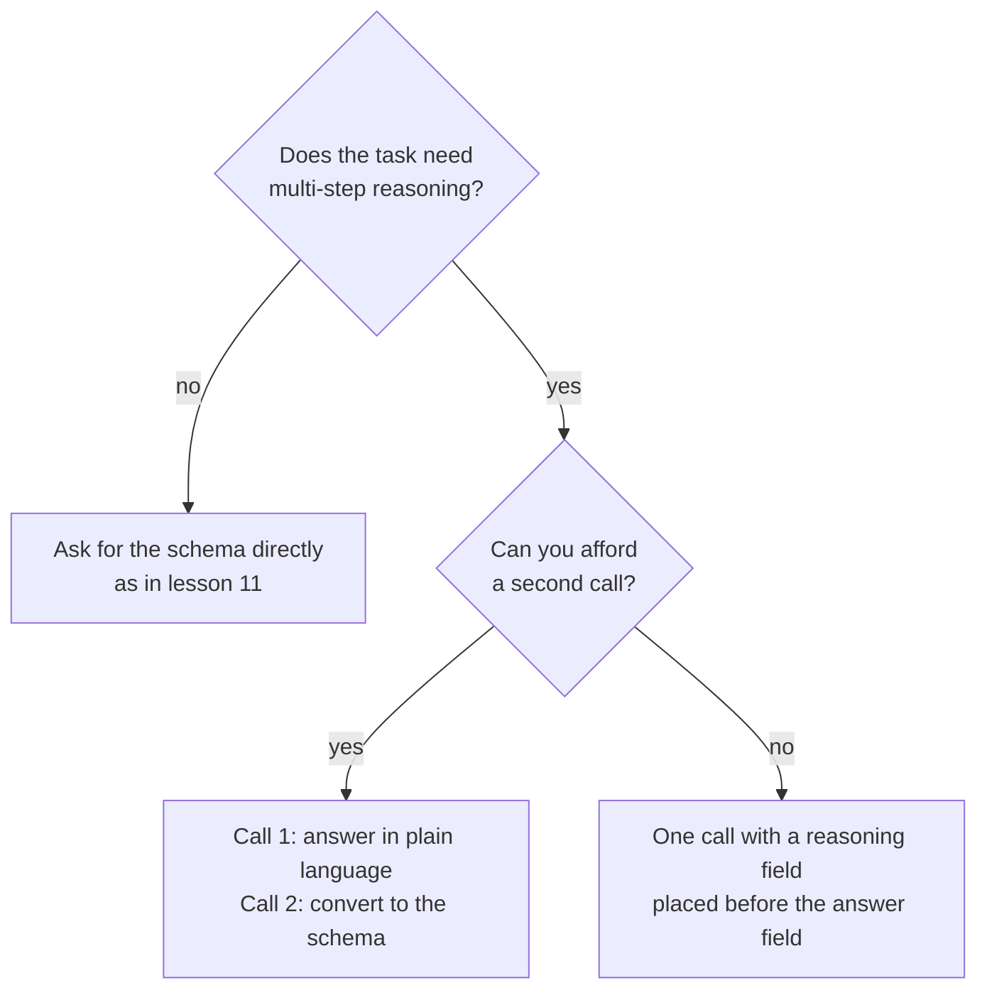

# Урок 12. Ограничения формата и рассуждение

**Связь с целью курса:** Вывод, который может разобрать программа, мало стоит, если из-за навязанного формата ответы становятся хуже. Этот урок показывает, где проявляется эта цена и как её не платить двумя способами.
**Первоисточник:** [Статья: «Let Me Speak Freely? A Study on the Impact of Format Restrictions on Performance of Large Language Models», Tam et al., 2024](https://arxiv.org/abs/2408.02442)
**Предварительные требования:** [Урок 11](0011-structured-output-from-the-prompt.md), [Цепочка рассуждений](../GLOSSARY.md), [Структурированный вывод](../GLOSSARY.md)

## Разминка

1. ▢ В уроке 8 мы спрашивали, когда промежуточные рассуждения улучшают ответ. Назовите задачу, где они помогают, и задачу, где они только добавляют токены.

<details markdown="1"><summary>Проверка</summary>

Они помогают в многошаговых задачах, например в арифметических текстовых задачах, где каждый шаг питает следующий. Они почти ничего не дают в задаче, которая решается за один шаг, например при выборе метки для очевидного предложения.

</details>

2. ▢ В уроке 9 говорилось, что написанное рассуждение не является достоверным объяснением ответа. Значит ли это, что оно бесполезно для модели, которая его написала?

<details markdown="1"><summary>Проверка</summary>

Нет. Достоверность говорит о том, объясняет ли текст читателю настоящую причину ответа. Токены рассуждения всё равно влияют на то, что модель пишет дальше, поэтому просьба о них может улучшить ответ, даже если как объяснение они плохи.

</details>

3. ▢ Урок 11 закончился циклом «разобрать, проверить, повторить». От чего защищает этот цикл?

<details markdown="1"><summary>Проверка</summary>

От ответа, который не разбирается или не соответствует схеме. Он ничего не говорит о том, верен ли ответ внутри корректного ответа, а это и есть тема этого урока.

</details>

## Что нужно знать

### Что измерила статья

Tam et al. сравнили одни и те же вопросы при разной степени ограничения формата. Три режима, от самого строгого к самому мягкому: JSON-режим (ограниченное декодирование, при котором во время генерации вывод ограничен корректным JSON), инструкции, ограничивающие формат (промпт, который просит формат и схему, как в уроке 11), и NL-to-Format, двухшаговый процесс, где сначала ответ даётся на естественном языке, а затем преобразуется в нужный формат.

В аннотации сообщается о значительном снижении способности к рассуждению при ограничениях формата и о том, что более строгие ограничения, как правило, вызывают большую деградацию на задачах рассуждения. На задачах рассуждения (GSM8K, Last Letter Concatenation, Shuffled Objects) более мягкие промпты обычно справлялись лучше, а JSON-режим в большинстве случаев был худшим. NL-to-Format на большинстве моделей показал почти тот же результат, что и неограниченный естественный язык.

### Две оговорки, которые стоит помнить

В собственном выводе статьи сказано, что ограниченное декодирование может мешать рассуждению, но повышать точность классификации. Значит, цена не универсальна: она проявляется на задачах рассуждения, а простая задача классификации может выиграть от строгого формата.

Исследование использовало модели того времени и само указывает свои пределы: оно сосредоточено на задачах с интенсивным рассуждением, а более простое рассуждение оставляет на будущее. Читайте его как повод измерять на своей задаче, а не как правило, что структура всегда вредит.

### Порядок полей входит в промпт

Объект JSON генерируется слева направо, поэтому поле пишется раньше тех, что идут после него. Статья обнаружила, что 100% ответов GPT-3.5 Turbo в JSON-режиме на задаче Last Letter ставили ключ `answer` перед ключом `reason`, и модель отвечала сразу, а не рассуждала сначала.

Поставьте поле рассуждения перед полем ответа, и рассуждение сможет повлиять на ответ.

```json
{
  "reasoning": "The order has 3 items at 12 each, which is 36. Shipping is 5, so the total is 41.",
  "answer": 41
}
```

Коротко о вендорах: на странице Anthropic о структурированных выводах предупреждается, что свойство, которое просит размышления модели или пошагового рассуждения, может привести к отказу, и предлагается вместо этого просить краткое объяснение. Там же сказано, что грамматика схемы применяется к прямому выводу, а не к блокам размышления, поэтому модель с фазой размышления свободно рассуждает перед структурированным ответом.

### Или сначала рассуждать, потом форматировать

Другой вариант: два вызова. Первый задаёт вопрос простым языком и позволяет модели рассуждать. Второй превращает этот ответ в структуру.



Второй вызов стоит запроса и добавляет шаг, который может внести собственные ошибки: в статье отмечено, что NL-to-Format иногда вносит ошибки генерации, что привело к немного более низкому результату у одной из небольших моделей. Выбирайте, измерив оба варианта на своей задаче.

## Практика

1. ▢ Сначала предскажите, потом проверьте. Промпт просит JSON с ключами в таком порядке: `answer`, затем `reasoning`. Задача: арифметическая задача из трёх шагов. Что модель сделает с рассуждением и что бы вы изменили?

<details markdown="1"><summary>Подсказка</summary>

Спросите себя, какое из двух полей модель пишет первым.

</details>

<details markdown="1"><summary>Проверка</summary>

Сначала она пишет ответ, поэтому последующее рассуждение не могло его породить: модель отвечает сразу и затем объясняет. Поменяйте порядок, чтобы `reasoning` шло перед `answer`. Именно этот сбой статья нашла в каждом ответе GPT-3.5 Turbo в JSON-режиме на задаче Last Letter.

</details>

2. ▢ Какая задача скорее всего потеряет точность из-за строгого формата вывода, согласно выводам статьи?

    - a) Пометить короткий отзыв как положительный или отрицательный.
    - b) Перемножить три числа за несколько записанных шагов.
    - c) Отнести обращение в поддержку к одной из четырёх очередей.
    - d) Выбрать вид спорта, названный в однострочном предложении.

<details markdown="1"><summary>Проверка</summary>

b. Это многошаговое рассуждение, то есть задача того типа, которому, по статье, ограничения вредят. Остальные задачи относятся к классификации, где, по сообщению статьи, ограниченное декодирование, наоборот, может повысить точность.

</details>

3. ▢ Перепишите эту схему так, чтобы модель рассуждала до ответа, и объясните, почему ваш порядок работает: `{"verdict": "...", "evidence": "...", "confidence": 0.0}` для задачи, где оценивается, следует ли утверждение из абзаца.

<details markdown="1"><summary>Проверка</summary>

Поставьте `evidence` первым, затем `verdict`, затем `confidence`: например, `{"evidence": "...", "verdict": "...", "confidence": 0.0}`. Модель пишет доказательства первыми, поэтому вердикт опирается на них. Переписывание, которое переносит только `confidence` или оставляет `verdict` первым, проблему не решает.

</details>

4. ▢ На запрос у вас один вызов и жёсткий предел задержки, а задача: текстовая задача, результат которой возвращается как JSON. Какой дизайн подходит лучше?

    - a) Два вызова: рассуждение простым языком, затем преобразование в JSON.
    - b) Один вызов, голый объект JSON только с полем ответа.
    - c) Один вызов, JSON с полем рассуждения перед ответом.
    - d) Один вызов, JSON с полем ответа, а затем рассуждения.

<details markdown="1"><summary>Проверка</summary>

c. Он укладывается в бюджет вызовов и позволяет рассуждению идти перед ответом. Вариант a требует второго вызова. Вариант b убирает рассуждение, которое нужно задаче. Вариант d даёт порядок, при котором модель сначала отвечает.

</details>

## Практика в реальной работе

- [ ] Сегодня: в окне чата задайте многошаговую текстовую задачу и попросите ответ в JSON, сначала с `answer`, затем с `reasoning`. Задайте её ещё раз, поставив `reasoning` первым. Отметьте, различаются ли ответы и где стоит рассуждение.
- [ ] Завтра: возьмите пять вопросов, ответы на которые можно проверить, прогоните каждый при обоих порядках и посчитайте верные ответы для каждого. Пяти мало, чтобы что-то доказать, поэтому считайте результат подсказкой проверить на реальном наборе.
- [ ] Посмотрите на промпт со структурированным выводом, которым вы пользуетесь, и проверьте порядок его полей. Если поле с суждением стоит перед доказательствами для него, поменяйте их местами.

## Что почитать дальше

- [Статья: «Let Me Speak Freely?», Tam et al., 2024](https://arxiv.org/abs/2408.02442)
- [Документация: «Structured outputs», Claude Platform Docs](https://platform.claude.com/docs/en/build-with-claude/structured-outputs)
- [Структурированный вывод и длинный контекст](../reference/structured-output-and-long-context.md)
- [Ресурсы](../RESOURCES.md)

---

Не доходит? Перечитайте первоисточник в начале: этот урок его сжимает, а при сжатии понимание как раз и утекает. Загляните в [глоссарий](../GLOSSARY.md), если какой-то термин оказался скользким.

Если неясен сам урок, а не материал, это дефект: [откройте issue](https://github.com/TokenCemetery/teach/issues).
